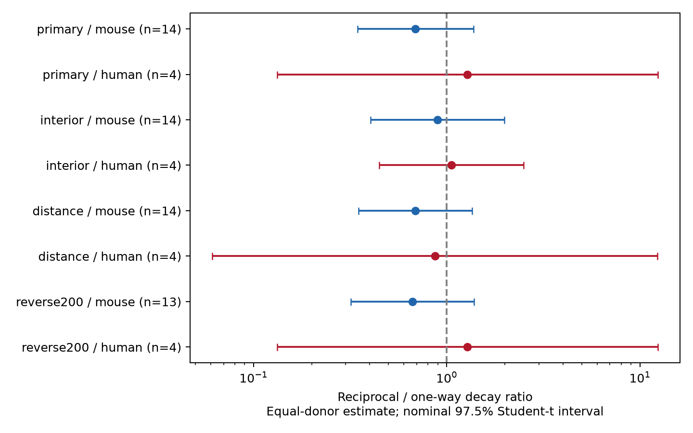

# Matched Allen slice data do not resolve a decay-time difference between reciprocal and one-way excitatory connections

Reciprocal excitatory connections did not have clearly longer voltage-response decay times than one-way connections in the selected Allen slice data. The mouse point estimate was shorter. Its uncertainty interval included no difference. The human sample had only four inferred donors and a wide interval. These results do not establish equal decay times.



## Question and prior work

A return connection can support recurrent signal flow. Longer response decay could extend the time over which signals interact in such a circuit. We tested whether reciprocal excitatory connections have longer measured postsynaptic potential (PSP) decay times than one-way excitatory connections with the same recorded cell labels and recording conditions. The test concerns a measured response property. It does not measure recurrent gain, memory, representation accuracy, or a causal effect of wiring.

Campagnola, Seeman, and colleagues describe cell-type dependence of synaptic response properties in this data source (2022, doi:10.1126/science.abj5861). The Allen project and data registry document the measured connection graph and response fits. PSP decay includes synaptic and membrane effects. It is not a direct receptor time constant.

We searched the signed local campaign for connectivity and reciprocal synapse work before fixing this question. We read the report on reciprocal decay matching (SCI 32f6778620e8aa94ae4462766a675e69bc45b43c82ed473e6f06d654da11c9a2) and the report on changes in response variability (SCI 4f83c3d64b084793a4c371caa1bc8faa4915d86d489ef2b4d631b1e65e02f83c). The first compares similarity between the two decay times in reciprocal pairs and separate connections. Our test compares the level of decay time between reciprocal and one-way connections. The second informed the matched design and reverse-detection check. No private worker files or prior code were used. The design was saved in files/design.txt after data availability checks, before contrast calculation. This is an exploratory study, not a preregistered test.

## Data and link between structure and function

The only raw data file used was:

`/mnt/dell-data/shared_datasets/allen_synphys/r2.1_small_2023-01-26/synphys_r2.1_small.sqlite`

Source: https://allen-synphys.s3-us-west-2.amazonaws.com/synphys_r2.1_small.sqlite . Version: r2.1 small, schema 22, last modified 2023-01-26. Size: 176771072 bytes. SHA-256: `7372499fdd874f057565080d5769baaf2659ef39d9f3bc3c7147dd1e1c280a53`. The script verified this hash and opened SQLite read-only. The shared data were not changed or downloaded again.

The SQL in files/analyze.py joins pair, reciprocal pair, cell, synapse, experiment, and slice records by their IDs. A connection and its reverse call come from the same two cells in one recording. This provides a direct link between the observed local circuit and its measured response. The graphs are functional connection samples from brain slices. They are not full anatomical connectomes. No activity data from other animals were linked by an assumed cell match. Only scalar decay estimates were used; pulse-train arrays were not used.

We required a detected monosynaptic excitatory connection, nonsynaptic excitatory cell-class labels at both ends, a reverse call of zero or one, and at least 10 excitatory test spikes in the reverse direction. Primary samples were mouse VisP and human TCx, analyzed separately. We then required a positive finite PSP decay estimate. Before this last requirement, mouse had 273 edges with 233 stored decay values, and human had 113 edges with 98 values. Missing decay values occurred in 32 of 202 mouse one-way edges and 8 of 71 reciprocal edges; the human counts were 14 of 87 and 1 of 26. Missingness can bias the comparison. We did not add a manual response-fit QC requirement. A positive value does not ensure a good fit.

## Matched comparison and uncertainty

Each matched stratum fixed the recording, ordered source and target Cre labels, and ordered source and target layer labels. Missing labels formed an explicit level. Both reciprocal and one-way edges had to be present in a stratum. A reverse call of zero defines a one-way edge in the observed data; it does not prove absence of a weak or cut reverse connection.

Within each stratum, we subtracted the mean log decay of one-way edges from that of reciprocal edges. We averaged stratum contrasts within recording, recordings within inferred donor, and donors with equal weight. Exponentiating this final contrast gives a geometric ratio of ratios. It is not the ratio of pooled arithmetic mean decay times. Both directed edges of a reciprocal pair can enter; they are not treated as independent animals.

Mouse donor IDs were inferred from an isolated six-digit number in the specimen name. Human IDs use the first three dot-separated fields of H-prefixed names. The fallback is slice ID. No retained sample used the fallback. These are inferred donor groups, not verified animal or patient IDs. Specimen names and all selected edges are supplied for inspection.

We report nominal 97.5% Student-t intervals over donor contrasts and nominal 97.5% percentile bootstrap intervals from 19999 donor resamples. Two primary groups motivated this Bonferroni level. With few donors, coverage is uncertain, especially for human. We also enumerate all donor sign assignments for a two-sided sign-flip test. This test requires independent symmetric contrasts under the null. It is not a randomization test of wiring. P-values are multiplied by two for the primary groups. No equivalence margin was set.

## Results

| Primary sample | Eligible / matched directed edges | Reciprocal / one-way matched edges | Recordings / inferred donors | Decay ratio | Nominal 97.5% t interval | Adjusted sign-flip p |
| --- | ---: | ---: | ---: | ---: | --- | ---: |
| Mouse VisP | 233 / 67 | 38 / 29 | 17 / 14 | 0.690 | 0.346 to 1.375 | 0.421 |
| Human TCx | 98 / 23 | 8 / 15 | 4 / 4 | 1.280 | 0.132 to 12.373 | 1.000 |

There were 18 mouse strata and four human strata. The log contrasts were -0.3716 and 0.2465. The bootstrap ratio intervals were 0.365 to 1.176 for mouse and 0.519 to 3.904 for human. Neither uncertainty method resolves a difference. The human interval is very sensitive to the method because there are only four donors. It should be used as a description of this sample, not a precise population bound. Removing one donor at a time gave mouse log contrasts from -0.454 to -0.187, and human contrasts from -0.204 to 0.556.

### Planned sensitivity checks

| Check | Mouse ratio [nominal 97.5% t interval]; donors | Human ratio [nominal 97.5% t interval]; donors |
| --- | --- | --- |
| Remove endpoint-like decay fits | 0.895 [0.402, 1.990]; 14 | 1.058 [0.448, 2.498]; 4 |
| Add exact 100 micrometre distance bins | 0.687 [0.349, 1.355]; 14 | 0.868 [0.061, 12.312]; 4 |
| Require 200 reverse test spikes | 0.666 [0.320, 1.388]; 13 | 1.280 [0.132, 12.373]; 4 |

The endpoint check kept decay values strictly above 0.00501 s and below 0.499 s. This is a diagnostic for endpoint-like fits, not a verified fit-quality filter. It removed one reciprocal and one one-way mouse edge from matched support. The mouse estimate moved toward one and its leave-one-donor-out log contrast range included zero. The human check removed one reciprocal and three one-way matched edges. Its ratio also moved toward one. Thus, a few endpoint-like values affect the estimated effect size.

The distance check also required distances from zero to 500 micrometres. The reverse-spike check tests sensitivity to detection effort. These checks change the matched sample and do not isolate mechanisms. Their intervals are descriptive and have no simultaneous coverage claim. Full estimates, counts, bootstrap intervals, sign-flip tests, and leave-one-donor-out ranges are in files/evidence/results.json.

## Limits and use

The data do not support a common rule that reciprocal excitatory connections have longer PSP decay in the tested samples. They also do not exclude effects of practical size. The mouse estimate points toward shorter decay, but the intervals include no difference and the estimate depends on endpoint-like fits. The human sample is too small to establish transfer.

Selection is substantial: matching kept 67 of 233 eligible mouse edges and 23 of 98 human edges. Slice damage, cut axons, missed reverse connections, missing fits, hidden cell types, synapse location, and membrane state can affect both topology and decay. Matching controls recorded labels and conditions. It does not control response strength, fit uncertainty, dendritic filtering, or all biological variation. Inferred donor IDs can group records incorrectly. Donor resampling does not include uncertainty in response fits or missing data.

Mouse visual cortex and human temporal cortex differ in region and tissue source. This design does not estimate a species effect. We did not test behavior, other regions, independent data releases, or intact-brain activity. A follow-up should use verified donor IDs, more donors with both circuit classes, raw fit uncertainties, and a common membrane-state protocol. Circuit models can use the supplied contrasts to test sensitivity; they should not assume a general topology-dependent decay rule from this sample.

## Reproduction and checks

Use Python 3.12 and the package versions in files/requirements.txt. From the extracted publication root:

```sh
python3 files/analyze.py --db /mnt/dell-data/shared_datasets/allen_synphys/r2.1_small_2023-01-26/synphys_r2.1_small.sqlite --out reproduced
python3 files/check_evidence.py
```

Without the raw file, reproduce the analysis from the supplied extracted edge table:

```sh
python3 files/analyze.py --edges files/evidence/connections.csv --out reproduced_from_edges
```

The raw-free rerun produced a byte-identical results.json. The independent standard-library checker reconstructs eligible edges and every matched edge set from the extracted table. It verifies counts, donor contrasts, ratios, and exact sign-flip tests for all eight analyses. It passed. It does not validate the original response fits, donor identity, interval coverage, or causal assumptions. The source hash, full SQL, complete extracted table, selected edges, stratum contrasts, donor contrasts, figure, and environment versions are included.

If retrieval is needed, use the helper and the completed path it returns:

```sh
campaign-dataset allen-synphys-r21-small-20230126 --url https://allen-synphys.s3-us-west-2.amazonaws.com/synphys_r2.1_small.sqlite --filename synphys_r2.1_small.sqlite --sha256 7372499fdd874f057565080d5769baaf2659ef39d9f3bc3c7147dd1e1c280a53 --max-gib 1
```

Reuse an existing completed dataset. Do not replace a missing shared mount with a local directory. Computations ran directly in this isolated workspace. No child agents were used. No remote archive or index was used.

## Attribution and job record

Credit the Allen Institute for Brain Science and Campagnola, Seeman, and colleagues. Source data remain under the Allen Institute terms at https://alleninstitute.org/legal/terms-use/ . The SCI baseline license applies to new material to the extent allowed by those terms and does not replace source terms. The raw database and upstream software are not redistributed.

Job: sci-1107-dell-neural-structure-and-computation-541662950b07. Topic: neural-structure-and-computation. Campaign: 11_07_2026. Machine: dell. Account: codex-andrii. Model: gpt-6.1-sol with high reasoning effort in the Codex harness through T3 Code. Date: 2026-11-08 UTC. The campaign-machine signing key is not a personal authorship claim. No private key is included.
