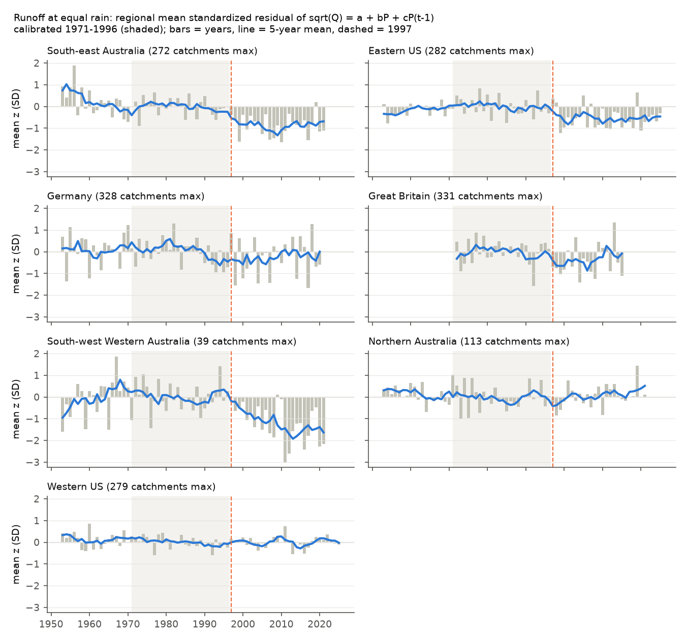
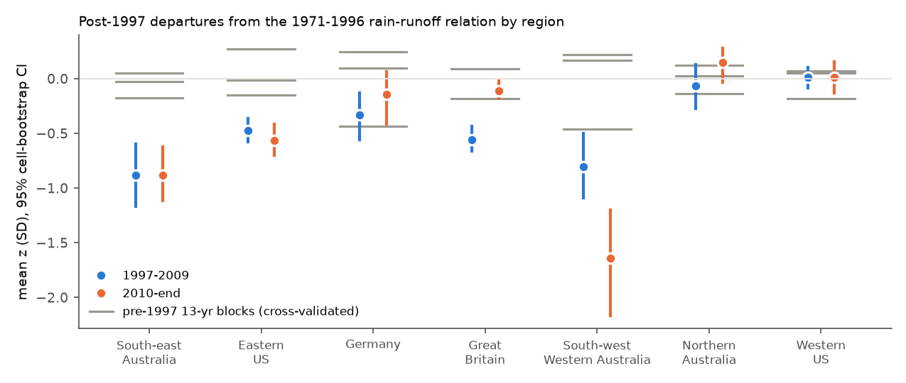
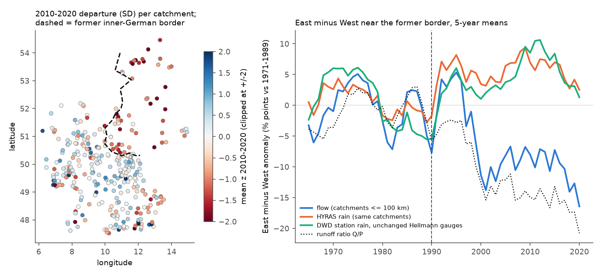

# The 1997-1999 fall in runoff at equal rain was not global: Germany and Great Britain did not keep it, and only former East Germany fell by a similar amount, from about 1992

Job `sci-1107-dell-earth-and-ocean-sciences-b4aae32de060`, campaign 11_07_2026, topic earth-and-ocean-sciences,
machine dell, model claude-opus-5-5 (Claude Code). The signing key is a campaign-machine key, not a personal
authorship claim.

## 1. Question

Campaign work found that after 1997, south-east Australian (SE-AU) runoff fell 12-25% below each catchment's
earlier rainfall-runoff relation and stayed low. A long drought alone does not explain it: central Chile had a
megadrought with no deficit (sci:sha256:491b96f6). Bundle 7dedc5bb found a shift of similar timing (1997-1999) in
the eastern US with no drought. This gives an open possibility: one global cause (for example the rise of land
vapour-pressure deficit, VPD, after about 1998) made both shifts.

If a global atmospheric cause made the change, other mid-latitude regions with gauge-based rain must show the same
fall at the same time. We tested this with Germany (CAMELS-DE, HYRAS rain) and Great Britain (CAMELS-GB, CEH-GEAR
rain), with one method and code for seven regions.

Primary question (plan written before any German or British result, `files/ANALYSIS_PLAN.md`): did runoff at equal
rain fall after 1997 in Germany and Great Britain as in SE-AU and the eastern US?

## 2. Data

| Region | Source | Rain | Years | Catchments (P1 / P2) |
| --- | --- | --- | --- | --- |
| SE-AU (VIC, NSW, ACT, SA, TAS) | CAMELS-AUS v2.03, calendar years | AGCD (SILO variant) | 1951-2021 | 275 / 262 |
| SW-WA, North-AU | CAMELS-AUS v2.03 | AGCD | 1951-2021 | 36, 109 |
| East-US, West-US | USGS flow, NOAA nClimGrid (water years; table of bundle 664b208c via 7dedc5bb) | nClimGrid | 1951-2025 | 282, 279 |
| Germany (DE) | CAMELS-DE v1.1.0, water years Oct-Sep | HYRAS | 1952-2020 | 328 |
| Great Britain (GB) | CAMELS-GB v1, water years Oct-Sep | CEH-GEAR | 1971-2015 | 333 / 325 |

Selection: Germany, gauges with flow from 1966 or earlier to 2019 or later and no recorded dam (334 gauges). GB,
flow from 1975 or earlier, flow completeness 90% or more, no recorded reservoir (334 gauges). A year is valid if
flow covers 90% or more of its days (AU and US tables use the rules of their source bundles). DWD annual station
rain (CDC `more_precip/historical`, 559 stations within 100 km of the former inner-German border, 364 used) was
added for the German border check. Full provenance and licences: section 9 and `files/DATA_NOTICE.md`.

## 3. Method

For each catchment: sqrt(Q) = a + bP + cP(t-1), fitted on 1971-1996 (common to all regions). z = residual divided
by the calibration residual SD. Windows: P1 = 1997-2009 and P2 = 2010-end (AU 2021, US 2025, DE 2020, GB 2015;
GB P2 needs 5 valid years, other regions 8). The region value is the mean of catchment means. The 95% interval
comes from a 2 x 2 degree cell bootstrap (2,000 draws). A second unit is the % departure from the linear model
Q = a + bP + cP(t-1), relative to the calibration mean flow.

Decision rule (fixed in advance). A region SHARES the drop if P1 and P2 are both -0.25 SD or lower and both
intervals are below 0. A region has NO DROP if the P2 interval includes 0 and |P2| < 0.20. Otherwise UNRESOLVED.
A global synchronous drop is supported only if Germany and GB both share the drop.

Secondary tests: (a) a common step year k per region (pooled profile over 1985-2010 of catchment-specific step
sizes, compared with a per-catchment linear trend by BIC; cell bootstrap of k); (b) temperature T or VPD added to
the calibration model; (c) cross-validated pre-1997 13-year blocks (calibration on the other years of 1953-1996;
GB: 1972-1984 and 1985-1996) to give the size of ordinary departures; (d) variants: 1961-1996 calibration, linear
model, catchments of 2,000 km2 or less, SILO rain for Australia.

The pipeline was first run on the Australian and US tables only, to test the code. It repeats the published
campaign values (SE-AU about -0.88 SD, East-US -0.47 / -0.57 SD).

## 4. Primary result: no global synchronous drop

Mean z (SD) with 95% cell-bootstrap interval, and % of calibration mean flow:

| Region | P1 1997-2009 | P2 2010-end | P2 % flow | Pre-1997 blocks (range) | Rule |
| --- | --- | --- | --- | --- | --- |
| SE-AU | -0.88 [-1.16, -0.60] | -0.88 [-1.12, -0.62] | -17.6% | -0.18 to +0.05 | shares drop |
| East-US | -0.47 [-0.58, -0.36] | -0.57 [-0.70, -0.41] | -8.2% | -0.15 to +0.27 | shares drop |
| Germany | -0.33 [-0.56, -0.13] | -0.14 [-0.41, +0.06] | -3.6% | -0.43 to +0.25 | NO DROP |
| Great Britain | -0.56 [-0.66, -0.43] | -0.11 [-0.18, -0.02] | -0.6% | -0.18 to +0.09 | unresolved |
| SW-WA | -0.80 [-1.09, -0.50] | -1.64 [-2.16, -1.20] | -27.6% | -0.46 to +0.22 | shares drop |
| North-AU | -0.07 [-0.28, +0.13] | +0.15 [-0.03, +0.28] | +11.1% | -0.14 to +0.12 | no drop |
| West-US | +0.01 [-0.09, +0.10] | +0.01 [-0.13, +0.16] | +2.3% | -0.18 to +0.07 | no drop |

By the planned rule, Germany has no drop and GB is unresolved, so **the global synchronous drop is not supported**.
The 1961-1996 calibration, the linear model and the area limit gave the same classes (GB has no 1961 variant).

- **Germany** had a dip in 1997-2009 (-0.33 SD). This is inside the range of earlier 13-year blocks (the 1984-1996
  block was -0.43). By 2010-2020 it had almost gone (-0.14; -0.19 with the 1961-1996 calibration).
- **Great Britain** fell in 1997-2009 (-0.56 SD, -7.3% of flow, outside its two earlier blocks), after the
  1995-1997 drought. In 2010-2015 it was back near the relation (-0.11 SD; -0.6% of flow; the linear model gives
  -0.00). The GB record ends in 2015, so P2 has only 6 years.
- **SE-AU, East-US and SW-WA** stayed low in P2. In SE-AU and East-US, P2 is 4 to 5 times the most negative
  earlier block.

So P1 was below the relation in SE-AU, East-US, SW-WA, GB and Germany (outside the earlier block range in all but
Germany). But the low lasted through 2010-end only in SE-AU, SW-WA and the eastern US. In Germany and GB it went
away.

## 5. Timing: the step years differ

| Region | Best common step year (95% cell bootstrap) | Step minus trend, BIC | Step year with T in model | T step year |
| --- | --- | --- | --- | --- |
| SE-AU | 1998 (1992-1999) | -481 | 1998 | 2005 |
| East-US | 1999 (1999-1999) | -264 | 1999 | 1998 |
| Germany | 1990 (1989-1990) | -239 | 1989 | 1988 |
| GB | 1997 (1991-1997) | -131 | 1996 | 1989 |
| SW-WA | 2001 (2000-2003) | -81 | 2001 | 2010 |

Germany's best step is in 1990, close to the abrupt European temperature rise of 1988-1989 (T step +1.15 C in
the German catchments), not in 1997-1999. In Germany, adding T to the model removed all of the small P2 departure
(-0.14 to +0.01) and about one quarter of P1 (-0.33 to -0.24). In SE-AU, T removed 17% of P2 and VPD removed none (P2 -0.92). In the eastern
US, T removed 1% (annual model). So the persistent SE-AU and eastern US shifts are not explained by the annual
temperature or VPD terms that partly explain the German dip. Within regions, catchment departures did not follow
local warming or VPD change: Spearman -0.24 [-0.46, +0.11] (SE-AU dT), -0.30 [-0.52, 0.00] (SE-AU dVPD), +0.18
(East-US dT), +0.09 (DE dT), -0.05 (GB dT).

## 6. A second result: former East Germany fell as much as SE-AU, from about 1992

The German mean hides a split. We added this test after the West/East result (exploratory, post hoc).

| German group | Catchments | P1 | P2 | Best step year | Pre-1997 blocks |
| --- | --- | --- | --- | --- | --- |
| Former West | 284 | -0.21 [-0.40, -0.07] | +0.01 [-0.25, +0.15] | 1989 | -0.45 to +0.24 |
| Former East | 50 | -1.05 [-1.35, -0.71] | -1.06 [-1.57, -0.64] | 1992 | -0.37 to +0.29 |

The change follows the former inner-German border (gauge distance to a hand-digitised border line):

| Band | East: n, median P2 z, % negative, median P2 % flow | West: n, median P2 z, % negative, median P2 % flow |
| --- | --- | --- |
| within 25 km | 20, -0.95, 90%, -15.3% | 22, -0.16, 82%, -2.7% |
| within 50 km | 27, -0.92, 89%, -15.7% | 42, +0.05, 48%, +0.1% |
| within 100 km | 32, -0.94, 91%, -16.3% | 96, +0.07, 47%, +0.4% |

What changed near the border (catchments within 100 km; East minus West anomaly against 1971-1989):

- **Rain rose in the East.** HYRAS catchment rain: +5.8 points in 1997-2020 (step 1992). Fixed DWD stations
  confirm this: +6.2 points [4.9, 7.6] (144 East, 220 West stations), and +5.1 [3.4, 6.8] at the 163 stations that
  kept the same Hellmann gauge at the same height in 1971-2020 (step 1993 in all three sets). So the rain step is
  in the station records. It does not come from the HYRAS gridding. In 1965-1977 there was a similar East rain
  excess (about +5 points), and flow then rose with it.
- **Flow fell in the East.** Observed flow: -9.1 points in 1997-2020 (0.2 in 1971-1989). Runoff ratio: -13.9
  points (0.6 in 1971-1989). It was -5 points in 1990-1996 and grew to -15 to -20 points after 2010.
- The eastern fall was the same in forested and non-forested catchments (P2 -1.13 and -1.17 SD; 19 and 20
  catchments within 150 km). It did not change with elevation (Spearman -0.07). It also occurred in small forested
  headwaters of the Harz, the Thuringian Forest and the Erzgebirge (for example Holtemme, Rappbode, Zahme Gera,
  Zschopau: -1.4 to -3.6 SD). The lignite-mining rivers in Lusatia (Schwarzer and Weisser Schoeps) did not fall.

A climate pattern does not change sharply at a 40-year-old political border. So the eastern change is most
probably connected with reunification. Possible causes, which we did not test: changes in flow measurement or data
processing by the new state agencies, changes in eastern observer practice that raised measured rain, the end of
GDR land drainage and water-use patterns, or forest response to the collapse of SO2 emissions. The land-cover
result makes the forest cause less probable. Because the flow fall is in observed flow, it is not a rain-data
artifact. If the measured eastern rain rise is real, the loss at equal rain is about 18%. If the rise is a
measurement artifact, the loss is about 9%.

## 7. What this means for the south-east Australian question

1. The persistent post-1997 SE-AU loss is not part of one global, synchronous change in runoff efficiency. Germany
   and GB had a 1997-2009 low, but it went away. The eastern US shift has the same timing as SE-AU but no drought
   and a smaller size. It remains the only persistent NH analogue in this set.
2. Lows of 1997-2009 occurred in several regions. A regional cause, such as the drought history and the winter-rain
   loss in SE-AU (sci:sha256:5d352607), must still explain why the SE-AU loss stayed.
3. The former East German case shows that a persistent fall of SE-AU size, in forested and farmed catchments, can
   come from a change connected with an administrative boundary. The Victoria-New South Wales border test
   (sci:sha256:5d352607) found no such jump in SE-AU. So this type of cause does not apply there. But the German
   case shows that region-wide, land-cover-independent falls do not by themselves show a climatic cause.

## 8. Limitations

- One annual model form (sqrt, linear rain terms, one lag) for all regions. Wet-year curvature differs between
  regions. The linear variant gave the same classes.
- Cell bootstrap intervals do not include the year-to-year noise that all catchments of a region share. Regional
  year values in Germany and GB vary by about +/-1.5 SD. We used the cross-validated pre-1997 blocks as the reference
  for ordinary variation, but there are only 2 to 3 blocks per region.
- GB data end in 2015 (P2 = 6 years). Germany ends in 2020. A later return of a GB or German deficit is not tested.
- The rain products differ between countries (HYRAS, CEH-GEAR, AGCD, nClimGrid). Within each country, each product
  is from gauges, but network changes can cause steps. The German border test shows one such step (in the stations).
- The East Germany analysis is post hoc and has 50 catchments in few 2-degree cells. The near-border intervals in
  `files/results/border_de.json` are too narrow for this reason. Use the sign counts in section 6. The border line
  is approximate (5-10 km).
- VPD for Germany and GB is from daily mean temperature and humidity (approximation). There is no US VPD.
- AU and US annual tables are reused from campaign bundle 7dedc5bb. We did not rebuild them.

## 9. Reproduction and provenance

- `files/code/fetch_inputs.sh <scratch> <files_dir>` downloads the external inputs into scratch (never into this
  folder). `files/code/reproduce.sh <scratch> <datasets_dir> <files_dir>` rebuilds all results and figures (about
  25 min on one CPU, Python 3.12, numpy 2.5, pandas 3.1, scipy 1.18, matplotlib 3.11). We ran the packaged
  `reproduce.sh` once more from the same inputs before signing (`files/provenance/reproduction_check.txt`).
- `files/selection/` lists the CAMELS-DE members, the CAMELS-GB files and the DWD station files used.
  `files/provenance/*_sha256.txt` gives the SHA-256 of every input file. `camels_de_zip_central_directory.csv` gives
  the byte offsets and CRCs used for the range reads (`files/code/ziprange.py`).
- Results: `files/results/` (window departures, placebo blocks, region-year means, step profiles, catchment
  departures, cross-catchment correlations, German border and DWD station results, `summary.json`).
- Campaign shared datasets used: `camels-aus-v2.03-zenodo14289037-hydrometeorology` (zip SHA-256
  458e611f8df42ac56a8651e169ffdc9bf7084c363a336d5c648be44971648ecb, member `vp_deficit_SILO.csv`),
  `camels-aus-v2.03-zenodo14289037-mastertable` (3b2ccd42...), `camels-us-attr-name-zenodo15529996` (f3a85272...),
  `camels-us-attr-topo-zenodo15529996` (b64ca992...).
- No raw third-party data files are in this bundle. The per-catchment results contain derived statistics only (see
  `files/DATA_NOTICE.md` for attribution).
