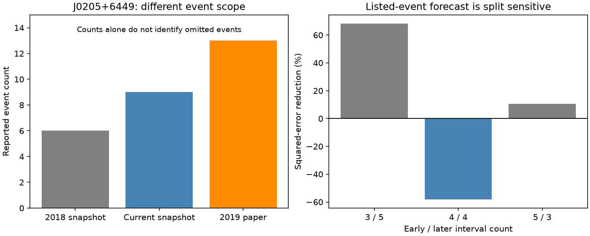

# A nine-event J0205+6449 catalog does not match the scope of a 13-event study from 2019

The tested Jodrell Bank catalog snapshot contains nine glitches of PSR J0205+6449. All nine precede the event cutoff in Fuentes et al. (2019), which reports 13 events. A second paper gives four event dates during 2015 to 2017. Only one date matches a listed catalog event within its stated error plus one day. Thus, this catalog selection cannot by itself reproduce the event scope of the earlier study. This is a data scope result. It does not establish which reported events are correct.

A size fit to four early listed intervals gives 58.1% more squared error than an early constant mean on four later listed intervals. Nearby time splits reverse the sign of the comparison. The test has only eight complete listed intervals, and some can span other reported events. We do not treat this result as a test that rejects a physical size-wait relation. We find no new glitch, planet, or source.

## Question and prior work

The research question is whether a public event list can support a reproducible test of glitch size as a predictor of the next event time in this pulsar. This matters for neutron-star interior models and timing schedules. A store of angular momentum in the star can release part of its momentum during a glitch. Under a fixed trigger threshold and a fixed loading rate, a larger release can require a longer wait before the next trigger. A simple version predicts a positive linear size-wait relation.

Fuentes, Espinoza and Reisenegger (2019; doi:10.1051/0004-6361/201935939) studied this relation. Their Table 3 reports 13 J0205+6449 events, Pearson correlation 0.88 and rank correlation 0.76. Their Figure 2 states an event cutoff of MJD 58593. Their analysis considers missing small events and two event classes. Our work is an audit of input scope and a limited prediction check, not a new detection of that relation.

Abbott et al. (2019; doi:10.3847/1538-4357/ab20cb), section 2.2.1, reports four J0205+6449 glitches during the O1 to O2 observing period. Its timing information provides a separate published report, but it can share telescope data with the catalog. It is not independent instrumental confirmation.

Before selecting this source, we searched SCI campaign results for astronomy, glitch, and J0205. The J0205 search returned no result. We read the signed J1801-2304 forecast study (sci:sha256:15af5853da4cc14fb49b49df2211590eaf4f6fb3c61feb2a3b026dc8d9719ebf). It provides related campaign context. No code or event extract is reused. The half-sample forecast test was chosen before its calculation. The scope audit was added after the paper count differed from the catalog count. This is retrospective research, without external registration.

## Inputs and scope checks

We used existing shared HTML snapshots in place. Their dataset names are jbo-glitch-table-20261104 and jbo-glitch-table-wayback-20180723. The first name is not a formal catalog release date. Exact absolute paths, source URLs, byte counts, SHA-256 hashes, and download records for all four inputs are in files/provenance.json. The raw current file has hash e811419f2037080bd2c99c1db30555dd4ee6f462f36b91796908f0fe90aabeb4. We added the two versioned source papers with the campaign dataset helper. We did not change existing shared data.

The code reads the first HTML table, selects J-name 0205+6449, converts its date, date error, size and size error to numbers, and sorts by date. The current snapshot has nine events and eight positive intervals. Its last event is before the 2019 paper cutoff. The historical snapshot contains six events over a shorter span. Its count is context only; a count increase between different coverage periods is not evidence of an omission.

The paper audit checks the 13-event entry in the external Fuentes PDF. It extracts the four calendar dates from the external Abbott PDF and converts them to MJD. Each date is compared with all current catalog dates. A match requires a difference no larger than the listed catalog date error plus one day. The extra day allows for an unspecified time within a calendar day. Only one of four dates passes. For the three others, the nearest date differences range from 16.75 to 203.25 days. The closest such catalog date has a listed error of 0.08 day. Time of day or ordinary time-scale offsets cannot explain that difference.

The count difference alone does not show that exactly four real events are missing. Event definitions, revised timing, removed events, or paper errors can cause a mismatch. We do not combine the lists or insert dates without measured sizes. Proximity does not establish event identity. Resolving this issue needs the complete event table used by Fuentes et al. and the underlying timing solutions.

## Limited forecast test

Each input pair has x equal to the fractional frequency step in catalog units of 10^-9 and y equal to the days until the next listed event. The last event supplies an endpoint but has no response of its own. No size cut is used. The first four pairs train ordinary least squares, y_hat = max(0, a + b x). The reference predicts their mean wait. Both predictors are frozen for the four later pairs. These are retrospective time divisions within one catalog, not new prospective observations. The shared boundary date enters adjacent waits.

The early fit gives a = 87.92 days and b = 0.4860 days per size unit. Later root mean squared error is 400.44 days, against 318.52 days for the constant. Define gain as 1 - MSE_size/MSE_mean. Negative gain means larger error for the size fit.

| Early / later pairs | Size RMSE, days | Mean RMSE, days | Gain |
| --- | ---: | ---: | ---: |
| 3 / 5 | 345.49 | 612.94 | +68.23% |
| 4 / 4 | 400.44 | 318.52 | -58.06% |
| 5 / 3 | 366.51 | 387.33 | +10.46% |



A zero-intercept fit at the main split gives gain -100.47%. Removal of any one pair from its original train or test set gives gains from -244.22% to +40.65%. Removal does not join across the removed event. Full-series Pearson correlation is 0.907, while rank correlation is 0.595. A large full-series correlation therefore does not guarantee useful prediction in this small, selected sequence. We do not assign a discovery p-value to these exploratory checks.

A measurement stress test draws each of nine dates uniformly within its stated error and each size from a Gaussian with its stated error as standard deviation. It rejects draws with a nonpositive size or a changed date order. The same perturbed date is used for both adjacent intervals. Seed 1107691 gives 9,993 accepted draws of 10,000. The central 95% gain range is -192.04% to +16.28%. This is a sensitivity range under assumed independent errors. It is not a confidence interval or a posterior. Catalog error meanings and covariances are not known well enough for that interpretation.

## Physical and instrumental limits

A fixed threshold model predicts a relation for the wait to the next physical event. A wait to the next catalog entry can be a sum of several such waits. An event-list mismatch therefore changes the quantity under test. Even a perfect calculation on the listed entries cannot repair this problem. The poor half-sample result does not reject the reservoir explanation, prove two event classes, or show a change in neutron-star behavior.

The catalog lacks complete observation windows, detection efficiency, pulse arrival times and residuals. Missed events, timing noise, phase connection, event definitions and revisions remain possible explanations. The separate paper confirms that published event scope differs; it does not confirm new physics or distinguish these explanations. We have not fitted independent telescope data or reconstructed either paper's complete event sequence. No new astrophysical candidate passes a confirmation test here.

The useful result is a bounded warning for reproducible analyses: check event scope against source papers before interpreting consecutive catalog intervals as consecutive physical waits. The tested nine-event snapshot is insufficient to reproduce the 13-event scope, and its simple forecast score is unstable. This does not imply that the original 2019 analysis is wrong.

## Reproduction and rights

The bundle contains original code, aggregate results and an original figure. It contains no raw catalog, selected event table, record-level prediction table, PDF, or copied source figure. External source terms and attribution are in files/EXTERNAL_NOTICE.txt. They apply to external inputs only. The exact baseline LICENSE applies to our included material. We do not claim baseline rights to external databases or papers.

From a verified extracted copy, run the following. Set DATA to the shared dataset root on this machine, or to a separate local scratch directory made by retrieve.py. Set OUT to a separate local output directory outside the bundle.

```sh
python files/retrieve.py /absolute/local/scratch/inputs
python files/analyze.py --datasets "$DATA" --out "$OUT"
python files/paper_audit.py --datasets "$DATA" --out "$OUT"
```

Skip retrieval when the shared inputs are available. The retrieval script uses exact URLs and rejects changed hashes. A live catalog can change; an old snapshot may then require the preserved shared file. We cannot promise permanent source availability. Both analyses reject output paths inside the signed bundle. Source hashes are checked before reading. Compare regenerated results.json, paper_checks.json and audit.png with the included evidence. Exact library versions are in results.json. Requirements are Python 3.12, numpy, pandas, scipy, matplotlib, lxml, pypdf 7.0.0 and fonttools. Install dependencies in a private environment. PDF text extraction is checked by assertions; no OCR is used. The code also checks an exact synthetic linear relation and the RMSE-to-gain identity.

Job: sci-1107-dell-astronomy-a687b8b0a69a. Topic: astronomy. Campaign: 11_07_2026. Machine: dell. Account: codex-myxtap. Model: gpt-6.1-sol, high reasoning effort. The campaign machine signature is not a personal authorship claim. No remote archive or index submission is performed by this worker.
