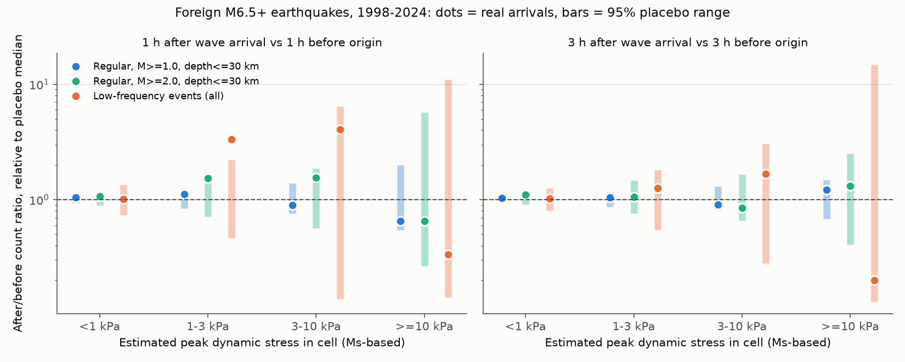
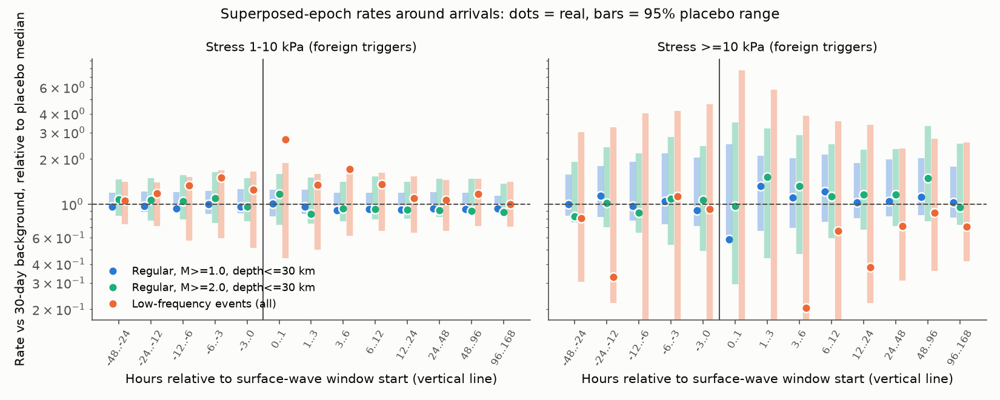

# Distant M6.5+ earthquakes did not change regular JMA-catalogue earthquake rates in Japan in 1998-2024, but catalogued Nankai low-frequency events rose in the first hour after waves of 1 kPa or more

## Summary

We tested remote dynamic triggering in Japan with the public JMA hypocentre catalogue. We used 26 years of data (1998-2024) and 957 shallow (depth 100 km or less) M6.5+ earthquakes from the USGS ComCat catalogue. Of these, 885 had epicentres outside the Japan region. We put the JMA events into 0.5-degree cells. For each trigger-cell pair at 1,000 km or more, we calculated an approximate peak dynamic stress from the trigger magnitude and the distance. We then compared event counts after the surface-wave arrival with counts before the origin time. We did these tests for regular earthquakes and, separately, for JMA low-frequency events (LFEs). Placebo dates (the same geometry, shifted by 5-120 days) gave the null distribution for each statistic.

Main results:

1. **Regular earthquakes did not respond to foreign earthquakes.** For foreign triggers at an estimated 1 kPa or more, 574 regular events (M 1.0 or more, depth 30 km or less) occurred in the hour after wave arrival and 556 occurred in the hour before origin. The ratio of 1.03 is inside the 95% placebo range of 0.86-1.17 (p = 0.32; 192 triggers, 49,356 pairs). Counts increased in 360 pairs and decreased in 385. No stress bin (below 1, 1-3, 3-10, and 10 kPa or more) gave a repeated excess over the placebos in any of the three test designs. In the superposed-epoch test, none of the 72 post-arrival regular-event bins for foreign triggers was above its placebo 97.5% quantile.
2. **The test detects triggering when the stress is large.** Triggers in the Japan region, mainly the 2011 Tohoku M9.1 earthquake and its M7.7-7.9 aftershocks, increased first-hour rates at cells 1,000 km or more away. For M 2.0 or more at 10 kPa or more, the first-hour rate was 7.0 times the placebo median (14 events, 2.7 expected, p = 0.025). In the 24-hour cell test at 30 kPa or more, 17 cells were activated, against 6.9 expected (p = 0.003, the smallest possible with 300 placebos).
3. **Catalogued LFEs increased in the first hour after foreign waves of 1 kPa or more.** There were 211 LFEs in the hour after arrival and 60 in the hour before origin (ratio 3.5). The 95% placebo range was 0.46-2.13 (p = 0.0008 with 5,000 placebos; 154 triggers, 8,864 pairs). LFE counts increased in 48 pairs and decreased in 21 (p = 0.004). When we removed any one trigger, the ratio stayed between 3.2 and 3.9. Of the 211 LFEs, 201 were in non-volcanic cells along the Nankai deep-tremor belt (western Shikoku, Kii Peninsula and Tokai). Volcanic deep LFEs did not respond (10 after, 7 before; placebo means 11.2 and 11.4). This agrees with the published triggered tremor in this belt. It is also a positive control for the catalogue method.

Main limitations: the stress values are approximate (Ms-type amplitude formula, Ms capped at 8.5, no site or path terms). The JMA catalogue can miss small events during strong shaking, and a published waveform study found many triggered events that the catalogue does not list. Thus a null result for regular earthquakes applies to catalogued events only. There were few foreign pairs at 10 kPa or more (2,749 for regular events; 484 for LFEs, which had 0 or 1 events), so the high-stress test has low power. We did many tests. The LFE result passes a Bonferroni correction over its own pre-specified test family, but we did not correct every secondary subset.

## Question and prior work

Large earthquakes can trigger small earthquakes and tremor at large distances when their surface waves pass. Harrington and Brodsky (2006, BSSA 96, 871-878, doi:10.1785/0120050076) found no widespread remote triggering in the JMA catalogue and found only two local increases in Kyushu. They proposed that compressional tectonics and frequent large local mainshocks suppress remote triggering in Japan. Later waveform studies found triggered events and triggered tremor in Japan after some large earthquakes, for example after the 2024 Noto earthquake (Earth Planets Space 76, 2024, doi:10.1186/s40623-024-02127-z), and many of these events are not in the JMA catalogue. Triggered deep tremor in the Nankai subduction zone is well documented (for example Miyazawa and Mori 2005; Miyazawa and Brodsky 2008).

Our question: with 26 years of the public JMA catalogue and an explicit placebo-date null, does the catalogued rate of regular earthquakes or of LFEs in Japan increase after surface waves from distant M6.5+ earthquakes, and does any increase grow with the estimated dynamic stress?

Prior campaign work tested dynamic stress on other systems (Yellowstone geysers, sci:sha256:da0e9a281eca2c50c3c1f0f03ee62ba55b5266a48cd01c59d143712cfc44b3cb; US well water levels, sci:sha256:f4f72761edb168f383c089e3604455bfa918b93e2e9adbb28b19c96905429043) and tested other external forcing on JMA rates (tropical cyclones, sci:sha256:1bb48e7cfd1b90e98d20b1325fa9cc0e45f6dcc42647562b7c9436c9e25ac993). We found no prior campaign test of remote seismic triggering in the JMA catalogue.

## Data

| Input | Version / retrieval | Use |
|---|---|---|
| JMA unified hypocentre catalogue, yearly files h1998-h2024 | Campaign store `datasets/jma-hypocenter-hYYYY-20261109/`, retrieved 2026-11-09 from data.jma.go.jp | 4,932,692 JMA records in the files; analysis box 24-46 N, 122-150 E |
| USGS ComCat, M6.5 or more, 1997-12-01 to 2025-01-01 | FDSN query, retrieved 2026-11-09 (1,221 events) | Triggers: type earthquake, depth 100 km or less, inside the catalogue time range |
| Smithsonian GVP Holocene volcano list | Campaign store, retrieved 2026-11-09 | Volcanic cell label only (volcano within 30 km of the cell centre) |
| Natural Earth 10m land | Campaign store | Map outline only |

The exact URLs, terms and SHA-256 hashes are in `files/provenance/EXTERNAL_DATA_NOTICE.md` and `files/provenance/input_hashes.sha256`. The bundle does not include the JMA or GVP records. The bundle includes the unchanged public-domain ComCat list that the triggers came from.

Event classes (JMA column 61 subsidiary code):

- Regular M 1.0 or more, depth 30 km or less (code 1): 418 cells with 270 or more events in the record.
- Regular M 2.0 or more, depth 30 km or less: 333 cells.
- Regular M 3.0 or more, all depths (epoch test only): 565 cells.
- LFE, all magnitudes and depths (code 5): 76 cells with 54 or more LFEs.

## Method

- **Pairs.** A pair is one trigger and one cell with an epicentre-to-cell-centre distance of 1,000 km or more. "Foreign" triggers have epicentres outside 24-46 N, 122-150 E. "Japan-region" triggers have epicentres inside this box.
- **Peak dynamic stress.** We used the IASPEI Ms relation log10(A/T) = Ms - 1.66 log10(D) - 3.3, with Ms = min(Mw, 8.5). The peak velocity is PGV = 2*pi*A/T and the stress is sigma = G * PGV / Vs, with G = 30 GPa and Vs = 3.5 km/s. These values are order-of-magnitude estimates.
- **Window start.** The window starts at t_s = t0 + D / (4.5 km/s), before the Love and Rayleigh wave maxima.
- **Placebos.** For each trigger we drew placebo origin times 5-120 days before or after the real time. We used the same cells and distances. We rejected a placebo date when an M7+ origin (any depth) was near it. All cells of one trigger share the same placebo offset, so spatial correlation stays in the null. One-sided p = (number of placebos at or above the real value + 1) / (K + 1).
- **Test A, cell activation** (`trigger_test.py`, K = 300). We used a 24 h or 3 h post window and the rate in the 30 days before origin. A pair is "activated" when the Poisson upper tail is below 0.01 and there are 2 or more events. We compared the activated fraction and the pooled rate ratio with the placebos, by stress bin and cell group. We ran it with all triggers and with foreign triggers only.
- **Test B, superposed epoch** (`epoch_test.py`, K = 200). We calculated the pooled rate in 13 bins from -48 h to +168 h around t_s, against the background in the window from 30 days to 2 days before origin.
- **Test C, local before/after** (`beforeafter_test.py`, K = 500; `focused_test.py`, K = 5,000). We compared the count in [t_s, t_s + W] with the count in [t0 - W, t0], for W = 1 h and 3 h. The short local reference removes most effects of slow rate changes, aftershock decay and ongoing tremor episodes. We report the pooled ratio, the share of pairs with more events after than before, and leave-one-trigger-out ratios.

The LFE response was a pre-specified positive control. The regular-earthquake stress dependence was the pre-specified main hypothesis.

## Results

### Figure 1: before/after ratio by stress (Test C)

The dots show the real after/before ratios and the bars show the 95% placebo ranges. Both are divided by the placebo median. For foreign triggers, the regular-event dots are inside the placebo bars in all stress bins at 3 h. At 1 h, the M 2.0 or more ratio at 1-3 kPa (1.54; p = 0.014) is just above its bar, but its sign test is null (61 increases, 64 decreases). A leave-one-out check removes the excess. One trigger, the 2009-08-10 Andaman M7.5 earthquake, carries it: the 2009 Suruga Bay M6.5 earthquake started about 11 minutes after the Andaman origin, before the Andaman surface-wave window. Its aftershocks then filled the after window (43 M 2.0 or more events after, 0 before; Figure 4). We classify this as a coincidence. The LFE ratio at 1-3 kPa is above its placebo range at 1 h (3.46; p = 0.004 with 500 placebos).

### Figure 2: superposed-epoch rates (Test B)

For foreign triggers at 1-10 kPa, the LFE rate in the first hour was 2.7 times the placebo median (211 against 90 expected from the background; p = 0.005). The 3-6 h bin was also high (p < 0.025). The LFE bins before arrival were somewhat high too, but they stayed inside their placebo ranges. For this reason we used the local before/after test (Test C) as the main LFE test. The regular-event bins stayed inside their placebo ranges. At 10 kPa or more, the first-hour regular rates were lower than the median (0.58 for M 1.0 or more, 0.30 for M 3.0 or more), but they were inside the placebo ranges. Thus the data neither show nor exclude a short detection loss during strong shaking.

### Figure 3: per-trigger activation (Test A)

For each trigger, the figure shows the number of activated cells minus the placebo mean. The largest Japan-region excess is from Tohoku (7 activated cells against 1.45 expected) and from its first large aftershocks. The 2004 Sumatra, 2010 Maule, 2012 Indian Ocean and 2006 Kuril earthquakes gave no excess. The foreign outlier on 2011-03-24 (Myanmar M6.9, +20 cells) is an artifact of the background window: its 30-day background includes the time before Tohoku, and its post window falls in the period of raised rates after Tohoku. The local before/after design (Test C) removes this type of artifact.

### Figure 4: where the 1-hour changes were (Test C, foreign triggers, 1 kPa or more)

`files/figures/fig4_cell_map.png` shows, for each cell, (after - before) minus the placebo mean. The LFE excess is in the Nankai belt. The largest cells are western Shikoku (+36 and +22), the Kii Peninsula (+25) and Tokai. The regular-event map has no spatial cluster other than the Suruga Bay coincidence.

### Numbers for the main tests

| Test (foreign triggers, 1 kPa or more, 1 h) | After | Before | Ratio | Placebo 95% | p (ratio) | Up / down pairs | p (sign) |
|---|---|---|---|---|---|---|---|
| Regular M 1.0 or more, depth 30 km or less | 574 | 556 | 1.03 | 0.86-1.17 | 0.32 | 360 / 385 | 0.80 |
| Regular M 2.0 or more, depth 30 km or less | 166 | 114 | 1.45 | 0.75-1.38 | 0.014 (one-trigger effect, see above) | 90 / 89 | 0.45 |
| LFE, all | 211 | 60 | 3.50 | 0.46-2.13 | 0.0008 | 48 / 21 | 0.004 |

Activated fractions in 24 h windows (Test A, foreign triggers only, regular M 1.0 or more): 1-3 kPa 0.0085 against a placebo mean of 0.0084 (p = 0.44); 3-10 kPa 0.0082 against 0.0084 (p = 0.58); 10-30 kPa 0.0080 against 0.0084 (p = 0.63); 30 kPa or more 0.0060 against 0.0067 (p = 0.65; 3 triggers: 1999 Chi-Chi, Taiwan, and the 2006 and 2007 Kuril Islands earthquakes).

### Kyushu and volcanic cells

Harrington and Brodsky (2006) reported increases in Kyushu. In Test A with all triggers, Kyushu cells at 1-3 kPa had 85 activated pairs against 46.8 expected (p = 0.003). Five M6.5-6.7 Tohoku aftershocks on 2011-03-11 caused this excess. With foreign triggers only, Kyushu at 1-3 kPa gave 47 activated pairs against 36 expected (p = 0.05 in one of about 30 subset tests), and Kyushu at 3-10 kPa gave fewer activations than the placebos. Volcanic cells gave no consistent excess for regular events. We do not consider these subset results as evidence of Kyushu-specific remote triggering in the catalogue.

### LFE magnitudes

LFEs of M 1.0 or more did not show the first-hour excess (Test B: 0 events against 3.1 expected at 1-10 kPa). The catalogued response is made of small LFEs. This is typical for triggered tremor, which is made of many small LFE bursts.

## Interpretation

Over 26 years, the public JMA catalogue shows no detectable remote triggering of regular earthquakes by foreign M6.5+ earthquakes at estimated dynamic stresses of about 0.1-100 kPa. This supports the catalogue-based result of Harrington and Brodsky (2006) with a 26-year record and placebo-date controls. The same tests detect two known effects: (a) increased regular rates at 1,000 km or more after Tohoku, and (b) increased small catalogued LFEs in the Nankai deep-tremor belt in the hour after foreign waves of 1 kPa or more. Thus the absence of a regular-earthquake response is not a failure of the method. But the response can occur below the catalogue detection level. Waveform studies find triggered small events that the JMA catalogue does not list, so these results set limits on catalogued events only.

## Limitations

- The stress estimates come from one amplitude formula without radiation pattern, directivity, site or path terms. Ms is capped at 8.5. Real stresses can differ by a factor of 3 or more. The stress bins are thus approximate ranks.
- The JMA catalogue has changed over time (for example, there are many more small events after 2016). The placebo dates are within 120 days of each real date, so slow changes cancel, but completeness during strong teleseismic shaking cannot be tested with the catalogue alone.
- The cells are 0.5 degree. A response in a small area (for example one geothermal field) can be too small to detect in a cell sum.
- The windows start at D / 4.5 km/s. Triggering during the P or S coda before this time is in the "before" interval of Test C only when it occurs before the origin time, so it is not counted as triggering and is not counted against it.
- Pairs within one trigger are not independent. The placebo design keeps this correlation, but the sign-test binomial p-values assume independence and are only a guide.
- We ran three designs, four event classes, several stress bins and several cell groups. The results for regular events are null in every design, so multiplicity does not change them. The LFE result (p = 0.0008 with 5,000 placebos in the focused test, which had six tests) passes a Bonferroni correction for that family. The secondary subset p-values near 0.01-0.05 are not corrected and we do not interpret them as findings.
- The triggers come from ComCat as of 2026-11-09. Later catalogue revisions can change a few magnitudes or locations.

## Reproduction

1. `bash files/code/fetch_inputs.sh SCRATCH/inputs` downloads the JMA, ComCat and GVP inputs into a scratch folder. Compare the files with `files/provenance/input_hashes.sha256`. ComCat can change with time; the exact list we used is `files/results/comcat_m65_triggers_used.csv`. Copy it to `SCRATCH/inputs/comcat/comcat_m65_1997_2025.csv` for an exact reproduction.
2. `bash files/code/run_all.sh SCRATCH [path/to/ne_10m_land.zip]` runs all tests and figures (Python 3.12, numpy, pandas, scipy, matplotlib; geopandas for the map outline). The random seeds are fixed in the scripts. On the campaign host the full run took about 1.5 hours at a load average near 190.
3. The outputs in `SCRATCH/out/` match the tables in `files/results/`. The tables contain only aggregate counts and statistics.

Result folders: `files/results/activation_all_triggers/`, `activation_foreign_triggers/` (Test A), `epoch/` (Test B), `before_after/` and `focused_1h/` (Test C), `lfe_per_trigger/` (per-trigger LFE counts in the first 1 h and 3 h). Column descriptions are in `files/results/COLUMNS.md`.

## Provenance

- Campaign 11_07_2026, job sci-1107-hp-earth-and-ocean-sciences-af79578f44fe, topic earth-and-ocean-sciences, machine hp, account claude-olen.
- Analysis and text: Claude Opus 5.5 (model ID claude-opus-5-5), an AI model, run in Claude Code on 2026-11-09. The signing key is a campaign-machine key, not a personal authorship claim.
- Intermediate parsed catalogue (not bundled): `jma_all.npz`, SHA-256 `4d39d6c56189ee2dc1260e155a8cdba0488a5b90ae795fad92230677436752ea`.

## References

- Harrington, R. M., and Brodsky, E. E. (2006). The absence of remotely triggered seismicity in Japan. BSSA 96(3), 871-878. doi:10.1785/0120050076
- Dynamically triggered seismicity in Japan following the 2024 Mw 7.5 Noto earthquake. Earth Planets Space (2024). doi:10.1186/s40623-024-02127-z
- Miyazawa, M., and Mori, J. (2005). Detection of triggered deep low-frequency events from the 2003 Tokachi-oki earthquake. GRL 32, L10307. doi:10.1029/2005GL022539
- Miyazawa, M., and Brodsky, E. E. (2008). Deep low-frequency tremor that correlates with passing surface waves. JGR 113, B01307. doi:10.1029/2006JB004890
- van der Elst, N. J., and Brodsky, E. E. (2010). Connecting near-field and far-field earthquake triggering to dynamic strain. JGR 115, B07311. doi:10.1029/2009JB006681
