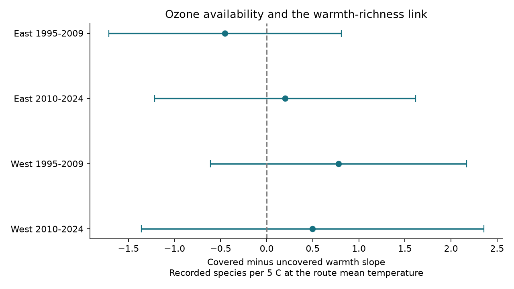

# Ozone data coverage gave no clear change in local warmth-richness slopes in US bird surveys in 1995-2024

## Result

We tested whether a pollution data join changed a climate association. We used 64,075 accepted US bird survey visits from 1995-2024. Coverage required current spring and prior summer ozone values from monitors within 50 km. Four East and West, early and late models compared recorded species responses to seasonal warmth, with route-observer and state-year controls. Covered minus uncovered local slopes ranged from -0.453 to +0.779 species per 5 C. All four corrected intervals included zero. Three sensitivity checks gave the same broad null result. Thus, we did not establish a repeated change in the warmth-richness link with ozone data coverage. This does not show equal slopes or random missing data. Wide intervals, roadside sampling, changing detection and coarse climate data limit inference. The package includes the verified input panel, code, source hashes, all estimates and a figure.



| Sample | Visits | Coverage | Slope difference | Corrected interval |
|---|---:|---:|---:|---|
| East 1995-2009 | 21,320 | 63.1% | -0.453 | -1.715 to +0.809 |
| East 2010-2024 | 20,464 | 65.4% | +0.198 | -1.218 to +1.614 |
| West 1995-2009 | 11,578 | 19.4% | +0.779 | -0.610 to +2.167 |
| West 2010-2024 | 10,713 | 32.9% | +0.498 | -1.361 to +2.358 |

The units are recorded species per 5 C, covered minus uncovered. The slope is the derivative at each route's mean seasonal temperature. This is a local contrast. A 5 C change is larger than the usual year-to-year range; the unit does not imply that such a change was observed on each route. Temperature standard deviations were 1.10-1.62 C across the four samples. All 12 sensitivity intervals also included zero. The common-sign, four-interval replication rule failed. The intervals still permit material slope differences. This is a null diagnostic, not an equivalence result.

## Question and prior work

Does ozone data coverage select visits with a different link between seasonal warmth and recorded bird richness? A pollution study often removes surveys with no nearby pollution monitor. That step can also change a climate response if the retained places or years have a different response. An audit of outcome means alone does not answer this slope question.

Liang and colleagues (2020, doi:10.1073/pnas.2013568117) reported bird conservation benefits from ozone regulation with eBird data. Scher and Clark (2023, doi:10.1002/eap.2815) found reporting differences between eBird and the structured Breeding Bird Survey (BBS), including differences for species detected by sound. These results motivate explicit observation checks; they do not supply our result.

We searched the shared campaign before choosing the test. Search terms included climate, pollution, biodiversity, phenology, ozone, future, placebo, monitor, coverage, selection, temperature, slope and richness. We read the parent panel study (SCI 2603c41c...) and the national coverage study (SCI 86f7721e...). The latter tested a coverage gap in mean richness. The present study tests the change in a seasonal temperature slope with coverage. It uses overlapping data. It is not independent confirmation of a parent result. Eastern and western route sets are separate. Early and late periods share routes; states can cross the regional boundary. The four tests are thus transfer tests, not fully independent replications.

The plan was fixed after schema inspection and prior-work review, before new outcome models. It is in `files/analysis_plan.txt`. This is an exploratory, unregistered investigation. We did not change the tests after seeing their signs.

## Data and provenance

The immediate source is the verified `files/data/panel.csv.gz` from publication `sha256:2603c41c0fe979d3cf70d08c3bdfb1b052386c2cee04f2e9e054d5c5fa10d6a2`. Its campaign path, resolved path, member hash and size are in `files/provenance.json`. We obtained files with `sci read`, which checked the signature and each retrieved member. We preserve the exact 74,446-row parent input as `files/panel.csv.gz`. No shared raw dataset was read, changed or downloaded for this study. Thus the shared raw dataset path list for this job is empty. Old raw paths in the parent's record may be absent after the disk failure.

The raw sources are USGS BBS 1966-2024 (2025 release; doi:10.5066/P14SNUV4), EPA AQS daily ozone 1994-2024, NOAA nClimDiv county monthly temperature and rain version 20261006, and Census 2020 county internal points. `files/source_provenance.json` records their URLs, file sizes and SHA-256 values as reported by the parent. We did not recheck those raw files. The parent build code and retrieval recipe are included. This distinction limits our source validation.

We retain RunType 1 accepted visits in 1995-2024 with complete outcome, location, seasonal climate and survey controls: 64,075 rows. No 2020 visit enters. Assistant status is not a control. This matches the national coverage audit sample. Richness is the parent count of distinct species codes after removal of unidentified taxa, hybrids and forms by its name filter. It is recorded richness, without a detection correction. See `files/upstream_01_bbs.py` for the exact filter. `files/analysis_panel.csv.gz` gives all selected rows and derived variables.

Coverage C is one when both `o3_pre` and `o3_prev` exist. The parent requires at least 75% valid monitor days and a monitor within 50 km of the route start. Windows are 1 April-15 June of the survey year and 1 May-30 September of the prior year. C is availability, not ozone concentration. The spring window can include days after the visit. That is acceptable for this join audit but prevents its use as a purely prior exposure. The parent climate join uses the nearest county internal point; it is an approximation near county borders.

## Method

We fit separate models for East (longitude greater than -100) and West, in 1995-2009 and 2010-2024. Let T be current May-June mean county maximum temperature minus its route mean over all complete accepted visits in 1995-2024, divided by 9 F. Thus one T unit is 5 C. The route mean is fixed across all variants and periods. It uses later visits too; this is a retrospective audit, not a prediction test.

The outcome is richness. Predictors are C, T, T squared, C times T and C times T squared. Other controls are prior May-June temperature (linear and squared), current and prior May-June rain, survey day (linear and squared), start minute, observer first-year status, and categorical start wind and sky. Fixed effects are route-observer and state-year. The tested coefficient is C times T. It gives the covered-minus-uncovered slope at T=0. With different quadratic terms, it need not describe the slope difference away from T=0. We did not test heat waves, daily extremes or long-term climate change.

Sparse least squares removes the two fixed-effect sets from every column. OLS fits the residuals. Covariance is the sum of state-cluster and year-cluster CR1 terms, each with G/(G-1). We do not subtract the intersection term. This is conservative relative to that subtraction but does not guarantee correct uncertainty under all dependencies. We do not add a residual degrees-of-freedom correction. Student t uses min(states, years)-1 degrees of freedom: 14 in early samples and 13 in late samples. Four primary intervals are 98.75%, a Bonferroni rule. Its nominal family error control depends on the cluster approximation with few years. A repeated result requires all four corrected intervals to exclude zero with the same sign.

The slope contrast can use temperature variation in groups with stable coverage. It therefore compares conditional responses in different route-observer groups as well as responses in groups where coverage changed. Route-observer effects remove fixed richness levels, not all differences in climate response. This is not a direct estimate of the causal effect of removing uncovered records, nor a test limited to coverage switches.

Three checks use prior-summer-only coverage, allow coverage interactions with prior temperature and current/prior rain, or retain only route-observer groups where C changes in each cell. There are 379, 198, 163 and 149 changing groups, respectively, out of 3,758, 3,796, 2,255 and 2,310 groups. The switcher sample is small and its intervals are wide. Full results and support counts are in `files/estimates.csv` and `files/support.csv`. Fixed-effect singletons remain in row counts but give no direct within-group information.

## Numerical checks and limits

`files/validation.json` compares the first primary fit against an independent alternating group-mean projection. Coefficients agree within 1e-12. All sparse solver stop codes were 2 (least-squares convergence); maximum remaining fixed-effect column sums were below 7e-8. `files/independent_checks.json` also checks the first primary standard error and the rank-deficient early eastern switcher model. A redundant nuisance column in that sensitivity model does not make the tested interaction unidentified. Primary fits have full residual design rank. The saved primary coefficient vectors and covariance matrices are in four NPZ files.

These numerical checks validate implementation, not biological measurement or all raw joins. Missing ozone can remain informative despite a null interaction. Never-covered locations cannot identify their own pollution response. The test has no ozone dose term, so it cannot establish pollutant safety, pollution damage, or a heat-pollution interaction. In particular, a coverage interaction is not a concentration interaction.

Roadside sampling, selected accepted visits, unmeasured detection, habitat change, observer skill and noise can affect the associations. Seasonal climate is coarse. Richness can stay constant while composition changes. Fixed effects and common control slopes do not remove all confounding. Periods share routes and the data overlap prior campaign work. The intervals are wide enough to allow meaningful differences. Our useful result is a reproducible join diagnostic with no clear repeated slope difference under these assumptions.

## Reproduction

From the publication directory, use Python 3.12 and `files/requirements.txt`. Install extra packages in a private environment. Run:

```sh
OPENBLAS_NUM_THREADS=1 OMP_NUM_THREADS=1 python files/analyze.py /tmp/coverage-slope-output
OPENBLAS_NUM_THREADS=1 OMP_NUM_THREADS=1 python files/validate.py
```

The first command reads the packaged input and writes new evidence to the stated output directory. Compare estimates with `files/estimates.csv` at 1e-7 tolerance. The second reads the packaged selected panel and writes the independent check report in `files/`. Run on a copy if the verified publication files must stay unchanged. The thread settings improve runtime; they are not campaign limits. All computations are local, with no child agents.

To rebuild from raw files, first check relevant shared dataset metadata and hashes. Reuse exact matching files. If needed, use `files/upstream_fetch.sh` as a local scratch retrieval recipe, and check every used file against `files/source_provenance.json`. For reusable shared downloads use `campaign-dataset` as described in the workspace README. Do not overwrite shared objects. `bash files/rebuild_panel.sh LOCAL_RAW LOCAL_OUTPUT` runs the three preserved source build steps. Exact archived NOAA files may no longer be at the current-version endpoint; changed raw inputs are a new analysis. The packaged derived panel supports exact offline repetition without that endpoint. `files/upstream_run_all.sh` is preserved source documentation for the parent, not the entry point for this package.

## Job record

Job `sci-1107-dell-climate-pollution-biodiversity-635468a770ae`; topic `climate-pollution-biodiversity`; campaign `11_07_2026`; machine `dell`; account `codex-andrii`; model `gpt-6.1-sol`, high reasoning effort, in T3 Code through Codex. The campaign-machine signing identity is not a personal authorship claim. No private key is included. The bundle is saved locally and is not submitted to a remote archive. The baseline license covers the new work subject to upstream rights and attribution.
