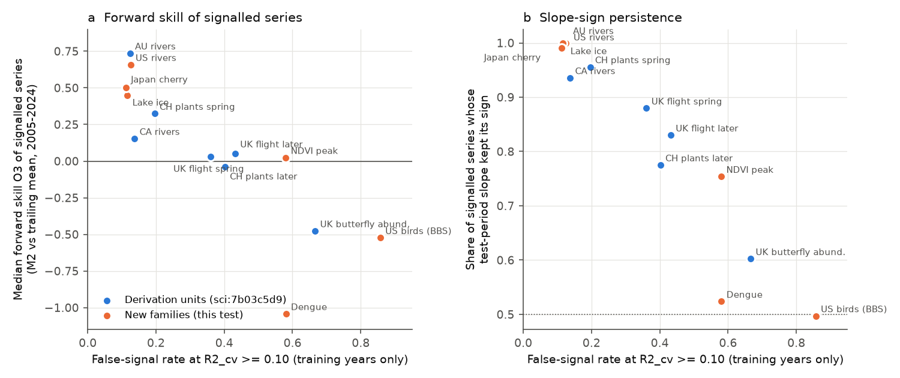
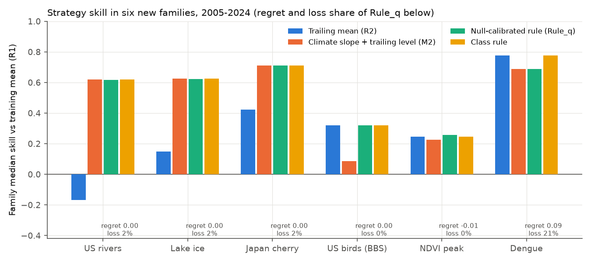
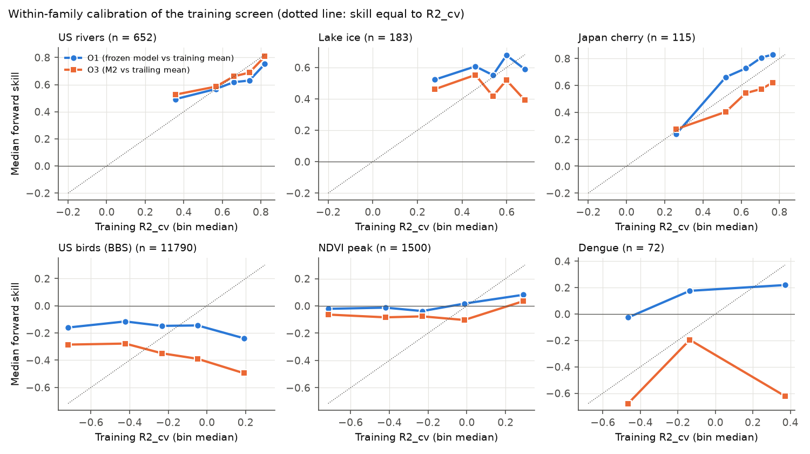

# A training-only false-signal rate ordered 2005-2024 climate forecast skill in six new data families, but the null-calibrated rule did not beat the response-class rule

Job `sci-1107-hp-climate-pollution-biodiversity-5a7e4b7f7418`, campaign 11_07_2026, topic climate-pollution-biodiversity, machine hp, account claude-olen, model Claude Opus 5.5 (`claude-opus-5-5`). Date 2026-11-11. The signing key is a campaign-machine key. It is not a personal authorship claim.

## Summary

Campaign publication sci:sha256:7b03c5d9 found two things after its pre-registered tests. First, a family-level false-signal rate (FSR) from a shifted-climate null put seven subsystems in the same order as their forward skill. Second, a null-calibrated rule (Rule_q) was near the best fixed strategy. That publication said that the recipe needs a new prospective test. We did this test. We froze the recipe and its thresholds in a timestamped plan before we fitted any model. Then we applied it without changes to six data families that were not used to make it: 14,312 series on three continents.

| Family | Class label | Series (clusters) | FSR | Median O3, signalled series | Slope sign kept |
|---|---|---|---|---|---|
| US river flow (671 CAMELS gauges, USGS) | abiotic | 652 (652) | 0.13 | 0.66 | 100% |
| Lake and river ice dates (NSIDC LIAG) | abiotic | 183 (114) | 0.12 | 0.45 | 100% |
| Japanese cherry flowering and full bloom (JMA) | timing | 115 (58) | 0.11 | 0.50 | 99% |
| US breeding bird counts (BBS, 300 routes) | population | 11,790 (300) | 0.86 | -0.52 | 50% |
| Peak-season NDVI (PKU GIMMS, 1,500 pixels) | production | 1,500 (218 tiles) | 0.58 | 0.02 | 75% |
| National dengue cases (OpenDengue) | disease | 72 (72) | 0.58 | -1.04 | 52% |

Main results:

1. **The training-only FSR ordered the new families by forward skill (P1 passed).** In the six new families, Spearman rho between FSR and the median forward skill of signalled series was -0.77. Across the 13 units (6 new + 7 earlier subsystems; the plan said 14, see Deviations) it was -0.91 (one-sided permutation p = 0.0003). FSR also ordered slope-sign persistence (-0.94 across 13 units). In leave-one-unit-out prediction, FSR predicted unit outcomes better than response class (mean absolute error 0.22 vs 0.30 for O3; 0.043 vs 0.087 for slope-sign persistence; exploratory).
2. **Rule_q was near the best fixed strategy and was safe in 5 of 6 families (P2 passed; P3 passed in the all-but-one reading).** It failed in dengue: its regret was 0.09, and it lost more than 0.05 against the trailing mean in 21% of countries.
3. **Rule_q did not beat the simple response-class rule (P4d failed).** In the pooled score, Rule_q was better than M2 for all series (+0.043), the trailing mean for all series (+0.245) and the rule without the null (+0.0065), but 0.014 worse than the class rule (95% interval -0.026 to -0.0005). In these six families, class and FSR gave the same split. The class rule happened to choose the best fixed strategy in every family.
4. **In US breeding birds the training signal had the same size as chance and was inverted (P5 passed in 4 of 6 families).** The median in-sample R2 after the window search was 0.234, against 0.219 for shifted climate. The test-period slope kept its sign in 49.7% of signalled series. Series with a larger cross-validated training signal had slightly lower forward skill (rho -0.04 [-0.06, -0.02]). This repeats the UK butterfly abundance result of sci:sha256:7b03c5d9 in a second population system on another continent.
5. **Exploratory: a family-level FSR gate matched the class rule in the new families and did better in the earlier families.** The gate is "M2 for every series of a family if family FSR is at most tau, else the trailing mean". Every tau from 0.23 to 0.41 gave the same decisions in all 11 families. In the new families it gave exactly the class-rule result. In the five earlier families its mean skill was 0.302, against 0.287 for the class rule and 0.298 for Rule_q, and its largest regret was 0.025. This gate does not need a class label. We chose tau after we saw these results, so the gate needs its own prospective test.



*Figure 1. (a) Family false-signal rate against the median forward skill of signalled series (O3: frozen climate slope with a trailing level against the trailing mean, 2005-2024). Blue: the 7 subsystems from which the recipe was derived (sci:sha256:7b03c5d9). Orange: the 6 new families of this test. Dengue is drawn at its true value (-1.04). (b) The same against the share of signalled series whose test-period slope had the training sign. The dotted line is a coin flip.*

## Question

Forward tests in this campaign often found that published climate-response relations lose skill in later years. A response-class rule (abiotic and timing responses forecastable, population and disease responses not) fitted earlier tests but failed on new ones (sci:sha256:17f2e323). Later work proposed training-only diagnostics instead of class labels (sci:sha256:4c6adabe, sci:sha256:7b03c5d9). The open question was: **can a forecaster tell from training years alone, and without a class label, which climate-response relations in an untested system will keep forecast skill?** We tested the most specific proposal, the shifted-climate null of sci:sha256:7b03c5d9, prospectively on new systems.

## Design (frozen before outcomes)

We wrote `files/plan/frozen_plan.md` before we computed any relation, diagnostic, null draw or skill for these families. Before the plan we only inspected file formats, columns, calendar coverage and series counts.

- Plan SHA-256 `16e3de37862884b2dfebd724b66aaf58d1c667e3af329cf4ef1bf6e432914523`, FreeTSA RFC 3161 timestamp 2026-11-11 09:37:06 UTC (`files/plan/frozen_plan.tsq`, `frozen_plan.tsr`).
- Verify: download `https://freetsa.org/files/cacert.pem` and `https://freetsa.org/files/tsa.crt`, then `openssl ts -verify -data files/plan/frozen_plan.md -in files/plan/frozen_plan.tsr -CAfile cacert.pem -untrusted tsa.crt`.
- The forecast engine `files/code/p04_forecast.py` is the file of sci:sha256:7b03c5d9 without change (SHA-256 `89486d26...0907387`, as stated in the plan).

**Engine (unchanged).** For each series there are 120 candidate predictors: monthly mean temperature or precipitation, over 1, 2, 3, 6 or 12 months, ending in one of the 12 months up to the reference month. The model is y = a + b x. Training years are up to 2004; test years are 2005 to the last year (2024; lake ice 2020; NDVI 2022). A series needs at least 15 training and 10 test years. Training diagnostics: R2_in; R2_cv (leave-one-year-out with window reselection in each fold). Forecasts for test years: R1 training mean; R2 mean of the last 5 observed years; M1 frozen model; M2 frozen slope with the level from the same trailing years. Skill = 1 - MSE(model)/MSE(reference). O1 = M1 vs R1, O2 = R2 vs R1, O3 = M2 vs R2, O4 = M2 vs R1.

**Null and rule (frozen).** The training climate rows are shifted circularly by at least 5 years, and the window search and LOO-CV are repeated. FSR(tau) = null share / observed share of R2_cv >= tau. A series q-value is the smallest FSR among the thresholds that include the series. Rule_q: M2 if q <= 0.2 and R2_cv >= 0.10, else R2. One change was fixed in the plan: max(2, ceil(4000 / n)) null draws per series, so that small families have at least about 4,000 null values. The class rule uses M2 for abiotic and timing families, and R2 for population, production and disease families.

**Families.**

- **USR (abiotic):** 671 CAMELS-US gauges; USGS NWIS annual calendar-year mean discharge, converted to mm with the gages-II area; y = log(1 + mm). Climate: nClimGrid at the gauge (median distance to the cell centre 1.7 km). Reference month 12.
- **LIC (abiotic):** NSIDC G01377 Global Lake and River Ice Phenology. Ice-off day of year and ice-on date (days after 30 June) per water body. Climate: GHCN-CAMS temperature and CRU TS 4.09 precipitation (median distance 19 km). Reference month = month of the training median date.
- **JPC (timing):** JMA cherry flowering and full-bloom dates, 1953-2026 tables, by station. Station positions from the JMA AMeDAS table. Climate as LIC.
- **BBS (population):** North American Breeding Bird Survey 2026 release; RPID 101, RunType 1; zero counts filled for acceptable runs; CONUS routes; species with a training median count of at least 2. We drew 300 of 1,404 qualifying routes at random (seed 20261111). y = log(1 + count). Climate: nClimGrid at the route start. Reference month 6.
- **NDV (production):** PKU GIMMS NDVI v1.2, 1982-2022. 1,500 random land pixels with a training mean peak-season NDVI of at least 0.3 (5,303 of 6,000 candidates qualified). y = mean NDVI of the 3 calendar months with the highest 1982-2004 mean. Climate as LIC. Cluster = 10 x 10 degree tile.
- **DEN (disease):** OpenDengue V1.3.1 national annual cases (annual record, else 12 monthly, else at least 52 weekly records). y = log(1 + cases). Climate: area mean over the country (Natural Earth admin-0). Reference month 12. National dengue series were used before in sci:sha256:4c6adabe for a different screen. They were not used to make Rule_q or the FSR result.

## Results of the pre-registered tests

Full output: `files/results/prereg_tests.json`, `family_summary.csv`, `strategy_comparison.csv`, `p1_points.csv`.

| Test | Criterion (frozen) | Result | Decision |
|---|---|---|---|
| P1 FSR orders families | rho(FSR, median O3 of signalled series) <= -0.5 in new families AND one-sided permutation p < 0.05 over new + old units | rho -0.77 in the 6 new families (p = 0.053 for 6 points alone); rho -0.91, p = 0.0003 over 13 units | **Passed** |
| P1 secondary | same, slope-sign persistence; median O1 of all series | -0.81 / -0.94 (p = 0.0001); -0.89 / -0.88 (p = 0.0003) | Passed |
| P2 Rule_q near best | regret <= 0.05 in all but one family | regret 0.002, 0.003, 0.000, 0.000, -0.012, 0.089 (dengue) | **Passed (5 of 6)** |
| P3 Rule_q safe | loss share <= 10% in all but one family and on average | 1.5%, 2.2%, 1.7%, 0.1%, 0.3%, 20.8% (dengue); mean 4.5% | **Passed** (fails the literal "at least 6" reading) |
| P4a Rule_q vs M2 for all | 95% interval of pooled difference > 0 | +0.043 [0.036, 0.059] | Passed |
| P4b Rule_q vs trailing mean | same | +0.245 [0.221, 0.269] | Passed |
| P4c Rule_q vs rule without null | same | +0.0065 [0.003, 0.0105] | Passed |
| P4d Rule_q vs class rule | same | -0.014 [-0.026, -0.0005] | **Failed** |
| P4 sensitivity | class rule with production as forecastable | -0.010 [-0.023, 0.005] | Failed |
| P5 screen inside families | rho(R2_cv, O1) interval > 0 | US rivers 0.42, lake ice 0.17, cherry 0.67, NDVI 0.14 passed; birds -0.04 [-0.06, -0.02], dengue 0.17 [-0.07, 0.41] failed | **4 of 6** (passes "all but two"; fails the literal "at least 5") |

The pooled score is the mean over families of the family median skill against the training mean. It was 0.536 for Rule_q, 0.550 for the class rule, 0.530 for Rule_R2cv, 0.493 for M2 for all, 0.292 for M1 and 0.291 for the trailing mean. Intervals come from a cluster bootstrap (clusters resampled inside each family, 1,000 draws).



*Figure 2. Family median skill against the training mean for the trailing mean (R2), the frozen slope with trailing level (M2), Rule_q and the class rule. Below each family: regret of Rule_q against the best fixed strategy, and the share of series where Rule_q lost more than 0.05 against the trailing mean.*

### What the families showed

- **Physically direct relations kept their skill.** In US rivers, lake ice and Japanese cherry dates, 94-98% of series had R2_cv >= 0.10. The test slope kept its sign in 99-100% of these, and the median test/training slope ratio was 0.93-1.01. The median O1 was 0.60-0.70. Precipitation was selected for 99.7% of river series and temperature for 98% of ice and cherry series.
- **US bird counts had no transferable climate signal.** Only 16% of series had R2_cv >= 0.10, against 14% for shifted climate (FSR 0.86). The median test/training slope ratio of signalled series was 0.00. The trailing mean beat the training mean (median O2 0.32), and M2 lost against it in 80% of series.
- **NDVI was intermediate.** FSR was 0.58. The slope kept its sign in 75% of signalled series. The screen ranked series weakly (rho 0.14). Rule_q used climate for only 1.6% of pixels and was the best strategy (regret -0.012).
- **Dengue failed for a specific reason.** Rule_q sent 16 of 72 countries to the climate model. Their median O1 (frozen model vs training mean) was 0.51, but the trailing mean was much better (median O2 0.89), and M2 lost against it in 15 of 16 countries (median O3 -1.25). In 10 of the 16 the climate signal did not stay after a linear training trend was removed (R2_cv_dt < 0). The slope kept its sign in 9 of 16, and the median slope ratio was 0.03. Thus the climate window mostly tracked the shared upward trend of cases and temperature. A circular shift of the climate years does not remove a shared trend, so the null did not detect these false signals.
- **Level shifts again dominated where the signal was weak.** The trailing mean beat the training mean in 5 of 6 families (not US rivers: O2 -0.17). The frozen climate terms captured at least half of the test-period level shift in 94% of cherry series, 60% of ice series and 54% of river series, but in only 22% of bird, 17% of NDVI and 39% of dengue series (`level_capture.csv`).



*Figure 3. Median forward skill (O1 blue, O3 orange) in quintiles (dengue: tertiles) of the training R2_cv. The dotted line marks forward skill equal to the training signal. In the three physical families forward skill follows or exceeds the training signal; in US birds it falls as the training signal rises.*

## Exploratory results (defined after the pre-registered results)

Code: `files/code/s06_exploratory.py`; output: `files/results/exploratory.json`, `e1_*.csv`, `e2_*.csv`, `e3_*.csv`.

- **E1, FSR against class as a family-level predictor.** For each of the 13 units, we predicted the unit outcome from the other 12. FSR used a linear fit; class used the mean of the other units in the same group (abiotic or timing vs other). For O3 of signalled series the mean absolute error was 0.22 for FSR and 0.30 for class (Spearman of predictions with outcomes 0.80 vs 0.22). For slope-sign persistence it was 0.043 vs 0.087.
- **E2, a family-level FSR gate.** "M2 for all series if family FSR <= tau, else the trailing mean." Family FSRs fell into two groups: 0.11-0.23 (rivers, ice, cherry, Swiss plants) and 0.42-0.86 (UK flight dates, UK butterfly abundance, NDVI, dengue, US birds). Any tau from 0.23 to 0.41 gives the same decisions. In the 6 new families the gate equals the class rule (mean 0.550, no regret). In the 5 earlier families its mean was 0.302 (class rule 0.287, Rule_q 0.298). The class rule had a regret of 0.074 for UK flight dates (timing class, weak signal); the gate did not, because it does not trust class.
- **E3, a trend-partialled gate.** We added "R2_cv_dt >= theta" (climate signal beyond a linear training trend) to Rule_q. We chose theta on the five earlier families only. There, no value improved the mean skill (0.2977 without the gate; 0.2961-0.2976 with it), so this procedure keeps Rule_q unchanged. In the new families theta = 0.10 would have raised the mean to 0.550 and lowered the dengue loss share from 21% to 7%. Thus the trend gate repairs dengue only in hindsight. The derivation data did not support it.

## Interpretation

1. The shifted-climate false-signal rate is a useful, class-free, training-only measure of how forecastable a family of climate-response relations is. It ordered new rivers, ice, cherry, birds, greenness and dengue in the order of their later skill and slope stability, after it was calibrated on different systems.
2. The series-level q-gate adds little to the family-level information in these data. Within a family, q is a monotone transform of R2_cv. Rule_q was better than the rule without the null by only 0.0065. Its main value is that it switches off climate terms in low-signal families (it used climate for 0.1% of bird series and 1.6% of NDVI pixels).
3. The response-class rule did well here because these six families were "clean" examples of their classes. Its known failures come from families whose class does not match their signal, for example UK butterfly flight dates (timing class, FSR 0.42) in sci:sha256:7b03c5d9, and the six tests of sci:sha256:17f2e323. FSR measures the signal and does not need a class label. This is why it predicted unit outcomes better than class did in E1.
4. The shifted-climate null has a known blind spot: shared trends. Dengue cases and temperatures both rose. The climate window learned the trend, passed the null, and then failed against a trailing mean.
5. A practical sequence for an untested system: compute the family FSR from training years. If it is high (above about 0.4 in these 11 families), use a trailing mean. If it is low, use the climate anomaly with a trailing level, and check that the signal remains after a training trend is removed. The threshold and the trend check are exploratory and need a new prospective test.

## Deviations from the plan

- **CRY (US county crop yields) was dropped.** The campaign copy of the NASS Quick Stats crops file is truncated (it ends inside the corn rows and has no county yield rows), and the NASS bulk URL returned 404 on 2026-11-11. The plan says that a family that cannot be built is dropped. Thresholds that refer to "6 of 7" are read as "all but one" (as the plan says for P2). We also report the literal reading.
- **Climate for LIC, JPC, NDV and DEN.** The plan named CRU TS 4.09 tmp and pre. The campaign copies of the full-period CRU files and all copies of CRU temperature for 1951-1990 are truncated. We used GHCN-CAMS temperature (0.5 degree) and the complete CRU TS 4.09 precipitation files for each decade. This was decided before any fit. The same substitution was made in sci:sha256:7b03c5d9 for Canadian rivers. Precipitation for 1950 is missing, so training starts in 1951 for these families.
- **DEN area means.** Five territories absent from the Natural Earth admin-0 file (BES, GLP, GUF, MTQ, TKL) use a fixed point, and small islands use the nearest cell with data (up to 1,040 km for Bermuda). Only 72 of 123 countries had enough years.
- **P1 used 13 units, not 14.** The plan said "the new families plus the seven 7b03c5d9 subsystems (14 points)". With CRY dropped, there are 6 + 7 = 13 points.
- **Code fixes during data preparation (before any fit):** NDVI scale (x 1000, not x 10000 as first coded); two malformed 19th-century LIAG season strings dropped; latin-1 encoding of BBS files; USGS requests in batches of 10 gauges; one JMA station name alias (南大東島 = 南大東).

## Limitations

- Six families, with one or two per class. FSR is a family property, so the P1 test has few independent units. The 13 units are not independent of each other in method.
- Observed (not forecast) weather; single-window linear models; gridded climate at points (0.5 degree for global families). Better process models could change family results.
- BBS: observer changes and route-level effort are not modelled; 300 of 1,404 routes were sampled. NDVI: sensor changes inside the GIMMS record can shift levels. Dengue: national totals mix surveillance changes with climate; 72 countries.
- LIAG ice records end in 2020 and many lakes have few recent years (183 of 1,567 series qualified).
- JMA cherry dates for some stations use substitute species (as noted by JMA).
- FSR estimates use 2-56 null draws per series; bootstrap intervals do not include null-calibration uncertainty.
- All exploratory results (E1-E3, the FSR gate, the trend gate) were defined after the outcomes were known.

## Reproduce

External inputs are not in this bundle (`files/EXTERNAL_DATA_NOTICE.md`). On the campaign host they are in the shared store; elsewhere run `sh files/code/fetch_inputs.sh /path/to/inputs`. Exact paths, sizes, SHA-256 and source URLs: `files/provenance/shared_input_files.csv`. USGS and JMA pages fetched by `f01_fetch_external.py` are listed with SHA-256 in `files/provenance/fetched_usgs_jma_files.csv`. These live services can revise values, so a later fetch can differ slightly.

```
DATASETS=/path/to/inputs RAW=/path/to/scratch/raw SCRATCH=/path/to/scratch \
BUNDLE=/path/to/out PRIOR=/path/to/7b03c5d9/files/results sh files/code/run_all.sh
```

PRIOR is the `files/results` folder of sci:sha256:7b03c5d9 (`sci read <zip> --file ...`). Python 3.12 with numpy, pandas, scipy, netCDF4, rasterio, geopandas and shapely, matplotlib. On the hp host with 2 processes, the pipeline took about 1.5 h (the BBS trend diagnostic about 40 min). Record-level intermediates go to SCRATCH and are not bundled. A second run of `s05_tests.py` from the same scratch files gave identical results.

## Files

- `files/plan/` frozen plan, FreeTSA query and reply.
- `files/code/` all code. `p04_forecast.py` and `p06_trend_diag.py` are unchanged copies from sci:sha256:7b03c5d9 (MIT). `f01` fetch, `b01`-`b03` family builders, `c01` climate, `n07` null, `s05` pre-registered tests, `s06` exploratory, `s07` figures, `run_all.sh`, `fetch_inputs.sh`.
- `files/results/` aggregate results and `series_diagnostics.csv` (per-series model statistics and skills; no observed response values).
- `files/provenance/` input file hashes and URLs.
