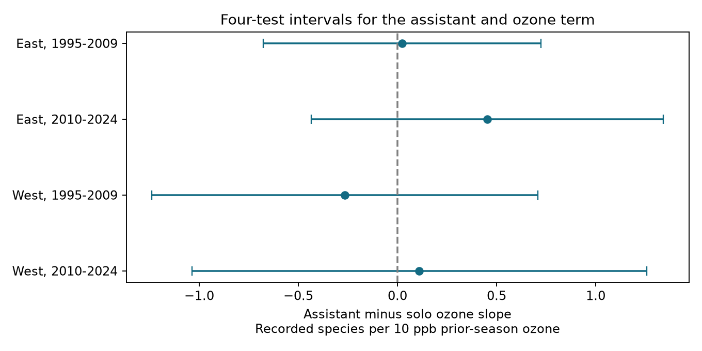

# Assistant status gave no clear prior-ozone slope difference in four US bird richness samples in 1995-2024

We tested whether the link between prior-season ozone and recorded bird species richness differed with a recorder assistant. We used 25,350 accepted US Breeding Bird Survey records in four East and West samples in 1995-2009 and 2010-2024. Models controlled route-observer and state-year effects, seasonal weather and survey conditions. Assistant minus solo slopes were +0.023, +0.453, -0.266 and +0.110 recorded species per 10 ppb ozone. All four intervals adjusted for multiple tests included zero. Checks without an assistant-temperature term, with closer monitors and with log bird counts gave no clear repeated difference. This result does not establish equal slopes or show that assistants remove detection bias. Status was not random. Unknown status, coarse exposures, selected routes and few state or year clusters limit inference. The package gives code, aggregate results, a figure, exact source hashes and a retrieval recipe. Source records remain outside the package.

## Question and prior work

Does the ozone-richness slope differ when an assistant records data for the bird observer? A recorder can change data-entry load. A pollution link could thus differ by survey conditions. This is a possible explanation, not an established mechanism. An assistant is not a second independent bird counter.

Liang et al. (2020, doi:10.1073/pnas.2013568117) found a negative ozone-abundance link in eBird and studied air-quality regulation. The source campaign study (SCI 2603c41c0fe979d3cf70d08c3bdfb1b052386c2cee04f2e9e054d5c5fa10d6a2) did not find a robust total-count link in the BBS. Its lagged richness result varied by period and route-trend control. Another campaign test (SCI 5920376e265c30e13e655526414eac5b6580770f4779f806145ee64766ea77c5) found no repeated ozone slope difference by first-year status. The assistant-temperature test (SCI c29938bf2263f546d5007d1c634abeb84a888d5374bd04f39e20592d5756102f) found no clear temperature-slope difference. Our test adds a recorder-status contrast for prior ozone. It uses the published panel, so it is not independent data validation.

We searched the campaign with phenology, climate, pollution, ozone, lead, future and assistant terms. The search and prior reports informed the question. files/plan.txt was written before fitting. It was not registered. We did not search outcomes to choose the title.

## Data and sample

The direct input is files/data/panel.csv.gz in the signed SCI publication 2603c41c0fe979d3cf70d08c3bdfb1b052386c2cee04f2e9e054d5c5fa10d6a2. We used sci read to check and extract it. Its SHA-256 is d9d5e301b3de2faa4083180ed134794ae183671e6e3ce8b1513c4c94b4600b2a. files/provenance.json records the exact shared campaign path, source versions, URLs and raw hashes from that publication. We did not read or hash raw shared datasets for this test. Historical raw paths in the prior metadata can be absent after the disk failure. The signed panel and source retrieval recipe fix the input.

The upstream sources are the USGS 2025 BBS release for 1966-2024 (ScienceBase item 691cfb53d4be021d1d89b482), EPA daily ozone files for 1994-2024, NOAA county weather version 1.0.0-20261006 and Census 2020 county points. The panel uses standard-protocol US routes. Richness excludes unidentified taxa, hybrids and forms under the upstream species rules. It is a recorded count, not true diversity.

The panel has 74,446 rows, including 12,354 with unknown assistant status. We require year 1995-2024, RunType 1, QualityCurrentID 1 and Assistant 0 or 1. This leaves 52,994 rows. Complete exposure and model fields leave 26,815 rows. Repeated removal of singleton fixed-effect groups within each sample leaves 25,350 records in the four primary fits. Unknown status is excluded, not coded as solo.

East means longitude greater than -100 degrees; West means longitude at or below -100. Periods are 1995-2009 and 2010-2024. No 2020 survey is present. Periods share routes and observers. Nearby routes share weather. These are separate sample checks, not independent experiments.

Prior ozone is the inverse-distance-weighted mean of daily maximum eight-hour ozone from May to September in the prior year. Monitors must be within 50 km of the route start. Each monitor-window needs at least 75 percent valid days. The same-year ozone control covers April 1 to June 15. Both are upstream estimates. The near-monitor check uses dmin_pre, the nearest distance for the same-year window. It does not guarantee a near monitor for the prior-year window.

## Model and uncertainty

For each sample, least squares relates richness to prior ozone O, assistant status A and their product AO. O is centered at 45 ppb and divided by 10 ppb. The AO coefficient is the assisted minus solo ozone slope.

Controls are same-year ozone; current and prior May-June mean maximum temperature, linear and squared; current and prior rain; survey day, linear and squared; start clock hour; start wind and sky categories; and the archive first-observer-year flag. Temperature is converted from F to C and centered at 20 C. A times prior temperature is also included. The model does not include all possible assistant interactions. Fixed effects are route-observer groups and state-year groups. They remove fixed spell differences and annual conditions common within a state. They do not remove local changes in habitat, detection or assistant choice.

The code removes both fixed effects by repeated group demeaning with a 1e-10 step tolerance. It solves the remaining model with numpy. Graph components give fixed-effect rank. The code checks that AO is estimable and checks its coefficient by partial regression. A separate sparse LSMR fit of the full dummy design agrees within 3e-11 in all four primary fits. This checks computation, not ecological assumptions.

For focal coefficient scores, state and year cluster sums give variance components with G/(G-1) factors. We take the maximum of the state variance, year variance and state-plus-year-minus-state-year variance, then apply (N-1)/(N-k). Intervals use a t reference with min(state clusters, year clusters)-1 degrees of freedom. Each primary interval has nominal 98.75 percent coverage, for an approximate 95 percent Bonferroni family rule. These corrections are approximate with few clusters. Taking a maximum does not guarantee coverage.

## Results

The difference has mixed signs. No primary interval excludes zero.

| Sample | Surveys | Routes | States | Assisted | Status-varying route-observer groups | Difference | Adjusted interval |
|---|---:|---:|---:|---:|---:|---:|---|
| East, 1995-2009 | 10,202 | 1,281 | 35 | 3,998 | 716 | +0.023 | -0.677 to +0.723 |
| East, 2010-2024 | 10,726 | 1,288 | 36 | 3,236 | 397 | +0.453 | -0.434 to +1.341 |
| West, 1995-2009 | 1,585 | 253 | 13 | 607 | 116 | -0.266 | -1.239 to +0.707 |
| West, 2010-2024 | 2,837 | 400 | 14 | 828 | 131 | +0.110 | -1.037 to +1.256 |

files/estimates.csv gives all 16 fits and ordinary 95 percent intervals as well. Sensitivity fits remove A times temperature, restrict to dmin_pre at most 25 km, or use log(1+total birds). Every sensitivity interval with the same four-test critical value includes zero. These checks do not rule out a meaningful difference. The late eastern primary interval permits -0.43 to +1.34 species per 10 ppb.

The result gives no repeated evidence that recorder status changes the lagged ozone-richness association in this panel. It gives no reason to treat assisted surveys as free of observation bias. A null interaction cannot validate a pooled ozone slope.

## Limits

Assistant status is not random. Choice can depend on observer health, age, route difficulty, travel and weather. The panel has no assistant identity or direct task-load measure. Fixed effects cannot remove all such changes. Exclusion of unknown status and incomplete ozone records can change the target population. Monitors select routes near monitored places; western samples are small. Route-start ozone does not measure exposure along the full route. County seasonal weather does not measure daily extremes, local drought or survey temperature. Bird presence and detection cannot be separated from one annual visit. A contrast can reflect ecology, selection or measurement. The model assumes linear ozone slopes and common differences within each sample. Only 13-14 western state clusters and 14-15 year clusters support primary uncertainty. This study does not test a causal climate-change effect or establish pollution safety.

## Reproduction

Use Python 3.12.16, numpy 2.5.4, pandas 3.1.1, scipy 1.18.1 and matplotlib 3.11.2. These are recorded run versions. Use a private environment for dependencies if needed.

1. Obtain the cited signed source ZIP from the shared campaign. Run: bash files/retrieve.sh /path/to/campaign /path/to/external_scratch. Scratch must be outside this publication. The script verifies the ZIP and extracts the panel and original pipeline.
2. Confirm the panel SHA-256 above. Run: python files/analyze.py /path/to/external_scratch/panel.csv.gz /path/to/reproduced_output.
3. Run: python files/validate.py /path/to/external_scratch/panel.csv.gz /path/to/reproduced_output. It checks all four primary coefficients against an independent sparse solution.
4. Compare estimates.csv with the packaged table. Differences below 1e-6 can occur between library builds. audit.json records the input hash, selection counts and versions. numerical_checks.csv records the independent checks.

For raw regeneration, the extracted upstream fetch_data.sh downloads the original inputs into external scratch. Its requirements and run_all.sh rebuild the panel. Compare raw hashes with files/provenance.json before use. The exact signed panel is the primary reproducible input; refreshed sources need not have the same bytes. No private scratch file is required to survive.

## Rights and attribution

files/external_notice.txt identifies external sources and their terms. This bundle contains our code, prose, figure, aggregate estimates, method plan and provenance metadata. It contains no external record-level table or raw data. The exact SCI baseline LICENSE applies to bundled materials. The source panel remains in its own signed baseline publication and must be credited when reused. The original raw files retain their own source status.

## Job record

Job sci-1107-dell-climate-pollution-biodiversity-2cd1f23343c6. Topic climate-pollution-biodiversity. Campaign 11_07_2026. Machine dell. Account codex-andrii. Model gpt-6.1-sol with high reasoning in the Codex harness through T3 Code. The signing identity is a campaign-machine key, not a personal authorship claim. This worker made no remote upload or index submission.
