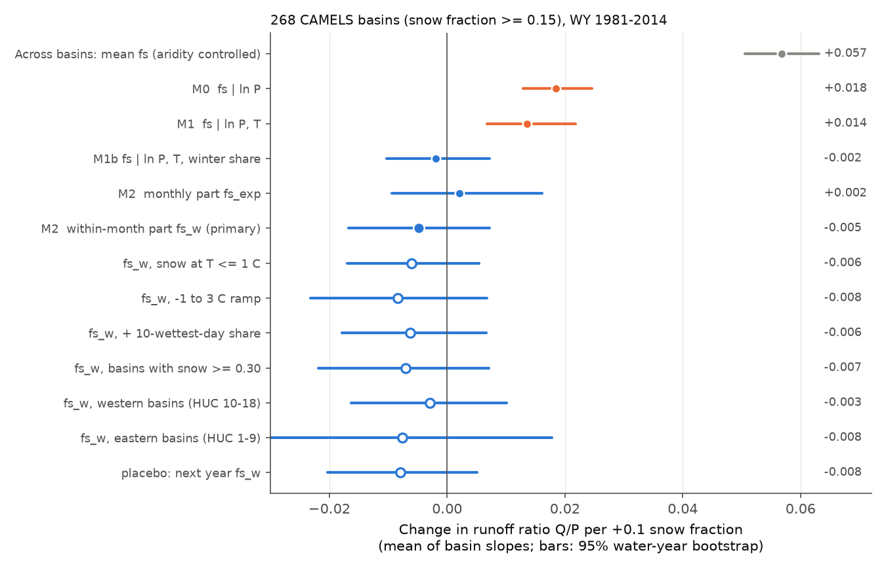
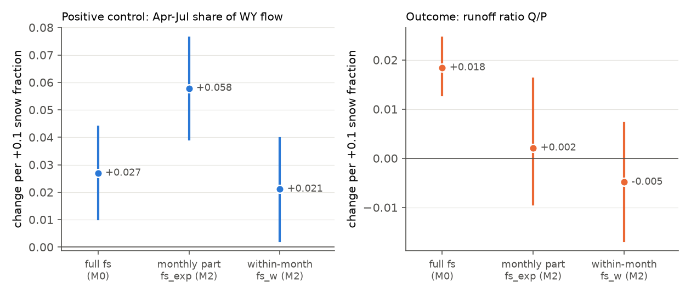
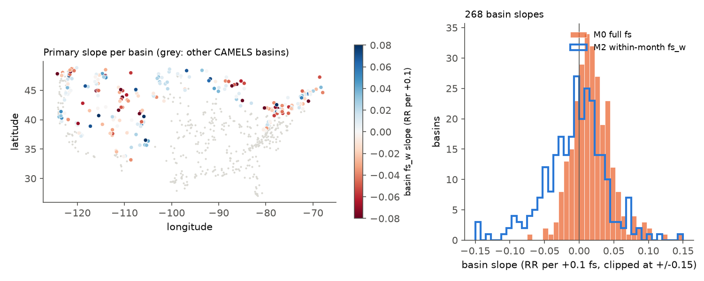

# The year-to-year snow fraction link to runoff ratio in 268 US snow basins followed the winter share of precipitation, not the rain or snow phase, in water years 1981-2014

## Summary

Berghuijs et al. (2014) reported that catchments with a larger fraction of precipitation as snow (fs) have more runoff. They also reported this link from year to year inside catchments. If the phase of precipitation controls runoff, then a warmer climate with less snow will give less water.

From year to year, fs changes with temperature and with the season of precipitation. These two factors also change evaporation. Thus a plain year-to-year link does not show that the phase itself has an effect. We separated fs into two parts:

- **fs_exp (monthly part):** the snow fraction that the monthly precipitation totals and the daily temperatures of each month give if precipitation is spread evenly over the days of the month.
- **fs_w (within-month part):** fs minus fs_exp. This part changes only when precipitation falls on the colder or the warmer days of the same month.

We used 268 CAMELS reference basins with a long-term snow fraction of 0.15 or more (8,895 basin water years, WY 1981-2014). In each basin, we fitted the annual runoff ratio (RR = Q/P) on the snow fraction parts and climate controls. Then we calculated the mean of the basin slopes and a bootstrap that resamples whole water years.

Main results, per +0.1 snow fraction:

| Model | Predictor | Change in RR | 95% interval |
| --- | --- | --- | --- |
| Across basins, aridity controlled (context) | mean fs | +0.057 | +0.051 to +0.063 |
| M0: ln P | fs | +0.018 | +0.013 to +0.025 |
| M1: ln P, T | fs | +0.014 | +0.007 to +0.022 |
| M1b: ln P, T, winter share of P | fs | -0.002 | -0.010 to +0.007 |
| M2: ln P, T, winter share, fs_exp | fs_exp | +0.002 | -0.009 to +0.016 |
| **M2 (primary)** | **fs_w** | **-0.005** | **-0.017 to +0.007** |

1. The plain year-to-year link was positive (M0, M1). This agrees in direction with Berghuijs et al. (2014). It was approximately one third of the across-basin slope.
2. When we added the winter (October-March) share of precipitation, the link went to zero (M1b). A +0.1 winter share gave +0.029 RR (95% interval +0.023 to +0.036).
3. The within-month part fs_w had no clear effect on RR (primary test). The interval includes zero and excludes the M0 and M1 point estimates. By our written plan, this means that the year-to-year link does not come from the phase itself when the monthly climate is fixed.
4. **Positive control.** fs_w moved flow into April-July: +0.021 share of WY flow per +0.1 fs_w (+0.002 to +0.040). This is 78% of the shift that the full fs gave in M0 (+0.027). Thus fs_w marks real snow storage. If the RR effect were in proportion to this storage shift, we expect approximately +0.014 RR per +0.1 fs_w. The upper limit of the interval, +0.007, excludes this value. (This scale argument was added after the first results; it was not in the plan.)
5. All sensitivity tests gave fs_w slopes from -0.003 to -0.008 with intervals that include zero (Figure 1). A placebo with the next year's fs_w also gave no effect.

**Limitations.** The test uses year-to-year changes in storm temperature inside a month. Snow from these changes is often a short-term store. A long-term change of climate removes snowpack in all months. Thus our result does not show that a warmer climate keeps runoff the same. It shows that the year-to-year link in these data is not evidence for a phase effect. The data are 1981-2014 only, the phase comes from a temperature rule on Daymet basin means, and the precipitation has gauge errors for snow.



*Figure 1. Mean of 268 basin slopes of the annual runoff ratio for +0.1 snow fraction, with 95% water-year bootstrap intervals. Grey: across-basin slope (context). Orange: plain year-to-year models. Blue: models with the winter share of precipitation or with the snow fraction split into parts. Open circles: sensitivity tests and the placebo for the primary within-month part fs_w.*

## Question and prior work

Berghuijs, Woods and Hrachowitz (2014, [doi:10.1038/nclimate2246](https://doi.org/10.1038/nclimate2246)) used the Budyko framework on US catchments. Catchments with a higher snow fraction had a higher runoff ratio at the same aridity. They also reported a year-to-year link inside catchments. Barnhart et al. (2016, [doi:10.1002/2016GL069690](https://doi.org/10.1002/2016GL069690)) linked runoff to the snowmelt rate. Musselman et al. (2017, [doi:10.1038/nclimate3225](https://doi.org/10.1038/nclimate3225)) projected slower snowmelt in a warmer climate. Jenicek and Ledvinka (2020, [doi:10.5194/hess-24-3475-2020](https://doi.org/10.5194/hess-24-3475-2020)) found that snowmelt is important for summer low flow in Czech catchments. Milly (1994, [doi:10.1029/94WR00586](https://doi.org/10.1029/94WR00586)) showed that the season of precipitation relative to evaporation demand changes the annual water balance.

A year with more snow is usually a colder year, and a year with more winter precipitation. Both factors decrease evaporation, and both factors increase fs. Our question was: **does fs change annual runoff when the monthly amounts of precipitation and the monthly temperatures are fixed?**

Campaign context. A search of the local campaign found no study of snow fraction and runoff. Related campaign studies used CAMELS for drought recovery ([sci:sha256:664b208c...](sci:sha256:664b208cefa5e9bb1114a6ccf84255fc886f296b6f72198e385cbc30055fa7af)), wildfire runoff ([sci:sha256:07ca7c27...](sci:sha256:07ca7c27870e5db5585553e28f4a17aeabff4e7a5fec234eb10b3f6962baa792)) and daily recession memory ([sci:sha256:88eddf50...](sci:sha256:88eddf50d9c7f470c5100e90784ddb4ed2d9c0121a63d83268b4bf573f7be159)). We reused the verified member manifest and the retrieval code of the last study.

## Data

| Data | Source and version | Use |
| --- | --- | --- |
| CAMELS US basin-mean Daymet forcing (prcp, tmax, tmin), daily | Newman et al. 2015 ([doi:10.5194/hess-19-209-2015](https://doi.org/10.5194/hess-19-209-2015)); `basin_timeseries_v1p2_metForcing_obsFlow.zip`, Zenodo record 15529996, v1.2 | Precipitation, temperature, snow fraction parts |
| CAMELS US USGS daily streamflow with QC flags | Same archive | Annual runoff, flow timing |
| CAMELS attributes `camels_clim.txt`, `camels_topo.txt`, `camels_name.txt` | Addor et al. 2017 ([doi:10.5194/hess-21-5293-2017](https://doi.org/10.5194/hess-21-5293-2017)); Zenodo record 15529996 | frac_snow (basin selection), aridity, GAGES-II area, HUC-02 region |

The shared campaign dataset store had no CAMELS time-series data. We retrieved the 1,342 needed members (671 forcing files, 671 flow files) by HTTP byte ranges into job-local scratch (about 186 MB). Each member was checked against its ZIP CRC, length and SHA-256 in `files/data/source_members.json`. All 1,345 listed members matched. The source archive has the provider MD5 `8e9a466710e8270b58f01d332a87184f`; we did not download or hash the complete archive. The attribute files are in `files/data/` with their hashes in `files/data/provenance.json`. We did not read or change any shared dataset.

Check: the basin-mean fs from our rule correlated with the CAMELS frac_snow at r = 0.994 over 671 basins. Our values were a median 0.82 times the CAMELS values (different period and definition details). We use CAMELS frac_snow only to select basins.

## Methods

The full plan is in `files/analysis_plan.txt`. We wrote it before we ran any outcome regression. Models M1b, M0_AMJJ and M2_fsexp_AMJJ, the across-basin slope, the winter-share slope and the scale argument in result 4 were added after the first results. They are diagnostics.

**Water-year table** (`files/code/extract.py`). Water year (WY) is October-September, WY 1981-2014. Daily Tmean = (tmax + tmin)/2. Primary rule: precipitation is snow when Tmean <= 0 C. fs = snow precipitation / P. For each calendar month m in the WY, the expected snow is P_m times the fraction of days in m with snow temperature. fs_exp = (sum of expected snow) / P, and fs_w = fs - fs_exp. Winter share = October-March P / P. Runoff Q (mm) comes from the daily flow in cubic feet per second and the GAGES-II area. A WY is valid if 95% or more of its days have flow (flag M and negative values are missing). Missing days in a valid WY get the WY mean flow for the totals. Flow centroid CT is the flow-weighted day after 1 October. AMJJ is the April-July share of WY flow.

**Models** (`files/code/analyze.py`). For each basin with 25 or more valid WYs, we fitted ordinary least squares models on standardized predictors and converted slopes back to physical units:

- M0: RR ~ ln P + fs
- M1: RR ~ ln P + T + fs
- M1b: RR ~ ln P + T + winter share + fs
- M2 (primary): RR ~ ln P + T + winter share + fs_exp + fs_w

The primary statistic is the mean of the basin slopes for fs_w. Intervals come from 2,000 bootstrap draws. Each draw resamples the 34 water years with replacement and uses the same years for all basins. This keeps the spatial correlation between basins. Each basin model is refitted with year weights in each draw.

**Checks.** Outcome ln Q in place of RR; snow rules Tmean <= 1 C and a linear ramp (all snow at -1 C, all rain at +3 C); an added control for the share of P on the 10 wettest days; basins with frac_snow >= 0.30; western (HUC-02 10-18) and eastern (HUC-02 01-09) basins; all 671 basins; and a lead placebo with the next WY's fs_w. Positive controls: CT and AMJJ as outcomes of M2.

## Results

### Size of the snow fraction parts

Inside a basin, the median standard deviation over years was 0.070 for fs, 0.063 for fs_exp and 0.035 for fs_w. The median correlation with annual mean temperature was -0.45 for fs and +0.03 for fs_w. Thus fs_w is almost independent of the annual temperature, as the design intends.

### Runoff ratio

All results are in `files/results/summary.json` (slopes per +1 fs; multiply by 0.1 for the values in this text).

| Sample / model | Basins | Mean slope per +0.1 | 95% interval | Median slope |
| --- | --- | --- | --- | --- |
| snow >= 0.15, M2 fs_w, T <= 0 C (primary) | 268 | -0.005 | -0.017 to +0.007 | -0.002 |
| snow >= 0.15, M2 fs_w, T <= 1 C | 268 | -0.006 | -0.017 to +0.006 | -0.003 |
| snow >= 0.15, M2 fs_w, ramp | 268 | -0.008 | -0.023 to +0.007 | -0.006 |
| snow >= 0.15, M2 + 10-wettest-day share | 268 | -0.006 | -0.018 to +0.007 | -0.003 |
| snow >= 0.30, M2 fs_w | 123 | -0.007 | -0.022 to +0.007 | -0.003 |
| snow >= 0.15 west, M2 fs_w | 159 | -0.003 | -0.016 to +0.010 | -0.001 |
| snow >= 0.15 east, M2 fs_w | 109 | -0.008 | -0.033 to +0.018 | -0.003 |
| all basins, M2 fs_w | 671 | median only | median -0.015 to +0.007 | -0.002 |
| snow >= 0.15, lead placebo (next WY fs_w) | 267 | -0.008 | -0.020 to +0.005 | -0.004 |
| snow >= 0.15, M2 fs_w, outcome ln Q | 268 | +0.007 (log units) | -0.027 to +0.041 | -0.001 |

For all 671 basins, the mean is not stable because some warm basins have almost no fs_w variation; we report the median. In the primary sample, 4% of basins had a positive fs_w slope with |t| > 1.96 and 6% had a negative one. Chance alone gives approximately 2.5% for each sign.

The bootstrap standard error of the primary mean was 0.0062 per +0.1 fs_w. Thus the test has approximately 80% power to detect a true mean effect of 0.017 RR per +0.1 fs_w (2.8 standard errors). This is near the M0 estimate.

### Positive control: flow timing



*Figure 2. Left: change in the April-July share of WY flow per +0.1 of each snow fraction predictor. Right: change in the runoff ratio for the same predictors. The within-month part fs_w moves flow into spring and summer, as snow storage must do, but it does not change the runoff ratio.*

| Outcome | Predictor | Mean per +0.1 | 95% interval |
| --- | --- | --- | --- |
| AMJJ share | fs (M0) | +0.027 | +0.010 to +0.044 |
| AMJJ share | fs_exp (M2) | +0.058 | +0.039 to +0.076 |
| AMJJ share | fs_w (M2) | +0.021 | +0.002 to +0.040 |
| CT (days) | fs_w (M2), snow >= 0.15 | +1.3 | -1.7 to +4.1 |
| CT (days) | fs_w (M2), snow >= 0.30 | +3.1 | +1.1 to +5.0 |

The AMJJ control passed in the primary sample. The CT control passed in the basins with more snow (frac_snow >= 0.30), but its interval included zero in the primary sample. Thus the instrument is clear for flow volume shares and weaker for the centroid date.

### Basin results



*Figure 3. Left: primary fs_w slope in each of the 268 basins (blue positive, red negative; grey dots are the other CAMELS basins). Right: distribution of the basin slopes for the full fs in M0 (orange) and for fs_w in M2 (blue outline). The M0 slopes are mostly positive. The fs_w slopes are centred near zero and are wider because fs_w varies less.*

Neither the western nor the eastern group had a clear positive mean fs_w slope (table above).

## Interpretation

In these basins, a year with a higher snow fraction had more runoff per unit precipitation. But the link went away when we controlled for the share of precipitation that fell in October-March. The part of the snow fraction that comes only from storm temperature inside each month moved flow into spring and summer, but it did not add runoff. The data agree with a seasonal water-balance effect (Milly 1994): precipitation in the cold season meets a low evaporation demand, whether it falls as rain or snow. The data do not support a separate year-to-year phase effect of the size of the plain association.

This result does not reject the across-basin relation of Berghuijs et al. (2014). That relation includes long-term snowpack, vegetation and soil adjustment, which year-to-year changes cannot test. It does show that the plain year-to-year link is not independent evidence for a phase effect, because the season of precipitation explains it.

## Limitations

- **Short-term snow only.** fs_w changes the phase of storms inside a month. Some of this snow melts in days. A warmer climate changes the phase in all months and shortens the snowpack season. Our test cannot measure that larger change. The positive control shows that fs_w changes spring-summer flow by 78% of the full-fs shift, but the storage duration can be different.
- **Phase rule.** We used a daily-mean temperature threshold on basin means. In mountain basins, the phase changes with elevation inside the basin. The three rules gave the same result.
- **Precipitation errors.** Daymet precipitation has gauge errors that are larger for snow. If snow undercatch is large, a snowier year has a lower measured P and a higher RR. This bias makes positive slopes more likely, so it does not explain our null result, but it adds noise.
- **Period and sample.** WY 1981-2014, reference basins with small human effect, annual data only. We did not test peak flow, low flow or groundwater recharge.
- **Controls.** The winter share is a simple seasonal control. Other seasonal patterns of precipitation can remain. The fs_exp slope was near zero once the winter share and T were in the model, so the monthly part did not add a phase effect either.
- **Power.** The intervals exclude the M0 and M1 point estimates, but they do not exclude effects smaller than approximately +0.007 RR per +0.1 fs_w.
- **Post hoc parts.** M1b, the winter-share slope, the across-basin slope and the scale argument were added after the first results. The primary test was fixed before the results.

## Reproduction

Requirements: Python 3.12 with numpy, pandas, matplotlib and requests (`files/code/requirements.txt`; versions in `files/data/provenance.json`).

```
bash files/code/reproduce.sh /absolute/work/dir stats   # statistics and figures from the bundled table (~10 min)
bash files/code/reproduce.sh /absolute/work/dir full    # also downloads the CAMELS members and rebuilds the table
```

`stats` mode rebuilt `summary.json` byte for byte from the bundled `basin_wy.csv` on the original machine. `files/code/audit.py` recalculated P, fs and fs_exp for 5 random basins with separate numpy code; the largest difference was 5e-7, from the 6-digit table precision (`files/results/audit.txt`).

## Files

- `files/analysis_plan.txt`: the plan written before the outcome models.
- `files/code/`: `retrieve.py` (byte-range download, from campaign publication 88eddf50), `ipv4_run.py` (IPv4 wrapper), `extract.py`, `analyze.py`, `extras.py`, `figures.py`, `audit.py`, `reproduce.sh`.
- `files/data/basin_wy.csv`: one row per basin and WY for 671 basins (SHA-256 `575688ec57f3c6757f15d6e825ca111e5ef342d1ba43a5c4081420a443a210e8`). Columns: P (mm), T (C), winter share, 10-wettest-day share, fs and fs_exp for three rules, flow valid fraction, Q (mm), CT, AMJJ.
- `files/data/source_members.json`: URL, byte offset, CRC and SHA-256 for every raw member. `files/data/provenance.json`: job, model, source versions, attribute hashes, software versions.
- `files/results/summary.json`: all pooled results. `per_basin_slopes.csv`: every basin slope and standard error. `extras.json`: across-basin and winter-share slopes. `fs_parts_by_basin.csv`: within-basin variation of the parts. `analysis_rows.csv.gz`: analysis table with derived columns. `draws_*.npy`: bootstrap draws of the pooled mean for the main models.

## Provenance

Job sci-1107-hp-earth-and-ocean-sciences-42a5f44cc85f, topic earth-and-ocean-sciences, machine hp, campaign 11_07_2026, account claude-myxtap. Analysis and text by the model claude-opus-5-5 (Claude Code) on 2026-11-08/09. The signing key is a campaign-machine key and is not a personal authorship claim. Upstream data are credited to their providers (NCAR CAMELS, USGS, ORNL Daymet). The baseline license covers the contributions of this publication and does not remove upstream terms.
