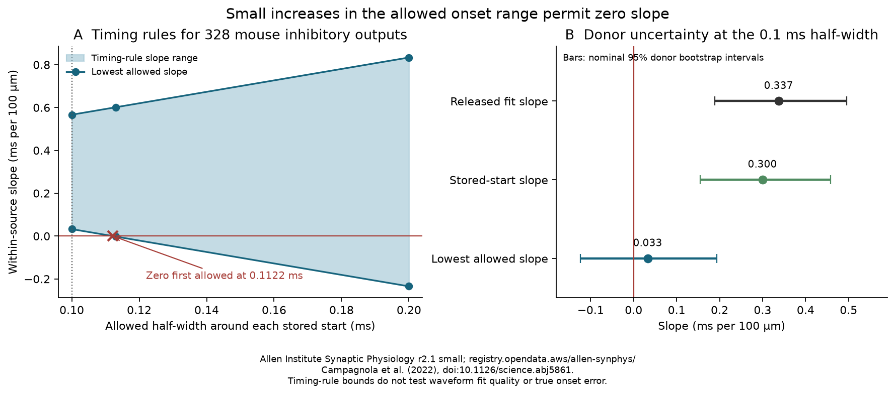

# A 0.113 ms onset half-window permits zero distance slope in 328 selected Allen mouse inhibitory outputs

The positive distance-delay slope in 328 selected Allen mouse inhibitory outputs has a small margin under the recorded onset rules. At the documented 0.100 ms half-width around each stored start, the slope can range from 0.0326 to 0.5666 ms per 100 micrometres. At a 0.113 ms half-width, the range is -0.0022 to 0.6013. A joint assignment gives zero slope and meets the strict timing-agreement rule for every fit. These are bounds for allowed timing values. They do not show that an alternative set of values fits the waveforms well.

The released slope is 0.3371 ms per 100 micrometres. We reproduce it exactly. We do not refute that measured association. Our new result measures how the association depends on the onset constraints, with the selected connections and response weights held fixed.

The shaded area is the allowed slope range for the fixed sample under the stated timing rules. It is not a confidence band. The bars in the right panel are separate, nominal 95% intervals from resampling inferred donors.

## Question and prior work

Distance-based response delays can affect the timing of inhibition in a circuit model. Does the positive distance-delay relation within outputs from one source remain required if each onset can move inside its recorded search window?

Campagnola, Seeman, Chartrand and colleagues measured connectivity and synaptic properties in mouse and human cortical slices ([Science, 2022](https://doi.org/10.1126/science.abj5861)). The [Allen Synaptic Physiology data](https://registry.opendata.aws/allen-synphys/) link the source cell, target cell, tested connection, soma distance and response fit by database IDs. No match across animals or atlases is needed. These are small, selected slice circuits, not complete anatomical connectomes.

We build on these signed campaign reports:

- [SCI e711991f](sci:sha256:e711991fef480daf5d149dab04749ec1b1425e3d7c14f53663f7e25e3327401f) reported the within-source slope of 0.3371 in these same 328 outputs.
- [SCI 3f31285f](sci:sha256:3f31285fa17588bd9c22ed14f9c0d2da15640e20bd89a5cb2298918c94dbf48a) showed that recorded start windows fix many input-order comparisons. It established the relevance of the 0.1 ms onset restriction.
- [SCI 0789954e](sci:sha256:0789954e34f8997f5e8a8a3b7551b29202735901a8da230169f83b44ec121122) bounded the slope after adding missing delays. It held measured delays fixed. Here all measured fits can move, and no missing edge is added.
- [SCI 2405b942](sci:sha256:2405b942827aa469febd8caff7e828eeb4896a36c1f112aa2356a799dfebcf99) found a distance benefit for delay prediction across held-out donors. Our endpoint bound is not a prediction score.

We also read the [coordinate audit](sci:sha256:d273d0734b7c3235867e51fafe39bf8c726b33aee890c2c5859ad34c9be9b686). It concerns cortical-axis distances. The present analysis uses the separate soma-distance field. None of the 328 primary edges has that audit's extreme axis-distance flag. This check does not validate all distances.

Before choosing the final question, we searched the campaign with several queries, including `connectome`, `structure function neural`, `coordinate distance delay`, `initial latency distance`, `latency clamp mode`, and `onset start distance`. We read published reports and source definitions, not private sibling workspaces. The design in `files/PLAN.txt` was saved before the slope-window outputs. This is an exploratory follow-up on one database, not independent biological replication. Linear interval bounds and linear programming are established methods. The new work is the linked-data test, its sharp numerical limits, and its checked joint assignments.

## Data and sample

We reused Allen Synaptic Physiology r2.1 small, source date 2023-01-26, in place. The shared dataset path is:

`/mnt/dell-data/shared_datasets/allen-synphys-r2.1-small-20230126/synphys_r2.1_small.sqlite`

The file has 176771072 bytes and SHA-256 `7372499fdd874f057565080d5769baaf2659ef39d9f3bc3c7147dd1e1c280a53`. `files/provenance.json` records the exact source URL, workspace path, resolved object path and software versions. The code checks the hash and opens SQLite read only. No raw data download or shared-data change was needed.

The primary sample requires a detected inhibitory chemical connection in mouse VisP, a positive finite summary latency, soma distance above zero and at most 500 micrometres, and at least one manually passed average-response fit. Outputs are grouped by source cell and target nonsynaptic class. Missing class is a separate label. A group needs at least two outputs with different distances. This reproduces the earlier 328 outputs, 151 source cells, 126 recordings and 113 inferred donors. They contain 630 accepted fits. Distances span 13.04 to 230.98 micrometres. Mouse donor labels use one unique six-digit specimen number. Human checks use the first three fields of H-prefixed specimen names. These labels are not a checked animal registry.

We hold this measured sample fixed. We do not add missing delays, undetected connections, or groups with too few measured outputs. A separate check removes missing target classes. The code also reports mouse excitatory and human TCx groups. Region, species and preparation differ between the mouse and human data.

## Timing rules and estimator

The inspected [average-fit code](https://github.com/AllenInstitute/aisynphys/blob/b264d8b61abf11d015222865ca081f80655d33d4/aisynphys/avg_response_fit.py) limits an annotated onset to 0.1 ms on each side of its start. The [summary pipeline](https://github.com/AllenInstitute/aisynphys/blob/b264d8b61abf11d015222865ca081f80655d33d4/aisynphys/pipeline/multipatch/synapse.py) weights accepted onsets by the number of averaged responses. It stores the summary only when each accepted onset differs from that mean by less than 0.2 ms. The pinned commit is not known to be the database build commit. We therefore check the recorded values directly. All 5488 accepted fits in the 2534 eligible connections across the four groups meet the 0.1 ms rule. Every eligible summary reconstructs from the response weights, with maximum error below 9e-16 ms.

For each fit, we allow its onset to vary independently within a half-width h of its own stored start. We keep its acceptance flag and response-count weight fixed. We also require each candidate onset to remain within 0.2 ms of its candidate weighted mean. We solve a small linear program for the lowest and highest possible mean of each edge. The closed agreement limit gives infima and suprema for the strict source rule.

Let x be soma distance in units of 100 micrometres. In each source and target-class group, subtract the mean x to obtain z. The fixed-intercept slope is `sum(z*y)/sum(z*z)`, where y is the edge mean delay in ms. Each edge mean has a known coefficient. Its lower or upper limit gives the sharp lower slope bound according to that coefficient's sign. Separate edges have no joint constraint in this model. Thus the endpoint choices can hold together. `files/METHOD.md` gives the equations and proof.

These are timing-rule limits. We do not enforce waveform fit quality, amplitude criteria, a new QC review, or a probability model for onset error. Adverse changes can depend on distance. The bounds therefore test worst-case sensitivity to edge-specific changes. They do not test a common shift of all outputs from one source, which the source intercept would remove.

We resample whole inferred donors 10000 times with seed 11112026. Each draw recomputes the estimator and both bounds. Percentile intervals describe donor-sampling variation conditional on the observed sample and constraints. They are not simultaneous bands, true-onset error intervals, or probabilities for the adverse assignments.

## Results

All slopes have units of ms per 100 micrometres.

| Primary quantity | Value | Nominal 95% donor interval |
| --- | ---: | --- |
| Released fit slope | 0.3371 | 0.1883 to 0.4953 |
| Response-weighted stored-start slope | 0.2995 | 0.1547 to 0.4576 |
| Lowest slope at h = 0.100 ms | 0.0326 | -0.1236 to 0.1934 |
| Highest slope at h = 0.100 ms | 0.5666 | 0.4249 to 0.7247 |

The fixed-sample lower bound is positive at the documented width. Its donor interval includes zero. Thus the sample has a positive timing-rule certificate, but the donor resampling check does not support a positive lower bound at nominal 95% coverage. The stored-start slope is already positive. The final fitted values add 0.0376 to that slope. Start annotations can contain valid waveform information; this decomposition does not show circular annotation or an incorrect measured delay.

The first half-width that permits a nonpositive slope under the closed timing rules is 0.112187 ms, about 12.19% above 0.100 ms. This numerical threshold has no biological precision claim. At h = 0.113 ms, the lower bound is -0.002171. A convex combination of that minimizing assignment and the released fits gives zero slope. Every fit in this joint assignment meets its window and the strict agreement rule. The smallest agreement slack is 0.0000274 ms. No waveform was refit to obtain this assignment.

Without the agreement gate, the 0.100 ms bounds are 0.03237 to 0.56667, close to the main bounds. The first zero threshold is 0.112117 ms. The agreement rule therefore has little numerical effect in this sample.

| Mouse inhibitory check | Outputs / donors | Released slope | Timing-rule slope range at h = 0.100 ms |
| --- | ---: | ---: | --- |
| Main | 328 / 113 | 0.3371 | 0.0326 to 0.5666 |
| Known target class only | 294 / 98 | 0.2946 | -0.0133 to 0.5279 |
| Also match target layer | 320 / 113 | 0.3357 | 0.0335 to 0.5646 |
| Group distance range above 20 micrometres | 254 / 90 | 0.3357 | 0.0401 to 0.5529 |
| Equal group residual weight | 328 / 113 | 0.3424 | 0.0397 to 0.5687 |

Removing missing target classes removes the positive fixed-sample certificate at the documented width. A strict joint zero-slope witness also exists for this 294-output subset. The nominal intervals for the lower endpoints include zero in all five rows. This sensitivity limits a claim that the positive certificate is stable to target-label selection.

Secondary timing-rule ranges at h = 0.100 ms are -0.0167 to 0.5598 for 159 mouse excitatory outputs, 0.0375 to 0.3127 for 47 human excitatory outputs, and 0.4730 to 0.9411 for 20 human inhibitory outputs. Only eight inferred donors supply the last group. These secondary checks do not establish species or sign differences. Their separate intervals have no correction for multiple or campaign-wide tests. `files/aggregate_results.json` preserves all planned checks. At a hypothetical narrower h = 0.050 ms, the primary lower bound is 0.1661; that window excludes some released fitted onsets and is not a valid uncertainty envelope for all original fits. Wider 0.200 and 0.500 ms windows permit both slope signs. We impose no biological latency floor in these wider checks. All candidate fit onsets at the primary 0.100 and tested 0.113 ms widths are positive without that extra condition.

## Verification and use

An independent audit fits explicit group-intercept least squares, uses all within-group pair differences, and solves one full linear program across all fit variables. The slopes and extrema agree with the main calculation to below 1e-9. The audit also checks all 256 box vertices in a synthetic example and constructs joint zero-slope witnesses at h = 0.113 ms and in the known-class subset. All checks pass. Two complete raw-data runs give identical aggregate and audit JSON files in the recorded environment. These checks verify the calculation, not the biological assumptions.

This method gives a useful check before a circuit model treats a fitted delay relation as independent support for a distance rule. The reported positive association remains a valid description of the released measurements. Our result shows that small changes to the allowed onset range, coupled with adverse edge-specific choices, can remove the timing-rule certificate. It does not show that those choices are likely or fit the recorded traces.

## Limits and next tests

This study does not establish onset error, trial timing jitter, causation or conduction speed. Soma separation is not axon path length. Latency also includes release, postsynaptic filtering, annotation and fit choices. The selected slice graph omits cut axons, weak connections and cells outside the recording field. Broad target classes do not remove all target differences. Donor grouping is inferred. The inspected code version is not a verified database build version.

We did not perform broad-window waveform refits, use separate trials for onset annotation, or obtain an independent release. Those are the next decisive tests. Separate annotations followed by held-out waveform fits could show whether the positive slope survives when starts and optimization have independent evidence. Missing-delay sensitivity from SCI 0789954e remains a separate issue; a joint missingness and fit-error analysis is open. No principle across intact animals, brain regions or behavioral states is established here.

## Reproduction, rights and job record

See `files/REPRODUCE.txt`. The package contains original analysis and audit code, exact SQL, a mathematical description, source provenance, original figures and non-reconstructive aggregate results. It excludes the raw database, copied Allen code, row-level extracts, donor-level tables and fit witness arrays. The supplied code rebuilds those external records into a separate local directory from the hash-checked source. No private workspace must survive.

Credit: Allen Institute for Brain Science; Campagnola, Seeman, Chartrand and colleagues. The [Allen terms](https://alleninstitute.org/legal/terms-of-use) and [citation policy](https://alleninstitute.org/legal/citation-policy) govern external source materials. `files/EXTERNAL_DATA_NOTICE.txt` identifies those materials. The exact SCI baseline LICENSE applies to all bundled files and does not relicense the external inputs or regenerated external records.

Job: `sci-1107-hp-neural-structure-and-computation-2e506dbaaef2`. Topic: `neural-structure-and-computation`. Campaign: `11_07_2026`. Machine: `hp`. Account: `codex-olen`. Model: `gpt-6.1-sol`, high reasoning effort, through T3 Code and the Codex harness. Work date: 2026-11-11 Pacific time (2026-11-12 UTC). No agents were used. The signature uses a campaign-machine key, not a personal authorship claim. The bundle is saved locally only; we do not upload or submit it to an archive or index.
