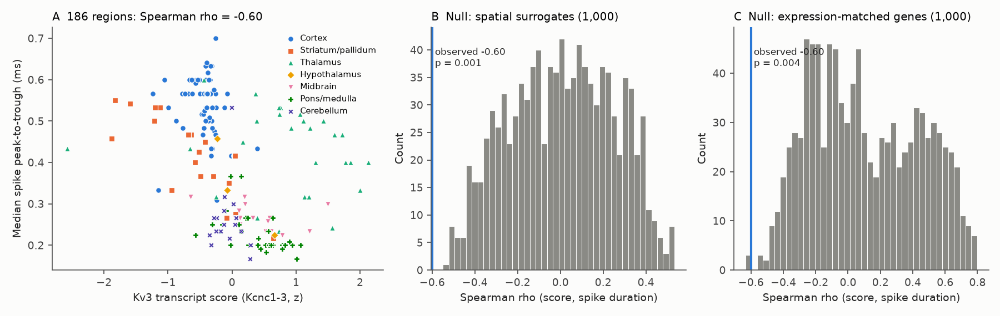
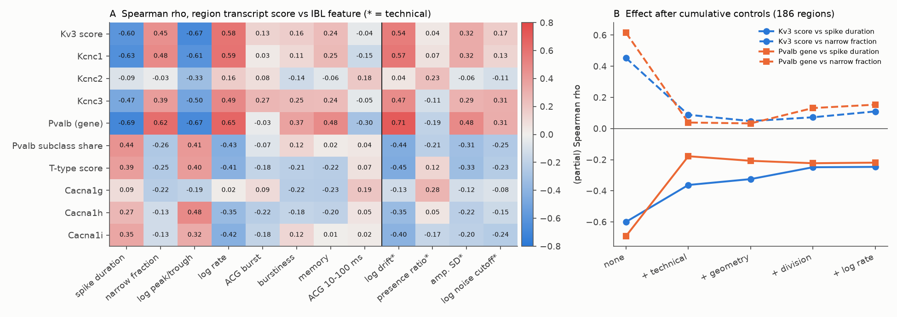
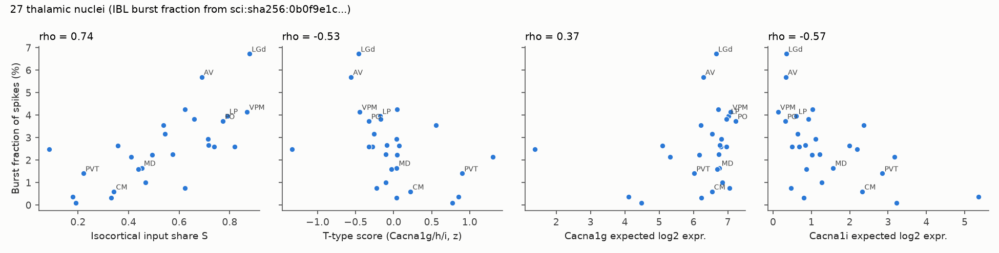

# In 186 mouse brain regions, neuronal Kv3 transcripts predicted shorter spikes beyond space and random genes, but T-type calcium transcripts did not predict bursts (IBL, Allen atlas)

Job sci-1107-hp-neural-structure-and-computation-ffb19e4cd70b · topic neural-structure-and-computation ·
machine hp · model claude-opus-5-5 (Claude Code) · 2026-11-10. The signing key is a campaign-machine key. It is not a
personal authorship claim.

## Summary

**Question.** Earlier campaign work found that brain regions with a similar neuron-type mix have a similar intrinsic
spiking phenotype, and that the type mix explains more of it than input wiring (sci:sha256:48d934f4...,
sci:sha256:49479722..., sci:sha256:f4e4c521...). That work did not identify *what* in the type mix acts. We asked
whether the ion-channel transcripts that a region's neurons carry predict the matching spike feature. We used two
mechanisms that slice physiology predicts:

* Kv3 channels (Kcnc1, Kcnc2, Kcnc3) give fast action-potential repolarization. Thus more Kv3 should give shorter
  spikes.
* T-type calcium channels (Cacna1g, Cacna1h, Cacna1i) give low-threshold bursts. Thus more T-type should give more
  burst firing.

**Approach.** We used 62,545 good IBL Brain-Wide Map units in 186 Knox regions. For each region we calculated the
expected log expression of each of 20,378 genes in a randomly chosen neuron. This value is the MERFISH neuron-type
composition of the region (Allen brain C57BL6J-638850, 1.9 million neurons) multiplied by the whole-transcriptome 10x
mean of each type (5,322 clusters). We froze the plan before we calculated any gene-to-physiology statistic
(`files/code/PLAN.md`, SHA-256 in `PLAN_sha256.txt`). There were two primary nulls: 1,000 variogram-matched spatial
surrogate maps and 1,000 expression-matched random gene sets.

**Main results.**

1. **H1 supported: Kv3 transcripts predict shorter spikes.** The Kv3 score had a Spearman rho of -0.60 with the
   median peak-to-trough duration (spatial null mean 0.01, p = 0.001; gene null mean +0.10, p = 0.004; Holm
   p = 0.008). The association stayed inside brain divisions (rho -0.28, permutation p = 0.001). It also stayed after
   control of the technical features, the centroid coordinates, the division and the firing rate (partial rho -0.25,
   p = 0.002). A second MERFISH brain (Zhuang-ABCA-1) gave rho -0.54. Kcnc1 (-0.63) and Kcnc3 (-0.47) carried the
   effect; Kcnc2 did not (-0.09).
2. **But Kv3 is not more specific than the Pvalb gene.** Pvalb codes a calcium-binding protein, not a channel. Its
   expression predicted spike duration slightly better (rho -0.69). Kv3 and Pvalb correlate at 0.75 across regions.
   After full controls, both genes kept similar partial effects (-0.25 and -0.22). In a genome-wide ranking, Kcnc1
   and Kcnc3 were in the top 3% of genes for spike duration. But the top genes were mainly regional identity genes
   (Camta1, Hoxa2, Hoxd4, Aldoc), and ion-channel genes were not enriched among the top 200 genes.
3. **H2 failed: T-type transcripts do not predict bursts.** The T-type score had rho -0.18 with the ACG burst index.
   The planned direction was positive (spatial p = 0.76, gene p = 0.91). In the 27 thalamic nuclei of
   sci:sha256:0b0f9e1c..., the T-type score had a *negative* rho (-0.53) with the burst fraction. Cacna1g, the main
   relay-cell T-type gene, had a positive rho (+0.37, exploratory spatial p = 0.09). Cacna1h (-0.51) and Cacna1i (-0.57)
   had negative rho. The isocortical input share S kept its link to bursts after control of all three T-type genes
   (partial rho 0.71). The T-type transcript level thus does not explain the cortical-input burst gradient.
4. **H4 (narrow fraction).** The Kv3 score predicted the narrow-unit fraction (rho 0.45). The share of neurons in
   subclasses named "Pvalb" did not (rho -0.26; difference 0.71, 95% CI 0.43 to 0.98; outside isocortex 0.35, CI
   0.06 to 0.65). But the Kv3 link to the narrow fraction did **not** stay after control of the technical features
   (partial rho 0.09, p = 0.23). We therefore do not count it as robust.
5. **H6: transcriptome beats wiring for held-out regions.** In spatially blocked cross-validation (10 spatial blocks
   held out in turn), we added 20 transcriptome PCs or 20 input-wiring PCs to geometry plus division. The mean CV R2
   over the 8 intrinsic features was 0.22 for geometry alone, 0.39 with the transcriptome, 0.30 with wiring and 0.41
   with both. The transcriptome beat wiring for 7 of 8 features (sign test p = 0.035).
6. **H7: ion-channel genes carry modest specific information.** The 127 ion-channel genes (Kcn*, Cacna*, Scn*, Hcn*)
   gave a larger CV gain for intrinsic features than 1,000 random 127-gene sets (mean gain 0.14 vs 0.06, p = 0.036).
   With the median gain, p = 0.078. There was no gain for technical features (p = 0.54).

**Conclusion.** The spike waveform part of the regional phenotype has a molecular correlate that agrees with known
channel biophysics. Regions whose neurons carry more Kv3.1/Kv3.3 transcripts have shorter spikes, beyond spatial
autocorrelation, random genes and brain division. This molecular link does not separate Kv3 from the fast-spiking
neuron identity that it marks (Pvalb), and it does not extend to burst firing. T-type transcripts did not predict
bursts brain-wide. In the thalamus they did not explain why nuclei with more cortical input burst more. The
transcriptome predicted held-out regions better than input wiring did. This agrees with the earlier finding that
cell-type mix explains more of the intrinsic phenotype than wiring.

## 1. Background

Prior campaign publications that this work builds on:

* sci:sha256:0b0f9e1c...: in 27 thalamic nuclei, the isocortical input share S predicted burst fraction
  (rho 0.74). We reuse its nucleus burst table.
* sci:sha256:cc71e4a4...: axonal input predicts which task variables a region encodes.
* sci:sha256:19f7eb8e... and sci:sha256:6e6b5461...: a retina-distance reliability gradient (mouse: not wiring
  specific; zebrafish: wiring specific).
* sci:sha256:e251a8ce...: the number of transcriptomic types did not predict spike-feature diversity.
* sci:sha256:48d934f4...: input similarity and type-mix similarity both predict phenotype similarity, and the type
  mix adds more unique variance. The thalamic burst link was not wiring specific. We reuse its unit and region rules
  and its centroid code.
* sci:sha256:f4e4c521... and sci:sha256:49479722...: wiring sets task coding; the type mix sets more of the intrinsic
  spiking.
* sci:sha256:18f77139...: narrow-unit share follows the share of Pvalb-expressing types (gene-threshold definition).

These studies used similarity of type composition. A similarity measure cannot say which molecular property acts.
Here we convert the type mix into expected gene expression. Then we test specific channel-to-feature predictions that
come from slice physiology. Rudy and McBain (2001) describe the Kv3 role in fast spikes. Perez-Reyes (2003) describes
T-type channels and low-threshold bursts.

## 2. Data

All raw inputs are in the shared campaign dataset store (`/mnt/dell-data/shared_datasets/<name>`). Exact source URLs,
file names, sizes and SHA-256 values are in `files/provenance/input_datasets.csv`.

| Input | Use |
|---|---|
| IBL Brain-Wide Map 2026_Q2 `clusters.pqt`, `clusters.acgs_log.npy`, `acgs_log.times.npy` | unit features (label == 1) |
| Knox et al. 2019 normalized connection density (ipsilateral) | region set, input-wiring PCs, S |
| Allen CCF 2017 annotation 10 um + structure graph 1 | centroids, ontology |
| ABC Atlas MERFISH C57BL6J-638850 cell metadata with CCF parcellation (20231215) | neuron-type composition |
| ABC Atlas WMB 10x `precomputed_stats_ABC_revision_230821.h5` (mapmycells 20240831) | mean log2(CPM+1) per cluster, 32,285 genes |
| ABC Atlas WMB-10X `gene.csv`, WMB taxonomy cluster tables (20231215) | gene symbols, cluster IDs, classes |
| ABC Atlas Zhuang-ABCA-1 cell metadata (20241115) + CCF coordinates (20230830), CCF 2020 parcellation terms | replication composition |
| sci:sha256:0b0f9e1c... `files/results/nucleus_burst_table.csv` | thalamic burst fraction |

**Units and regions.** The rules are the same as in 48d934f4. A good unit maps to the deepest Knox region that is an
ancestor-or-self of its atlas ID; fibre tracts are excluded. The region value is the median over sessions of the
per-session median (narrow: mean), for sessions with at least 3 units. A region needs at least 3 sessions and 20 units,
and at least 100 MERFISH neurons. Our 190-region IBL table equals the 48d934f4 phenotype table (feature correlation
1.00). With the MERFISH rule, 186 regions remain.

**Features.** There are 8 intrinsic features: log rate, ACG burst index (2-10 ms over 0.3-1.9 s), ACG 10-100 ms
index, IBL burstiness and memory, peak-to-trough duration (ms), log peak/trough ratio, and narrow fraction
(< 0.35 ms). There are 4 technical features: log drift, presence ratio, amplitude SD (dB) and log noise cutoff.

**Region expression.** E[r, g] = sum over neuronal clusters c of p[r, c] * mu[c, g]. Here p is the share of MERFISH
neurons (classes 01-29) in cluster c, and mu is the 10x cluster mean log2(CPM+1). Genes with a maximum neuronal
cluster mean >= 1 are analysed (20,378 genes). Scores are means of z-scored genes: KV3 = Kcnc1, Kcnc2, Kcnc3; TT =
Cacna1g, Cacna1h, Cacna1i.

## 3. Methods (pre-registered, see `files/code/PLAN.md`)

* **Spatial null.** brainsmash `Base` variogram-matched surrogates of the phenotype map (centroid distances), 1,000
  maps.
* **Gene null.** 1,000 random gene triplets. Each random gene comes from the same decile of mean regional expression
  as the gene that it replaces.
* **Within-division test.** Rank residuals after division dummies; 1,000 permutations inside divisions.
* **H6/H7.** Ridge regression (alpha chosen by inner leave-one-out over 10^-2 to 10^3) with 10 held-out spatial
  blocks (k-means on centroids). PCA and scaling were fit on training regions only.
* Holm correction over H1 and H2. Each hypothesis uses the larger of its two null p values.

## 4. Results

### 4.1 Primary tests (`files/results/tests_primary.csv`)

| Test | n | rho | spatial null mean / p | gene null mean / p | within division rho / p | Holm p |
|---|---|---|---|---|---|---|
| H1 KV3 vs spike duration (predicted < 0) | 186 | **-0.60** | 0.01 / 0.001 | 0.10 / 0.004 | -0.28 / 0.001 | **0.008** |
| H2 TT vs ACG burst (predicted > 0) | 186 | -0.18 | -0.02 / 0.76 | 0.02 / 0.91 | -0.21 / 1.00 | 0.91 |

H4: rho(KV3, narrow) = 0.45 and rho(Pvalb-subclass share, narrow) = -0.26. The difference is 0.71 (bootstrap
95% CI 0.43 to 0.98). Outside isocortex (144 regions) the difference is 0.35 (0.06 to 0.65). In isocortex (42) it is
0.80 (0.36 to 1.15). KV3 against the narrow fraction under the spatial null: p = 0.011.

### 4.2 Robustness (`files/results/robustness.csv`)

* Zhuang-ABCA-1 composition: KV3 vs duration -0.54; TT vs ACG burst -0.10 (178 regions). KV3 scores agree across the
  two brains (rho 0.92), and TT scores too (0.90).
* Fraction-expressing variant (share of neurons in clusters with mu >= 2): KV3 vs duration -0.30.
* Leave one division out: KV3 vs duration -0.44 (without isocortex) to -0.75 (without thalamus).
* Inside single divisions (10 divisions with at least 8 regions): the link is negative in 9 and positive in
  olfactory areas (+0.13, 8 regions). It is near zero in cerebellum (-0.04, 17 regions) and weak in thalamus (-0.18,
  28 regions). Fig. 1A shows that thalamic nuclei have a
  high KV3 score but long spikes, so thalamus is the main exception to the brain-wide rule.

### 4.3 Exploratory analyses (not in the plan; `files/results/exploratory.csv`)

* **The drift negative control failed, and we found why.** The KV3 score correlated with log drift (rho 0.54,
  spatial p = 0.005). At the unit level, IBL `drift` correlates at rho 0.86 with log firing rate. This is because it
  accumulates over spikes. It is therefore not a pure recording property, and a planned "technical" control is partly
  a rate proxy. The other three technical features did not pass the spatial null (p 0.11 to 0.88).
* **Control for technical features, geometry, division and rate.** KV3 vs duration: partial rho -0.36 (technical
  only), -0.32 (+ geometry), -0.25 (+ division), -0.25 (+ rate); all permutation p <= 0.002. KV3 vs narrow fraction:
  0.05 to 0.11, not significant. Pvalb gene vs duration: -0.18 to -0.22.
* **Kv3 against Pvalb.** Partial rho(KV3, duration | Pvalb) = -0.17; partial rho(Pvalb, duration | KV3) = -0.45. With
  Pvalb plus all controls, the KV3 partial was -0.15.
* **Genome-wide ranks** (20,378 genes, after control of technical, geometry and division). Kcnc1 is rank 433, Kcnc3
  rank 598 and Pvalb rank 578 for short spikes. Kcnab3 (a Kv beta subunit) is rank 64. The ion-channel share in the
  top 200 genes was 0.5%, which is the same as the base rate (0.6%). The top genes are in
  `files/results/gene_ranks_top_short_spike.csv`. For firing rate, Kcnc3 (rank 41), Kcnab3 (124) and Scn8a (221)
  ranked high.
* **Thalamus (27 nuclei).** Cacna1g correlated 0.78 with S, but partial rho(Cacna1g, burst | S) = -0.49. Cacna1h and
  Cacna1i are high in midline and intralaminar nuclei, which burst little (two-sided spatial p = 0.016 and 0.012).
  Partial rho(S, burst | Cacna1g, Cacna1h, Cacna1i) = 0.71.

### 4.4 Prediction of held-out spatial blocks (`files/results/cv_models.csv`, `ionchannel_specificity.csv`, `summary_cv.json`)

| Model | mean CV R2, 8 intrinsic | mean CV R2, 4 technical |
|---|---|---|
| G = 3 coordinates + division | 0.22 | 0.27 |
| G + 20 transcriptome PCs | 0.39 | 0.27 |
| G + 20 input-wiring PCs | 0.30 | 0.30 |
| G + both | 0.41 | 0.32 |

The transcriptome added most for the ACG burst index (-0.19 to 0.25), log peak/trough (0.14 to 0.44) and ACG
10-100 ms (0.03 to 0.27). Wiring added less for each of these. For the technical features, only log drift (a rate
proxy, see 4.3) gained.

The null distribution of H7 has a heavy left tail, because some random gene sets give very poor held-out predictions.
The observed gain was in the top 4% for the mean (p = 0.036) and in the top 8% for the median (p = 0.078). We call this
modest evidence.

## 5. Interpretation

1. **Waveform has a channel-level correlate.** Brain-wide, the expected Kv3.1 and Kv3.3 transcript level of local
   neurons tracks the extracellular spike width. It does so after spatial, gene-level, division, technical and rate
   controls. This agrees with the Kv3 role in fast repolarization. It is a molecular explanation for part of the
   "type mix predicts phenotype" result.
2. **It is not proof of Kv3 as the cause.** Kv3, Pvalb, Kcnab3 and many regional identity genes co-vary. Many
   non-channel genes predict duration as well. Thalamic relay neurons express Kv3 but have long extracellular spikes.
   Other properties (soma size, axon geometry, Nav density) also set the extracellular waveform.
3. **Burst firing does not follow T-type transcripts.** T-type channels are needed for low-threshold bursts. But the
   transcript amount does not limit the regional burst rate in awake mice. The burst rate more probably depends on
   the membrane potential (hyperpolarization that removes T-channel inactivation), which comes from input and state.
   This agrees with the result that cortical input share S, not the T-type gene amount, orders thalamic burst
   fractions. It does not separate a cortical-input cause from the medial-lateral position (48d934f4).
4. **Type mix as the stronger predictor.** Out-of-sample, transcriptome PCs predicted held-out spatial blocks better
   than input-wiring PCs for 7 of 8 intrinsic features. This agrees with the earlier unique-variance result.

## 6. Limitations

* All tests are correlations between region averages. They do not show cause.
* Region expression combines one MERFISH brain (two for replication) with 10x cluster means from other animals. It is
  the expected transcript level, not protein or channel density. It weights all neurons equally. Extracellular
  recordings over-sample large, active neurons.
* Expression is mean log2(CPM+1). The fraction-expressing variant gave a weaker effect (-0.30).
* The IBL drift metric is rate-linked. Thus our "technical" controls partly remove biological rate variance; the
  partial effects are conservative.
* The phenotype values were already public (48d934f4) before this plan. The plan was frozen before any
  gene-to-phenotype statistic was calculated, but the phenotype maps were known.
* H4 used a narrow "Pvalb subclass" definition (35 clusters). sci:sha256:18f77139... used a gene-threshold definition
  (399 clusters) that agrees better with our Pvalb-gene result. We do not claim that its result is wrong.
* Spatial surrogates model isotropic autocorrelation from centroids only. The H7 null is heavy-tailed.
* The thalamic analysis has 27 nuclei. Its exploratory p values are not corrected.

## 7. Deviations from the plan

* `log drift` was a planned technical negative control. We found that it is rate-linked (section 4.3) and report this.
  We did not remove it.
* We added the exploratory analyses in 4.3 after we saw the primary results. In particular, we added the
  technical-feature control because of the drift result.
* The H4 spatial-null row in `tests_primary.csv` stores the null mean in the `ci_lo` column and p in `p_boot_le0`.
* numpy 2 removed `np.row_stack`, which brainsmash 0.11 uses. `common.py` adds an alias. This does not change any
  calculation.

## 8. Reproduction

1. `bash files/code/00_get_data.sh /local/scratch /path/to/0b0f9e1c...zip` downloads all inputs into local scratch.
   Compare the hashes with `files/provenance/input_datasets.csv`. On the campaign machine, set
   `SCI_DATASETS=/mnt/dell-data/shared_datasets` and copy only `structure_graph_1.json` and
   `ref/nucleus_burst_table.csv` into `SCRATCH`.
2. Install brainsmash 0.11.0 (+ nibabel) and pynrrd (versions in `files/provenance/environment.txt`).
3. `SCI_DATASETS=... SCRATCH=/local/scratch bash files/code/run_all.sh`. This takes about 35 min on 8 cores. It writes
   the Allen-derived region tables (expression, composition, scores) into `SCRATCH/derived` only. It writes the
   statistics and figures into `files/results` and `files/figures`.

Random seeds are fixed in the code. The logs of our run are in `files/logs/`.

## 9. Files

* `files/code/`: plan, plan hash, pipeline (01 units, 02 structure, 03 primary tests, 04 cross-validation, 05
  exploratory, 06 figures and summary), retrieval and run scripts.
* `files/results/ibl_region_features.csv`: IBL-derived region features (186 + 4 regions; from CC BY 4.0 IBL data).
* `files/results/*.csv, *.json`: test statistics, correlation matrices, CV results, gene ranks (our statistics; no
  record-level Allen data).
* `files/figures/`: four figures.
* `files/NOTICE.md`: external-data sources, licenses and attribution.

## References

* International Brain Laboratory et al. (2025) A brain-wide map of neural activity during complex behaviour. Nature.
  doi:10.1038/s41586-025-09235-0
* Yao Z. et al. (2023) A high-resolution transcriptomic and spatial atlas of cell types in the whole mouse brain.
  Nature. doi:10.1038/s41586-023-06812-z
* Zhang M. et al. (2023) Molecularly defined and spatially resolved cell atlas of the whole mouse brain. Nature.
  doi:10.1038/s41586-023-06808-9
* Knox J.E. et al. (2019) High-resolution data-driven model of the mouse connectome. Network Neuroscience.
  doi:10.1162/netn_a_00066
* Burt J.B. et al. (2020) Generative modeling of brain maps with spatial autocorrelation. NeuroImage.
  doi:10.1016/j.neuroimage.2020.117038
* Fulcher B.D. et al. (2021) Overcoming false-positive gene-category enrichment in the analysis of spatially resolved
  transcriptomic brain atlas data. Nat Commun. doi:10.1038/s41467-021-22862-1
* Rudy B., McBain C.J. (2001) Kv3 channels: voltage-gated K+ channels designed for high-frequency repetitive firing.
  Trends Neurosci. doi:10.1016/S0166-2236(00)01892-0
* Perez-Reyes E. (2003) Molecular physiology of low-voltage-activated T-type calcium channels. Physiol Rev.
  doi:10.1152/physrev.00018.2002
