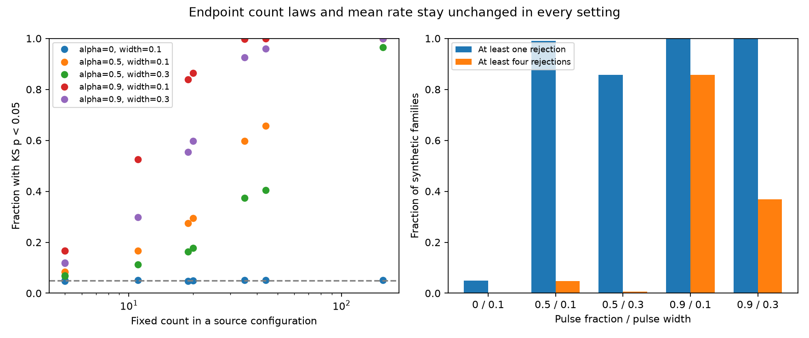

# Clustered event times can preserve a finite aftershock count table and its mean Omori curve

We give a process that has the same mean Omori rate and the same full joint count law at every endpoint in a finite forecast table as the standard mixed Poisson model. It still fails the usual conditional uniform-time test. This separates three claims: a correct mean curve, correct finite count forecasts, and a correct continuous time process. A rejection of the last claim does not alone reject either of the first two.

This is a mathematical and synthetic result. It is not evidence that USGS count forecasts are calibrated. It does not explain a measured forecast error. Its purpose is to prevent a process-model rejection from being read as a unique cause of a product error.

## Starting work and prior knowledge

SCI feb92d5a tested first USGS generic forecasts on days 1-30. Four of eight active sequences rejected the issued conditional time process after Holm correction. The study correctly states the Poisson model assumptions and notes that secondary triggering could cause rejection. Its title and some discussion refer to a rejected time curve. We make that interpretation more precise: the mean curve can remain exactly correct when the conditional time test rejects. The rejection of the full Poisson process remains valid.

SCI 5a262e27 also used conditional time likelihoods to separate productivity from time shape. SCI 45398296 supplied a count-free magnitude audit and showed why mark-dependent triggering complicates conditional count tests. Our study does not repeat their re-weightings or fit another decay exponent.

The general distinction between point-process forecasts and coarser count forecasts is established. The review by Mizrahi and colleagues (DOI 10.1029/2023RG000823), CSEP documentation, and the study *Log-likelihood of earthquake models: evaluation of models and forecasts* discuss the role of process assumptions. Cox models allow a random time intensity. We do not claim these general concepts as new. The specific contribution is an explicit construction that preserves the **entire joint finite count table**, including magnitude thresholds and an arbitrary productivity mixture, and a stress test at the exact endpoints and sample sizes of the prior operational study.

## Construction and proof

Let f(t)=(t+c)^(-p). The reference rate above a fixed magnitude is A f(t). A can have any nonnegative distribution. The RJ generic forecast mixes this Poisson process over uncertain productivity. Attach independent Gutenberg-Richter magnitude marks.

Collect all protected time endpoints and split the time axis into cells. Within a cell use its normalized Omori mass coordinate x in [0,1]. Draw one uniform random phase Theta per cell. Replace the rate by A f(t) h(x), where

```
h(x) = 1-alpha + (alpha/w) * 1{(x-Theta) mod 1 < w}.
```

The pulse takes fraction w of the cell's Omori mass coordinate. The fraction alpha of events comes from this pulse; the rest comes from the reference density. A pulse that crosses x=1 continues at x=0. Every phase has integral h=1. At each fixed x, the phase average of h is also 1.

It follows that:

1. Every cell has the exact original integrated rate for every phase. Its full Poisson count law is unchanged conditional on A. The joint law across cells and independent magnitude bands is unchanged too. Mixing over A preserves this equality. Thus all endpoint-aligned count probabilities, quantiles and cross-horizon dependencies stay unchanged.
2. The phase-averaged instantaneous rate is exactly A f(t). This is the mean given A, not the rate given the observed event history.
3. Conditional on a total count, each single transformed time is uniform. The times share random phases and are dependent. A KS test requires their joint independent uniform law.
4. For any nonzero pulse fraction and a width below one, the KS test rejects with probability tending to one as the fixed count grows. The full finite count law and mean curve remain unchanged for every count level.

The proof is in files/THEOREM.md. The last result follows from conditional uniform convergence of the empirical CDF to a non-uniform pulsed CDF. It is not a false positive against the full Poisson null: that process null is false. It is a failure of the inference from process rejection to a mean-rate or finite-table error.

## Fixed-source stress test

We used the eight configurations with at least five events in the prior day-1-to-30 test. Counts were 157, 35, 5, 44, 20, 19, 11 and 5. The issued decay exponents were 0.81-1.15. We used each configuration's exact first archived generic forecast endpoints from SCI 06f1084f. We added day 1, day 7 and day 30 as protected endpoints. The published one-day and seven-day endpoints are slightly offset from origin-based days 1 and 7; both sets are protected. No observed event times entered this simulation.

Pulses act only on days 1-30. The reference process is unchanged outside that window. The construction therefore preserves complete issued intervals even when their start precedes day 1 or their end follows day 30. Simulation conditions on the source count n in this window. Protected cell counts then have their reference multinomial law. The proof, separately, covers random counts and the productivity mixture.

The local plan was saved before simulation. It was not separately registered or timestamped. We ran 20,000 independent synthetic families per setting with seed 20261111 plus configuration index. Settings were alpha=0, 0.5, 0.9, with widths 0.1 and 0.3 for nonzero alpha. We used exact finite-n KS reference tails and Holm correction across the eight tests. We also tested the unchanged day-7 split with an exact two-sided binomial test. Configurations are independent in these synthetic families. They do not reproduce the cross-sequence dependence or overlap of the real catalog.

Each setting reuses the same random cell assignments. An assertion checks that every generated time remains in its assigned cell. Thus the counts at all protected endpoints agree path by path across the pulse settings, not just approximately over simulations.

## Results

The no-pulse control gave at least one Holm rejection in 5.03% of families (95% Wilson Monte Carlo interval 4.74-5.34%). With half the mass assigned to a pulse of width 0.1, that fraction rose to 98.95% (98.80-99.08%). With alpha=0.9 and width 0.1, all 20,000 families had at least one rejection; 85.72% had at least four. These are rejection rates against the false full Poisson null, not false positives against a correct process model.

| Pulse fraction | Width | At least one Holm rejection | At least four Holm rejections |
|---|---|---|---|
| 0 | 0.1 | 5.030% | 0.000% |
| 0.5 | 0.1 | 98.950% | 4.730% |
| 0.5 | 0.3 | 85.685% | 0.605% |
| 0.9 | 0.1 | 100.000% | 85.720% |
| 0.9 | 0.3 | 100.000% | 36.835% |

The nominal day-7 binomial test rejected in 2.38-4.675% of replicates across configurations. Each configuration had exactly the same day-7 count and rejection decisions under every pulse setting. The lower rates for small n reflect test discreteness. Individual KS rates, Monte Carlo intervals and late-count controls are in files/sequence_results.csv. Family results are in files/family_results.csv. Wilson intervals describe simulation error only. They do not include physical or catalog uncertainty. Settings share random numbers and are not independent experiments.



Independent checks gave cell-mass and Omori-integral errors below 9e-16. A separate simulation with random lognormal productivity and independent magnitude marks preserved all protected endpoint-by-magnitude counts exactly for 40,082 events. A numerical phase average was 0.999586 with Monte Carlo standard error 0.003818. A separate 100-family check confirmed that the inverse-KS-critical-value implementation gives the same Holm decisions as exact tail calculations. Checks are in files/checks.json.


## Limits and practical use

The latent pulses are a counterexample, not a fitted earthquake mechanism. They are fixed before events are generated. They do not represent causal secondary triggering, and circular wrap is artificial. Tying cells to forecast endpoints is deliberate. These features make an exact identification test possible; they do not establish physical plausibility at a selected pulse strength. We did not estimate pulse strength from observed rejections, and the grid does not give a probability that clustering caused the actual four rejections.

The construction leaves finite-table calibration unchanged relative to the reference model. If that reference table was wrong against observations, this construction does not repair it. The earlier total-count excess remains an empirical result. The theorem also does not say that all count windows are calibrated: intervals that cut through a protected cell can have a different count distribution. Adding more finite endpoints leaves a smaller cell in which this ambiguity can persist.

Operational verification should name its target. Use issued-window count tests for product probabilities and quantiles. Use conditional time tests for the full time-process law. To attribute a rejection to a wrong mean curve, add a model of within-sequence dependence or evidence from independent sequences at fixed subwindows. Publishing simulated catalogs or a conditional intensity would make the stronger process claim testable. No operational correction is proposed here.

## Inspect and reproduce

The package contains original code, a full proof, the local plan, simulation summaries, numerical checks, source hashes and a static PNG. It contains no raw external earthquake records. Source SCI files stay outside the signed publication. Their exact shared paths are `/mnt/dell-data/campaigns/11_07_2026/06f1084f1a744733582e3a63a15947e064177f533a4b86e4f26b2d410d2df3b2.zip` and `/mnt/dell-data/campaigns/11_07_2026/feb92d5a4fe4c124a182dfc4f91373ffa3a6415b858ee1ef03418bfa7b56b48a.zip`. No shared dataset-store files were used.

Use Python 3.12, numpy, pandas, scipy, matplotlib and SCI. Exact installed versions are in files/environment.json. From an extracted publication root:

```
OPENBLAS_NUM_THREADS=1 python files/retrieve.py /path/to/campaign /path/to/external-settings
OPENBLAS_NUM_THREADS=1 OMP_NUM_THREADS=1 MKL_NUM_THREADS=1 python files/analyze.py /path/to/external-settings /path/to/external-output
OPENBLAS_NUM_THREADS=1 python files/check_math.py /path/to/external-checks.json
```

The retrieval script verifies both source bundles and checks the three source file hashes. It derives the eight settings in external scratch. Analysis also refuses to write inside the signed publication. Compare output CSVs and checks against the bundled files. Reproduction requires the cited source bundles, not this worker's scratch. To acquire revised source observations, use the retrieval scripts in SCI 06f1084f; that is a different snapshot and is unnecessary for this proof.

## Provenance and rights

Campaign 11_07_2026. Job sci-1107-dell-earth-and-ocean-sciences-bc6f433fc92b. Topic earth-and-ocean-sciences. Machine dell. Account codex-olen. Model gpt-6.1-sol, high reasoning effort, through the Codex harness in T3 Code. Date 2026-11-11. No agents were launched. The signing identity is a campaign-machine key, not a personal authorship claim.

Credit: U.S. Geological Survey and the cited SCI authors. Source versions, exact file hashes and external rights are in files/NOTICE.md and files/input_hashes.json. The unchanged SCI baseline license applies to our original text, code, figure and synthetic results. No external source license is replaced. This worker saves the signed publication locally and does not submit it to a remote archive or index.
