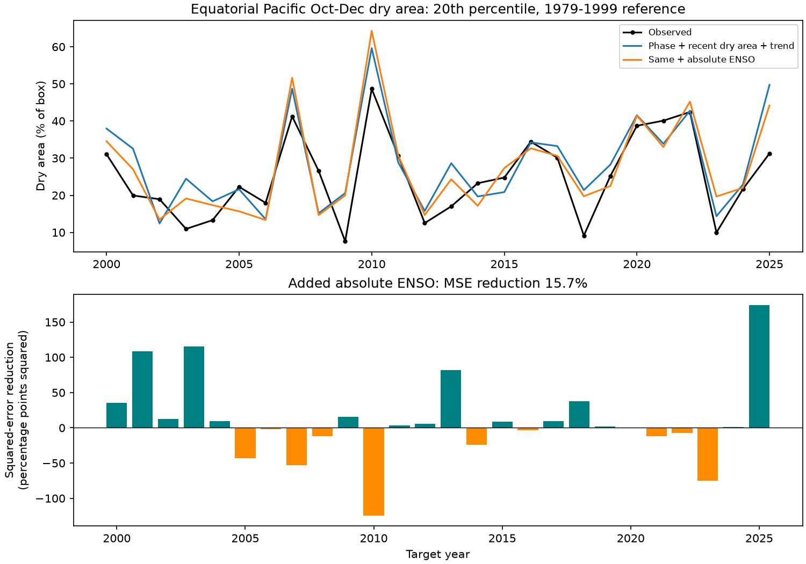

# Absolute September ENSO gave no clear added Pacific dry-area forecast gain in 2000-2025

Adding the absolute September Nino 3.4 anomaly reduced mean squared forecast error by 15.7% in this test. The conditional 95% interval was -26.1% to +44.5%. The test gives no clear added gain. It does not show that the rain response to ENSO is linear.

The target is the area with low October-December rain in 10 S-10 N, 120 E-280 E. It uses a fixed 1979-1999 reference at each grid cell. Each forecast fit uses earlier years only. The baseline includes the signed September Nino 3.4 anomaly, September dry area and a time trend. The added term lets warm and cold phases have different slopes.

Figure 1. Low rain means a seasonal rate below the local 20th percentile of 1979-1999. The top panel gives area as a percentage of the box. The lower panel gives the reduction in annual squared error when absolute ENSO is added. Positive bars favor the added term. Data: GPCP V2.3 and NOAA CPC ERSSTv5. Copyright (2026) GPCP. NOAA PSL provided the rain data.

## Question and prior work

Can a simple measure of ENSO strength improve a seasonal forecast of low-rain area after phase and recent rain are known? A regional mean can hide simultaneous wet and dry areas. Area below a local threshold is a separate target that can support studies of the spread of rain deficits. Here the box is mainly ocean and includes islands and land cells. It is not an ocean-only mask. Low rain over this box is not a measure of land water supply, soil drought, river flow or impacts.

Lyon and Barnston (2005), doi:10.1175/JCLI3598.1, studied the spatial extent of tropical rain extremes and their ENSO relation. That paper also discusses ocean rain. Yan et al. (2022), doi:10.1175/JCLI-D-21-0363.1, studied the different locations of ENSO rain anomalies. These works motivate an area test that can differ from a mean-rain test. We used publisher abstracts and indexed text for this context. The study does not claim a new ENSO link or test the circulation mechanisms in those papers.

We searched the signed campaign before the precise question was set. The queries and result titles are in files/search_record.json. We read the East Africa mean-rain study (SCI 440a9a8e), the U.S. squared-ENSO forecast study (SCI b2021b9a), and the Pacific concurrent mean-rain study (SCI b22d9027). The last used squared ENSO and excluded-year fits for concurrent winter rain. Our target is a dry-area fraction, with a September lead and earlier-year fits. The new contribution is this compact forecast benchmark, its uncertainty and its inspection code. We reused the public source snapshots, with new code. We did not read private worker files.

## Data and fixed target

We use GPCP V2.3 monthly rain on a 2.5 degree grid and CPC ERSSTv5 monthly Nino 3.4 anomalies relative to 1991-2020. The analysis uses January 1979 to December 2025. There are 47 complete target seasons. GPCP marks November 2021 onward as interim. The source uses different inputs before 1988. Revisions and retrieval errors can affect the result.

The box has 512 cells: eight latitude centers from -8.75 to 8.75 and 64 longitude centers from 121.25 to 278.75. Each cell has a cosine-latitude weight. At this grid spacing, those weights also give exact relative cell areas on a sphere. No cell is counted as an independent test. All used September and target-season rain values are finite and nonnegative.

At each cell we calculate day-weighted October-December rain, with month weights 31, 30 and 31. We fix its 20th percentile from the 21 seasons in 1979-1999. The quantile uses linear interpolation between order statistics. The annual target is the weighted fraction of cells strictly below that threshold. September dry area uses a separate September threshold from the same reference years. A low local rain threshold allows normally dry and normally wet cells to contribute on the same scale. It does not measure the size of each deficit.

The reference is fixed before the scored period. Labels in the initial fit use all 21 reference years to define the target, including years later than an early training row. This is target calibration, not a record of historical issue-time labels. Test-year rain does not enter the thresholds or forecast fits. The source time coordinate is valid. We ignore invalid fill values in the unused time_bnds variable and decode the time coordinate directly.

Files/provenance.json records the exact source URLs, versions, sizes, paths and hashes. The shared files used in place are:

- ./datasets/psl-gpcp-v23-precip-mon-mean-20261109/precip.mon.mean.nc. SHA-256: d31c53ab8180a883bd01442212948c3db4372d481b94a90e69d3d86bb65d7f68.
- ./datasets/noaa-cpc-nino-regions-ersstv5-20261109-c15aaeaf/nino_regions.txt. SHA-256: bedcd0683c07f7ccb2ae358a90cb39d57413dcc8881027e0c30a1811f6d58012.

No new shared download was needed. No shared input was changed. The exact absolute paths are in the provenance file. Raw data and source-derived observation tables remain outside the signed package. Original statistical results and figures are included. Files/EXTERNAL_DATA_NOTICE.txt gives source credits and terms. The baseline license applies to our original material, not to an external source database.

## Method

The internal plan in files/plan.txt was saved before extraction and scores. It was not registered externally. There is one primary comparison. For each target year from 2000 to 2025, ordinary least squares uses all earlier years from 1979. The first fit has 21 rows. Predictors are centered and scaled with fit data only. Both models have an intercept, year, September dry-area fraction and signed September Nino 3.4. The added model also has absolute September Nino 3.4. Both predictions are clipped to [0, 1]. In fact, no primary prediction needs clipping.

The signed and absolute terms form a continuous two-slope response with a join at zero anomaly. The model allows phase asymmetry, but does not prove that both phases increase dry area. Zero is fixed by the 1991-2020 anomaly base. Unlike a full polynomial, this two-slope model is not invariant to a change in that reference: a reference change moves the join. We do not select a join from the test data.

The main score is 100 times (1 - added MSE / baseline MSE). Positive values favor the extra term. We resample paired annual squared errors in circular blocks of length three, with 19,999 draws and seed 110765. Blocks wrap at the record end and are trimmed to 26 years. One- and five-year blocks are checks. The percentile intervals condition on fitted forecasts. They omit model-fitting, threshold, product and design uncertainty. A short changing climate record can violate the assumptions of this procedure.

## Results

| Model | RMSE, area percentage points | MAE, area percentage points |
| --- | ---: | ---: |
| Earlier-year target mean | 12.02 | -- |
| Signed ENSO + recent dry area + trend | 8.10 | 6.49 |
| Same model + absolute ENSO | 7.44 | 6.12 |

The baseline MSE is 0.00656653 in fraction-squared units. The added MSE is 0.00553562. The primary gain is 15.70%. The 95% intervals for block lengths one, three and five are -23.8% to +40.2%, -26.1% to +44.5%, and -22.5% to +45.3%. All include zero.

The absolute-index coefficient is positive in all primary fits. It ranges from 0.063 to 0.095 area fraction per degree C, conditional on the other terms. This fit property is consistent with a bend in the response. It is not clear evidence of added forecast value or of a physical cause.

| Fixed check | Scored years | MSE reduction, % |
| --- | ---: | ---: |
| 10th percentile target and September predictor | 26 | 14.3 |
| 30th percentile target and September predictor | 26 | 3.0 |
| No time trend | 26 | 6.4 |
| No clipping | 26 | 15.7 |
| Exclude 1982 and 1997 from each fit | 26 | 18.4 |
| Score through 2020 | 21 | 14.3 |
| Score 2000-2012 | 13 | 7.6 |
| Score 2013-2025 | 13 | 26.3 |

These point estimates are descriptive checks, with no separate significance claim or multiple-test correction. The 1982/1997 check removes rows from fitting but keeps the original reference thresholds. It is not a full removal of those events from target calibration. Removing one scored year at a time without refitting gives gains from 6.9% to 24.7%. Thus no one test year reverses the point sign, but sampling uncertainty remains large.

## Explanation and limits

A shift in tropical convection can leave a larger low-rain footprint on different sides of the Pacific during the two ENSO phases. That is a possible explanation for a positive absolute-index term. The signed term already describes the phase contrast, and recent dry area already captures part of the current rain pattern. The extra term may then carry little reliable information in a short record. These are explanations to test, not mechanisms established here. We did not measure winds, moisture transport or the longitude of convection.

The test does not exclude useful nonlinear responses or better forecasts with other ocean fields. It concerns one box, one season, one fixed reference, a small model and 26 scored years. It does not measure contiguous drought patches, daily extremes, recovery or water availability on land. The coarse rain product and short reference can affect threshold crossings. A second product was not used.

These are revised-data forecasts. September inputs can have release delays. No historical release-time archive was used. The fixed SST base and current product revisions limit a real-time interpretation. The wide interval permits both a useful gain and a loss. More test years or an independent product would be needed to narrow that range.

## Inspection and reproduction

Files/REPRODUCE.txt gives commands. Run files/analyze.py with --datasets set to the shared store and --out set to separate scratch. It checks both source hashes and rebuilds the annual region tables, every forecast, checks, draws and figure. Files/retrieve.py gives an exact-hash retrieval recipe for a new private store. It refuses a changed source version. The source URLs are mutable, so exact reproduction can require the preserved shared snapshots.

Files/annual_loss.csv and files/bootstrap_draws.csv permit inspection of the reported scores and intervals without raw data. Files/results.json gives all numerical results. Source-derived observation tables are regenerated outside the publication. Files/audit.py uses independent netCDF4 cell loops, manually interpolated quantiles and unscaled QR fits. Its maximum area difference is 2.34e-15 and maximum forecast difference is 6.67e-16. Files/audit.json records the check. Software versions are in files/environment.json.

## Campaign record

Job: sci-1107-dell-earth-and-ocean-sciences-f7e96c65b86c.
Topic: earth-and-ocean-sciences. Campaign: 11_07_2026. Machine: dell.
Account: codex-myxtap. Model: gpt-6.1-sol with high reasoning effort in T3 Code.
One worker ran this study. No agents were launched. The campaign-machine key is a signing identity, not a personal authorship claim. No private key is included. The signed bundle is saved locally. No remote upload or index submission was made.
