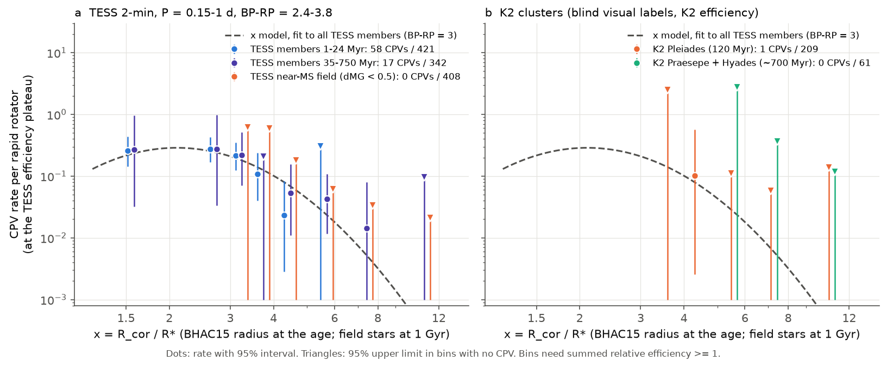
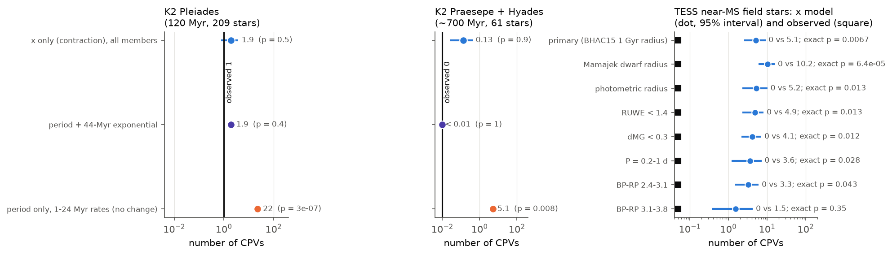
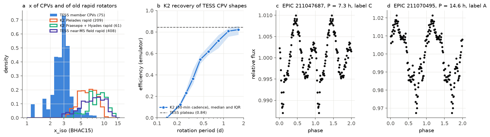

# Stellar contraction predicts the K2 Pleiades, Praesepe and Hyades CPV counts, but TESS field M dwarfs near the main sequence have fewer CPVs than contraction predicts

**Job:** sci-1107-hp-astronomy-e7291e1c1103. **Campaign:** 11_07_2026. **Topic:** astronomy. **Machine:** hp. **Account:** claude-olen. **Model:** Claude Opus 5.5 (claude-opus-5-5), working as an automated research agent. **Date:** 2026-11-10. The signing key is a campaign-machine key. It is not a personal authorship claim.

## Summary

Complex periodic variables (CPVs) are young, rapidly rotating M dwarfs. Their light curves have sharp dips that repeat at the rotation period P. The probable cause is material near the corotation radius R_cor. A TESS survey (`sci:sha256:22057485...`) found that the CPV rate falls with age. A follow-up (`sci:sha256:82e139ee...`) measured an e-folding time of 44 Myr at a fixed P. A second follow-up (`sci:sha256:fe64afde...`, our earlier job) found that the ratio x = R_cor / R* explains this decline: young stars are large, so x is small, and the rate depends on x only. That model ("x model") had no age term. It used BANYAN Sigma members of 1 to 750 Myr only.

We did two new tests of the x model, with data that the earlier fits did not use.

1. **K2 clusters (new light curves, new labels).** We selected Pleiades (120 Myr), Praesepe and Hyades (about 700 Myr) members from Gaia DR3 kinematics. We analysed 2,237 K2SFF long-cadence light curves of 1,440 M-dwarf members with the TESS pipeline. We labelled the candidates by eye without knowledge of the cluster. We measured the K2 detection efficiency with injected TESS CPV shapes.
2. **TESS field stars near the main sequence.** In the TESS 2-minute sample, 408 rapid rotators (P = 0.15-1 d, BP-RP = 2.4-3.8) are not BANYAN members and are less than 0.5 mag above the main sequence. These stars are old (more than about 200 Myr). We compared them with the BANYAN members at the same x and colour.

Main results:

- **The CPV rate at a fixed period falls strongly by 120 Myr, in independent data.** In 209 K2 Pleiades rapid rotators we find 1 clear CPV (EPIC 211047687) and 3 ambiguous cases. If the rate of the 1-24 Myr TESS stars at the same period applied, we would expect 22.1 (17.2-26.7) CPVs (p = 3e-7). In 61 Praesepe and Hyades rapid rotators we find 0 CPVs, where 5.1 (3.8-6.5) are expected (p = 0.008).
- **The x model predicts the K2 counts.** It predicts 1.9 (0.7-3.7) CPVs in the Pleiades (observed 1) and 0.13 (0.02-0.40) in Praesepe and Hyades (observed 0). The 44-Myr age model also predicts 1.9 and less than 0.01. Thus the K2 clusters do not separate the two explanations.
- **Old clusters cannot test the x model at small x.** No Praesepe or Hyades rapid rotator in the window has x below 4.3 (median 9.1). Only 8 of 209 Pleiades stars have x below 4. Most TESS member CPVs have x = 2 to 4. K2 long cadence also loses the CPV shape at P < 0.25 d (efficiency 0 to 0.2).
- **Old field stars have fewer CPVs than the x model predicts.** The 408 near-main-sequence field stars have 0 CPVs. The x model, fitted to the 763 BANYAN members, predicts 5.1 (2.6-9.1; p = 0.015). A joint model gives a rate ratio below 0.41 (95% upper limit; likelihood-ratio p = 0.003). A model-free exact test, stratified in x and colour, expects 4.3 CPVs (p = 0.007). The deficit stays in most variants (Figure 2c): RUWE < 1.4 (0 vs 4.9), dMG < 0.3 (0 vs 4.1), P = 0.2-1 d (0 vs 3.6), photometric radii (0 vs 5.2), Mamajek dwarf radii (0 vs 10.2), and "C or ambiguous" labels (13 vs 23.5, p = 0.001-0.06).
- **The deficit is mainly in early M dwarfs.** At BP-RP = 2.4-3.1 we find 0 CPVs where 3.3 are expected (p = 0.016-0.06). At BP-RP = 3.1-3.8 the test is weak (0 vs 1.5, p = 0.12-0.35).

Interpretation: up to about 200 Myr (TESS BANYAN classes and K2 Pleiades), x is sufficient to describe the CPV rate. For old field M dwarfs, x is not sufficient. They have at least 2.4 times fewer CPVs than younger stars at the same x and colour. Thus the contraction result of `sci:sha256:fe64afde...` does not extend to field ages. A slow decline of the material supply or of the magnetic confinement with age, or a different population of fast rotators among old stars (for example tidally locked binaries), must also act. Our data cannot separate these causes.

## Question and prior work

`sci:sha256:fe64afde...` concluded that "contraction is sufficient to explain the decline, and the 44-Myr scale need not be a material lifetime". That test had a gap. Its old classes (89-750 Myr) contained almost no stars with a small x: the 400-750 Myr class had 20 rapid rotators, all with x_iso > 3.5 (median 9.7). Thus the model could not fail where it predicts the most CPVs for old stars. It also used the same TESS labels for the fit and the test.

We asked: (1) Does the x model predict CPV counts in an independent data set with its own detection pipeline and labels? (2) Do old stars at a given x have the CPV rate of young stars at the same x?

Prior K2 work: Rebull et al. (2016, Pleiades) found six stars with short, angular dips ("orbiting clouds?"). Rebull et al. (2017) found no such star in Praesepe. Stauffer et al. (2017, 2018) found 19 or more in Upper Scorpius and other young regions. These papers did not measure detection efficiencies or compare with a rate model. Bouma et al. (2024) defined CPVs in TESS data.

## Data

- **Source CPV survey** `sci:sha256:22057485a2da3a065a5f74f1a999add62ae8add4988f98bbb1998078166493e0`: TESS star table (labels, periods, Gaia photometry), folded light curves of the vetted stars, light-curve features, label tiers, `cpvlib.py`.
- **Age classes and emulator** `sci:sha256:82e139eed109fa6f6bfbff2e90503862a06d83e37ef5852e6e3c9946ef3c6394`: BANYAN Sigma classes, TESS injection efficiencies, the training features of the visual-label emulator, `foldfeat.py`.
- **Contraction model** `sci:sha256:fe64afde04cfd9533b020f3d879bc20fe49e7f4941f89e799cef78cf78ac7be1`: its `01_stellar_params.py` gives x_iso, x_sb and the main-sequence radius R_ms for all TESS stars. Our rerun reproduces its numbers exactly (negative log-likelihood 223.93; young-to-old transfer 14.16 predicted, 17 observed).
- **K2 target lists**: MAST K2 search (`archive.stsci.edu/k2/data_search/search.php`), campaigns 4 (Pleiades, Hyades), 5, 16, 18 (Praesepe) and 13 (Hyades), retrieved 2026-11-10.
- **K2 light curves**: K2SFF v1 (Vanderburg and Johnson 2014), MAST HLSP `archive.stsci.edu/hlsps/k2sff/`, extension BESTAPER, column FCOR. We read only the first 300 kB of each file (HTTP range request). `files/data/k2_lightcurves.csv` lists each URL and a SHA-256 of the arrays (T, FCOR, MOVING) that we used.
- **Gaia DR3** (`gaiadr3.gaia_source`) through the AIP TAP mirror `gaia.aip.de/tap`, cone queries around each cluster with broad parallax and proper-motion limits (`code/01_fetch_targets.py`). The ESA archive returned HTTP 503 on that day. Upper Scorpius queries timed out on both services, so we did not include Upper Scorpius.
- **BHAC15 tracks** and the **Mamajek dwarf table** (2022.04.16), with the same SHA-256 values as in `sci:sha256:fe64afde...`. Not bundled.
- `files/provenance/input_provenance.json` gives the SHA-256 of the three source ZIPs, of each file that we used from them, of the external tables, and of every query result. No shared campaign dataset had K2 or cluster data. We did not add a shared dataset.

## Method

1. **Membership** (`02_members.py`). For each cluster we computed a mean space velocity from Gaia RV stars. A star is a member if its tangential velocity is within 2.5 km/s (plus 2 sigma of its errors) of the cluster motion projected at its position, it is within 15 pc (Hyades 18 pc) of the centre on the sky, and within 15-18 pc plus 3 sigma along the line of sight. Results: Pleiades 1,581 members at 135.7 pc, Praesepe 1,232 at 184.9 pc, Hyades 522 at 47.1 pc (`results/membership_summary.json`). We matched members to K2 targets within 3 arcsec after we moved the Gaia positions to epoch 2000.
2. **K2 features** (`03_k2_features.py`). For members with BP-RP >= 1.8: remove thruster cadences and the first 1.5 d; divide by a 5-d running median; remove upward outliers (> 4 sigma from a 12-harmonic model; flares); Lomb-Scargle 0.08-15 d and the P, 2P, 3P choice of `cpvlib`; fold into 100 bins for the full campaign and for three segments of about 25 d. Rapid rotator: P < 2 d and folded amplitude > 20 times the binned noise (as in the TESS survey).
3. **K2 efficiency** (`04_injection.py`). We used 98 folded TESS CPV curves of 56 on-target CPVs as templates (the selection of `sci:sha256:82e139ee...`). For each of the 526 K2 rapid-rotator light curves we injected 24 templates at the star's period into its own residual series (flux minus its 12-harmonic model). We integrated each template over the 29.4-min exposure. The efficiency eta is the mean probability of the TESS label emulator (gradient-boosted trees, retrained from the released features) after the S/N > 20 cut and the pre-screen. We used the best of the full fold and the three segments, and the best campaign per star. The rate models use eta / 0.844 (the TESS plateau) as the offset, as in the TESS analyses.
4. **Blind visual labels** (`06_vet_sheets.py`, `08_vet_collect.py`). We showed 107 folded curves in random order, with an anonymous ID, the period and the S/N only: the 37 K2 curves that pass the pre-screen (sharpness >= 5 or >= 3 dips, in the full fold or in one segment), 40 injected TESS CPV shapes in K2 residual series, and 30 rapid rotators that fail the pre-screen. The labels are C (clear CPV shape), A (ambiguous) and N, as in the TESS survey. We wrote the labels (`results/k2_vet_labels_raw.csv`, SHA-256 in `k2_vet_labels_raw.sha256`) before we read the key. The sheets are in `files/vetting/`.
5. **Stellar parameters** (`05_k2_params.py`). Teff from the dereddened BP-RP (E(B-V) = 0.04 Pleiades, 0.027 Praesepe, 0 Hyades); BHAC15 radius and mass at 120 Myr (Pleiades; variants 100 and 150 Myr) or 700 Myr (Praesepe, Hyades); x_iso = R_cor(M_iso, P) / R_iso. Same code as `sci:sha256:fe64afde...`.
6. **Model predictions for K2** (`07_predict.py`, variants `12_k2_variants.sh`). Poisson models fitted to the TESS sample of `sci:sha256:fe64afde...` (763 members, 75 CPVs, P = 0.15-1 d, BP-RP = 2.4-3.8): x model ([1, lx, lx^2, colour], all members or 1-24 Myr only), period model with the best exponential age term (tau = 44 Myr), and period model fitted to 1-24 Myr stars (no change with age). Expected K2 count = sum of rate times eta / 0.844. Intervals from 300 bootstrap refits.
7. **Matched-x test** (`09_matched_x_test.py`, variants `10_variants.sh`). Reference: the 763 TESS BANYAN members. Test groups: TESS non-members with dMG < 0.5 (x with the BHAC15 radius at 1 Gyr, as in `sci:sha256:fe64afde...` for field stars), K2 Pleiades, K2 Praesepe + Hyades. Three tests: (a) transfer of the reference fit with 300 bootstrap refits; (b) one joint model with a rate ratio for each test group (profile-likelihood interval); (c) an exact conditional test in 6 x bins times 3 colour bins, without a model: in each cell, the events split between reference and test group by their summed efficiency.

## Results

### K2 vetting and efficiency

| quantity | value |
|---|---|
| K2 member light curves analysed (BP-RP >= 1.8) | 2,237 (Pleiades 583, Praesepe 1,501, Hyades 153) |
| rapid-rotator light curves | 526 |
| pass the pre-screen | 37 |
| real curves labelled C / A | 1 / 3 (all Pleiades) |
| pre-screen failures labelled C | 0 of 30 |
| injected TESS CPV shapes labelled C / C or A | 32 / 38 of 40 |
| injected shapes passed by the emulator | 24 of 40 (mean probability 0.59) |

The emulator efficiency is thus lower than our visual recovery (0.59 against 0.80). We use the emulator efficiency in the primary analysis. This makes the K2 predictions low. A variant with eta times 1.35 (visual scale) gives 2.5 CPVs for the Pleiades with the x model (observed 1). The K2 efficiency falls from 0.8 at P = 1-2 d to below 0.2 at P < 0.25 d, because the 30-min exposure smears the sharp features (Figure 3b).

Rebull et al. (2016) listed six Pleiades stars with angular dips. Two are in our member sample, and we labelled them C (EPIC 211047687) and A (EPIC 211070495) without knowledge of their identity. The other four do not pass our Gaia DR3 membership: three have no Gaia source within the Pleiades parallax and proper-motion box, and one (EPIC 211016654) is 19 pc in front of the cluster and moves 3.7 km/s from the cluster motion. If they were members, the Pleiades count would be 3 to 5. This does not change the conclusions (the x model and the age model predict 1.9; the no-change model predicts 22). The two other ambiguous Pleiades stars are EPIC 211032382 and EPIC 211100748.

### K2 cluster counts against the TESS models

| model (fitted to TESS) | K2 Pleiades: predicted (95%) | p (obs <= 1) | K2 Praesepe + Hyades: predicted | p (obs = 0) |
|---|---|---|---|---|
| period, 1-24 Myr rates, no change | 22.1 (17.2-26.7) | 3e-7 | 5.1 (3.8-6.5) | 0.008 |
| period + 44-Myr exponential | 1.9 (1.4-2.3) | 0.45 | < 0.01 | 1 |
| x model, all members | 1.9 (0.7-3.7) | 0.45 | 0.13 (0.02-0.40) | 0.86 |
| x model, 1-24 Myr members | 0.7 (0.2-2.1) | 0.81 | 0.02 | 0.97 |
| observed | 1 (209 stars) | | 0 (61 stars) | |

`results/k2_prediction_variants.csv` has the variants (efficiency of the full fold only, visual scale 1.35, C or A labels, BP-RP 2.0-4.2, P 0.15-2 d, RUWE < 1.4, Pleiades age 100 or 150 Myr). In all of them the no-change model fails (p <= 0.012 for Praesepe + Hyades, p <= 1.2e-5 for the Pleiades), and the x and age models agree with the data.

### Matched-x test of old field stars

| variant | near-MS field stars | observed | x model predicted (95%) | p (transfer) | rate ratio, 95% upper limit | p (rate ratio = 1) | exact stratified: expected, p |
|---|---|---|---|---|---|---|---|
| primary (BHAC15 radius at 1 Gyr) | 408 | 0 | 5.1 (2.6-9.1) | 0.015 | 0.41 | 0.003 | 4.3, 0.007 |
| Mamajek dwarf radius (test group only) | 408 | 0 | 10.2 (6.0-15.8) | < 0.001 | 0.19 | < 0.001 | 8.1, < 0.001 |
| photometric radius (both groups) | 408 | 0 | 5.2 (2.3-10.2) | 0.018 | 0.43 | 0.005 | 3.7, 0.013 |
| RUWE < 1.4 | 350 | 0 | 4.9 (2.3-8.2) | 0.020 | 0.43 | 0.004 | 3.7, 0.013 |
| dMG < 0.3 | 300 | 0 | 4.1 (2.2-7.1) | 0.027 | 0.50 | 0.007 | 3.8, 0.012 |
| P = 0.2-1 d | 391 | 0 | 3.6 (1.2-7.2) | 0.057 | 0.64 | 0.017 | 2.9, 0.028 |
| P = 0.15-2 d | 720 | 0 | 4.0 (2.5-5.8) | 0.024 | 0.50 | 0.007 | 3.6, 0.020 |
| BP-RP = 2.0-4.2 | 518 | 2 | 7.4 (4.4-12.5) | 0.040 | 0.95 | 0.042 | 5.9, 0.039 |
| P = 0.08-1 d, BP-RP = 2.0-4.2 | 535 | 2 | 10.1 (6.4-15.3) | 0.007 | 0.64 | 0.005 | 7.4, 0.011 |
| C or ambiguous labels | 408 | 13 | 23.5 (13.6-35.6) | 0.059 | 0.74 | 0.005 | 20.8, 0.001 |
| reference 1-200 Myr members | 408 | 0 | 5.1 (2.5-9.7) | 0.015 | 0.41 | 0.003 | 4.3, 0.006 |
| reference 1-24 Myr members | 408 | 0 | 2.7 (1.5-5.3) | 0.082 | 0.74 | 0.027 | 2.1, 0.106 |
| BP-RP = 2.4-3.1 | 291 | 0 | 3.3 (1.5-6.1) | 0.061 | 0.64 | 0.016 | 2.6, 0.043 |
| BP-RP = 3.1-3.8 | 117 | 0 | 1.5 (0.4-4.3) | 0.27 | 1.73 | 0.12 | 0.95, 0.35 |
| control: 0.5 <= dMG < 1 | 204 | 4 | 2.7 (1.2-5.0) | 0.82 | 2.34 | 0.78 | 4.4, 0.54 |

All rows: `results/matched/variants.csv`; each variant folder has `transfer.csv`, `ratios.csv`, `stratified.csv` and `binned.csv`. The near-MS field stars have median x_iso = 8.2 and median P = 0.57 d. Only 15 of them have x_iso < 4 (expected 1.6 CPVs). Thus most of the expected CPVs are at x = 4 to 8. There the BANYAN members of 35-200 Myr still have CPV rates of 1-5% (Figure 1a). The control group 0.5-1 mag above the main sequence (a mix of younger stars and binaries) agrees with the x model. The prediction from the 1-24 Myr members only is lower (2.7). That fit does not include the older members, which have most of the reference stars at x > 4.

## Interpretation

The K2 data confirm, with new light curves and new labels, that CPVs become rare at a fixed rotation period by 120 Myr and are absent near 700 Myr. The x model of `sci:sha256:fe64afde...` predicts these counts without new parameters. But the K2 clusters cannot separate contraction from an age effect: old cluster M dwarfs rotate too slowly to reach x < 4, where the x model predicts most CPVs, and K2 long cadence cannot see the sharp features at the short periods that would give a small x.

The TESS field stars near the main sequence give the more direct test. At the same x and colour, they have fewer CPVs than the BANYAN members, by a factor of at least 2.4. This is evidence for a second age-dependent factor beyond contraction, which acts on a time scale longer than about 200 Myr. Possible causes: a smaller supply of material (for example the loss of a debris reservoir), a weaker or more complex magnetic field that cannot hold material at corotation, or a different population of fast rotators among old stars. Close binaries that are tidally locked can rotate fast at old ages. They are probably more common among old fast rotators than among young ones, and they could have no CPV behaviour. The deficit is concentrated in early M dwarfs (BP-RP < 3.1), where single old stars rotate slowly and binaries are a larger fraction of the fast rotators. Thus we do not claim that the material lifetime is measured.

The earlier result of `sci:sha256:fe64afde...` stays valid within the BANYAN classes (1-750 Myr). Our test shows that its conclusion "no extra age term is necessary" does not hold for field M dwarfs. A decisive test needs old (> 200 Myr) fully convective M dwarfs with x < 4, that is, P < 0.2-0.3 d, with 2-minute or faster photometry. A TESS 2-minute or 20-second program for the fastest single M dwarfs in Praesepe, the Hyades and the field would give it.

## Limitations

- **Labels.** One automated agent labelled the K2 curves (this job). Another agent instance labelled the TESS curves (source survey). The definitions are the same, but the two vetters are not calibrated against each other on the same curves. Our visual recovery of injected TESS shapes in K2 (32 of 40 as C) gives one calibration. The vetter saw only the folded curves, but knew that the sample contained cluster stars.
- **Efficiency model.** The K2 efficiency comes from an emulator that was trained on TESS labels. The injected shapes are fixed in time; real CPVs change between sectors, and K2 campaigns are about three times longer than a TESS sector.
- **Membership.** Our Gaia kinematic cuts are strict. They reject four of Rebull's six Pleiades dip stars. Upper Scorpius is missing because the Gaia queries timed out. The near-MS field group has no individual ages. Some stars can be young stars near the main sequence or members of groups that BANYAN does not contain.
- **Binaries.** Unresolved binaries change R_sb and x_sb. Tidally locked close binaries can be a large fraction of old early-M fast rotators. RUWE < 1.4 does not remove close binaries. This is the main alternative explanation of the field deficit.
- **Model dependence.** The x model is quadratic in log x. Most of the predicted field CPVs are at x = 4-8, where the reference rate (1-5%) depends on about 20 CPVs in the 35-200 Myr classes. The model-free stratified test agrees, but it uses the same reference stars. The radius scale changes the size of the deficit (factor 2 between BHAC15 and Mamajek radii).
- **Small numbers.** The K2 tests rest on 1 CPV (Pleiades) and 0 CPVs. The late-M field test (0 vs 1.5) is not informative. Several p-values are near 0.01-0.06; we tested many variants, and they are not independent.
- We did not obtain spectra or new observations.

## Reproduction

`sh files/code/run_all.sh BASE_ZIP AGE_ZIP CONTRACTION_ZIP SCRATCH [NTHREADS]` repeats the full analysis in a separate scratch folder. BASE_ZIP, AGE_ZIP and CONTRACTION_ZIP are `campaign/22057485a2da3a065a5f74f1a999add62ae8add4988f98bbb1998078166493e0.zip`, `campaign/82e139eed109fa6f6bfbff2e90503862a06d83e37ef5852e6e3c9946ef3c6394.zip` and `campaign/fe64afde04cfd9533b020f3d879bc20fe49e7f4941f89e799cef78cf78ac7be1.zip`. The script verifies the three ZIPs with `sci verify`, downloads the external tables and checks their SHA-256, queries MAST and the AIP Gaia mirror, downloads the K2SFF light curves (about 300 kB each, 88 MB in total), and runs the steps in order. It copies the bundled visual labels and checks that the seeded vetting key is the same as `files/data/k2_vet_key.csv`. On the campaign host the K2 download and features took about 22 min with 8 threads, the injections about 15 min with 6 processes, and the model steps about 10 min. We repeated steps 5 to 13 (stellar parameters, vetting key, labels, all model variants and figures) in a fresh folder from the scratch light curves and efficiencies: the vetting key was identical, and all result tables and figures were the same byte for byte. We did not repeat the network steps 1 to 4 (queries, downloads, injections) a second time. If the host IPv6 route is broken, put a `sitecustomize.py` that forces IPv4 on PYTHONPATH. Python 3.12.15, numpy 2.5.4, pandas 3.1.1, scipy 1.18.1, matplotlib 3.11.2, scikit-learn 1.9.1, astropy 8.0.2.

Files:

- `files/code/`: all analysis code (our code under MIT; `basecode/cpvlib.py` and `foldfeat.py` come from the cited SCI publications under the same baseline licence).
- `files/results/`: aggregate results. `k2pred/<variant>/` (K2 predictions, binned K2 rates), `matched/<variant>/` (matched-x tests), `k2_prediction_variants.csv`, `matched/variants.csv`, `membership_summary.json`, `vet_summary.json`, the raw visual labels and the injection recovery list.
- `files/data/`: K2-only tables: `k2_lightcurves.csv` (EPIC, campaign, cluster, period, S/N, efficiency, K2SFF URL, array hash), `k2_vet_key.csv` (vetting ID, kind, EPIC, period, S/N, emulator probability, label), `k2_star_labels.csv` (EPIC, cluster, labels). They contain no Gaia values.
- `files/figures/`: three figures. `files/vetting/`: the six blind vetting sheets.
- `files/provenance/`: input hashes, printed outputs and the software versions.
- `files/EXTERNAL_DATA.md`: notice for external data.

We do not bundle record-level tables with Gaia DR3 values (cluster member lists, colours, parallaxes, radii, x values). `run_all.sh` writes them into the scratch folder; their SHA-256 values are in `files/provenance/input_provenance.json`.
