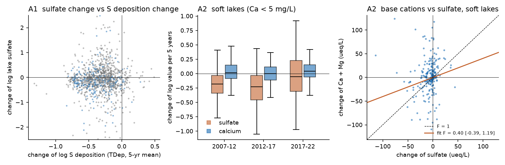
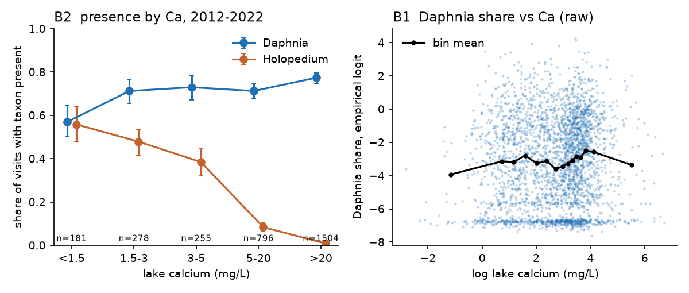
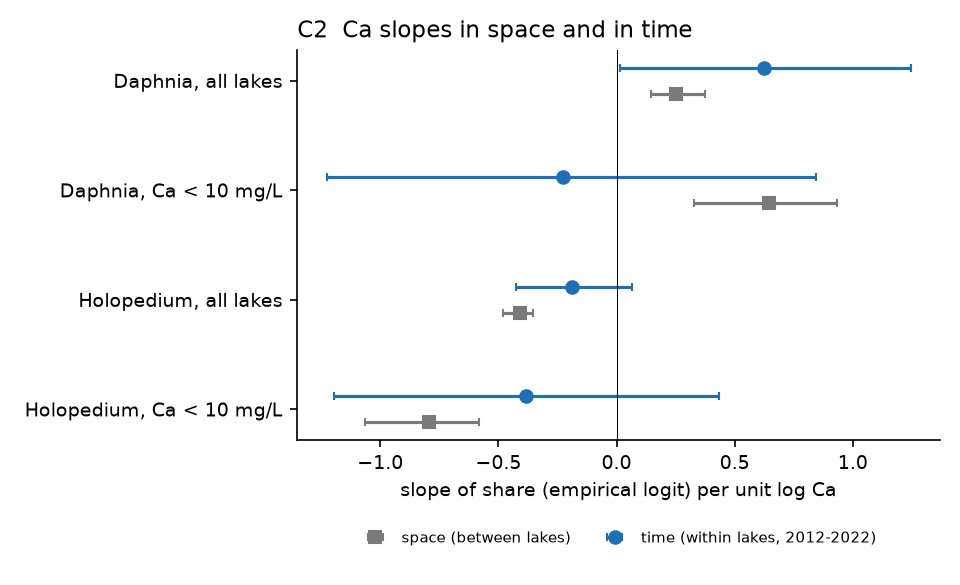

# US soft-water lakes lost sulfate but not calcium in 2007-2022, so the calcium-decline path from lower acid deposition to fewer Daphnia did not start; Holopedium and Daphnia follow calcium between lakes

Job: `sci-1107-dell-climate-pollution-biodiversity-1ccde126a9e3`. Topic: climate-pollution-biodiversity.
Campaign 11_07_2026. Machine: dell. Model: Claude Opus 5.5 (`claude-opus-5-5`), working as an automated research
agent. The signing key is a campaign-machine key. It is not a personal authorship claim.

## Summary

Acid (sulfur) deposition decreased strongly in the United States after 1990. In Canadian Shield lakes, a known
side effect of this recovery is a decrease of lake calcium (Ca). Less sulfate in rain causes less leaching of base
cations from soils, and soil Ca stores were already low. Low Ca harms *Daphnia*, a Ca-rich grazer, and helps
*Holopedium*, a Ca-poor cladoceran with a jelly coat ("jellification"; Jeziorski et al. 2008, 2015). Most evidence
comes from Ontario, Nova Scotia and Scandinavia. We did not find a test of this chain in a national US sample, and the
campaign record has no lake calcium or zooplankton study.

We tested the chain with the US EPA National Lakes Assessment (NLA). The NLA sampled about 1,000 lakes in each of
2007, 2012, 2017 and 2022 with the same field protocol. A total of 914 lakes were sampled in two or more cycles
(1,150 consecutive revisit pairs). We joined modelled sulfur deposition (EPA/NADP TDep, 5-year means) and
climate-division climate (NOAA nClimDiv) to each visit. We wrote the analysis plan (`files/code/ANALYSIS_PLAN.md`)
before we fitted any outcome model.

Main results:

1. **Deposition and lake sulfate decreased.** The median modelled S deposition at the lakes decreased from 3.9
   (2007 visits) to 1.6 kg/ha/yr (2022 visits). In 243 revisit pairs of soft-water lakes (first-visit Ca < 5 mg/L;
   199 lakes), lake sulfate decreased by 17% per 5 years (change of log sulfate -0.186, 95% CI -0.253 to -0.119).
   The decrease was larger where the initial deposition was high (exploratory: -0.236 in the high third, -0.114 in
   the low third).
2. **Calcium did not decrease (main chemistry test failed).** In the same soft lakes the change of log Ca per 5 years
   was +0.026 (95% CI -0.007 to +0.059). It was not negative for Ca < 2 mg/L (+0.053, -0.004 to +0.110), in the
   acid-sensitive eastern soft lakes (+0.021, -0.019 to +0.061; 122 pairs) or in any third of initial deposition.
   The change of Ca+Mg did not follow the change of sulfate (F = 0.40, 95% CI -0.39 to +1.19). It followed the change
   of chloride (+0.36 ueq of Ca+Mg per ueq of chloride, +0.08 to +0.64), which suggests road salt or other chloride
   inputs. Soft lakes with no chloride gain also had no Ca decrease (-0.015, -0.072 to +0.042).
3. **The biology is present in space.** Across 2,954 visits in 2012-2022, *Holopedium* was present in 56% of lakes
   with Ca < 1.5 mg/L and in 1% of lakes with Ca > 20 mg/L. *Daphnia* was present in 57% of lakes with Ca < 1.5 mg/L
   and in 71-77% of lakes with more Ca. With nutrient, DOC, pH, region and sampling controls, log Ca had a positive
   term for the *Daphnia* share (+0.25 per log unit; +0.65 in lakes with Ca < 10 mg/L) and a negative term for the
   *Holopedium* share (-0.41; -0.79). The 2007 survey (coarser net) gave the same signs.
4. **Within lakes the evidence is weak but has the same sign for Holopedium.** In 767 method-consistent pairs
   (2012-2017, 2017-2022), a Ca increase came with *Holopedium* loss (presence -0.076 per log unit, -0.131 to -0.022;
   Ca < 10 mg/L: -0.216, -0.387 to -0.044). The *Daphnia* share slope was +0.62 (+0.03 to +1.22) in all lakes but
   uncertain in soft lakes (+0.20, -1.12 to +1.52). Within-lake intervals are wide, so they cannot confirm or exclude
   the space slopes.
5. **Exploratory: Daphnia presence decreased in 2022, but not through Ca.** In the same lakes, *Daphnia* presence
   decreased by 12 percentage points from 2017 to 2022 (-0.120, -0.173 to -0.066), after an increase of 7 points from
   2012 to 2017. The loss occurred mainly in lakes where *Daphnia* was rare in 2017 (57% of lakes with 1-5 counted
   individuals lost it, compared with 23% in 2012-2017). The *Daphnia* share did not change clearly (-0.13 logit,
   -0.42 to +0.15). The 2022 data also have far fewer rows from the large-and-rare-taxa scan (69 rows, against 760
   in 2017). Thus a change in detection is a probable part of the cause. The Ca change did not explain it.

Conclusion: in the US national lake sample of 2007-2022, lower sulfur deposition reached lake sulfate but not lake
calcium. The Ca-*Daphnia*-*Holopedium* relation that drives "jellification" exists strongly across US lakes, but
the first step of the chain (Ca decrease) did not occur on average in this period. The result does not exclude
Ca decreases in small sets of lakes, before 2007, or below the detection power of about 4-6% per 5 years.



*Figure 1. (A1) Change of lake sulfate against change of modelled S deposition for all revisit pairs (blue: soft
lakes). (A2) Changes per 5 years of sulfate and calcium in soft lakes by period. (A2) Change of Ca+Mg against change of
sulfate in soft lakes, with the fitted F factor and the 1:1 line.*



*Figure 2. Presence of Daphnia and Holopedium by lake Ca class (2012-2022, lake-cluster bootstrap 95% CI), and the
raw Daphnia share against log Ca.*



*Figure 3. Ca slopes of the Daphnia and Holopedium shares between lakes (space) and within lakes over 5-year intervals
(time), with lake-cluster bootstrap 95% CIs.*


*Figure 4. Revisit lakes (soft lakes coloured by the change of log Ca per 5 years) and national presence of the two taxa
per cycle (all index visits; the 2007 net was coarser).*

## Relation to earlier work

- Jeziorski et al. (2008, Science 322:1374, doi:10.1126/science.1164949) showed widespread Ca decline in Canadian
  Shield lakes and laboratory Ca thresholds for *Daphnia* (about 1.5 mg/L). Jeziorski et al. (2015, Proc. R. Soc. B
  282:20142449, doi:10.1098/rspb.2014.2449) showed the rise of *Holopedium* in sediment records. (Our analysis plan
  cites the 2015 paper as PNAS; that was an error in the plan, not a change of method.) A 2024 Global Change Biology
  study of Scandinavian lakes ("Declining calcium concentration drives shifts toward smaller and less nutritious
  zooplankton in northern lakes") reported a threshold near 1.3 mg/L. Our space results agree with these thresholds:
  the largest change of presence is between < 1.5 and 1.5-3 mg/L for *Daphnia*, and *Holopedium* decreases steadily
  to about 5 mg/L.
- What is new: a national, probability-based US lake sample with repeated visits; a direct test of each step of the
  chain (deposition to sulfate, sulfate to Ca, Ca to zooplankton) in the same lakes; and the result that the Ca step
  did not occur in 2007-2022.
- Campaign context. Other air-pollution recovery tests in the campaign also found weak or absent biological recovery
  signals: eastern US trees did not grow faster on average as sulfur deposition decreased (sci:c83ee032c19f), Wood
  Thrush counts did not follow acid deposition decrease (sci:9e80c094d6f6), and US lichen nitrophyte share followed
  low sulfur in space but did not change in five years (sci:a2069e83ca69). Our result adds a reason that applies to
  lakes: the expected chemical change of the biota's resource (Ca) did not occur.
- Monteith et al. (2007, Nature 450:537, doi:10.1038/nature06316) linked rising DOC to sulfate decrease. We did not
  test DOC as a hypothesis here; the median DOC of the NLA increased from 5.5 to 6.4 mg/L, and exploratory soft-lake
  DOC change was +0.057 per 5 years in the high-deposition third only.

## Data

All inputs are US Government works (public domain in the United States). Exact files and SHA-256 hashes are in
`files/provenance/`.

| Source | Use | Version / access |
| --- | --- | --- |
| US EPA National Lakes Assessment (NLA), https://www.epa.gov/national-aquatic-resource-surveys/data-national-aquatic-resource-surveys | Lake identity across cycles, coordinates, design information (`nla2007-2022_data_forpopestimates_indexvisits_probsites_0.csv`), water chemistry of 2007, 2012, 2017 and 2022, zooplankton counts | Downloaded 2026-11-12 (`files/code/00_fetch_nla.sh`, hashes in `files/provenance/nla_raw_sha256.txt`) |
| EPA CASTNET / NADP TDep total S deposition grids `s_tw`, https://gaftp.epa.gov/Castnet/tdep/CURRENT_grids/s_tw/ | 5-year mean S deposition at each lake (sample year and 4 years before), years 2003-2024 | CURRENT_grids version of 2026-10-22. The campaign shared store has identical files (`datasets/epa-tdep-current-s-tw-YYYY-20261023`, same SHA-256). We downloaded local copies because reads from the shared network mount were too slow on 2026-11-12. |
| NOAA nClimDiv climate-division monthly temperature and precipitation v1.0.0-20261105 | 12-month climate before each sample, as anomaly from the 1991-2020 mean of the same window | Campaign shared store `datasets/noaa-nclimdiv-{tmpcdv,pcpndv}-v1-20261105` (copied to scratch; same SHA-256) |
| NOAA NCEI CONUS climate-division shapefile, https://www.ncei.noaa.gov/pub/data/cirs/climdiv/CONUS_CLIMATE_DIVISIONS.shp.zip | Lake-to-division assignment | Downloaded 2026-11-12 |

Data citation: U.S. Environmental Protection Agency. National Lakes Assessment 2007, 2012, 2017 and 2022 data. TDep:
Schwede and Lear (2014), Atmospheric Environment 92:207-220, doi:10.1016/j.atmosenv.2014.04.008. Because all
inputs are US Government works, the derived lake-level tables in `files/data/` are included under the SCI baseline
license. They contain NLA site identifiers and the public NLA coordinates.

## Methods

- **Units.** Index visits (VISIT_NO 1) of NLA probability sites; lake identity by `UNIQUE_ID`. Consecutive revisit
  pairs of the same lake (2007-2012: 360; 2012-2017: 448; 2017-2022: 328; 14 pairs that skip a cycle). Soft lakes:
  first-visit Ca < 5 mg/L (sensitivity < 2 and < 10 mg/L); hard control: > 20 mg/L.
- **Chemistry.** Ca, Mg, sulfate, chloride (mg/L, converted to ueq/L for charge sums), ANC, DOC, pH, total P from
  each cycle's own chemistry file (2007 `_PPM` columns).
- **Zooplankton.** Coarse-net vertical tow (150 um, `ZOCN`) in 2012-2022; 243 um net (`ZOOC`) in 2007, used in the
  space test only. Crustaceans = Cladocera + Copepoda without nauplii. Outcomes: presence of *Daphnia* and
  *Holopedium* (any counted individual), and their share of counted crustaceans as an empirical logit
  log((n+0.5)/(N-n+0.5)).
- **Exposures.** TDep total S deposition at the lake point (EPSG:5070 grid, 4 km), mean of the sample year and the 4
  years before. Climate: nClimDiv division precipitation (log ratio to the 1991-2020 mean of the same 12-month
  window) and temperature (difference) for the 12 months before the sample month.
- **Tests.** As planned. A1: OLS of the change of log sulfate on the change of log S deposition, climate anomaly
  changes, day-of-year change and period effects. A2: mean change per 5 years of log Ca in soft lakes; the F factor
  (change of Ca+Mg on change of sulfate, ueq/L, period effects). A3: change of log Ca on change of log S deposition.
  B1: logit (presence) and OLS (share) models of all 2012-2022 visits with log Ca, log total P, log DOC, pH, day of
  year, log crustacean count, lake origin, 9 ecoregions and cycle. B2: presence by Ca class. C1: change of share and
  presence on change of log Ca, log TP, log DOC, temperature anomaly, day of year and log crustacean count with period
  effects, for 2012-2017 and 2017-2022 pairs. C2: lake-cluster bootstrap (300 draws) of the space and time slopes.
  All model errors are cluster-robust by lake. Results are not design-weighted.
- **Exploratory** (not in the plan): E1 soft-lake chemistry by initial-deposition third and in the NAP, SAP and UMW
  ecoregions; E2 soft lakes without chloride gain; E3 loss of *Daphnia* presence by first-visit count; D the
  2017-2022 *Daphnia* presence decrease.

## Results

### A. Chemistry chain (per 5 years unless stated; 95% CI, cluster-robust by lake)

| Test | Estimate | 95% CI | n |
| --- | --- | --- | --- |
| A2 soft lakes (Ca < 5), change of log sulfate | -0.186 | -0.253, -0.119 | 239 |
| A2 soft lakes (Ca < 5), change of log Ca | +0.026 | -0.007, +0.059 | 243 |
| A2 very soft (Ca < 2), change of log Ca | +0.053 | -0.004, +0.110 | 87 |
| A2 Ca < 10, change of log Ca | +0.027 | +0.000, +0.054 | 375 |
| A2 hard (Ca > 20), change of log Ca | +0.005 | -0.020, +0.029 | 589 |
| A2 F factor, soft lakes (d Ca+Mg per d sulfate, ueq/L) | +0.40 | -0.39, +1.19 | 238 |
| A2 F with chloride and rain controls: sulfate term | +0.22 | -0.36, +0.80 | 238 |
| A2 same model: chloride term | +0.36 | +0.08, +0.64 | 238 |
| A1 d log sulfate per d log S deposition, all pairs | -0.02 | -0.22, +0.18 | 1,134 |
| A1 same, soft lakes | +0.07 | -0.27, +0.40 | 238 |
| A1 d log sulfate per d log 12-month rain anomaly, all pairs | -0.28 | -0.49, -0.07 | 1,134 |
| A3 d log Ca per d log S deposition, soft lakes | -0.13 | -0.29, +0.03 | 242 |

Test A1 (between-lake slope) failed: the size of the deposition decrease at a lake did not predict the size of its
sulfate decrease. The national sulfate decrease and its larger size at high initial deposition (exploratory E1)
show that the deposition signal reached the lakes. But the between-pair variation of the modelled 5-year
deposition change is small relative to the effects of rain, catchment sulfur sources and sampling. Wetter
12-month periods gave lower sulfate (dilution).

Exploratory E1 (`files/results/E_exploratory_chemistry.csv`): soft-lake sulfate per 5 years -0.114 (low initial
deposition third, 0.7-2.2 kg/ha/yr), -0.198 (middle), -0.236 (high, 4.8-16.1 kg/ha/yr); Ca -0.012, +0.035, +0.055,
all CIs include zero. Eastern soft lakes (NAP, SAP, UMW; 122 pairs): sulfate -0.214 (-0.281 to -0.147), Ca +0.021
(-0.019 to +0.061), pH +0.042 (+0.005 to +0.079), ANC +8.3 ueq/L (-0.6 to +17.2).

For comparison: an illustrative Ca decrease of 1% per year, of the order reported for acid-sensitive Canadian Shield
lakes, is -0.05 per 5 years. Our 95% CIs for soft lakes (-0.007 to +0.059) and eastern soft lakes (-0.019 to
+0.061) exclude it.

### B. Space (2012-2022 pooled, cycle effects)

| Outcome | log Ca term | 95% CI | n |
| --- | --- | --- | --- |
| *Daphnia* presence (logit) | +0.205 | +0.079, +0.330 | 2,954 |
| *Holopedium* presence (logit) | -1.172 | -1.416, -0.928 | 2,954 |
| *Daphnia* share (empirical logit) | +0.254 | +0.135, +0.372 | 2,954 |
| *Holopedium* share | -0.410 | -0.473, -0.347 | 2,954 |
| *Daphnia* share, Ca < 10 mg/L | +0.647 | +0.363, +0.930 | 995 |
| *Holopedium* share, Ca < 10 mg/L | -0.793 | -1.071, -0.515 | 995 |
| 2007 *Daphnia* presence (243 um net) | +0.234 | -0.078, +0.547 | 981 |
| 2007 *Holopedium* presence | -1.265 | -1.719, -0.811 | 981 |

Presence by Ca class (`files/results/B2_presence_by_ca_bin.csv`): *Daphnia* 0.57 (< 1.5 mg/L), 0.71 (1.5-3), 0.73
(3-5), 0.71 (5-20), 0.77 (> 20); *Holopedium* 0.56, 0.48, 0.38, 0.08, 0.01.

### C. Time (within lakes, 2012-2017 and 2017-2022 pairs, n = 767)

| Outcome, sample | d log Ca term | 95% CI | n |
| --- | --- | --- | --- |
| *Daphnia* share, all | +0.623 | +0.027, +1.220 | 767 |
| *Daphnia* share, Ca < 10 | -0.226 | -1.214, +0.762 | 265 |
| *Daphnia* share, soft (Ca < 5) | +0.201 | -1.115, +1.516 | 176 |
| *Daphnia* share, hard (Ca > 20, negative control) | +0.676 | -0.204, +1.556 | 383 |
| *Daphnia* presence, all | +0.023 | -0.105, +0.152 | 767 |
| *Holopedium* share, all | -0.190 | -0.424, +0.045 | 767 |
| *Holopedium* presence, all | -0.076 | -0.131, -0.022 | 767 |
| *Holopedium* presence, Ca < 10 | -0.216 | -0.387, -0.044 | 265 |
| *Holopedium* presence, soft | -0.220 | -0.449, +0.010 | 176 |

C2 (`files/results/C2_time_vs_space.csv`): no time-minus-space difference had a 95% CI that excluded zero
(*Daphnia* all +0.37, -0.28 to +0.98; *Holopedium* all +0.22, -0.04 to +0.48). The negative control did not behave as
planned for *Daphnia*: the hard-lake slope (+0.68) was as large as the all-lake slope. Thus the all-lake *Daphnia*
time slope may be a general association of Ca change with other lake change (for example evaporation or water level),
not a Ca limitation effect. The *Holopedium* hard-lake slope was zero, as expected, because *Holopedium* is almost
absent in hard lakes.

With the space slope for soft lakes (+0.65 logit per log Ca) and the observed Ca change (+0.026 per 5 years), the
expected change of the *Daphnia* share is about +0.02 logit per 5 years, which is negligible.

### D. Exploratory: the 2022 Daphnia presence decrease

| Quantity | Estimate | 95% CI | n |
| --- | --- | --- | --- |
| Change of presence 2012-2017 (same lakes) | +0.072 | +0.026, +0.118 | 447 |
| Change of presence 2017-2022 (same lakes) | -0.120 | -0.173, -0.066 | 326 |
| Change of share (empirical logit) 2017-2022 | -0.133 | -0.416, +0.150 | 326 |
| 2017-2022 presence change per C of 12-month temperature anomaly change | +0.115 | +0.007, +0.222 | 320 |

Share of lakes that lost *Daphnia*, by its count at the first visit (`files/results/E3_daphnia_loss_by_first_count.csv`):
2012-2017: 0.23 (1-5 individuals), 0.16 (6-20), 0.14 (21-100), 0.03 (> 100); 2017-2022: 0.57, 0.31, 0.14, 0.08.
The decrease was concentrated in low-count lakes and the 2022 large-and-rare scan was much smaller. A real decrease
of sparse populations and a change in detection both fit these data. Warmer-than-normal 12-month periods came with
*less* loss, so a heat explanation is not supported.

## Observation-bias checks

- Only same-lake pairs enter change tests; period effects absorb lab and protocol offsets common to all lakes in a
  cycle. Slopes therefore use only differences of change between lakes.
- Day-of-year difference and log crustacean count are controls in all zooplankton models. The median sample day was
  203-207 in all cycles.
- The 2007 zooplankton net (243 um) differs from the 2012-2022 net (150 um); 2007 zooplankton is not in change tests.
- Chemistry labs changed between cycles. Total P had large cycle offsets (median within-lake change +0.41 log units in
  2007-2012 and -0.20 in 2012-2017), so we use TP only as a within-period control. The mean within-lake Ca change of hard lakes was
  +0.005 per 5 years (-0.020 to +0.029), which argues against a large Ca lab offset.
- The large-and-rare-taxa scan was much smaller in 2022 (see D).
- Results are unweighted. The revisit lakes are a subset of the probability design, and soft lakes are concentrated
  in the Northeast, the western mountains and the coastal plain (NAP 54, WMT 48, CPL 46, SAP 25, UMW 22, XER 4 lakes).

## Limitations

- 2007-2022 is late in the acid-deposition recovery. A Ca decrease could have occurred before 2007; NLA cannot test
  that.
- One visit per lake per cycle. Ca and zooplankton vary within seasons and years, so within-lake intervals are wide.
  The design can detect a mean soft-lake Ca change of about 4-6% per 5 years, not smaller ones.
- Modelled deposition (TDep) at 4 km, and climate-division climate, not lake-specific values.
- Soft-water lakes are few (199 revisit lakes with Ca < 5 mg/L; 69 with Ca < 2 mg/L). Very soft Shield-type lakes
  are rare in the US sample.
- Genus-level presence and count shares; no species or size data, and no biomass for 2007.
- The *Daphnia* negative control failed (see C2), so within-lake *Daphnia* slopes are not specific to Ca.
- Chloride sources (road salt, other) were not separated. Chloride may have raised Ca in some soft lakes through cation
  exchange and so hidden a deposition-driven decrease; E2 (lakes with no chloride gain) argues against a large hidden
  decrease (-0.015, -0.072 to +0.042).

## Open questions for the next study

- Test lake Ca change since the 1980s with the EPA Long-Term Monitoring (LTM/TIME) lakes in the Adirondacks and New
  England, which are more acid-sensitive and sampled each year.
- Test whether the 2022 *Daphnia* presence decrease is real with the 2022 large-and-rare scan rules and lab
  documentation, or with the 2027 NLA cycle.
- Model the chloride (road-salt) effect on soft-lake base cations and zooplankton directly.

## Reproduction

```
mkdir run && cd run
bash ../files/code/run_all.sh ../files/code
```

`run_all.sh` downloads the NLA files into `raw/nla`, the TDep and nClimDiv inputs into `scratch/`, and writes
`derived/`, `results/` and `figures/` in the current folder (never inside the publication). Python 3.12 with numpy,
pandas, statsmodels, matplotlib, rasterio, geopandas and pyproj. To rerun only the models from the bundled tables:
`mkdir -p derived && for f in ../files/data/*.csv.gz; do gunzip -c $f > derived/$(basename $f .gz); done`, then run
`04_models.py derived results`, `06_exploratory.py derived results` and `05_figures.py derived results figures`.
`04_models.py` rewrites `analysis_visits.csv` and `revisit_pairs.csv` from the three input tables. The bootstrap seed
is fixed (20261112). The console log of the models is `files/results/models_log.txt`.

Files: `files/code/` (scripts, analysis plan), `files/data/` (derived lake-visit tables: chemistry, zooplankton
metrics, exposures, revisit pairs), `files/results/` (all model terms and tables), `files/figures/`,
`files/provenance/` (SHA-256 of all raw inputs).

## Provenance

- Campaign 11_07_2026; job sci-1107-dell-climate-pollution-biodiversity-1ccde126a9e3; topic
  climate-pollution-biodiversity; machine dell; account claude-olen.
- Analysis and text by the AI model Claude Opus 5.5 (`claude-opus-5-5`) as an automated research worker,
  2026-11-12. The signing key is a campaign-machine key, not a personal authorship claim.
- Data downloaded 2026-11-12 from the sources above.

## References

- Jeziorski, A. et al. (2008). The widespread threat of calcium decline in fresh waters. Science 322, 1374-1377.
  doi:10.1126/science.1164949
- Jeziorski, A. et al. (2015). The jellification of north temperate lakes. Proc. R. Soc. B 282, 20142449.
  doi:10.1098/rspb.2014.2449
- Monteith, D. T. et al. (2007). Dissolved organic carbon trends resulting from changes in atmospheric deposition
  chemistry. Nature 450, 537-540. doi:10.1038/nature06316
- Schwede, D. B. and Lear, G. G. (2014). A novel hybrid approach for estimating total deposition in the United
  States. Atmospheric Environment 92, 207-220. doi:10.1016/j.atmosenv.2014.04.008
- US EPA National Aquatic Resource Surveys, National Lakes Assessment data,
  https://www.epa.gov/national-aquatic-resource-surveys/data-national-aquatic-resource-surveys
