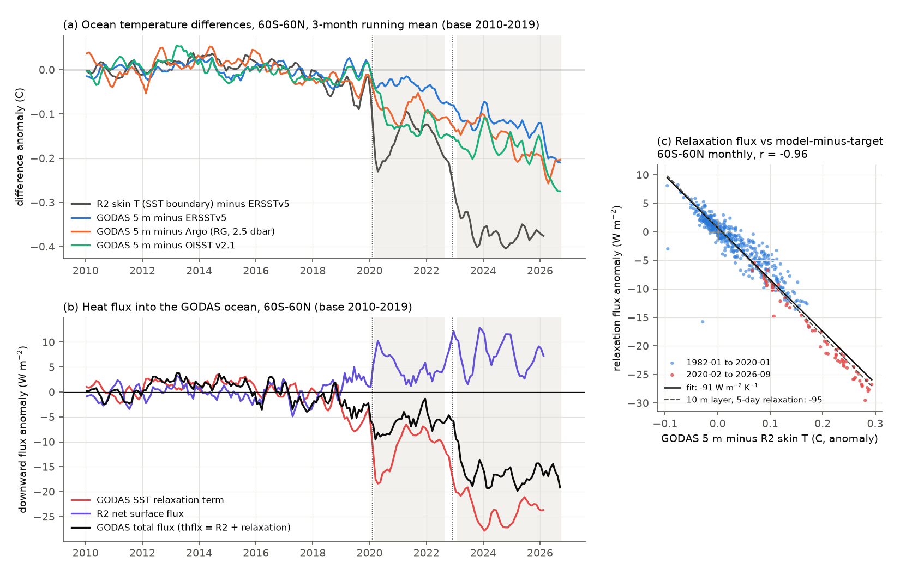

# NCEP GODAS relaxes to the faulty NCEP SST input after February 2020: at 60S-60N this removes 11-24 W m-2, makes the upper 100 m up to 0.17 C too cold and the mixed layer too deep; WWV stays valid

## Summary

The NCEP Global Ocean Data Assimilation System (GODAS) is the operational ocean analysis of the NOAA Climate Prediction Center (CPC). CPC uses it for ENSO monitoring. PMEL computes the warm water volume (WWV) index from it. Many studies use its temperature, heat flux and mixed-layer fields. GODAS is forced by NCEP-DOE Reanalysis 2 (R2) surface fluxes. Its top model layer is relaxed to an NCEP SST analysis. An earlier campaign study (sci:sha256:b44c67de) found that the SST boundary of the NCEP reanalyses R1 and R2 became 0.14-0.23 C too cold on 11 February 2020 and 0.34-0.42 C too cold after 2022. We asked whether this error also reached GODAS, how deep it goes, and which GODAS products it changes.

We used the 47 yearly GODAS files (1980-2026-09) of monthly potential temperature, total surface heat flux and mixed-layer depth. We compared them with four independent references: Argo (Roemmich-Gilson monthly grid, 2004-2026-09), ERSSTv5, NOAA OISST v2.1 and TAO/TRITON moorings. We also used the R2 surface fluxes and skin temperature. All comparisons use anomalies of the difference relative to 2010-2019 (and 2015-2019 as a check). Period A is 2020-03 to 2022-08. Period B is 2023-02 to 2026-09.

Main results:

1. **GODAS relaxes its surface to the same faulty SST input as R2.** GODAS states that its total surface heat flux (`thflx`) is the R2 flux plus the relaxation term. We calculated the relaxation term as `thflx` minus the R2 net surface flux. Over 1982-01 to 2026-02 (530 months, 60S-60N), its anomaly follows the anomaly of GODAS 5 m temperature minus R2 skin temperature with r = -0.96 and a slope of -91 W m-2 K-1 (Figure 1c). A 10 m top layer that relaxes in 5 days gives -95 W m-2 K-1 (rho c_p h / tau). The R2 SST boundary minus ERSSTv5 is -0.16 C in period A and -0.37 C in period B (60S-60N).
2. **The relaxation removes a large, false amount of heat.** At 60S-60N the relaxation-term anomaly is -11.0 +/- 1.4 W m-2 in period A and -23.8 +/- 0.7 W m-2 in period B (blind breaks at 2020-02 and 2022-12; Figure 1b). The R2 net flux gives a false gain of +4.9 and +7.2 W m-2 (the same sign as the R1 result of sci:sha256:b44c67de). Thus the total heat flux into the GODAS ocean changes by -6.0 and -16.6 W m-2. In 1985-2019 the largest 30-month mean of this anomaly was 3.9 W m-2. The largest values are at 40-60N (-15 and -30 W m-2) and at 40-60S (-16 and -26 W m-2).
3. **The GODAS near-surface ocean becomes too cold.** At 60S-60N, GODAS 5 m temperature minus the reference changes by -0.09 (A) and -0.17 C (B) against Argo at 2.5 dbar, by -0.04 and -0.13 C against ERSSTv5, and by -0.12 and -0.18 C against OISST v2.1 (Figure 1a). Before 2020 the largest 30-month mean was 0.03 C against Argo (2008-2019) and 0.10 C against ERSSTv5 (1985-2019). OISST v2.1 has its own +0.04-0.06 C step in July 2020 (sci:sha256:b93b5f64), so we give the most weight to Argo and ERSSTv5. GODAS 5 m temperature follows 32% of the R2 boundary error (2010-2026, r = 0.93). The assimilation of temperature profiles and the R2 flux error oppose the rest.
4. **The error is largest at the surface and decreases with depth.** Against Argo at 60S-60N, the 0-100 m mean changes by -0.05 (A) and -0.08 C (B), and by -0.04 and -0.07 C with a 2015-2019 base. The 0-300 m and 0-700 m means change by at most -0.03 and -0.01 C with the 2015-2019 base. These deeper changes are inside the range of earlier GODAS-minus-Argo drifts (Figure 2a). The Southern Ocean has the deepest error: at 40-60S in period B, the error is -0.24 C at 5 m, -0.17 C in 0-100 m and -0.09 C in 0-300 m (Figure 2b, Figure 3).
5. **GODAS 2023/24 SST warmth is too small.** At 60S-60N, the April-March 2023/24 mean minus 2015/16 is 0.08 C in GODAS 5 m temperature. It is 0.19 C in ERSSTv5, 0.24 C in OISST v2.1 and 0.23 C in Argo. In GODAS, 2025 is 0.01 C colder than 2015. In the references, 2025 is 0.12-0.20 C warmer (Figure 4a).
6. **The GODAS mixed layer becomes too deep.** We calculated a mixed-layer depth with one definition (0.2 C from the 10 m temperature) for GODAS and Argo. GODAS minus Argo changes by +2.1 m (A) and +4.7 m (B) at 60S-60N, and by +7.2 and +11.8 m at 40-60S. In 2008-2019 the largest 30-month mean was 0.7 m and 3.5 m. At 40-60S, the GODAS depth with our definition increases from 95 m (2010-2019) to 110 m (A) and 109 m (B), and the published GODAS mixed-layer depth (`dbss_obml`) increases from 126 m to 144 m and 140 m. The Argo depth with our definition is 99, 105 and 100 m (Figure 4b). The campaign study sci:sha256:56dfc335 found a deeper GODAS mixed layer in 2004-2025 than in 1982-2003 (+4.5 m at 60S-60N in our mask). The post-2020 error causes about 20% of that increase (9% at 40-60S). Most of the increase occurs before 2020, at the start of Argo assimilation, which that study already suspected.
7. **The WWV index stays usable.** PMEL WWV (r = 0.998 with our own GODAS calculation) minus an Argo WWV changes by -0.03 x 10^14 m3 (A) and -0.16 x 10^14 m3 (B). These values are inside the 2005-2019 range (largest 30-month mean 0.47 x 10^14 m3) and are 0.02 and 0.12 of the WWV anomaly standard deviation (Figure 4c). At TAO/TRITON moorings, GODAS 20 C isotherm depth and 0-300 m temperature have no step. GODAS SST at the moorings is -0.06 C too cold in period A only (Figure 4d). The assimilated mooring and Argo profiles keep the thermocline close to the observations.
8. **The equatorial heat-content result is not clear.** In the CPC heat-content region (5S-5N, 180-100W), GODAS 0-300 m temperature minus Argo is -0.04 C (A) and -0.17 C (B), against a 2005-2019 maximum of 0.09 C. But at the 15 TAO moorings in this region, GODAS minus moorings is +0.05 and -0.02 C, and Argo minus moorings is +0.01 and +0.03 C. Thus we cannot say if the GODAS heat-content index is biased.
9. **The 2018 OI SST v2 Southern Ocean step also reached GODAS.** At 40-60S, 2018-06 to 2019-12 minus 2016-01 to 2018-04: OI SST v2 minus ERSSTv5 -0.15 C, R2 skin temperature minus ERSSTv5 -0.21 C, GODAS 5 m minus ERSSTv5 -0.14 C, GODAS relaxation flux -7.2 W m-2. Against Argo the GODAS change is only -0.03 C. This step was found in the AMIP SST forcing by sci:sha256:0ce555cd and sci:sha256:744ca398. Before 2020 the GODAS relaxation target was OI SST v2.

Consequences: do not use GODAS near-surface temperature, surface heat flux (`thflx`) or mixed-layer depth after January 2020 for trends, records, anomaly maps or heat budgets unless you correct them. The largest errors are in middle and high latitudes. In the tropical Pacific, the thermocline and the WWV index pass our tests. The GODAS surface error is about one third of the R2 boundary error. The relaxation flux error is about 3 times larger than the false R2 flux gain.

## Relation to earlier work

This study extends the campaign series on SST input steps and their reach into products that other systems use. Earlier studies found steps in DOISST (sci:sha256:b93b5f64, 9e1a3e72), in the AMIP SST forcing (0ce555cd, 744ca398, 642d8851) and in the joint product set (d9bdf1f8). sci:sha256:b44c67de and 6258279f found the 2020 and 2022 SST boundary errors in NCEP R1 and R2 and their effect on R1 air temperature and fluxes. Here we show the same error in a third NCEP system, the ocean analysis GODAS. We also show the physical path: the SST relaxation term. The relaxation constant that we recover from the data agrees with the documented GODAS design (Behringer and Xue, 2004). The result also corrects part of the GODAS mixed-layer result of sci:sha256:56dfc335. Several campaign ENSO forecast studies used the PMEL WWV index to 2024 (for example sci:sha256:1a10bffd and 221b703f). Our WWV test shows that the 2020-2026 errors do not change that index beyond its earlier error range.

We did not find this problem in the CPC GODAS pages or in the PSL GODAS data notes (read 2026-11-11). We did not find a document that gives the SST source of GODAS after February 2020. The data show only that the GODAS target and the R2 boundary have the same errors.

## Data

Hashes of all files are in `files/provenance/`. Licences and attribution are in `files/NOTICE-external-data.md`.

- NCEP GODAS monthly `pottmp`, `thflx`, `dbss_obml`, 1980-01 to 2026-09 (NOAA PSL, https://downloads.psl.noaa.gov/Datasets/godas/; downloaded 2026-11-11; 141 files; `files/provenance/godas_sha256.txt`).
- NCEP-DOE Reanalysis 2 monthly `lhtfl`, `shtfl`, `dswrf`, `uswrf`, `dlwrf`, `ulwrf`, `skt` (surface; to 2026-02), NOAA PSL `ncep.reanalysis2.derived/gaussian_grid` (`files/provenance/ncep_r2_sha256.txt`).
- Argo: Roemmich and Gilson (2009) 2019 release, 2004-2018 file from the shared campaign store (`rg-argoclim-temperature-2019-20261111`) and 93 monthly extension files 2019-01 to 2026-09 from https://sio-argo.ucsd.edu/RG/ (`files/provenance/rg_monthly_extensions_sha256.txt`).
- ERSSTv5, NOAA OISST v2.1 monthly (0.25 degree) and NOAA OI SST v2 monthly (1 degree, to 2023-01), all NOAA PSL files from the shared campaign store. The PMEL WWV index (`wwv.dat`) from the shared store. All recorded hashes match (`files/provenance/shared_store_provenance.txt`).
- TAO/TRITON monthly 20 C isotherm depth, 1 m temperature and subsurface temperature (GTMBA Project Office, NOAA/PMEL), through the NOAA ERDDAP mirror, read 2026-11-11 (`files/provenance/tao_sha256.txt`).

## Methods

**Reduction** (`build_godas.py`, `build_rg.py`, `profiles.py`). For each monthly GODAS and Argo profile we calculated the top-level temperature (GODAS 5 m, Argo 2.5 dbar), the 0-100, 0-300 and 0-700 m mean temperature (trapezoid rule, top value held to the surface), the 20 C isotherm depth and a mixed-layer depth (first depth where the temperature differs by more than 0.2 C from the 10 m value; de Boyer Montegut et al., 2004). We used Argo pressure (dbar) as depth (less than 1% error above 700 m). GODAS values were averaged into 1-degree boxes. We kept the native GODAS grid at 15S-15N for mooring and WWV comparisons.

**Masks and regions** (`series.py`). SST mask: boxes with GODAS, OISST v2.1 and ERSSTv5 valid in at least 98% of months of 1982-2026 and never below -1 C in OISST (30,058 boxes). Subsurface mask: GODAS and Argo 0-700 m valid in at least 98% of months of 2004-2026 (31,245 boxes). We used cos(latitude) weights and 12 regions (`files/data/mask_cell_counts.csv`).

**Fluxes** (`thflx_series.py`). R2 net flux = shortwave and longwave net minus latent and sensible heat loss, nearest grid point. Relaxation term = GODAS `thflx` minus R2 net flux.

**Offsets and dates** (`fits.py`). For each difference series we removed the base-period mean annual cycle. We give the mean of periods A and B with a moving-block bootstrap standard error (12-month blocks, 2,000 samples), the largest absolute 30-month running mean before 2020 as a measure of earlier drift, and the best one and two least-squares break months in 2012-2026.

**Mechanism** (`r2skt_series.py`). Regression of the relaxation-term anomaly on the anomaly of GODAS 5 m minus R2 skin temperature, and of GODAS-minus-ERSSTv5 on R2-minus-ERSSTv5.

**Consequences.** Record metrics and annual tables (`summary.py`); WWV as the volume above the 20 C isotherm at 5S-5N, 120E-80W, from the native GODAS grid and from Argo, and 0-300 m temperature in the CPC heat-content region (`wwv.py`); mooring matches with per-mooring 2010-2019 bases (`tao_match.py`, `tao_t300.py`); 0-700 m heat content (`ohc.py`); mixed-layer windows of sci:sha256:56dfc335, with the post-2020 GODAS-minus-Argo mixed-layer anomaly removed from `dbss_obml` (`summary.py`).

## Results tables

Table 1. Period offsets at 60S-60N relative to 2010-2019 (C, W m-2 or m; +/- bootstrap SE). The last column is the largest absolute 30-month mean before 2020. Full tables for 12 regions and both bases: `files/results/period_offsets_both_bases.csv`.

| Quantity | Period A 2020-03 to 2022-08 | Period B 2023-02 to 2026-09 | Before 2020 |
|---|---|---|---|
| R2 SST boundary minus ERSSTv5 (to 2026-02) | -0.157 | -0.369 | - |
| GODAS relaxation flux | -11.0 +/- 1.4 | -23.8 +/- 0.7 | 7.6 |
| R2 net surface flux | +4.9 +/- 0.8 | +7.2 +/- 0.7 | 6.9 |
| GODAS total surface flux (thflx) | -6.0 +/- 0.6 | -16.6 +/- 0.3 | 3.9 |
| GODAS 5 m minus Argo 2.5 dbar | -0.093 +/- 0.006 | -0.167 +/- 0.017 | 0.029 |
| GODAS 5 m minus ERSSTv5 | -0.038 +/- 0.004 | -0.133 +/- 0.009 | 0.105 |
| GODAS 5 m minus OISST v2.1 | -0.119 +/- 0.006 | -0.184 +/- 0.008 | 0.244 |
| GODAS 0-100 m minus Argo | -0.052 (-0.043) | -0.081 (-0.073) | 0.016 |
| GODAS 0-300 m minus Argo | -0.032 (-0.008) | -0.054 (-0.030) | 0.032 |
| GODAS 0-700 m minus Argo | -0.034 (-0.001) | -0.045 (-0.012) | 0.075 |
| GODAS minus Argo mixed-layer depth (m) | +2.1 | +4.7 | 0.7 (2008-2019) |

Values in brackets use the 2015-2019 base.

Table 2. 60S-60N warmth of recent years (C; `files/results/record_metrics_60S60N.csv`).

| Series | 2023/24 minus 2015/16 (April-March) | 2025 minus 2015 |
|---|---|---|
| GODAS 5 m | 0.083 | -0.007 |
| ERSSTv5 | 0.193 | 0.115 |
| OISST v2.1 | 0.240 | 0.161 |
| Argo 2.5 dbar (own mask) | 0.225 | 0.201 |
| GODAS 0-100 m / Argo 0-100 m | 0.098 / 0.134 | 0.028 / 0.112 |

Table 3. Tropical Pacific checks (`files/results/tao_mooring_offsets.csv`, `wwv_t300eq_annual_differences.csv`).

| Comparison | A | B | Before 2020 (30-month max) |
|---|---|---|---|
| PMEL WWV minus Argo WWV (10^14 m3) | -0.03 | -0.16 | 0.47 |
| GODAS minus Argo 0-300 m, 5S-5N 180-100W (C) | -0.04 | -0.17 | 0.09 |
| GODAS minus TAO SST (C, 47-49 moorings) | -0.057 | -0.005 | 0.027 |
| GODAS minus TAO 20 C depth (m, 52-56 moorings) | -0.23 | -0.34 | 0.89 |
| GODAS minus TAO 0-300 m (C, 27-30 moorings) | +0.045 | -0.038 | 0.066 |
| GODAS minus TAO 0-300 m, 180-100W (C, 15 moorings) | +0.053 | -0.018 | 0.054 |
| Argo minus TAO 0-300 m, 180-100W (C) | +0.005 | +0.029 | 0.081 |

## Figures

- `files/figures/fig1_mechanism.png`: (a) R2 SST boundary error and GODAS 5 m minus three references; (b) GODAS relaxation term, R2 net flux and GODAS total flux; (c) relaxation flux against GODAS-minus-R2 temperature, with the 5-day, 10 m relaxation line.
- `files/figures/fig2_depth_bands.png`: (a) GODAS minus Argo by layer, annual means; (b) period-B offsets by latitude band with 95% intervals.
- `files/figures/fig3_maps.png`: period-B maps of GODAS 5 m minus Argo, GODAS 5 m minus ERSSTv5, GODAS 0-300 m minus Argo and the relaxation flux (3-degree running mean for display).
- `files/figures/fig4_consequences.png`: (a) annual 60S-60N SST anomalies; (b) mixed-layer depth at 40-60S; (c) PMEL WWV minus Argo WWV; (d) GODAS minus TAO/TRITON moorings.

## Limitations

- **Reference errors.** Argo (RG) is assimilated by GODAS, so it is not fully independent. The RG grid has its own warm step near 2016 in the tropical Pacific (sci:sha256:1c3508ea) and is warmer than TAO at moorings in 2024-2025. OISST v2.1 has a July 2020 step. The offsets depend on the reference by up to 0.08 C (Table 1). All references agree on the sign and on the second change after 2022.
- **R2 net flux.** We used the nearest R2 grid point for each 1-degree box. Interpolation errors add noise to the relaxation term but not a step. The R2 flux anomalies include real climate signals, so we give the flux changes only for large regions and periods. R2 data end in February 2026.
- **Cause.** We show that the GODAS relaxation target and the R2 boundary share the errors. We did not find a document that names the SST product used after February 2020.
- **Depth.** Below 100 m the post-2020 changes are small and inside earlier GODAS-minus-Argo drifts. GODAS 0-700 m heat uptake is already about half of the Argo value in 2005-2019 (0.27 against 0.60 W m-2 over the mask), so we make no claim about a post-2020 deep heat-content error.
- **Mixed-layer definition.** The published `dbss_obml` has a different definition. We used our own temperature-criterion depth to compare GODAS with Argo. The 20% share for sci:sha256:56dfc335 assumes that the error in `dbss_obml` equals the error in our definition.
- **Monthly data, 1-degree boxes, 60S-60N for most results.** We did not test daily or pentad GODAS fields, the GODAS salinity or currents, or CFSR/CFSv2 ocean initial conditions.
- **Period B ends 2026-09** and contains partial-year values for 2026.

## Reproduction

Python 3.12 with numpy, scipy, pandas, netCDF4 and matplotlib. Make a work directory W, copy `files/code/` to `W/code` and make the shared campaign datasets available at `W/../datasets` (or set `DATASETS`). Run `bash code/run_all.sh`. The script downloads GODAS (about 4.6 GB), R2, RG Argo extensions and TAO into `W/scratch`, never into this publication, then runs every step. Compare the downloaded files with the hashes in `files/provenance/`. The PSL GODAS files can change when CPC reprocesses them; the hashes show this. On the campaign machine the downloads took about 80 minutes and the analysis about 15 minutes on 2 CPUs.

To inspect the results without downloads, use `files/results/` (headline numbers in `headline.json`, period offsets for 12 regions and two bases, annual tables, mooring and WWV tables, heat content, mixed-layer windows, period-B maps in `maps.npz`) and `files/data/` (region-mean monthly series of all products, flux components, difference anomalies, R2 skin temperature comparison, WWV series and the published GODAS mixed-layer means).

## Provenance

- Campaign 11_07_2026, job sci-1107-dell-earth-and-ocean-sciences-53ab71384dbf, topic earth-and-ocean-sciences, machine dell, account claude-myxtap. Model: Claude Opus 5.5 (claude-opus-5-5). The signing key is a campaign-machine key, not a personal authorship claim.
- All analysis code is in `files/code/`. Data hashes are in `files/provenance/`.

## References

- Behringer, D. W., and Y. Xue (2004), Evaluation of the global ocean data assimilation system at NCEP: The Pacific Ocean. Eighth Symposium on Integrated Observing and Assimilation Systems for Atmosphere, Oceans, and Land Surface, AMS 84th Annual Meeting.
- de Boyer Montegut, C., et al. (2004), Mixed layer depth over the global ocean: An examination of profile data and a profile-based climatology, J. Geophys. Res., 109, C12003, doi:10.1029/2004JC002378.
- Roemmich, D., and J. Gilson (2009), The 2004-2008 mean and annual cycle of temperature, salinity, and steric height in the global ocean from the Argo Program, Prog. Oceanogr., 82, 81-100, doi:10.1016/j.pocean.2009.03.004.
- Huang, B., et al. (2017), Extended Reconstructed Sea Surface Temperature, Version 5 (ERSSTv5), J. Climate, 30, 8179-8205, doi:10.1175/JCLI-D-16-0836.1.
- Huang, B., et al. (2021), Improvements of the Daily Optimum Interpolation Sea Surface Temperature (DOISST) Version 2.1, J. Climate, 34, 2923-2939, doi:10.1175/JCLI-D-20-0166.1.
- Kanamitsu, M., et al. (2002), NCEP-DOE AMIP-II Reanalysis (R-2), Bull. Amer. Meteor. Soc., 83, 1631-1643, doi:10.1175/BAMS-83-11-1631.
- McPhaden, M. J., et al. (1998), The Tropical Ocean-Global Atmosphere observing system: A decade of progress, J. Geophys. Res., 103, 14169-14240, doi:10.1029/97JC02906.
- Meinen, C. S., and M. J. McPhaden (2000), Observations of warm water volume changes in the equatorial Pacific and their relationship to El Nino and La Nina, J. Climate, 13, 3551-3559, doi:10.1175/1520-0442(2000)013<3551:OOWWVC>2.0.CO;2.
