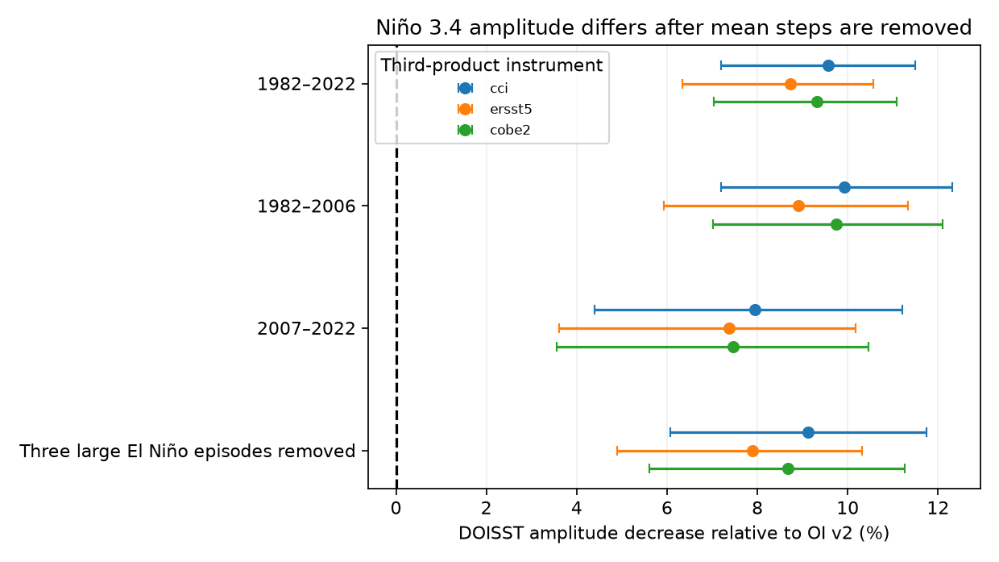
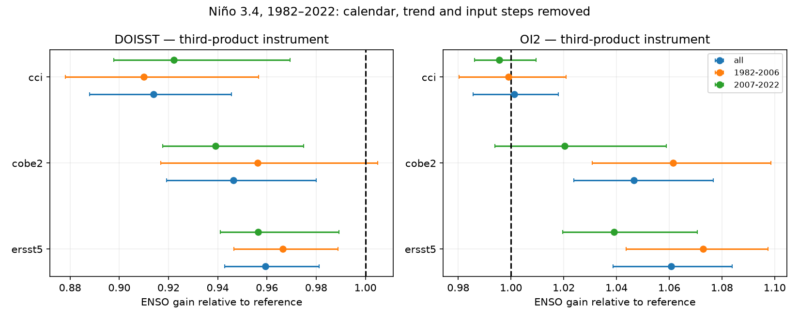

# DOISST has 9-10% less Nino 3.4 amplitude than OI v2 after trend and step removal in 1982-2022

## Result

DOISST v2.1 and OI SST v2 differ in more than their mean steps. In the Nino 3.4 region (5S-5N, 170-120W), DOISST has 8.7-9.6% less ENSO amplitude than OI v2 over 1982-2022 after calendar means, a linear trend and five input steps are removed. Here, amplitude means the regression gain of the common ENSO signal, measured with a third SST product as an instrument. It is not a statement about the true ocean amplitude.

OI v2 is the historical post-1981 SST source for AMIP forcing. DOISST is the source of a newer AMIP prototype in the cited campaign work. Thus, a change between these source records can change the supplied ENSO signal even after mean steps are removed. We test the source records, not the final processed forcing files or an atmosphere model. We do not measure the effect on rain, radiation or climate feedback.

| Third-product instrument | DOISST / OI v2 gain | Conditional 95% interval, 24-month blocks |
|---|---:|---:|
| ESA SST CCI v3.0.1 | 0.904 | 0.885-0.928 |
| ERSSTv5 | 0.913 | 0.894-0.937 |
| COBE-SST2 | 0.907 | 0.889-0.930 |

All full-record intervals with 12, 24 and 48-month blocks are below one. Gain is 0.901-0.911 in 1982-2006 and 0.921-0.926 in 2007-2022. Every 24-month interval in these two eras is below one. The eras overlap in uncertainty; this is not proof of a change in the gain. After the July-June windows of the 1982/83, 1997/98 and 2015/16 El Nino events are removed, gain is still 0.909-0.921 and every interval is below one. The full tested set is in `files/direct.csv`.

## What this adds

The selected campaign study (SCI 9e1a3e72) reported 4-12% smaller DOISST anomalies against references as a secondary result. It did not test reference-noise bias, direct OI v2 source gain with a third product, warm-cold asymmetry, or held-out fit of nonlinear and seasonal alternatives. The new evidence is that the direct source-record difference survives these noise and event checks. The lack of clear nonlinear or seasonal gain is also useful: these records do not support a more complex amplitude correction.

This is not the first report of SST-product differences during ENSO. Huang et al. (2013, DOI 10.1175/JTECH-D-13-00034.1) studied the large 2012 differences. Huang et al. (2015, DOI 10.1175/JTECH-D-14-00121.1) tested AVHRR bias adjustments and found that the adjustment scheme can change tropical Pacific SST. Yang et al. (2021, DOI 10.1175/JCLI-D-20-0793.1) compared several SST series, including Nino 3.4. Those studies give plausible causes and prior context; this study does not identify the cause of the residual gain difference.

## Tests against references

We use three complete references: ERSSTv5, COBE-SST2 and ESA SST CCI v3.0.1. HadISST1 is a secondary control, not an independent truth. HadSST4 is excluded because its regional series has gaps. Against the three references, full-record DOISST instrument gains are 0.959, 0.946 and 0.914. Their conditional intervals are below one. Symmetric standard-deviation ratios are 0.959, 0.947 and 0.907, so the result does not depend only on the direction of a regression. OI v2 gains are 1.061, 1.047 and 1.001. References therefore do not agree on the absolute ENSO scale. OI v2 agrees with CCI, while it has larger amplitude than the two in situ products. We do not label either record as correct.

A constant gain lowers buffered held-out squared difference by 13.1% against ERSSTv5, 12.8% against COBE-SST2 and 30.1% against CCI, compared with an intercept-only fit of the residual product difference. Quadratic and seasonal terms do not give a consistent further gain: relative to the gain fit, quadratic changes range from a 2.1% loss to a 0.2% gain, and seasonal changes range from a 1.3% loss to a 0.9% gain. These are conditional reconstruction tests after a fixed full-record nuisance fit. They are not independent forecasts.

The quadratic DOISST coefficients are -0.002, +0.001 and -0.022 per K against ERSSTv5, COBE-SST2 and CCI. All three pointwise intervals contain zero. Some annual sine terms have intervals above zero, but COBE-SST2 does not confirm them, and held-out fit gains are small. With the in situ reference mean, warm-minus-cold gain is -0.015 (interval -0.068 to +0.050) for DOISST and +0.028 (-0.033 to +0.098) for OI v2. Thus, the data do not establish a different warm and cold gain. These tests are exploratory and no multiple-test correction is used; isolated intervals must not be read as confirmed discoveries.

## Data and methods

The only numerical input is the verified `files/data/index_series.npz` in SCI publication 9e1a3e72650f07a215accf776c2f88bdb5c9461d78249bc5a59f407e71dac573. Its SHA-256 is `14d61cde10112899b2253860f47c0f3f72d7c1c2b26805f4b497408655d34523`. We read the 1982-2022 Nino 3.4 series for 492 months. The upstream calculation uses area-weighted 5-degree boxes on a fixed ice-free mask and anomalies from 1991-2020 calendar means. Its CCI sample is one pixel per 1-degree cell every third day. We did not download or open shared raw data. Source versions, URLs, exact shared paths and inherited hashes are in `files/upstream_provenance.json`. These are upstream records, not newly checked raw files.

For each series we remove a nuisance design N: an intercept, 11 calendar-month terms, linear time and five binary steps at January 1985, January 2005, January 2007, July 2020 and October 2021. July 2020 is a monthly approximation to the 7 July change. We use least squares; rank-deficient columns within an era are handled by the least-squares pseudoinverse. We fit each era anew. Let residual DOISST be y, residual OI v2 be x and residual third product be z. The direct instrument gain is (z'y)/(z'x). This cancels noise in x only under the assumption that z has no error correlation with the relevant product errors, conditional on their common signal. Shared observations and calibration can violate this assumption. The reported gain remains a well-defined observed covariance ratio without that assumption, but it is then not a latent true-signal gain.

The direct comparison uses each of CCI, ERSSTv5 and COBE-SST2 as z. For the reference comparisons, CCI is the instrument for the in situ references, and ERSSTv5 is the instrument for CCI. We also report ordinary regression and standard-deviation ratios. These are complementary diagnostics, not three independent experiments.

Direct gain intervals use 1,500 circular block resamples of the joint product series and nuisance rows. Each resample refits the nuisance terms. Block sizes are 12, 24 and 48 months for the full record and 24 months for era and event-exclusion tests. Removed-event records concatenate the retained months before resampling, so block adjacency crosses the three deleted windows. Reference-gain intervals use 1,500 resamples of fixed residuals with 24-month blocks; they are conditional on that nuisance fit. Shape tests fit the product-minus-reference difference with N, residual ENSO, its square, and ENSO times annual sine and cosine. They use 2,000 joint block resamples. Warm-cold tests use ENSO and its absolute value with N and 2,500 resamples. All intervals are pointwise percentile intervals; they are not confidence bounds on systematic error.

Held-out tests use successive five-year blocks from 1982, with a final one-year block in 2022 and a 12-month buffer removed from the training set. They compare intercept, gain, quadratic and seasonal fits to the residual difference. Full-record nuisance removal occurs before this split. This use of full-record nuisance information limits the interpretation to conditional reconstruction. Scores are sums of squared errors weighted by the number of test months. No new correction is applied to an SST field.

## Checks and limits

The regional DOISST-minus-reference series equals the difference of the two saved regional series to within 6.3e-16 K for all three complete references. This checks the use of the common mask. Code checks that instrument gain equals the ratio of instrument slopes and that reverse instrument gain is reciprocal. Saved results include all tested cases, not only the positive ones. Seeds and software versions are in `files/audit.json`.

This is one regional aggregate, not a map or a global variance test. It cannot distinguish spatial smoothing, bias adjustment, calibration, sampling error or time response as causes. CCI and the in situ products have their own errors and are not fully independent. ENSO has few large events; even 48-month blocks do not cover every possible dependence scale. Trends and steps can remove part of physical low-frequency ENSO variability. The early and late eras have different event samples. A linear atmosphere response would inherit a gain change only if the relevant spatial SST pattern were scaled in the same way; this scalar test does not establish that condition. Mean-step corrections alone do not address the measured residual amplitude difference. An operational forcing correction needs spatial tests and independent observations before use.

## Reproduction and rights

Run `bash files/reproduce.sh /path/to/campaign /path/to/new_scratch` from an unpacked publication. This verifies the source ZIP, retrieves and hashes the input into external scratch, runs the analyses in sequence with one numerical thread, and regenerates all tables and figures. It needs Python 3.12, NumPy, pandas, Matplotlib and the SCI CLI. This run used Python 3.12.16, NumPy 2.5.4 and pandas 3.1.1. No external service or new raw-data download is needed if the cited campaign bundle is present. The source bundle also supplies the raw-to-index code if a complete upstream rebuild is required. Mutable raw URLs may not reproduce older file hashes; the signed aggregate is the exact input for this study.

Only our code, narrative, figures and aggregate fit statistics are bundled. No monthly source database is redistributed. Source credits and external terms are in `files/NOTICE_external_data.md`. The baseline license is unchanged. The source publication is credited for its data reduction and provenance.

Job: sci-1107-dell-earth-and-ocean-sciences-322b463a1e7b. Topic: earth-and-ocean-sciences. Campaign: 11_07_2026. Machine: dell. Account: codex-olen. Model: gpt-6.1-sol, high reasoning effort. The campaign-machine signing key identifies the run and is not a personal authorship claim.
