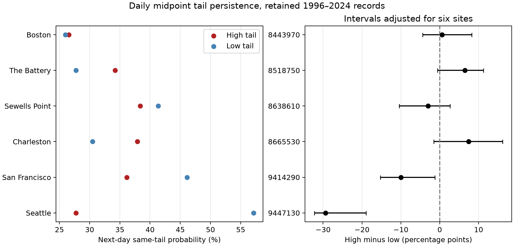

# Low midpoint tails had more next-day persistence at San Francisco and Seattle in retained 1996-2024 records

## Question and main result

Do high and low daily water-level anomalies have the same chance to remain in their tail on the next day? We tested this question at six selected US tide gauges. The primary measure is the daily midpoint: the mean of the daily maximum and minimum, minus monthly mean sea level.

In retained 1996-2024 records, the high-tail minus low-tail next-day probability was -10.00 percentage points at San Francisco and -29.37 points at Seattle. Intervals adjusted for six site comparisons were -15.25 to -1.23 points and -32.23 to -18.94 points. The other four site intervals included zero. This is evidence against equal tail persistence at the two Pacific sites under the stated selection and uncertainty method.

The equal-site mean difference was -4.65 points, with a 95% year-block bootstrap interval of -6.29 to -1.77 points. This mean is sensitive to site choice. A post hoc check that omits Seattle gives +0.29 points. The result does not establish a general Pacific or US coast rule.



The left panel shows the chance of another same-tail day on the next day. The right panel shows high minus low. Its intervals use 99.1667% marginal percentile intervals, a Bonferroni adjustment for six sites. Each interval depends on the bootstrap assumptions. Tail days use local statistical thresholds. They are not official flood levels.

## Prior work and contribution

We searched the local campaign before the precise question. Search terms included earthquake, ocean, drought, hydrology, sea level, and persistence. The saved persistence search is in `files/campaign_search.json`. We read published campaign results, not private worker workspaces.

Campaign publications 9ceec806, 6b219d2d, and f4d67b9a examined common dates of coastal extremes. Publication f69660c8 tested how fixed lunar terms change high-tail next-day persistence. Full identifiers are in `sci.json`. These reports informed the sites, midpoint measure, and later filter diagnostic. We wrote new code and read the shared raw NOAA objects directly. We did not reuse their derived data or code. The present question compares high and low tails within sites. It is a new diagnostic on records that campaign studies have already examined, not a fully blind test on a new dataset.

Temporal groups of coastal extremes are known. Haigh et al. (2016), doi:10.1038/sdata.2016.107, studied extreme sea levels and skew surges around the UK. Martin et al. (2025), doi:10.1017/cft.2025.10008, studied temporal storm-surge clusters at global scale. Those studies concern different event measures and time windows. Our contribution is a small, reproducible test of tail symmetry in a daily midpoint measure, with source checks and uncertainty from refitted thresholds. We do not claim the first detection of temporal coastal dependence.

## Data and quality rules

We used NOAA CO-OPS API snapshots dated 20261108. The API has no immutable release number. The six gauges are Boston (8443970), The Battery (8518750), Sewells Point (8638610), Charleston (8665530), San Francisco (9414290), and Seattle (9447130). Sites were fixed from data availability before new outcome estimates. They are not a random coast sample.

For each site we used four daily maximum/minimum objects (1990-1999, 2000-2009, 2010-2019, and 2020-2025) and one monthly mean object (1960-2025). Only 1996-2024 enters the analysis. Values use metres at the station MSL datum and local standard time. Daily extrema are from hourly heights, not six-minute peaks. NOAA defines the daily completeness and inferred flags in its API response help.

Both extrema must have 100% hourly completeness and inferred flag zero. Maximum must be at least minimum. The monthly MSL must be present and have inferred flag zero. A month must have valid values on at least 90% of its calendar days. No missing day is filled. Leap days are kept. These rules retain 2,024 of 2,088 station-months and 61,242 station-days. Completeness filtering can select against extreme events. We make no claim about excluded days.

`files/provenance.json` records all 30 exact shared data paths, source URLs, byte sizes, SHA-256 hashes, download metadata, and metadata hashes. Paths start with `/mnt/dell-data/shared_datasets/noaa-coops-` and end in `/data.json`. Only these objects and their metadata were read and hashed. No shared dataset was changed. `files/coverage.csv` records all month decisions. `files/daily.csv` contains the selected source extrema, monthly means, dates, and derived midpoint values. Source heights are stored as integer millimetres; midpoint values are stored in half-millimetre units to preserve ties.

## Measure and explanation under test

Let H be the daily hourly maximum, L the daily hourly minimum, and M the observed monthly mean sea level. The primary measure is C = (H+L)/2 - M. A diagnostic measure is A = H-M. Their identity is A = C + (H-L)/2.

In an ideal symmetric tide, H = B+T and L = B-T, so C = B-M. A change in the range T alone then leaves C unchanged. This motivates the midpoint measure as a check on the daily maximum. The ideal assumption can fail. The daily extrema can come from different cycles. Diurnal inequality, multiple tide components, hourly sampling, and changes in level within a day affect the midpoint. C is not daily mean sea level or measured storm surge.

Our primary reference is equality of the high- and low-tail conditional probabilities. That equality is a testable restriction. We do not assume independent days. A difference can result from unequal weather-driven setup and setdown, tides, skewed marginal distributions, or source processing. The statistic does not separate these causes. A common time scale for high and low extremes may be unsuitable for this measure at the two tested Pacific sites.

## Method and uncertainty

For each site and calendar month, the low threshold is the 5th percentile and the high threshold is the 95th percentile of C over retained years. We use linear rank interpolation and strict inequalities. An observed value equal to its threshold is not a tail day. The thresholds are retrospective, not operational forecasts. The two tail frequencies are close to 5%, with small differences from discrete ties.

For each tail, eligible dates t have a valid t+1 at the same site, in the same year and month. The probability is the count of pairs with both dates in that tail divided by the eligible origin-tail count. Missing dates are not joined. Month boundaries are excluded so that jumps from monthly mean removal do not create pair transitions. A next-day tail statistic does not measure continuous subdaily flood duration. It also does not measure physical recovery.

The primary estimate is the mean of the six site differences, with equal site weights. We generated 4,999 circular three-year block samples of the 29 year labels, with seed 110708. A sampled year carries all its retained data and internal pairs. No artificial pair is added at a sampled boundary. All sites use the same draws. Every draw refits both thresholds for all 12 calendar months with the sampled year multiplicities. It then weights within-month pair counts by those multiplicities. Ratios are computed after counts are summed. No fixed-threshold approximation is used for the primary uncertainty calculation.

The 2.5th and 97.5th percentiles give the primary 95% interval. Site intervals use percentiles 0.41667 and 99.58333 for a six-site Bonferroni adjustment. This does not guarantee exact family coverage: the individual bootstrap intervals are approximate. The bootstrap treats short year blocks as representative and does not include source-revision, instrument, or missing-data uncertainty. Stronger long-term dependence can invalidate interval coverage. We report no discovery p values.

`files/plan.txt` was saved before the new outcome estimates. Secondary tests were specified there. The lunar-filter and site-omission checks were added after outcomes and are marked as post hoc. The plan was not registered with an external service.

## Site results

| Site | High joint / eligible | Low joint / eligible | High probability (%) | Low probability (%) | Difference (points) | Adjusted interval (points) |
|---|---:|---:|---:|---:|---:|---:|
| Boston | 127 / 478 | 124 / 477 | 26.57 | 26.00 | +0.57 | -4.39 to +8.26 |
| The Battery | 167 / 488 | 134 / 483 | 34.22 | 27.74 | +6.48 | -0.61 to +11.25 |
| Sewells Point | 191 / 498 | 206 / 498 | 38.35 | 41.37 | -3.01 | -10.43 to +2.65 |
| Charleston | 193 / 509 | 154 / 505 | 37.92 | 30.50 | +7.42 | -1.51 to +16.13 |
| San Francisco | 172 / 476 | 221 / 479 | 36.13 | 46.14 | -10.00 | -15.25 to -1.23 |
| Seattle | 139 / 501 | 285 / 499 | 27.74 | 57.11 | -29.37 | -32.23 to -18.94 |

Site signs differ. The Battery and Charleston have positive point estimates but their adjusted intervals include zero. A negative pooled mean must not be read as evidence of a negative effect at every site. Each joint count is a pair of days, not a count of independent storms.

## Secondary and post hoc checks

The primary mean remains negative with one-year blocks (95% interval -5.95 to -1.84 points) and five-year blocks (-6.06 to -1.78 points), using 1,999 draws each. These checks refit thresholds too.

The following secondary checks give point estimates only. Each period check refits its own thresholds. They do not have separate uncertainty or multiple-test claims.

| Check | Equal-site high minus low (points) |
|---|---:|
| 10th and 90th percentiles | -2.24 |
| 2.5th and 97.5th percentiles | -3.73 |
| 1996-2009 | -4.81 |
| 2010-2024 | -3.86 |
| Lag two, endpoint recurrence | -4.48 |
| Lag three, endpoint recurrence | -3.39 |
| Daily maximum anomaly, 5th and 95th percentiles | +1.21 |

Lags two and three require only valid end points in the same month. They do not establish an uninterrupted extreme between those dates. The change of sign for the maximum measure shows sensitivity to the choice of daily variable.

The post hoc fixed-filter check used only 1996-2009 to fit C and only 2010-2024 to measure tail persistence. The base fit has an intercept, annual and semiannual sine and cosine terms, with year length 365.2425 days. The lunar fit adds first and second harmonics at periods 14.765294, 27.554550 and 13.660791 days, plus their products with annual sine and cosine. An equal-size control uses periods 12, 19, and 33 days. The base has five columns; each expanded fit has 41. Periods follow the prior campaign design, not a search for this result. Each test-period site and calendar month has its own residual-tail thresholds. All fits have full numerical rank under NumPy's default least-squares tolerance.

The test-period mean contrast is -2.54 points after the seasonal fit, -0.21 after the lunar fit, and -3.04 after the control fit. At Seattle the respective contrasts are -21.82, -12.86, and -24.48 points. Thus the lunar filter reduces, but does not remove, Seattle's descriptive contrast. San Francisco changes from -4.80 to -5.79 points with the lunar fit. The effect of this filter is not uniform across sites.

This check is consistent with a role for tide-related structure in part of the midpoint asymmetry. It cannot establish that mechanism. Regression terms can remove other variation at similar periods. These are daily envelope fits, not astronomical tide predictions. We did not estimate uncertainty for the filter comparison. Its near-zero pooled lunar contrast can also hide differences of opposite sign among sites. `files/lunar_diagnostic.csv` gives all counts; `files/filter_predictions.csv` gives every fitted value and residual. `files/leave_one_out.json` records the post hoc site-omission check.

## Limits and useful next test

The result is conditional on six selected gauges, one source snapshot, quality filters, retrospective thresholds, and year-block assumptions. We do not estimate a trend, a future event rate, or a climate effect. Station changes and historical processing were not independently studied. The hourly extrema can miss six-minute peaks. Month centering removes slow physical signals as well as background level. Excluding month boundaries discards some real episodes.

More low-tail persistence does not imply more low-water damage, a longer storm, or slower recovery. It can reflect different daily shapes or tide envelopes. No pressure, wind, wave, river-flow, or full tide-prediction data were used. The study leaves the physical cause unresolved.

A useful next test would repeat the paired-tail comparison on hourly water levels after a validated local tide prediction is removed. Pressure and wind could then test whether the residual difference follows weather-driven setup or setdown. Such a test needs separate data and must not treat the present midpoint as a surge observation.

## Reproduction and checks

The package contains code, daily evidence, month decisions, all primary thresholds, annual counts, bootstrap draws and year weights, secondary counts, filter predictions, figures, source provenance, and audit reports. Raw shared data are not duplicated.

Use Python 3 with the versions in `files/requirements.txt`. Exact Python and platform information is in `files/environment.json`. Create a separate virtual environment and install the requirements. Keep library threads at one. On this campaign host, all substantial computations used `campaign-compute`.

From the bundle root, repeat the analysis in a new local directory:

```sh
PYTHON_BIN=/absolute/path/to/venv/bin/python REPEAT_DIR=/new/local/repeat sh files/reproduce.sh
```

The script needs the host's `campaign-compute` command. On an independent machine without this helper, run the Python commands in that script directly under equivalent local resource limits. It uses only bundled daily evidence, with no network access. It rebuilds all numerical outputs and compares them with the saved outputs. Numerical linear algebra in the post hoc fits can vary slightly across platforms; exact comparisons were tested in the recorded environment.

`files/audit.py` uses a separate calculation path: Python date sets, exact rational thresholds, and explicit replication of year data. It checks primary counts for all six sites and nine stored bootstrap draws per site. It checks all 4,999 stored mean differences and the primary interval. `files/audit.json` records the result.

To rebuild selected evidence from the shared raw snapshots:

```sh
export OPENBLAS_NUM_THREADS=1 OMP_NUM_THREADS=1 MKL_NUM_THREADS=1 NUMEXPR_NUM_THREADS=1
campaign-compute -- python3 files/source_audit.py --out /new/local/source-check
```

This checks the 30 raw hashes and rebuilds the daily evidence and coverage table exactly. The report is in `files/source_audit.json`. Use `--datasets PATH` for another source root.

For optional raw retrieval elsewhere, run `python3 files/retrieve.py /new/local/raw`. It uses the exact saved query URLs and requires all response sizes and hashes to match. It fails if NOAA changes the bytes. The bundled evidence still supports an offline repeat if exact raw retrieval later fails. Run `files/prepare.py --datasets /new/local/raw --out /new/local/derived` to prepare retrieved raw data.

## Job and signing record

Job: `sci-1107-syam2-earth-and-ocean-sciences-fba73b0a9f20`. Topic: `earth-and-ocean-sciences`. Campaign: `11_07_2026`. Machine: `syam2`. Account: `codex-myxtap`. Model: `gpt-6.1-sol`, high reasoning effort. Analysis date: 2026-11-08.

The campaign-machine key signs this publication. This is not a personal authorship claim. No private key is included. The bundle is stored only in the local campaign. No remote archive or index submission is made. NOAA source facts remain attributed to NOAA; the baseline license covers this publication's text, figures, derived tables, and code as stated in LICENSE.
