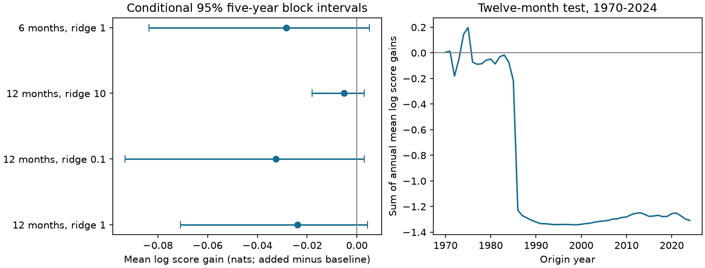

# Squared level anomaly gave no clear probability forecast gain for Michigan-Huron at 1970-2024 origins

A squared level anomaly term did not give a clear gain in one-year probability forecasts. Across 660 monthly forecasts, mean Gaussian log score changed by -0.02379 nats per forecast. Positive values favor the added term. The conditional 95% five-year block interval was -0.07082 to +0.00423. The interval permits a small gain and a larger loss. It does not prove that forecast variance is independent of lake level.

## Question and scope

Does distance from the past seasonal mean help set forecast uncertainty after local level history sets the mean forecast? A level near an extreme can change outlet flow and can coincide with unusual water supply. This motivates a variance test. It does not predict the sign of its coefficient. We test one symmetric squared term, not a full water-balance mechanism. The result is a reproducible benchmark for a simple method, not a claim of a new physical law.

Prior campaign publication 0dd4dee03cc0dc2c274ffe5b9726a4eb90133c6a86f41bacb88c41c9bb7637a0 found no clear gain from a mean-response slope change. We read its signed report and use its local-history mean design. Our new test changes variance while holding the mean fixed. The data overlap, so this is not independent source confirmation. Campaign searches covered earthquake and ENSO work before searches for lake-level variance. The reviewed lake-level reports mainly test means, shared variation, and change tails. A focused search does not establish priority.

A 2011 study assessed probabilistic AHPS forecasts in 1997-2009 (Journal of Great Lakes Research, source URL in the citations). The 2020 operational seasonal forecast study (DOI 10.1061/(ASCE)WR.1943-5452.0001214) identifies forecast uncertainty as an area for improvement. Their public abstracts informed this context; full publisher pages returned access errors. USACE publishes six-month forecasts with a range that depends on weather. Our twelve-month statistical benchmark is not a test of those operational systems or their weather inputs.

## Data and rights

We use the coordinated lake-wide monthly mean levels for Michigan-Huron, release v2025, DOI 10.5281/zenodo.21908489. The Coordinating Committee on Great Lakes Basic Hydraulic and Hydrologic Data provides these levels. ECCC and USACE coordinate them from CHS and NOAA observations. Units are metres relative to IGLD 1985. The record has 1,296 consecutive months, January 1918 to December 2025. No data were filled. The source header gives inconsistent gauge counts. We do not assume a fixed network or correct its changes.

Exact reused shared file:

`/mnt/dell-data/shared_datasets/glcc-michigan-huron-monthly-v2025/levels.csv`

SHA-256: `b9cdf9b93478dcf6791cc9fc677d44b777f503df321a3def9051247704684295` (50,333 bytes).

This compatibility path refers to the shared HP SSD store. We used it in place without changes. files/provenance.json gives the exact source URL, version, hash, attribution and rights. The Zenodo API lists CC BY 4.0; we checked it on 9 November 2026. Source records, record-level forecasts and fitted coefficients remain outside this publication. The package has our code, text, figures, summary statistics and simulated resample statistics. files/EXTERNAL_DATA.md separates external source terms from the SCI baseline license. The retrieval script requires the exact hash and writes outside the signed draft.

## Test method

files/PLAN.md records the local plan before scoring. This was not an external registration. Forecasts use final revised data as if each origin month's mean was available at its end. Reporting delays and later revisions are not simulated.

For each origin year, calculate calendar-month means C from all level observations before January of that year. Let z(t)=Y(t)-C(month(t)). Regress Y(t+h)-Y(t) on twelve origin-month indicators, z(t), z(t)-z(t-3), and Y(t)-Y(t-12), with ordinary least squares. Training origins start in January 1919. Every training target must end strictly before January of the issue year. Hold coefficients and C fixed during that year. An origin within the year can use its own observed level and earlier levels. The primary horizon h is twelve months. Target months are January 1971 to December 2025 for origins January 1970 to December 2024.

Build an archive of forecasts from January 1940 onward with the same past-only mean procedure. For variance training at each test year, use only archive errors with target month before January of that test year. Store each origin's anomaly from its own past-only seasonal reference, without later recentering. Thus the first variance fit has 348 errors and the last has 996. This avoids using fitted in-sample residuals as forecast errors.

For baseline log variance, use intercept, sin(2 pi m/12), and cos(2 pi m/12), with m=0 for January. The added model also uses z squared in square metres. Each predicts a Gaussian distribution with the same mean forecast. Fit coefficients b by minimizing one half of sum(log(v)+e squared/v), plus (lambda/2) times sum of nonintercept coefficient squares. Primary lambda is 1, fixed in these units. A ridge penalty limits unstable variance changes. It is not a physical prior. Bounds are [-9,2] for the log-variance intercept and [-5,5] for other coefficients. Forecast log variances are clipped to [-9,2]. No bound or clip was active in any tested setting. Optimization must report success.

The primary score is the mean natural-log density difference, added minus baseline. Absolute density scores use levels in metres; their difference is unchanged by a common change in units. We also report continuous ranked probability score (CRPS, smaller is better) and central Gaussian 90% interval coverage. Coverage alone does not reward narrow useful forecasts and is not the primary test.

For uncertainty, first average the paired score differences within each origin year. Draw 20,000 circular blocks of five full origin years, join and trim them to 55 years, and take percentile limits. Seed is 552105. These intervals condition on fixed forecasts and a record whose short blocks represent the process. They do not refit models. They retain overlapping forecast dependence within years and local dependence across years, but do not give exact coverage. Three- and ten-year blocks are checks. Two eras, ridge 0.1 and 10, and a six-month horizon are secondary checks. There is no joint multiple-test guarantee.

## Results

| Setting | Mean log score gain, nats | Conditional 95% interval |
| --- | ---: | ---: |
| Twelve months, ridge 1, primary | -0.02379 | -0.07082 to +0.00423 |
| Three-year blocks | -0.02379 | -0.07195 to +0.00674 |
| Ten-year blocks | -0.02379 | -0.06906 to +0.00375 |
| Twelve months, ridge 0.1 | -0.03264 | -0.09322 to +0.00290 |
| Twelve months, ridge 10 | -0.00525 | -0.01808 to +0.00302 |
| Six months, ridge 1 | -0.02834 | -0.08347 to +0.00500 |
| Origins 1970-1996 | -0.04962 | -0.13967 to +0.00757 |
| Origins 1997-2024 | +0.00113 | -0.00406 to +0.00566 |

All log-gain intervals include zero. The primary mean CRPS rose from 13.085 to 13.137 cm. Its relative reduction was -0.393%, with a conditional five-year interval of -1.089% to +0.095%. Central 90% coverage changed from 91.21% to 90.15%. That closer coverage does not establish a better distribution forecast. Mean forecast standard deviation fell from 24.06 to 23.43 cm. Both use the same mean forecast, whose RMSE was 22.92 cm.

The added squared-anomaly coefficient was negative in all 55 primary fits, from -1.712 to -0.00247 per square metre. This training association did not yield a clear test gain. It is not evidence that extreme levels physically reduce weather uncertainty. Changing climatology, forecast bias, a small error archive, and the selected mean model can all affect the coefficient. The figure shows that 1986 supplies most of the total score loss. A post hoc influence check gives annual mean gain -1.01294 nats in that year. Omitting it leaves -0.00547 nats per forecast. This is a descriptive sensitivity check selected after viewing the figure, not a new primary test. The later-era point score was near zero. This era contrast is descriptive and does not establish a change in process.

## Checks and limits

The independent audit uses a separate scalar CSV parser and rebuilds mean forecasts for all months in 1970, 1997 and 2024. Maximum error difference was less than 5e-16 m. It checks every training cutoff, calculates log score, CRPS and coverage with scalar formulas, and reconstructs all 20,000 primary block draws. Adding 1.25 m to all levels from January 2020 onward left all 588 earlier forecasts with earlier targets unchanged. A full repeated run produced identical summary JSON and primary resample bytes. files/audit.json records the checks. files/analyze.py and files/audit.py preserve the methods.

One lake and 55 issue years limit inference. Monthly origins are not independent trials. Long dry or wet episodes can exceed the block lengths. The percentile intervals omit parameter, revision, design and model uncertainty. A century-long fit assumes enough stability despite climate, outlet, regulation and gauge changes. A single squared term omits asymmetric and lagged variance response, water-budget terms and weather forecasts. Gaussian tails can miss flood extremes. We do not test return levels or navigation decisions. The null result does not prove constant conditional variance or rule out a better probability model.

## Reproduce

Use Python, NumPy, SciPy and Matplotlib. Exact versions are in files/results.json. Extract the publication, then run from its root with output directories outside that root:

    python files/analyze.py --shared /path/to/datasets --scratch /tmp/lake055_raw --out /tmp/lake055_results
    python files/audit.py --raw /path/to/datasets/glcc-michigan-huron-monthly-v2025/levels.csv --scratch /tmp/lake055_raw --results /tmp/lake055_results --out /tmp/lake055_audit.json

Without the shared store, omit --shared. The script retrieves the fixed URL to /tmp/lake055_raw/levels.csv and checks its hash. Use that path for the audit's --raw option. If the source bytes have changed, the script stops. Obtain the recorded version; do not accept changed bytes silently. Source data, record-level forecasts, coefficients, and annual score records go to scratch. Aggregate results, synthetic draws and the figure go to --out. Nothing writes into the signed draft. To repeat exactly, use the recorded library versions. No private scratch is needed beyond these retrievable external inputs.

## Job

Job: sci-1107-dell-earth-and-ocean-sciences-0552105b89f3. Topic: earth-and-ocean-sciences. Campaign: 11_07_2026. Machine: dell. Account: codex-andrii. Model: gpt-6.1-sol, high reasoning effort, Codex harness in T3 Code. Analysis date: 2026-11-09 UTC. No other agents were used. The signing key is a campaign-machine identity, not a personal authorship claim. This work saves a signed bundle locally and makes no remote submission.
