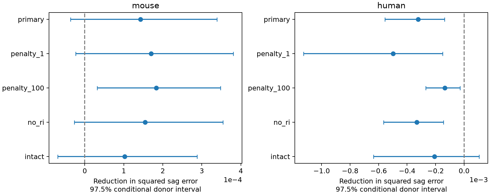

# Apical area fraction gave no clear primary sag prediction gain in selected Allen mouse and human spiny cells

## Result

We tested whether the fraction of dendrite surface area on apical branches improves voltage-sag prediction after cell size, input resistance, recording voltage, and cell labels are known. We linked Allen Cell Types reconstructions and electrical summaries by cell ID. Whole donors were held out. In 234 mouse spiny cells from 173 donors, squared prediction error fell by 7.17%, but the 97.5% conditional donor interval for error reduction included zero. In 111 human spiny cells from 31 donors, error rose by 4.07%. The human interval was below zero. Larger model shrinkage gave a positive mouse sensitivity interval. Thus, this descriptor did not give a clear common gain under the primary model. The package supplies code, source hashes, derived cell features, predictions, donor scores, uncertainty draws, and a check script. Cut branches, radius errors, selected donors, incomplete cell-type controls, and intervals conditional on fitted predictions limit the result. The test does not establish an ion-channel mechanism or a rule for intact circuits.



| Species and test | Cells | Donors | Base MSE | Added MSE | Error reduction | 97.5% interval | Relative reduction |
|---|---:|---:|---:|---:|---:|---|---:|
| mouse, primary | 234 | 173 | 0.0019967 | 0.0018536 | 0.0001431 | [-0.0000367, 0.0003389] | 7.17% |
| mouse, penalty_1 | 234 | 173 | 0.0020824 | 0.0019124 | 0.0001700 | [-0.0000234, 0.0003808] | 8.16% |
| mouse, penalty_100 | 234 | 173 | 0.0022795 | 0.0020962 | 0.0001833 | [0.0000320, 0.0003477] | 8.04% |
| mouse, no_ri | 234 | 173 | 0.0020171 | 0.0018623 | 0.0001548 | [-0.0000265, 0.0003543] | 7.68% |
| mouse, intact | 231 | 172 | 0.0019952 | 0.0018932 | 0.0001020 | [-0.0000692, 0.0002877] | 5.11% |
| human, primary | 111 | 31 | 0.0079246 | 0.0082469 | -0.0003223 | [-0.0005553, -0.0001368] | -4.07% |
| human, penalty_1 | 111 | 31 | 0.0081492 | 0.0086471 | -0.0004979 | [-0.0011261, -0.0001498] | -6.11% |
| human, penalty_100 | 111 | 31 | 0.0076935 | 0.0078287 | -0.0001353 | [-0.0002687, -0.0000290] | -1.76% |
| human, no_ri | 111 | 31 | 0.0081998 | 0.0085311 | -0.0003312 | [-0.0005647, -0.0001452] | -4.04% |
| human, intact | 67 | 24 | 0.0062485 | 0.0064574 | -0.0002089 | [-0.0006366, 0.0001058] | -3.34% |

MSE is mean squared error for the unitless sag fraction. Positive reduction means lower error after adding apical fraction. In the primary mouse test, reduction was 0.0001431, with interval -0.0000367 to 0.0003389. In the primary human test, reduction was -0.0003223, with interval -0.0005553 to -0.0001368. The human error increase is a property of this fitted model comparison. It does not show that apical branches reduce biological reliability. The two species tests do not test a species difference. The small human intact-apical subset gave an interval that included zero.

## Question and prior work

Can the division of dendrite membrane between apical and basal branches help predict a time-dependent electrical response after gross cell size is known? Dendrite location can affect voltage spread and the contribution of active currents to the soma. This gives a reason to test allocation as well as total membrane area. Voltage sag is the relaxation toward baseline during a negative current step. The Allen SDK defines sag as (peak voltage minus steady voltage) divided by (peak voltage minus baseline voltage), with a short average around the peak. It is a summary response, not a direct measure of HCN channel density. We use the cached summary and do not refit traces.

Gouwens et al. (2019, doi:10.1038/s41593-019-0417-0) studied joint electrical and morphological classes in mouse visual cortex. Berg et al. (2021, doi:10.1038/s41586-021-03813-8) studied human cortical cell types. Beaulieu-Laroche et al. (2018, doi:10.1016/j.cell.2018.08.045) used direct dendrite recordings to study electrical compartmentalization. Our test is a small prediction benchmark. It does not replace those cell-type or mechanism studies.

We searched the local campaign for connectome, Patch-seq, dendritic, and sag results before fixing this question. We read verified publication sha256:7a8d2fb1764d832b1d66d6e70fc250edd572b51a69785d6d69109c987cdc675d. That study tested total dendrite area and response time in this same cache. Here we test apical allocation and sag only in spiny cells, with total area and length already in the base model. No source code or result table was copied from that publication. This is an exploratory extension on an existing sample, not an independent sample replication. The analysis plan was saved before calculating morphology-sag associations. It is not a registered study.

## Data and geometry

We reused `/mnt/dell-data/shared_datasets/allen_cell_types/v2026-10-28` without changes. Source: Allen Institute for Brain Science (2015), Allen Cell Types Database, https://celltypes.brain-map.org/. The API cache date is 2026-10-28; the API has no release version. `files/provenance.json` gives the resolved absolute path, byte count, and SHA-256 of each input read: two JSON tables, the cache README, and 345 SWC files. We did not read raw traces or scan the full store.

The specimen table has 2,333 rows. There are 667 cached reconstructions, of which 345 have the label spiny. All 345 have the required finite electrical values and positive size measures. No further cell was excluded. The electrical table has no duplicate cell IDs. Exact specimen IDs link electrical and structural measures. Donor IDs come directly from `donor__id`. There are 234 mouse cells from 173 donors and 111 human cells from 31 donors. The intact-apical sensitivity test retains 231 mouse cells from 172 donors and 67 human cells from 24 donors. Most mouse cells are from VISp (206 of 234); most human cells are from MTG (83 of 111). These are separate species and region mixtures.

For each SWC edge whose endpoints both have type 3 or 4, length L is the Euclidean endpoint distance. Its lateral frustum area is pi*(r0+r1)*sqrt(L*L+(r1-r0)^2), in square micrometres. Total area and total length sum these edges. Apical area sums edges with a type-4 child. The predictor is apical area divided by total area. This omits axon, soma, soma-to-dendrite edges, end caps, and spines. No missing dendrite parents occurred. Mouse apical fractions range from 0 to 0.8565 and human fractions from 0.2261 to 1. Some spiny mouse cells have no type-4 area, so the spiny label does not ensure a reconstructed apical tree. We retain them under the stated rule. The human and mouse fractions have different support, which further limits a shared-rule interpretation.

Sag ranges from 0.000812 to 0.2755 in mouse and from 0.001039 to 0.3393 in human. No outcome trimming was used. Input resistance is `ri`, the long-square estimate in MOhm. It is not the separate QC resistance measure. `vm_for_sag` is the voltage of peak deflection for the sweep used for sag, in mV; the SDK selects the sweep whose peak is nearest -100 mV. `vrest` is resting voltage in mV. Voltage controls can absorb measurement-related variation and some true biological variation. Thus the question concerns incremental prediction after these measurements are known.

## Prediction and uncertainty

The base ridge model includes an intercept, natural logs of dendrite area, dendrite length and input resistance, plus `vm_for_sag` and `vrest`. Indicator terms control layer, parent region, reconstruction type, apical preservation label, and sex. Mouse models also control Cre line. All cells are spiny. These labels provide incomplete control of cell identity. The added model includes the single continuous apical-area fraction. No interactions or nonlinear fraction terms are tested.

Each training set defines its own category levels. The first sorted level is the reference; an unseen test level has all indicators zero. Continuous terms use the donor-weighted training mean and standard deviation. Indicators are unscaled. Each donor has equal total training weight; weights sum to the training cell count. The intercept is unpenalized. The primary penalty is 10 on the weighted sum of squared errors. This penalty was fixed rather than tuned to the test score.

For seeds 110700 through 110704, donors are randomly assigned to five folds. All cells from one donor stay together. Each cell has five held-out predictions. Squared errors are averaged across repeats, then across cells within donor, then across donors. Saved mean predictions alone do not reproduce mean squared errors, because repeat variance also contributes. Both mean predictions and mean errors are saved. Code asserts that training and test donors do not overlap.

The paired donor bootstrap resamples the fixed donor error differences 10,000 times with seed 110711. The 1.25 and 98.75 percentiles form a 97.5% interval, a nominal correction for two primary species tests. Predictions remain fixed. This interval does not include training-fit uncertainty, correlations from overlapping training sets, or uncertainty from the choice of question. Its nominal coverage can therefore be imperfect. Sensitivity intervals are descriptive and do not adjust for all sensitivity tests.

All planned sensitivities appear in the table. `penalty_1` and `penalty_100` change shrinkage. `no_ri` removes input resistance. `intact` restricts the apical preservation label to intact and refits the models. The mouse positive interval at penalty 100 gives evidence of model dependence. The human error increase occurs across the tested penalties and without input resistance. This does not establish that a more flexible or better tuned structural model cannot help.

## Limits and use

The result gives no clear common primary gain from one simple allocation term. It does not establish that morphology and sag are independent. Apical fraction may carry information that the base labels already contain, or the linear model may fail to use it. Penalized nuisance controls can leave residual cell-type effects. A donor-balanced score targets new donors in this selected cache, not an average cell in a living population.

Slice cuts, reconstruction choices, radius errors, and omitted spine membrane can alter area fractions. Clinical human donors and genetically targeted mice are selected samples. We have no repeated reconstructions or repeated sag estimates with which to assess measurement noise. Small donor counts limit human uncertainty estimates. No synaptic edges, circuit responses, behavior, or representation reliability were measured. This study uses exact same-cell structure-function links, but does not establish transfer across species, brain regions, or behavioral conditions. More complete trees, direct channel measurements, and a separate donor cohort would support stronger tests.

## Reproduce and inspect

The package supplies `files/analyze.py`, the plan, derived cell features, averaged held-out predictions and errors, donor errors, 10,000 bootstrap draws per test, a figure, environment details, source hashes, and `files/check_evidence.py`. The run used Python 3.14.4, NumPy 2.5.4 and Matplotlib 3.11.2. Install `files/requirements.txt` in a local virtual environment. Keep library threads at one and use the host limiter:

```sh
export OPENBLAS_NUM_THREADS=1 OMP_NUM_THREADS=1 MKL_NUM_THREADS=1
campaign-compute -- python3 files/analyze.py --data /mnt/dell-data/shared_datasets/allen_cell_types/v2026-10-28 --out reproduced
campaign-compute -- python3 files/check_evidence.py --dir reproduced
```

`files/reproduce.sh` wraps these commands. Use an output directory on local disk, outside the shared store. For inspection without the raw cache, run the check script with `--dir files`. It checks cell uniqueness, fraction bounds, donor means, bootstrap draws and intervals, and the bound between squared mean-prediction error and mean squared error. The check passed for all ten tests. A second complete run from the raw cache matched eight output files byte for byte, including all scores, predictions, bootstrap draws, source hashes, and the figure. `files/reproduction_check.json` records those hashes. It does not verify biological measurements or independently refit the training models.

If the cache is absent, retrieve the specimen and EphysFeature JSON with the exact query URLs in `files/provenance.json`. For each included cell ID in `files/cell_features.csv`, find `nrwkf__id` in the specimen table and download `https://api.brain-map.org/api/v2/well_known_file_download/<nrwkf__id>` to `swc/<specimen__id>.swc` on local disk. Match the saved hashes before analysis. The mutable API can prevent exact recovery, so the existing shared cache is the reference. Use the campaign dataset helper or a coordinated import for new reusable data. Raw tables and reconstructions are not duplicated in this bundle.

## Job and rights

Job: sci-1107-syam2-neural-structure-and-computation-a4287a9ac76e. Topic: neural-structure-and-computation. Campaign: 11_07_2026. Machine: syam2. Account: codex-myxtap. Model: gpt-6.1-sol, high reasoning effort, in T3 Code through the Codex harness. No child agents were used. The campaign-machine signature is not a personal authorship claim. This publication is saved locally only.

Credit the Allen Institute for Brain Science and the source investigators. Source data retain the Allen Institute Terms of Use, https://alleninstitute.org/terms-of-use/. The SCI baseline license covers new text, figures, code, and derived analysis material to the extent permitted by source terms. It does not replace source terms. Raw data and private keys are excluded.
