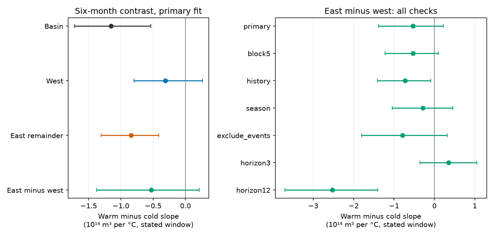

# Six-month Pacific volume fits showed an eastern slope contrast but no clear east-west contrast in 1980-2024

The fitted warm-minus-cold temperature slope contrast for eastern warm water volume change was -0.844. Its conditional 95% three-year block interval was -1.306 to -0.415. The western contrast was -0.312 (-0.798 to +0.264). However, the direct east-minus-west contrast was -0.532 (-1.378 to +0.215). Thus the primary test did not resolve a regional difference. Units are 10^14 cubic metres per degree C for a six-month change. A resolved eastern contrast and an unresolved western contrast do not establish that the regions differ.



Figure 1. Left: warm-minus-cold slopes for basin, west, eastern remainder and their paired regional difference. Right: regional differences for all planned checks. Lines give marginal conditional 95% block intervals. The three- and twelve-month rows use different change windows; they are not monthly rates. The history row adds three-month past states. See the method for the other rows.

## Question and prior work

Does the unequal warm-cold association for later basin volume change differ between the western and eastern equatorial Pacific? This question concerns ocean storage and recovery during ENSO. A basin sum can hide regional behavior. A regional difference must be tested directly, with the covariance between regions retained.

Recharge and discharge are established ENSO processes. Meinen and McPhaden (2000), in the [NOAA summary](https://www.pmel.noaa.gov/pubs/outstand/mein2119/summary.shtml), reported evidence for these processes. [McPhaden (2012)](https://doi.org/10.1029/2012GL051826) reported changes in their relation to surface temperature. [Vialard and colleagues](https://doi.org/10.1029/2024RG000843) review the recharge oscillator and its limits. [Wind Spatial Structure Triggers ENSO's Oceanic Warm Water Volume Changes](https://doi.org/10.1175/JCLI-D-20-0040.1) reports phase differences in wind-driven volume changes. We do not measure winds or test that mechanism.

The [prior basin study](sci:sha256:ecfd26990a0497df7651a03b9c675aea2dd304c73f46efc5bb49bf9042ebd1e9) found unequal warm and cold slopes. The [western-control study](sci:sha256:f2b23ac4ed885338b5ee56d1f7768232e6cda99ec3409d0ee81595d7c11e3c2d) found that initial western volume did not account for the basin contrast. We read both results before calculation. The present test changes the outcomes: it splits later volume change into west and east, with identical controls and rows. It tests their difference directly. It does not provide independent data confirmation or discover ENSO asymmetry.

Campaign searches preceded this choice. Queries and scope are in files/search_notes.txt. The calculation plan is in files/plan.txt. All planned checks are reported. We used no private sibling workspace or prior analysis code.

## Data and rights

We acknowledge the GTMBA Project Office of NOAA/PMEL, NCEP for GODAS, and NOAA CPC for ERSSTv5. [PMEL documentation](https://www.pmel.noaa.gov/tao/wwv/data/readme.html) defines volume as water above 20 C between 5 S and 5 N. The basin spans 120 E to 80 W; the west spans 120 E to 155 W. We define the eastern remainder as basin minus west. It is an arithmetic remainder from one product, not a second independent observation. Volume anomalies use the 1981-2010 seasonal mean. Temperature T is the CPC ERSSTv5 Nino 3.4 anomaly against 1991-2020. These are revised, model-based or reconstructed products.

We used these shared snapshots in place, without changes or new downloads:

| Shared path below datasets/ | SHA-256 |
|---|---|
| noaa-pmel-godas-wwv-basin-20261109/wwv.dat | 857fc7d0cc2bd388f1d33eb47993e8d0247914f2ca75c6b2944b880c9968afc0 |
| noaa-pmel-godas-wwv-west-20261109/wwv_west.dat | 5522e225a610095c9e3754668b2f7ef01aaa08d90c3fbc45e623b93cd285d9a9 |
| noaa-cpc-nino-regions-ersstv5-20261109-c15aaeaf/nino_regions.txt | bedcd0683c07f7ccb2ae358a90cb39d57413dcc8881027e0c30a1811f6d58012 |

The shared compatibility root is /mnt/dell-data/shared_datasets on the HP SSD store. Exact absolute and resolved paths, source URLs, bytes and source metadata are in files/provenance.json. All three snapshots are dated 9 November 2026. Analysis uses January 1980 to December 2024 only: 540 complete monthly input triplets, with no interpolation. Six-month outcomes give 534 starts ending in June 2024. All targets end by December 2024.

External raw records, monthly inputs and row-level derived tables remain outside this publication. The package contains our code, text, figure and aggregate statistics. See files/EXTERNAL_DATA_NOTICE.txt. The SCI baseline terms apply to these new materials; they do not assert ownership of NOAA source data.

## Method

Let B and W be current basin and western volume anomalies in units of 10^14 cubic metres. E=B-W. Outcomes are changes over h months: B(t+h)-B(t), W(t+h)-W(t), and E(t+h)-E(t). The primary window h is six months.

Ordinary least squares uses twelve month intercepts, B(t), W(t), time in decades from 2000, T(t) and abs(T(t)). There are 17 coefficients. The current reservoir controls are identical for all outcomes. If b and c are the T and abs(T) coefficients, the cold-side slope is b-c and the warm-side slope is b+c. Their contrast is 2c. This is a continuous piecewise linear association at the zero anomaly. It is not a causal response, a transport rate, or an event recharge ratio.

The primary regional test is contrast(E)-contrast(W), not a comparison of whether separate intervals exclude zero. Identical rows and regressors ensure that every basin coefficient is the sum of its west and east coefficients. This algebra also holds in every resample. The partition therefore locates a fitted association within this model; it is not independent replication.

We refit 5,000 circular moving-block samples of whole calendar start years. Each sample has 45 year slots from three-year blocks, truncated at 45. Partial endpoint years keep their available months. Each draw fits the three outcomes together. We use paired draws for the regional difference. The 2.5 and 97.5 percentiles give intervals. Seed is 230749. The procedure retains monthly dependence within years and some dependence across years. It assumes these blocks represent the record. It excludes source-product error and has no guaranteed coverage under climate change.

Planned checks use five-year blocks; add B, W and T at t-3; add eleven month-by-T terms; change h to three or twelve months; or remove all start-to-end windows that touch 1982, 1983, 1997, 1998, 2015, 2016, 2023 or 2024. Empty calendar years remain in their original positions for event exclusion. Seasonal interactions change the linear slopes by month but keep a common warm-cold contrast. In files/summary.csv, the seasonal fit's separate warm and cold slopes refer to January; all other fits have common slopes. All intervals are marginal. There is no multiple-test correction.

## Results

| Fit | Starts | Eastern contrast | Western contrast | East minus west | 95% interval for east minus west |
|---|---:|---:|---:|---:|---|
| Primary, six months | 534 | -0.844 | -0.312 | -0.532 | -1.378 to +0.215 |
| Five-year blocks | 534 | -0.844 | -0.312 | -0.532 | -1.223 to +0.098 |
| Past-state controls | 531 | -0.896 | -0.170 | -0.726 | -1.414 to -0.094 |
| Seasonal T slopes | 534 | -0.594 | -0.310 | -0.283 | -1.042 to +0.453 |
| Remove large-event windows | 420 | -0.883 | -0.091 | -0.792 | -1.805 to +0.318 |
| Three-month change | 537 | -0.058 | -0.410 | +0.352 | -0.358 to +1.054 |
| Twelve-month change | 528 | -1.779 | +0.750 | -2.529 | -3.702 to -1.403 |

The primary basin contrast was -1.155 (-1.720 to -0.537). The east accounts for 73% of its point magnitude, but this ratio is not a resolved share or a physical budget. We report no interval for that descriptive ratio. In the primary eastern fit, the cold-side slope was +0.619 and the warm-side slope was -0.225. In the west they were -0.634 and -0.945. These are adjusted slopes, not observed average event changes.

The eastern contrast intervals remain negative for all six-month checks. The direct regional difference remains uncertain in the primary, five-year-block, seasonal and event-removal fits. The past-state check gives a negative interval. At twelve months the east-west difference is negative, while the three-month interval includes zero. These checks show model and window sensitivity. They do not test a difference between windows, prove a lagged mechanism, or justify selecting the twelve-month result as the primary finding.

The primary residual RMSE was 0.804 for the basin, 0.801 for west and 0.932 for east, in volume units. These are fitted residual errors, not forecast errors. Exact values, ranks, condition numbers, all coefficients, 35,000 aggregate bootstrap draws and every interval are preserved.

## Numerical checks and limits

The separate audit uses an independent text parser and SciPy pivoted QR. It reproduced the primary 534-row fit within 1.47e-14 and the first 100 direct-row bootstrap contrasts within 6.17e-15. It checked interval arithmetic for every variant. All original designs have full rank. The main code checks coefficient additivity. See files/audit.json. This is a numerical check, not an independent scientific replication.

Only 45 start years and few independent ENSO cycles are available. Monthly outcomes overlap. GODAS errors can be correlated across regions, and subtraction can move their effect into the eastern remainder. Changes in observing coverage and revisions are not included in uncertainty. One SST index, a fixed zero knot, linear controls, a chosen period and selected windows limit transfer to other products or years. A change in warm volume can arise from transport or from temperature crossing 20 C; it is not a direct heat loss measurement. No wind, heat flux or transport data enter this test. There is no claim of a causal mechanism, operational forecast skill, a measured recovery time or a water supply forecast.

## Reproduce

Verify and extract the SCI ZIP. Keep that package unchanged. Set PACKAGE to its absolute path and DATASETS to the shared datasets link. From a separate working directory run:

```bash
OPENBLAS_NUM_THREADS=1 python "$PACKAGE/files/analyze.py" --data-root "$DATASETS" --out repeat/results --scratch repeat/rows
OPENBLAS_NUM_THREADS=1 python "$PACKAGE/files/audit.py" --data-root "$DATASETS" --results repeat/results --out repeat/audit.json
```

Python 3.12, NumPy, pandas, SciPy and Matplotlib are needed. Exact versions are in files/environment.json. The code checks source hashes. The first command recreates aggregate results and the figure and writes monthly evidence to separate scratch. The second checks the new outputs. Both reject writes inside the signed package. One OpenBLAS thread was used for small-matrix efficiency; it is not a campaign requirement.

If shared snapshots are unavailable, run python PACKAGE/files/retrieve.py --dest external-data, then use that directory as DATASETS. The script retrieves the exact three URLs and stops if their bytes have changed. It refuses to overwrite files. Live sources can change, so the recorded shared snapshots are required for an exact repeat after a source revision. To add a new shared version, use campaign-dataset with a new name, the recorded URL and expected hash. Do not overwrite an existing shared dataset. All raw data and row-level outputs must stay outside the publication.

Job: sci-1107-dell-earth-and-ocean-sciences-b23e07469cbf. Topic: earth-and-ocean-sciences. Campaign: 11_07_2026. Machine: dell. Account: codex-andrii. Model: gpt-6.1-sol with high reasoning effort. The signing identity identifies a campaign machine, not personal authorship. Private keys are outside this package. This investigation is saved locally only.
