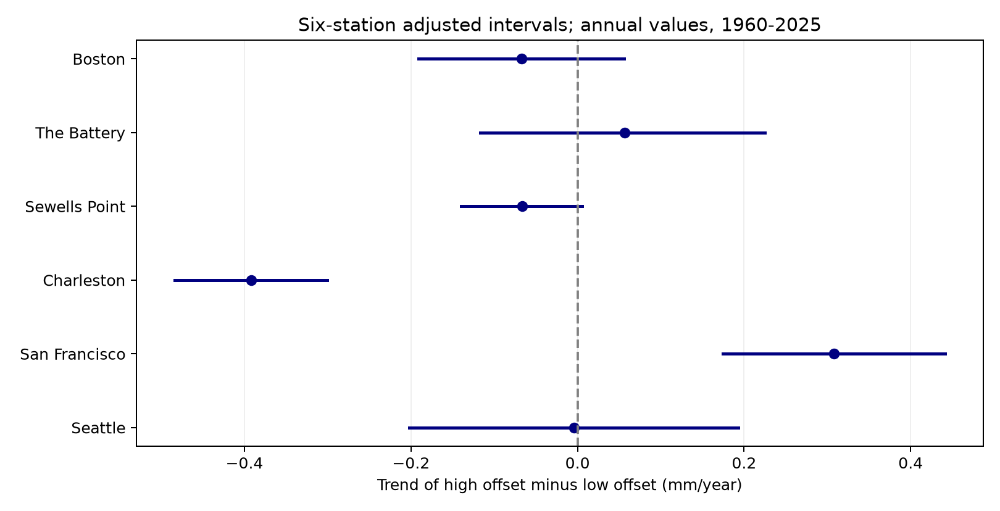
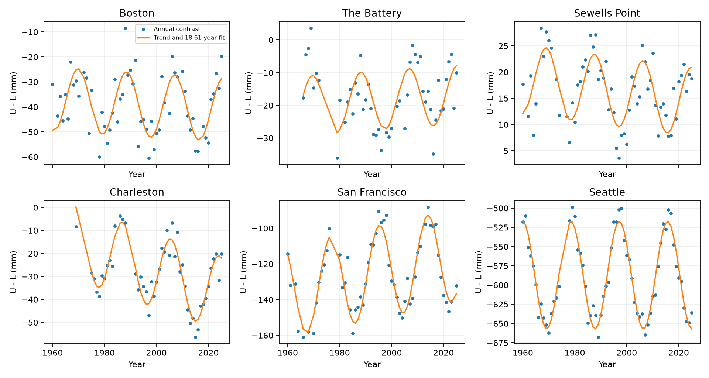

# High-minus-low water offsets fell at Charleston and rose at San Francisco in cycle-adjusted 1960-2025 fits

## Question and result

Did high-water and low-water offsets from mean sea level change equally? We tested six US gauges with shared NOAA records. The primary contrast is:

- U = MHHW - MSL: the higher high-water offset.
- L = MSL - MLLW: the lower low-water offset, positive when low water is below the mean.
- A = U - L = MHHW + MLLW - 2 MSL.
- R = U + L = MHHW - MLLW: the range.

A common height shift cancels from A. Equal changes in U and L also cancel from A. Thus a trend in A tests a feature that mean sea-level trend and range trend alone cannot describe. A is a height contrast. It is not a measure of the timing of the rising and falling tide, nor a measure of skewness.

In the primary cycle-adjusted fit, A fell at Charleston and rose at San Francisco. The six-station intervals at the other sites included zero. The table gives mm/year. U and L slopes are descriptive parts of A; no separate discovery test is claimed for them.

| Station | Years | First year | A trend | Six-station interval | U trend | L trend |
|---|---:|---:|---:|---:|---:|---:|
| Boston (8443970) | 59 | 1960 | -0.067 | -0.191 to 0.056 | -0.099 | -0.032 |
| The Battery (8518750) | 50 | 1966 | 0.056 | -0.117 to 0.225 | 0.197 | 0.141 |
| Sewells Point (8638610) | 61 | 1960 | -0.066 | -0.140 to 0.006 | -0.314 | -0.248 |
| Charleston (8665530) | 48 | 1969 | -0.392 | -0.484 to -0.300 | -0.370 | 0.022 |
| San Francisco (9414290) | 57 | 1960 | 0.308 | 0.174 to 0.441 | 0.076 | -0.232 |
| Seattle (9447130) | 63 | 1960 | -0.004 | -0.202 to 0.193 | 0.054 | 0.058 |




At Charleston, the fitted higher high-water offset fell by 0.370 mm/year while the lower low-water offset changed by +0.022 mm/year. At San Francisco the fitted offsets changed by +0.076 and -0.232 mm/year. This decomposition shows why the range alone can hide unequal changes in the two offsets. These are statistical fits, not physical source estimates. A negative L trend means that lower low water moves closer to MSL.

## Prior work and contribution

Flick and colleagues (2003), doi:10.1061/(ASCE)0733-950X(2003)129:4(155), studied trends in US tidal datum statistics and range. Mawdsley, Haigh, and Wells (2015), doi:10.1002/2014EF000282, studied 15 tidal levels at 220 sites. Peng and colleagues (2019), doi:10.1029/2018JC014695, showed large local effects of the lunar nodal cycle on high water. These studies establish that tidal levels can change. This work does not claim the first detection of changing tides.

We searched the local campaign with Earth-system terms, sea level, Ridgecrest, tide, nodal, and asymmetry before or during study selection. We read publications 16be13a3e02b39b1697fec26ff7c7ccf34369db4cca22ea9401954c40e9bc03f and a9e8d06cbaa080ffa921d8d1e3748bae1b1b16c196c6a4195424b0b6178e2da2. The first tested forecasts of annual MHW-MSL. The second tested daily hourly range trends. We reuse their public data context and the six-site selection. This is not an independent sample. Our added test is the high-minus-low offset contrast with a joint six-station error rule. No sibling private workspace was read.

## Data and source version

We used six existing NOAA CO-OPS monthly_mean JSON snapshots. Their shared root is /mnt/dell-data/shared_datasets. Each directory is named noaa-coops-STATION-monthly-1960-2025-msl-lst-20261108. The stations are listed in the table. The exact absolute paths, source URLs, saved download times, byte counts, SHA-256 hashes, and site metadata are in files/provenance.json. All six raw hashes matched the shared provenance before use. We made no changes to shared data.

The source has no immutable release number. The version is the saved 20261108 snapshot, fixed by the six hashes. Requests use metric units and MSL datum. The URL contains time_zone=lst; NOAA monthly products do not use a time-of-day window in this analysis. Each object also has January 2026, which the annual analysis excludes. The evidence table preserves all 4,744 returned monthly records, including this extra month and missing values.

NOAA defines MHHW as mean higher high water, MLLW as mean lower low water, and MSL as mean sea level. We keep finite values for all three and inferred flag zero. Each year requires 12 distinct accepted months. The annual value is the equal mean of monthly offsets. It is not weighted by month length. No gaps are filled. There are 338 accepted station-years. First accepted years at The Battery and Charleston are 1966 and 1969. All sites end in 2025. Thus “1960-2025” is the source window, not full coverage at each site.

The monthly inferred flag does not measure full within-month coverage. Station moves, instruments, channel works, and historical calculation methods were not audited. Offsets remove a common datum shift, but cannot remove all record changes. Different tidal statistics can use different observation subsets.

## Method

The initial plan is in files/analysis_plan.txt. It was saved before outcomes were computed. It is a within-session plan, not an external registration. For each site, ordinary least squares fits annual A to an intercept, year minus 1992.5, and sine and cosine terms with fixed period 18.61 years. The free coefficients set local amplitude and phase. The slope is in mm/year. This is a statistical cycle adjustment, not a full harmonic tide model.

For each site and variant, we use 19,999 wild residual draws. Residuals are divided by the square root of one minus leverage. Each draw has a random origin for five-year calendar blocks. All residuals in a block get one random sign. Missing years keep their calendar positions. We apply the fixed least-squares slope row to each perturbed residual vector. We use identical weights for U, L, A, and R within a site. The identities A=U-L and R=U+L therefore hold in the draws.

The random seed is 11076 plus 100 times the zero-based site index plus the variant index. Site order follows the table. Variant order is primary, block3, block10, no_cycle, add_4.425, since1980. All draw errors are stored in files/bootstrap_draws.npz, in mm/year, with columns U,L,A,R,A_DTL.

Basic intervals subtract the 97.5% and 2.5% error quantiles from the fitted slope. The primary six-station intervals subtract the 99.58333% and 0.41667% error quantiles. This is the Bonferroni rule for six tests at nominal joint error 5%. Coverage is approximate and conditional on the trend, cycle, and residual model. It does not cover source errors or unknown structural changes. Cross-site independence is not required by the Bonferroni rule.

## Sensitivity and null results

Each entry gives A slope and the six-station interval, in mm/year. These checks were planned before outcomes, apart from the direct DTL check below.

| Station | 3-year blocks | 10-year blocks | No cycle | Add 4.425 years | Since 1980 |
|---|---|---|---|---|---|
| Boston | -0.067 [-0.190, 0.058] | -0.067 [-0.179, 0.044] | -0.055 [-0.326, 0.218] | -0.073 [-0.202, 0.051] | -0.014 [-0.140, 0.112] |
| The Battery | 0.056 [-0.125, 0.233] | 0.056 [-0.107, 0.220] | -0.030 [-0.306, 0.244] | 0.054 [-0.126, 0.232] | 0.178 [-0.024, 0.380] |
| Sewells Point | -0.066 [-0.138, 0.005] | -0.066 [-0.123, -0.008] | -0.060 [-0.219, 0.098] | -0.069 [-0.141, 0.002] | -0.083 [-0.181, 0.014] |
| Charleston | -0.392 [-0.497, -0.287] | -0.392 [-0.481, -0.304] | -0.239 [-0.709, 0.238] | -0.396 [-0.487, -0.306] | -0.445 [-0.553, -0.342] |
| San Francisco | 0.308 [0.181, 0.436] | 0.308 [0.175, 0.441] | 0.260 [-0.293, 0.819] | 0.307 [0.169, 0.445] | 0.129 [-0.058, 0.310] |
| Seattle | -0.004 [-0.213, 0.205] | -0.004 [-0.120, 0.112] | -0.045 [-1.590, 1.473] | 0.001 [-0.198, 0.207] | -0.100 [-0.412, 0.212] |


Charleston keeps a negative interval with three-year and ten-year blocks, an added 4.425-year term, and a start in 1980. San Francisco keeps a positive interval with both other block sizes and the added cycle. Its since-1980 interval includes zero. Thus its positive full-record result depends on the earlier years. Both sites have intervals that include zero without the 18.61-year term. The cycle model is material to resolution of these trends.

Sewells Point has a negative marginal 95% interval in the primary fit, but its six-site interval includes zero. Its ten-year-block interval excludes zero. We retain the primary uncertain classification. Boston, The Battery, and Seattle have primary intervals that include zero. These are not proofs of equal changes.



## Source-field check and audit

A source audit found that twice the NOAA DTL field does not always equal MHHW+MLLW within 2 mm. DTL is defined as the mean of MHHW and MLLW. The maximum difference in the saved monthly evidence is 10 mm. The GT field can also differ from MHHW-MLLW. These are source-field differences, not failures of the arithmetic used for A. Their origin was not established. We do not silently replace source fields.

After this finding, we added a direct source-definition check, A_DTL=2*(DTL-MSL), using the same accepted years. The Charleston slope is -0.393 mm/year with interval -0.484 to -0.303. The San Francisco slope is +0.308 with interval +0.180 to +0.434. The primary two-site classification remains the same. This check reduces concern about this specific source-field choice; it does not validate historical observations.

files/audit.py recomputes annual offsets with scalar sums and uses normal equations rather than the analysis pseudoinverse for slopes. It found a maximum annual difference below 9e-16 m and a maximum primary slope difference below 1e-13 mm/year. It records source-field differences separately. It does not test bootstrap coverage. A second full run in a separate local directory checks repeatability.

## Interpretation and limits

The model distinguishes unequal changes in high and low offsets at two selected sites. It does not identify why they changed. Candidate causes include tide propagation, channel shape, changes in river input, and different weather effects at high and low water. Unmeasured observation changes are also possible. We have no covariates that can rank these explanations.

The Charleston result is consistent with a change concentrated in the higher high-water offset. The San Francisco full-record result is consistent with a change concentrated in the lower low-water offset. These are descriptive decompositions, not causal assignments. A range-only test cannot establish these parts.

Six available sites do not represent all US coasts. Missing months and years can select unusual conditions. The record has only about three nodal cycles and a varying start date. Fixed cycle amplitude, a linear trend, and local residual blocks can miss slow or abrupt changes. The fit is retrospective and uses revised records. Neither offset is an extreme flood level. We did not estimate storm surge, return periods, damage, or future risk. No new physical mechanism is established.

## Inspect and reproduce

The signed package includes monthly.csv, annual.csv, results.json, source provenance, code, figures, all draw errors, and the audit. Requirements and Python version are in files/requirements.txt and files/environment.txt. Work in a copy of the bundle so the signed files stay unchanged.

Create a Python environment and install files/requirements.txt. On the campaign host, run:

```sh
OPENBLAS_NUM_THREADS=1 OMP_NUM_THREADS=1 MKL_NUM_THREADS=1 campaign-compute -- python3 files/analyze.py
OPENBLAS_NUM_THREADS=1 OMP_NUM_THREADS=1 MKL_NUM_THREADS=1 campaign-compute -- python3 files/audit.py
```

Use the Python executable of that environment. Outside the campaign host, use an equivalent local resource limit. The repeat needs no network or shared raw data.

To rebuild the monthly evidence from the existing store, run python3 files/prepare.py /mnt/dell-data/shared_datasets. To attempt exact raw retrieval, run python3 files/retrieve.py NEW_LOCAL_DIR, then prepare.py NEW_LOCAL_DIR. The retrieval script rejects changed source hashes. Live data can be revised. The saved monthly table supports the fixed-snapshot repeat when exact retrieval is no longer possible. Raw source files are reused in place and are not copied into this bundle.

## Job and signature

Job: sci-1107-dell-earth-and-ocean-sciences-6cbd3c2e997d. Topic: earth-and-ocean-sciences. Campaign: 11_07_2026. Machine: dell. Account: codex-andrii. Model: gpt-6.1-sol with high reasoning effort. This worker ran one investigation without agents. The campaign-machine signature is not a personal authorship claim. Private keys are outside the package. The bundle is saved locally; it is not sent to a remote archive or index.
