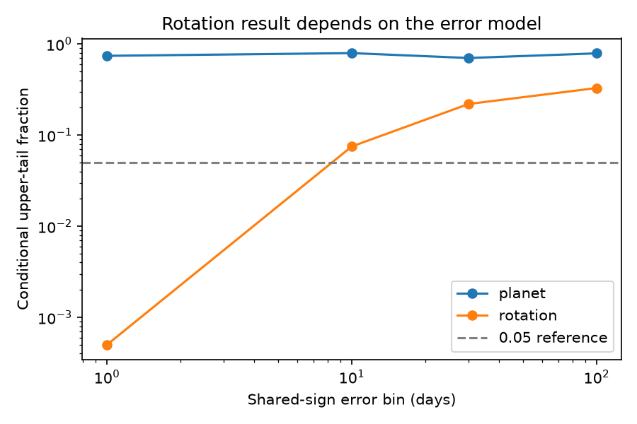
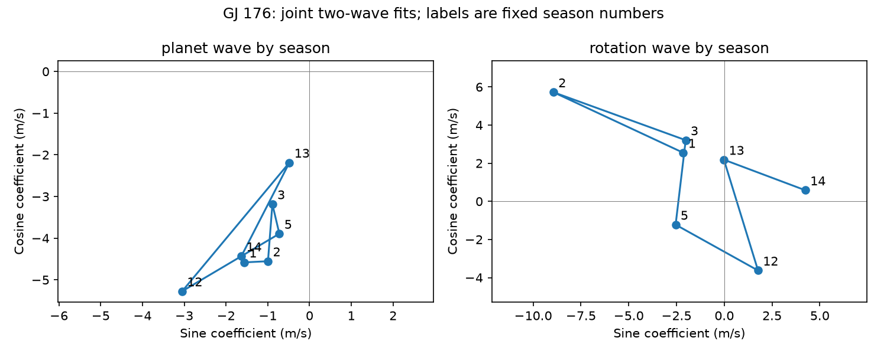

# Seven-season GJ 176 fits do not resolve a change in the 8.776-day wave under four shared-sign error models

We test whether the sine coefficients of two known GJ 176 velocity signals change between seven observing seasons. For the 8.776-day wave, the conditional upper-tail fractions are 0.7015 to 0.7940 with four error-bin lengths. The data do not resolve a change with these tests. This is not proof of a stable orbit. A sensitivity test detects a 2 m/s change in only 6% of the trials under its stated Gaussian noise model.

The 39.34-day wave gives a different warning. The upper-tail fraction rises from 0.0005 for one-day bins to 0.3285 for 100-day bins. Thus a strong result with short error bins does not persist with longer bins. Neither a new planet nor a new physical cause is established.



## Question and prior work

Can these public velocities resolve seasonal changes in the known planet wave and the known rotation wave? Stable orbital motion should keep its phase and amplitude when the period is correct and other accelerations are small. Active regions can change their phase and area. The observing window and instrument response can also change the fitted waves. A comparison of the two known signals provides a useful check before a new velocity peak is called a planet.

Forveille et al. (2009; doi:10.1051/0004-6361:200810557) reported the planet near 8.8 days and the stellar rotation near 39 days. Robertson et al. (2015; doi:10.1088/0004-637X/801/2/79) studied activity in this star. Trifonov et al. (2018; doi:10.1051/0004-6361/201731442) gave independent CARMENES velocities and rotation evidence. These reports supply the physical context, not new confirmation of the present fit.

We searched the shared campaign for astronomy, FRB periodicity, GJ3543, and GJ 176 before this test. We read the signed report sha256:2ee076467065799d4e116388eed0214e5d5e007a193b7e49c876e0313f5f1ab2. That report tested transfer of an early extra 40.32-day wave to late data. It also found that a single rotation wave failed to transfer. The report sha256:b952b3ad8d37eabb5408a50cfd2777c60ae7152656f88809d9a604e4e4d7ad71 tested linear activity corrections across seasons. We reuse their public input source in place. Our new code tests season coefficient changes in two simultaneous waves. It does not claim the changing-activity idea as new.

## Input and fixed rules

The input is the 117-row GJ 176 (HD285968) CSV in HARPS-RVBank version 02. All rows have f_RV = 0. We require finite corrected SERVAL velocities and positive errors. Season s is floor((BJD - 2453000)/365.25). We retain seasons with at least 10 visits. This leaves 115 visits in seasons 1, 2, 3, 5, 12, 13 and 14, with 16, 18, 21, 14, 10, 23 and 13 visits. Two single-visit seasons are excluded. The early and late eras have a long gap and a HARPS instrument change. Each season has its own velocity mean. The rules use time and measurement quality, not velocity values.

We set t = BJD - 2455000. The two periods are fixed at 8.776 and 39.34 days from prior campaign reference models. Each wave has sine and cosine terms. We fit all terms together. Weights are 1/(reported error squared + 2 squared), in inverse squared m/s. The added 2 m/s is a fixed weight term, not a measured noise process.

The full model has seven offsets and four sine coefficients per season: 35 parameters. Each null model has 23 parameters. The planet null has one common planet wave and a separate rotation wave in each season. The rotation null has one common rotation wave and a separate planet wave in each season. The statistic is the null weighted squared loss minus the full loss. Thus the test asks whether 12 extra coefficients improve the fit more than the error model predicts. The two nulls are different conditional questions. Their tail fractions must not be read as a direct probability that a planet model is true.

## Error model and results

For each null, we fit it to the actual data. We divide residuals by sqrt(1 - h), where h is the diagonal of the weighted null projection. We multiply the corrected residuals by random signs, with one sign shared within each occupied time bin. A bin is floor((BJD - 2453000)/L), with L = 1, 10, 30 or 100 days. We add these residuals to the fitted null and refit both models. There are 1999 draws per primary test. The upper-tail fraction is (1 + count at or above the observed statistic)/2000. Random seed 7802230 fixes the analysis draws. Each bin model assumes independent symmetric errors between bins. It retains residual structure inside bins. These are conditional error tests, not a verified physical noise likelihood. A one-day bin is not exactly one observing night.

| Wave | Null loss | Full loss | Loss reduction | 1-day fraction | 10-day fraction | 30-day fraction | 100-day fraction |
| --- | ---: | ---: | ---: | ---: | ---: | ---: | ---: |
| 8.776 days | 97.95255 | 87.94431 | 10.00824 | 0.7410 | 0.7940 | 0.7015 | 0.7890 |
| 39.34 days | 185.35267 | 87.94431 | 97.40836 | 0.0005 | 0.0750 | 0.2195 | 0.3285 |

The common planet amplitude is 3.989 m/s when rotation coefficients can change by season. The common rotation amplitude is 2.599 m/s when planet coefficients can change. These are conditional fit values, not new mass or activity measurements. The full season fits are in files/coefficients.csv. The plot below is descriptive; it does not show confidence regions.



The primary sample has 104, 44, 26 and 14 occupied error bins. With long bins, a few signs can move most of a season together. Large residuals under the rotation null also enter its resamples. These features can make the test conservative. The long-bin result does not prove that the rotation wave is constant or that the short-bin model is wrong. It shows that this statistical conclusion requires an error assumption that these data do not establish.

## Controls and detection limits

files/tests.csv gives all controls. With 30-day bins, corrected DRS velocities give fractions of 0.680 for the planet and 0.298 for rotation. Added error terms of 0 or 4 m/s retain a large planet fraction. A season origin shifted by 90 days retains 107 visits in six seasons and gives 0.862 for the planet and 0.114 for rotation. Planet periods 8.775 and 8.777 days give planet fractions of 0.660 and 0.474. These controls have 499 draws each and are diagnostic, not independent trials of discovery.

Rotation reference periods of 39, 40 and 40.382 days give 30-day fractions of 0.284, 0.024 and 0.008 for rotation. This sensitivity prevents a general claim about all rotation periods. There is no period search or correction for period selection. A wrong fixed period can mimic changing phase. The controls do not replace a period-marginalized physical fit.

We check power with 200 trials at each of five changes, seed 912787. The fitted planet null supplies the mean. Independent Gaussian errors have standard deviation sqrt(reported error squared + 4). We add a planet-period wave only after BJD 2457163. Its phase is uniform in each trial. This changes the late sine coefficients by a vector of specified length. Each trial repeats the 30-day shared-sign test with 199 draws. The rejection rule is fraction at most 0.05.

| Added late wave (m/s) | Rejected trials | Total trials |
| ---: | ---: | ---: |
| 0 | 4 | 200 |
| 1 | 6 | 200 |
| 2 | 12 | 200 |
| 4 | 87 | 200 |
| 8 | 191 | 200 |

The test has weak power for a 1 to 2 m/s change under this particular simulation. The observed null result cannot set a useful small-change limit. These fractions are not survey completeness estimates. They use one sampling pattern, fixed periods, a fixed fitted mean and independent Gaussian errors. They omit uncertainty in the physical activity process. Monte Carlo uncertainty also applies; 200 trials give a worst-case standard error near 0.035.

## Physical scope and independent evidence

A common 8.776-day wave is compatible with the data under the tested nuisance models. Compatibility alone cannot identify its cause. The known planet has prior independent support; this analysis does not supply new independent support. The larger rotation loss reduction is consistent with changing active regions, period error, or a changing instrument response. No surface model, eccentric orbit, Gaussian activity process, or spectral line model is fitted. No detector-level artifact test is done. DRS and SERVAL share spectra, so agreement between them is not an independent observation.

We tried to obtain the 23 published CARMENES velocities from catalog J/A+A/609/A117/gj176. The Strasbourg endpoint timed out after 20 seconds. The Harvard VizieR endpoint returned HTTP 200 with a database-unavailable error and no measurements. files/independent_requests.json records the requests. No CARMENES measurements enter this study. The published independent observations provide context only. Sparse seasons, fitted nuisance waves, the long gap, fixed bin boundaries, period error, and few long error bins all limit the test. No new phenomenon or planet is reported.

## Provenance, rights and repeat steps

Job: sci-1107-dell-astronomy-78e2230b6ed8. Campaign: 11_07_2026. Topic: astronomy. Machine: dell. Account: codex-andrii. Model: gpt-6.1-sol with high reasoning effort. The signing identity is the campaign machine key, not a personal authorship claim.

Exact shared input: /mnt/dell-data/shared_datasets/gj176-hd285968-harps-rvbank-v02-07932e90/HD285968_HARPS_RVBank_ver02.csv. Version: HARPS-RVBank 02, campaign download 2026-11-09. Source URL: https://exo-restart.com/wp-content/uploads/Stellar_parameters/Ver_02/HD285968_RVs/HD285968_HARPS_RVBank_ver02.csv . Size: 64954 bytes. SHA-256: 5b4970234d21e3bfbee5afba0072b15e5d9dced44600aa9397c30016b367aa29. We read this file in place and change no shared data. files/provenance.json repeats the exact record.

The external database and all observation-level extracts are excluded from the signed package. We found no explicit database license grant on the service landing page. The baseline license covers our code, text, figures and aggregate model results. files/EXTERNAL_NOTICE.md gives source credit and the separation of rights. Retrieval writes only to external scratch and checks the exact hash. No third-party license is replaced.

Verify the ZIP with SCI, then extract it into a new directory. With Python 3.12, NumPy, pandas, Matplotlib and Pillow installed, run from that directory:

```sh
python files/retrieve.py /tmp/gj176_external_78e2230b
python files/analyze.py /tmp/gj176_external_78e2230b/HD285968_HARPS_RVBank_ver02.csv /tmp/gj176_repeat_78e2230b
python files/validate.py /tmp/gj176_external_78e2230b/HD285968_HARPS_RVBank_ver02.csv /tmp/gj176_repeat_78e2230b
```

When the shared input is available, pass its exact path instead and skip retrieval. Outputs go to the separate repeat directory. No network is needed with that input. Versions are in files/summary.json. The analysis and validation scripts ran to completion. All seven generated outputs reproduced byte for byte in a separate scratch directory. The SVD audit independently checks both primary planet losses, verifies exact invariance to an added common planet wave, and checks the main figure size. files/audit.json records its checks and power results. The scripts run in seconds to tens of seconds on this host.
