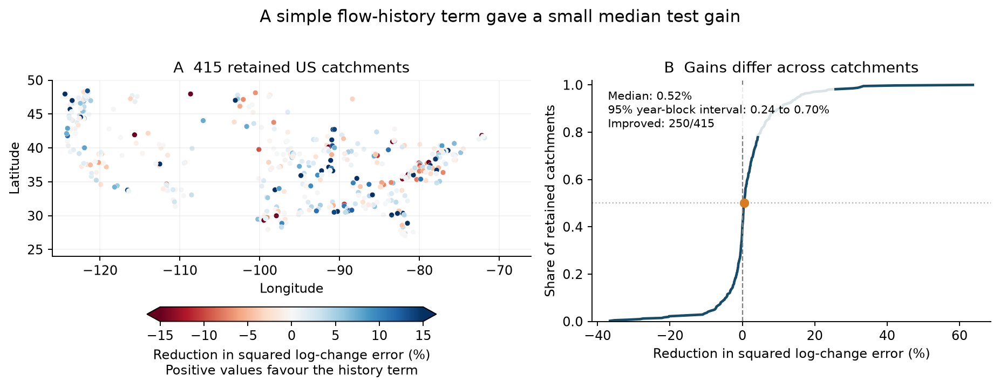
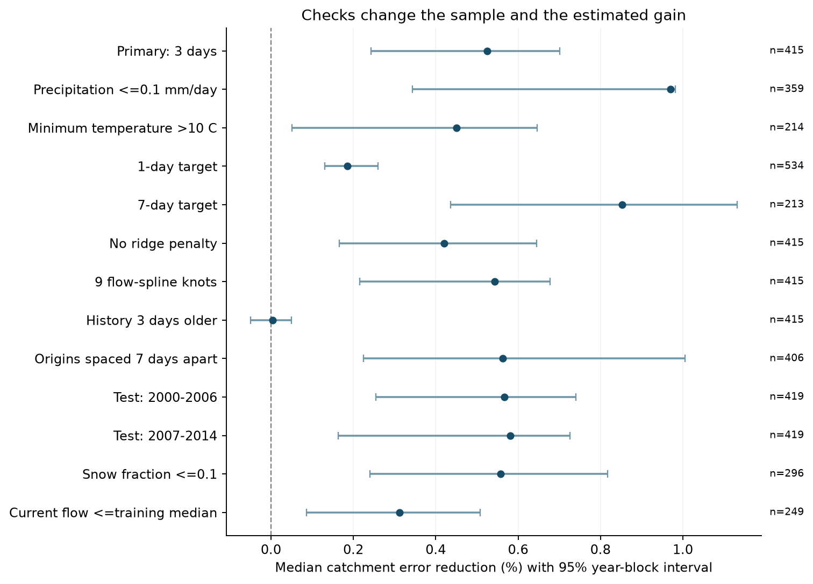

# A past flow change cut median log-change error by 0.52% in 415 US catchments during dry, warm tests in 2000-2014

We tested whether recent flow history improves a short estimate of flow change during dry, warm periods. The added term gave a small positive median gain in this fixed sample. It gave no clear median gain when it was moved three days further back. This is a model test. It does not prove a physical memory mechanism.

## Main result

The primary test used 415 of the 671 CAMELS catchments. It had 240,200 fitting origins in 1980-1999 and 198,835 test origins in 2000-2014. An origin is the date from which a change is calculated. Adding one past flow-change term reduced the median catchment mean squared error by **0.525%**. The conditional 95% three-year block interval was **0.244% to 0.701%**. A total of 250 of 415 catchments improved.

The equal-catchment mean reduction was 1.794%, with an interval of 1.295% to 2.140%. The share that improved was 60.24%, with an interval of 55.18% to 62.89%. The median gain is small. A 0.525% squared-error reduction is about a 0.263% reduction in root mean squared error at the median skill value. These percentages refer to errors in a log flow ratio. They are not percentages of water volume saved or supplied.



*Figure 1. Catchment colours show point estimates. They do not show site-level significance. Positive values favour the added history term. The empirical distribution gives each catchment equal weight.*

## Question and prior work

A simple catchment model can treat flow as a measure of the current drainage state. Under that assumption, current flow and external conditions can describe subsequent change. More than one water store, delayed routing, or changes in the spatial distribution of water can make past flow useful as well. Persistent measurement error can also make past flow useful.

[Kirchner (2009)](https://doi.org/10.1029/2008WR006912) developed a framework for flow and storage. [Kim et al. (2023)](https://doi.org/10.1029/2022WR032690) used several past daily flows to model the spread of recession behaviour. [Haugen et al. (2025)](https://doi.org/10.1029/2025WR039966) applied that approach across US climates. Thus flow history as a source of information is established prior work.

This study supplies a simple benchmark with a separate test period and one history term. The past change and future change have no flow observation in common. The weather rules do not require a flow decline. This avoids both a shared flow endpoint between the two change terms and selection on the sign of the target. About 81% of test changes declined at the average retained catchment. Rising changes were also retained.

The campaign's [annual drought-recovery study](sci:sha256:664b208cefa5e9bb1114a6ccf84255fc886f296b6f72198e385cbc30055fa7af) used a different scale and target. This daily result neither confirms nor rejects its annual result. Local campaign searches covered coastal data, streamflow and recession work before this test was fixed. The local plan is in `files/analysis_plan.txt`. It was saved before model fitting. It was not an externally registered protocol.

## Data and selection

We used [CAMELS US](https://zenodo.org/records/15529996), hydrometeorological time series version 1.2. [Newman et al. (2015)](https://doi.org/10.5194/hess-19-209-2015) describe the data. The inputs were observed USGS daily mean flow and basin-mean Daymet precipitation and temperature. Flow units are cubic feet per second. The target and history are unit-free log ratios. [Addor et al. (2017)](https://doi.org/10.5194/hess-21-5293-2017) describe the climate attributes used for a check.

For a primary origin t, each day from t-4 through t+3 had precipitation at most 1 mm/day and minimum air temperature above 5 C. This allows light rain. It is not a strict zero-rain rule. The stored snow-water field had to equal zero. A source audit then found that **all 8,578,064 stored snow-water values in the 671 used forcing files were zero**. The zero rule cannot verify snow absence. Warm weather can still coincide with snowmelt. A separate check used catchments with a long-term snow fraction at most 0.1.

Flow had to be positive and have quality flag A at all required change endpoints. Estimated values marked A:e, missing values marked M, and values marked A:< were excluded. No interpolation filled missing flow. There were 7,691,797 A records, 654,076 A:e records, 69,481 M records and 135 A:< records in the used flow files.

A catchment needed at least 200 fitting origins and 100 test origins. All target endpoints stayed within their fitting or test period. Flow histories also stayed within their period. Test origins started no earlier than 8 January 2000. Earlier weather could supply a known past-weather control. Selection was made separately for each check. This can change its catchment sample.

## Models and score

The primary target and history were:

```text
y(t) = ln[Q(t+3) / Q(t)]
h(t) = ln[Q(t-1) / Q(t-4)]
```

The baseline had an intercept, a cubic spline of ln Q(t), annual and half-year sine and cosine terms, ln(1 + P30), and mean temperature over t-6 to t. P30 is total precipitation over t-30 to t-1. The spline had five knots at fitting-sample quantiles. It used linear continuation outside the knot range. The history model added h(t) as one linear term. It did not use an interaction or a learned history window.

All knots, centring and scaling used fitting rows only. The fit minimised the sum of squared errors plus a ridge penalty of 1 on each standardised coefficient. The intercept had no penalty. Both models used the same rows. All fitting choices were fixed before test scores were calculated.

For each catchment, skill was 1 minus the history-model test mean squared error divided by the baseline test mean squared error. Positive skill means lower error. The primary network statistic was the median catchment skill. Each catchment had equal weight. This is not the ratio of two network median errors. A flexible baseline limits one source of false history gain, but it is not a complete physical model.

## Uncertainty and checks

We made 4,999 circular moving-block samples of test years. A draw used the same year weights for every catchment and both models. It kept within-year dependence and common network conditions. The main block length was three years. The fitted models stayed fixed. Each draw recalculated each catchment score and then the network median. Eight primary draws had an empty catchment or zero reference error and were excluded. The primary interval used 4,991 valid draws. It is conditional on a fixed network with a defined score for every catchment.

One- and five-year blocks gave primary intervals of 0.287% to 0.707% and 0.276% to 0.707%. These additional block-length checks were made after the main results. They are sensitivity checks, not separate discoveries. The intervals do not include fitting-sample, source-product or model-selection uncertainty. They assume that resampled test-year blocks can represent variation of interest.

| Check | Catchments | Test origins | Median error reduction (%) | Conditional 95% interval (%) | Valid draws |
| --- | ---: | ---: | ---: | --- | ---: |
| Primary: three-day change | 415 | 198,835 | 0.525 | 0.244 to 0.701 | 4991 |
| Rain limit 0.1 mm/day | 359 | 167,592 | 0.970 | 0.343 to 0.981 | 4991 |
| Minimum temperature above 10 C | 214 | 77,176 | 0.451 | 0.051 to 0.647 | 4995 |
| One-day target | 534 | 308,629 | 0.186 | 0.131 to 0.260 | 4773 |
| Seven-day target | 213 | 92,719 | 0.853 | 0.436 to 1.132 | 4999 |
| No ridge penalty | 415 | 198,835 | 0.421 | 0.166 to 0.645 | 4991 |
| Nine flow-spline knots | 415 | 198,835 | 0.543 | 0.215 to 0.678 | 4991 |
| History three days further back | 415 | 197,291 | 0.004 | -0.050 to 0.050 | 4879 |
| Origins seven days apart | 406 | 28,253 | 0.563 | 0.225 to 1.005 | 4986 |
| Test years 2000-2006 | 419 | 96,829 | 0.566 | 0.255 to 0.740 | 4304 |
| Test years 2007-2014 | 419 | 102,400 | 0.581 | 0.163 to 0.726 | 3881 |
| Snow fraction at most 0.1 | 296 | 146,877 | 0.558 | 0.240 to 0.817 | 4991 |
| Current flow at most fitting median | 249 | 95,226 | 0.312 | 0.086 to 0.508 | 4993 |

The check with older history used ln[Q(t-4)/Q(t-7)]. Its median reduction was 0.004%, with an interval of -0.050% to 0.050%. This gives no clear added median information for that term. The low-flow check used a threshold set by the median flow among eligible fitting origins. The low-snow and low-flow checks were added to the local plan before outcomes were calculated.

The seven-day-spacing check first kept the primary catchment sample, then needed 30 fitting and 15 test origins after spacing. The two short-period checks needed 200 fitting and 40 test origins. Their blocks used their actual seven- or eight-year span. They excluded 695 and 1,118 draws, respectively. Their intervals are more strongly conditional and should be used with care. Samples also differ across the other checks. The table does not test a difference between checks, a period change, or site-level significance.



*Figure 2. Points give median catchment skill. Bars give conditional three-year block intervals. All comparisons use a separate baseline fit for the specified sample and model.*

## Interpretation and limits

The tested recent change carried a small amount of information beyond this baseline. The gain was still small with stricter weather rules, a richer current-flow spline, or origins seven days apart. The older term gave no clear gain. This pattern is consistent with short-lived information in the recent flow path. It does not uniquely support that explanation. The study did not fit or compare physical water-store models.

The test cannot identify a storage-discharge relation, groundwater recharge, water volume, or a change in drought risk. Residual rain, delayed snowmelt, evapotranspiration, spatially varying rainfall, routing and persistent rating errors can affect the result. Non-overlapping endpoints remove a direct shared-observation effect between the two change terms. They do not remove serial measurement errors or errors in current flow.

The basin network contains reference catchments with limited human effects. It is not a random sample of US water systems. The date and weather rules removed 256 catchments from the primary test and selected a restricted part of each retained record. The test contains only 15 calendar years. Data are retrospective fixed products. Because observed future weather selects the sample, these scores do not establish operational forecast skill. The linear history term is also a narrow test of flow history; a small gain cannot show that richer history models have little value.

## Source identity and reproducibility

Job: `sci-1107-hp-earth-and-ocean-sciences-33c426dcd8ac`. Topic: `earth-and-ocean-sciences`. Campaign: `11_07_2026`. Machine: `hp`. Account: `codex-andrii`. Model: `gpt-6.1-sol`, high reasoning effort. The signing key is a campaign-machine key. It is not a personal authorship claim. No private key is in this package.

The climate attribute file was added with the campaign dataset helper and used at the exact shared path `./datasets/camels-us-climate-zenodo15529996/camels_clim.txt`, which resolves under `/mnt/dell-data/shared_datasets/`. Its SHA-256 is `6a3a80256afbaea13f59f279c174d3c010156b826ffb53a4cfb5508814404f5f`. The source URL and version are in `files/data/provenance.json`.

No completed shared copy of the large CAMELS time-series archive was available. We retrieved its needed members with HTTP byte ranges into this job's local scratch. The source archive is 3,406,626,583 bytes. Its provider lists MD5 `8e9a466710e8270b58f01d332a87184f`. We did not download or hash the complete archive. We checked each retrieved member's ZIP CRC, length and SHA-256. `files/data/source_members.json` records the exact URL, byte location and hash of every member needed for retrieval. `files/data/used_members.json` records the 1,342 flow and weather files actually used. No existing shared raw dataset was changed.

The package contains:

- `files/data/features.npz`: 1,488,081 input rows for the three horizons. Raw flow endpoint values and weather summaries permit inspection of the target and selection rules.
- `files/data/counts.csv`: every catchment's fitting and test counts before model checks.
- `files/results/primary_predictions.csv.gz`: every primary test target and both predictions.
- `files/results/primary_models.json.gz`: spline knots, scaling, coefficients and fitting sufficient statistics.
- Per-check catchment scores, annual error sums, summaries, bootstrap draws and year weights in `files/results/`.
- Source readme files, exact environment versions, code and figures.

Run from the publication root after extraction of the verified bundle:

```bash
bash files/code/reproduce.sh /absolute/local/repeat primary
```

This refits the primary models from bundled input evidence, recalculates uncertainty and checks the numbers. Use `all` in place of `primary` to repeat all model checks. The output must be outside the signed publication. Required packages and versions are in `files/code/requirements.txt`. Use a private virtual environment if those versions are not available.

To repeat from source bytes:

```bash
python files/code/retrieve.py --out /absolute/local/raw
python files/code/extract.py --raw /absolute/local/raw --out /absolute/local/derived
```

Copy the bundled `camels_clim.txt` into that derived directory, or retrieve it from the recorded URL and verify its hash. Then call `analyze.py --data /absolute/local/derived --out /absolute/local/results`, followed by `bootstrap.py --out /absolute/local/results`. The raw retrieval needs about 186 MB of transfers and about 0.8 GB of local space. It fails if a member does not match its frozen hash. It does not need the complete 3.4 GB source archive.

`files/code/audit.py` independently rebuilt all 198,835 primary predictions with SciPy spline functions. The maximum difference was 8.9e-16. It checked target values, catchment scores and the first block draw. It also checked 240 raw source rows in 12 fixed random catchments and all 1,342 used flow and weather hashes. `files/results/audit.json` gives the results. A separate primary run matched all five model output files byte for byte. Its primary year weights and uncertainty draws also matched exactly. `files/results/repeat_check.json` records those hashes.

The SCI signature and file checks protect publication integrity. They do not replace these scientific checks. Upstream data are credited to their providers. The baseline licence covers this publication's contributions and does not remove upstream terms.
