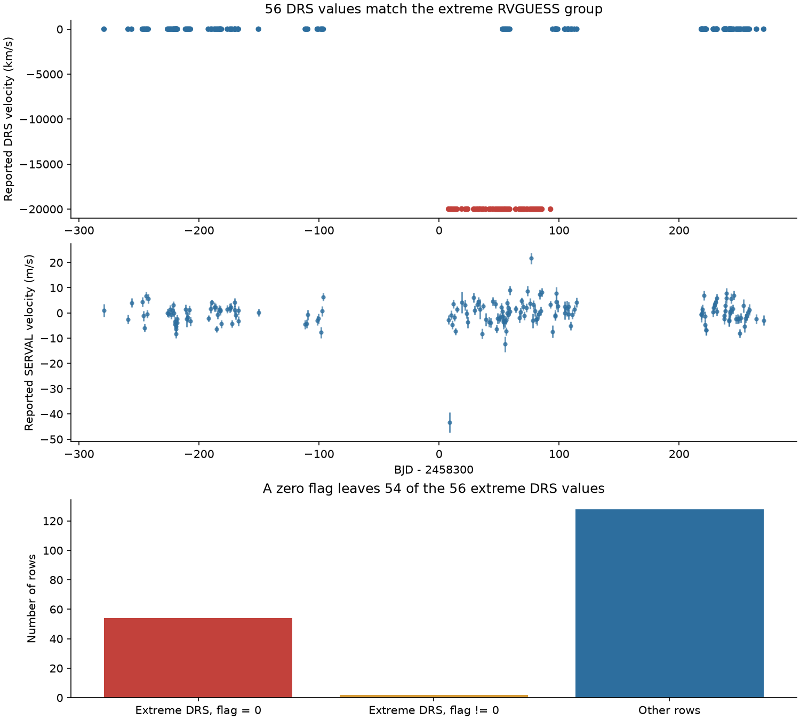
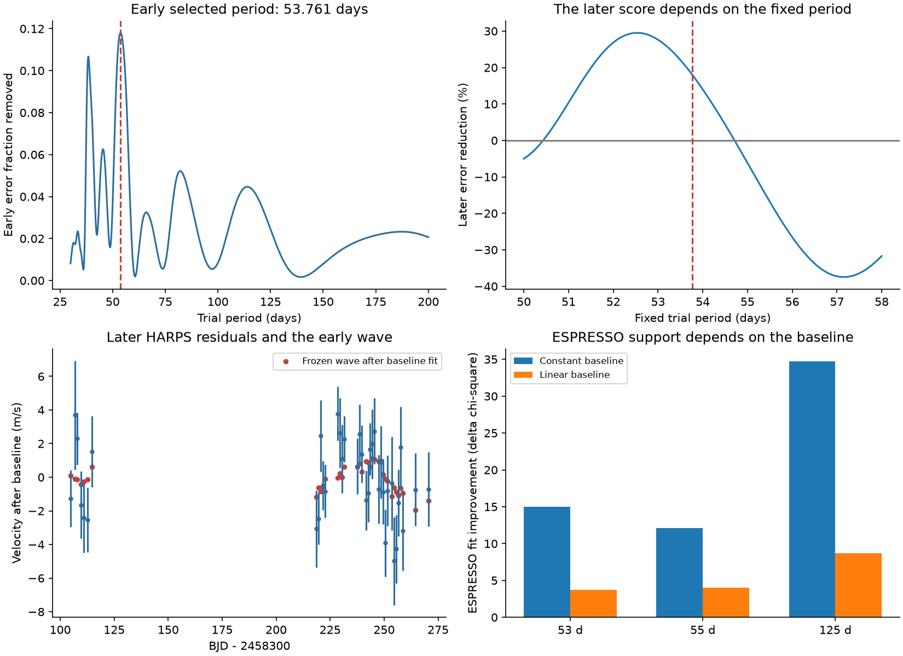

# Fifty-four GJ 1061 rows with a zero quality flag have DRS velocities near minus 20000 km/s in HARPS RVBank v02

We find a specific artifact in a public velocity product. The GJ 1061 file in HARPS RVBank v02 has 56 DRS velocities near minus 20000 km/s. Of these rows, 54 have `f_RV = 0`. All 56 rows have `RVGUESS = -20000` and the same observing program. The same exposures give small relative velocities with SERVAL. Two original ESO exposure headers also contain the extreme target-velocity input. This is a data quality result. It is not a new fast star, a new planet, or an error estimate for the full archive.



## Question and prior work

Can the long-period signals of GJ 1061 survive data quality checks and tests with later or independent observations? The first comparison of velocity reductions exposed the artifact above. We then made the artifact audit the main question: can a zero row flag be used alone to select the DRS column in this file?

Dreizler et al. (2020) reported three small planets and a longer signal near 53 days. Their analysis used TERRA and SERVAL velocities. Dreizler et al. (2025) added ESPRESSO observations, fitted planet interactions, and interpreted signals near 55 and 125 days as likely stellar activity. We do not claim that these long-period signals or their possible activity origin are new. Our secondary tests give a fixed-wave prediction score and show how the score depends on the period, reduction, and slow baseline. [2020 study](https://doi.org/10.1093/mnras/staa248), [2025 study](https://doi.org/10.1051/0004-6361/202452490).

Before the precise question, we searched the campaign for astronomy, GJ 191, GJ 3543, glitch, CHIME, Gaia, GJ 1061, GJ 887, and GJ 581. After the artifact appeared, we searched for GJ1061, RVGUESS, and HARPS DRS. The exact narrow search responses are in `files/search_*.json`. We read the published GJ 3293 study, SCI `sha256:5ffa54a92081e82eae66e564c92c5b7b0bdfad3c048b666637f1a06a800575f3`, for its related prediction method and reduction checks. We reuse no data or code from that study. No private worker workspace was read. These searches do not prove priority.

The work was exploratory. We changed focus after seeing the DRS values. No protocol was registered before the fits. The exact artifact counts do not depend on a statistical search threshold.

## Inputs and provenance

The primary file has 184 exposures. Its dates are Barycentric Julian Days (BJD). The velocity columns used here are in m/s; figures convert the extreme DRS values to km/s. `RV_mlc_nzp` is the SERVAL product with nightly correction. `RV_mlc` is the product without that correction. `RV_drs_nzp` and `RV_drs` are DRS products. They need not have the same zero point as the relative SERVAL velocities. We allow for this before comparing them. The data source and methods are described by [Trifonov et al. (2020)](https://doi.org/10.1051/0004-6361/201936686) and [Perdelwitz et al. (2024)](https://doi.org/10.1051/0004-6361/202348263).

All reusable downloads were added with `campaign-dataset`. Existing shared data were not changed. The paths below are compatibility paths to the shared SSD store. Each row gives the exact file used. Full SHA-256 hashes, byte counts, retrieval times, and source URLs are in `files/provenance.json`.

| Input | Exact shared path | SHA-256 |
| --- | --- | --- |
| RVBank v02 CSV | `/mnt/dell-data/shared_datasets/gj1061-harps-rvbank-v02-6fb72a1c/GJ1061_HARPS_RVBank_ver02.csv` | `3b7b2b89b6600c4ab10a8c805bf9d05ab8798833f8be8f855b9f971824e1288d` |
| RVBank v02 DAT | `/mnt/dell-data/shared_datasets/gj1061-harps-rvbank-v02-dat-6fb72a1c/GJ1061_HARPS_RVBank_ver02.dat` | `22a5db41a5357a863005c964a3f8869d92409a04c5cf1b1f96ac43f50d43aec9` |
| Dreizler et al., arXiv 2504.10926 v1 | `/mnt/dell-data/shared_datasets/gj1061-dreizler2025-arxiv250410926v1-6fb72a1c/paper.html` | `1edd336a296f6d8b8cacf174c97a4aef39a52c5fd3a5d7c75675b82b76c36fe5` |
| ESO header, 2018-07-08 | `/mnt/dell-data/shared_datasets/gj1061-harps-20180708-header-6fb72a1c/header.html` | `a1616a54e78a0ed28183f79c57759e7067f09cf0d70f46bd7530a17ebd9dbbab` |
| ESO header, 2018-09-07 | `/mnt/dell-data/shared_datasets/gj1061-harps-20180907-header-6fb72a1c/header.html` | `d268282994e578f5ea7af8066f86ab010032a59d69d490823e64be7d320033e9` |
| HARPS DRS manual, Issue 1.0, 2003-09-30 | `/mnt/dell-data/shared_datasets/harps-drs-manual-0016-6fb72a1c/DRS.pdf` | `619aeb5c0d3d8043e9016c5be8f386a8a0091988cab76ee826df3f3cfe2ee8ff` |

Small copies of the first five inputs are in `files/inputs/`. The manual is not copied. Its source URL and hash permit retrieval and inspection. The code extracts all 26 published ESPRESSO rows from Table 5 of the fixed article version. It uses the table as printed, without changing its dates or averaging rows. These are observations from a separate instrument in 2023. The two ESO headers are archive evidence from the same HARPS exposures, not independent astronomical observations. CSV and DAT are two exports of the same data, not independent measurements.

## Artifact test and exact results

We compare all 184 rows without a flag cut or residual cut. First, the CSV and DAT values must agree exactly in the columns BJD, both DRS velocities, corrected SERVAL velocity, RVGUESS, and f_RV. They do.

For each row, let `d = RV_drs_nzp - RV_mlc_nzp`. The supplied guard marks a row when `abs(d - median(d)) > 100000 m/s`. The median permits a constant difference between absolute and relative velocities. Thresholds of 10000, 100000, 1000000, and 10000000 m/s each mark the same 56 rows. Each marked row has `RVGUESS = -20000`. No other row does. The same extreme values occur before the nightly DRS correction.

| RVGUESS | Rows | Rows with f_RV = 0 | Median DRS velocity, m/s | DRS median absolute deviation, m/s | SERVAL median absolute deviation, m/s |
| ---: | ---: | ---: | ---: | ---: | ---: |
| -20000 | 56 | 54 | -20009957.259 | 97.190 | 2.917 |
| -20 | 55 | 55 | -6.238 | 4.479 | 2.363 |
| 1 | 73 | 72 | 1115.652 | 2.990 | 2.480 |

The extreme group spans BJD 2458307.9259711 to 2458392.8671780, or 84.94 days. All its rows have program `0101.C-0516(A)`. There are 181 rows with `f_RV = 0` in the full file. A cut on this flag alone retains 54 extreme DRS values, or 29.8 percent of those 181 rows. This result does not mean that the flag was designed to validate every column. A valid SERVAL row need not give a valid DRS velocity.

The reported DRS errors in the extreme group range from 1.96 to 6.99 m/s. These small errors do not describe the gross offset or the large within-group spread. With inverse-variance weights from those errors, the scatter after a free constant is 3684.79 m/s. Adding 20000000 m/s to every value leaves that scatter unchanged. A constant correction therefore does not repair the group. We do not supply replacement DRS velocities.

The ESO records for exposures `HARPS.2018-07-08T09:58:50.571` and `HARPS.2018-09-07T07:34:49.764` both contain `HIERARCH ESO TEL TARG RADVEL = -20000.000`. Their target names and program IDs match the RVBank rows. The [HARPS DRS manual](https://www.eso.org/sci/facilities/lasilla/instruments/harps/doc/DRS.pdf), printed page 18, defines this input in km/s. Thus, the extreme input exists in the original observation metadata. It was not created by our CSV parser. The relation between this input and the output supports a metadata or reduction explanation. It does not identify the precise software operation that produced the outputs. A unit error is a possible explanation, not a proved cause.

The guard also gives the same rejection set after a common 10 m/s, 53-day sine wave is inserted into both products. This is a check that a small signal common to the two products does not cause the large discrepancy. It is not a general false-positive test. The guard requires a majority with a useful common zero point and can fail for other targets or other products. It is supplied as a target-specific audit tool.

`row_audit.csv` preserves every row and its guard value. `rejected_drs_rows.csv` gives all 56 suspect rows with exposure IDs. `guess_groups.csv` gives the group results. `header_evidence.json` records the relevant source cards. All are under `files/derived/`.

## Secondary test of the long-period signal

We use SERVAL for this test. We do not try to restore the suspect DRS data. We select observations after BJD 2457200 and with `f_RV = 0`. This leaves 174 exposures. A fit with an offset, linear trend, the three known periods, and a fixed 53-day wave removes two exposures with residuals above five times `sqrt(error^2 + 1^2)` m/s. The cut uses the full series and is not a blind selection. The removed exposure IDs are preserved. The 172 accepted exposures give 142 weighted nightly values, grouped by `floor(BJD)`. The error floor of 1 m/s is added before averaging. It is a weight choice, not a measured noise law.

The early set has 105 nights from BJD 2458020.8148384 to 2458398.8638404. The later set has 37 nights from BJD 2458404.7774846 to 2458570.5062492. The split is BJD 2458400. The known periods are fixed at 3.204, 6.689, and 13.031 days. Their sine and cosine coefficients, an offset, and a linear trend form the baseline. The phase origin is BJD 2458300.

The early search has 4000 equally spaced frequencies from 1/200 to 1/30 per day. Each frequency adds a sine and cosine and refits the baseline. We select the largest early error reduction and refine the frequency within its adjacent grid points. The result is **53.760742 days**, with an early amplitude of **1.328642 m/s**.

The extra wave is frozen for the later test. The later baseline is fitted separately with and without that frozen wave. If R is the weighted operator that removes the later baseline, the score is `1 - sum((R(y-wave)/error)^2) / sum((R(y)/error)^2)`. This is a conditional residual prediction test. It does not forecast the three planet orbits or the instrument offset.

The selected wave reduces later weighted squared error by **18.11 percent**. Weighted RMS changes from **2.165 to 1.959 m/s**. Conditional block ranges include zero:

| Block length, days | Early blocks | Later blocks | Accepted draws | Nominal 95 percent gain range |
| ---: | ---: | ---: | ---: | ---: |
| 5 | 36 | 13 | 999 | -14.77 to 42.06 percent |
| 20 | 14 | 5 | 985 | -33.74 to 26.50 percent |

For each draw, we change the sign of early full-model residuals in occupied time blocks, after a leverage correction. We add the signed residuals to the fitted early model and refit. We separately sample occupied later blocks with replacement and refit the later baseline. We skip 14 rank-deficient later fits in the 20-day case. The period stays fixed. The ranges omit frequency-selection uncertainty and correlations longer than these blocks. With only five later blocks in one case, they cannot give a precise coverage guarantee. No search-wide false-alarm probability is reported.

The point score is 27.63 percent at an assumed period of 53 days and -6.16 percent at 55 days, under the linear baseline. These are sensitivity checks, not periods selected with later data. The selected-period score is 11.85 percent without the time trend and 20.21 percent after adding second harmonics of all three planet terms. On the same accepted exposures, the SERVAL product without nightly correction gives only 0.77 percent gain at the selected period. It shares spectra with the corrected product. This is a reduction check, not independent confirmation.



### Independent ESPRESSO observations

We fit the 26 published ESPRESSO values over 81.76 days. The fixed known periods are 3.2073, 6.6821, and 13.066 days from the 2025 paper. All three sine and cosine pairs are fitted locally. This allows their phases to change rather than extrapolating an inadequate three-sine model over five years. These nuisance periods were inferred using the published data, including ESPRESSO, so this is not a blind confirmation test. We add a fixed 0.6 m/s floor in quadrature to the printed errors.

| Extra period | Amplitude with constant baseline, m/s | Amplitude with linear baseline, m/s | Fit improvement with constant baseline, delta chi-square | Fit improvement with linear baseline, delta chi-square |
| ---: | ---: | ---: | ---: | ---: |
| 53 days | 0.916 | 0.377 | 15.02 | 3.75 |
| 55 days | 0.815 | 0.421 | 12.07 | 4.00 |
| 125 days | 1.231 | 2.308 | 34.71 | 8.66 |

Each extra pair adds two coefficients. A slow trend removes much of the apparent improvement near 53 to 55 days. The observations cover less than one 125-day cycle, so a 125-day wave and a slow baseline are poorly separated. The fits use one extra period at a time. They do not distinguish a planet, stellar activity, and other slow errors. The separate instrument supplies no baseline-independent confirmation of an extra planet in this test.

## Interpretation and limits

The main result is an exact audit of one frozen file. It shows that row flags, finite values, and small formal errors alone do not make its DRS column suitable for a small-planet search. The rejected values follow observation metadata and do not appear as the same large shifts in the SERVAL reduction. This supports a data-processing explanation. We neither infer a high physical stellar speed nor establish a new astrophysical phenomenon.

The primary audit does not test the full RVBank archive, rerun DRS, fit raw spectra, or locate the exact software fault. The ESO headers verify the input for two exposures only. The two file exports share a source. The guard is not a general catalog reliability bound. The 2020 and 2025 planet studies used other velocity products; this audit does not refute their three known planets.

The secondary wave has uncertain time transfer and strong baseline and reduction sensitivity. Stellar activity remains plausible from the prior work. Instrument effects and an incomplete orbital or noise model also remain possible. The study does not exclude a weak extra planet. The simple sine baselines do not replace the published dynamical and correlated-noise analysis. The nightly errors can omit shared errors within a night. No universal planet-occurrence limit follows.

## Reproduce and inspect

From the publication root, with Python 3.12, NumPy, SciPy, pandas, Matplotlib, and Beautiful Soup installed, run:

```sh
python files/analyze.py --output reproduce
```

This command uses the included input snapshots. It needs no network or shared store. It first checks the input SHA-256 hashes in `files/provenance.json`, compares the CSV and DAT, and checks the two source headers. It then writes the row audit, rejection list, nightly samples, fit tables, all accepted resampling draws, JSON results, and two static PNG figures. The random seed is 6110726. Compare `reproduce/results.json` with `files/derived/results.json`. Tested library versions are in `files/derived/environment.json`.

To retrieve an original input, use its exact `source_url` in `files/provenance.json` and save it in a new local directory. Check its hash before use. To add a reusable copy to the campaign, use `campaign-dataset NAME --url URL --filename FILENAME --sha256 HASH`, with an unused name. Do not replace an existing dataset. Live HTML can change; the signed copies preserve the bytes used here. The source notes also record failed header lookups that were excluded.

The supplied baseline license applies to new text, figures, derived tables, and code. Source copies retain source attribution and applicable original terms. Dreizler et al. (2025), arXiv 2504.10926 v1, is CC BY 4.0. RVBank and ESO retain credit for their public products. We claim no ownership of source observations.

Job: `sci-1107-hp-astronomy-6fb72a1cffc9`. Topic: astronomy. Campaign: `11_07_2026`. Machine: hp. Account: codex-andrii. Model: gpt-6.1-sol, high reasoning effort. One automated worker performed the work. No agents were launched. The signature uses the configured campaign-machine key. It is not a personal authorship claim.
