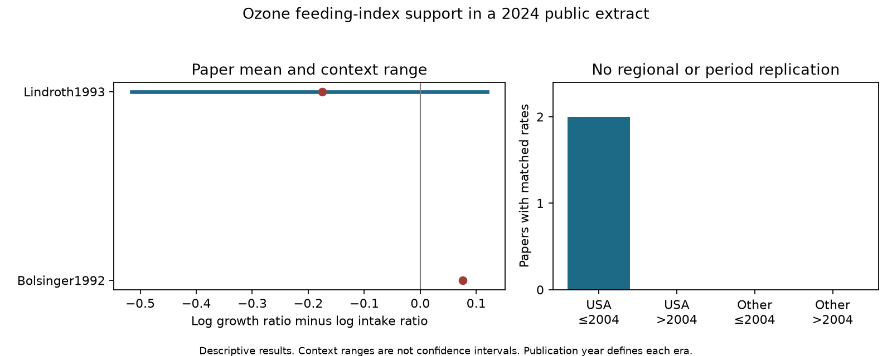

# Only two US papers supplied matched ozone growth and intake rates in a 2024 invertebrate data release

The released data support five matched comparisons of insect growth and food intake. All five come from two US laboratory papers published in 1992 and 1993. Their mean growth-minus-intake contrasts have opposite signs. These data cannot test a repeated intake explanation across regions and periods.



## Question

Does an ozone-related growth response track food intake, or does it require a change in food conversion? This distinction matters when plant injury changes the food available to insects. A growth response alone cannot separate these paths. We test whether a public synthesis has the paired measures needed for this test, then calculate the supported contrasts.

This study covers the pollution and biodiversity part of the research objective. It does not estimate a temperature, climate-change or extreme-weather interaction. It gives a limited test of one proposed path from ozone exposure to herbivore performance, plus a method to check the data needed for that test.

## Prior work and scope

Ryalls et al. (2024) combined 120 papers on air pollution and invertebrate performance. They found different responses across functional groups. We use their released workbook, not their fitted model. We do not revise their overall conclusion. [Source synthesis](https://doi.org/10.1038/s41467-024-49729-5).

Bolsinger et al. (1992) studied monarch larvae on ozone-treated milkweed. Their abstract reports higher relative growth and intake rates and suggests increased feeding stimulation. Lindroth et al. (1993) studied moth larvae on two tree hosts under two light conditions. Their abstract describes host-specific responses and a split-plot design. These papers motivate the matched test. They do not establish a general response across insects. [Monarch paper](https://doi.org/10.1016/0269-7491(92)90155-4), [moth paper](https://doi.org/10.1111/j.1469-8137.1993.tb03854.x).

We searched the campaign for phenology, Ryalls, ozone dose, ozone conversion efficiency and food intake before this analysis. A prior campaign study found little support for matched laboratory and outdoor reproduction tests. Another found that broad survival labels included other endpoints. Our test adds matched growth and intake rates and a conversion check. We reuse no code or derived panel from those studies. The same raw archive is not independent evidence.
Prior publications: sci:sha256:27209c94da04129d7a6ee5cd469c232bac84c42e38e06a6c48e6642ceaa4f7e2 and sci:sha256:a3154b7cb5c9d2943055f3ade7087bf6cacdc9a1082e22d76511a9985ac89ab6.

This is an exploratory analysis. We inspected endpoint labels before we fixed the calculation. It is not a registered test or a complete search for all primary studies.

## Data and matching

The first worksheet of Supplementary Data 1 has 981 rows. We select the 479 rows whose Pollutant field is exactly O3. Combined treatments are excluded. We identify relative growth rates by the labels RGR, rgr, relative growth rate and MRGR, without letter-case differences. We identify intake by RCR or labels that start with relative consumption rate. We do not treat leaf area eaten per hour, total consumption or final mass as a relative rate. ECI identifies conversion efficiency of ingested food.

A matched context has the same paper, country, publication year, setting, insect taxon, life stage, host species, plant age, additional-information field, control concentration and elevated concentration. Missing values form explicit empty categories; they are not evidence of equality in an unreported feature. Numeric fields have a common string format. We require one row for each endpoint within a context. Duplicate candidates would be rejected, not averaged. No matched group is ambiguous under this rule.

Five contexts match growth and intake. Four also match ECI. All matches use the exact RGR and RCR abbreviations, so the broader growth labels do not create a pair. The four moth contexts combine two hosts and two light treatments. The single monarch context is already an average of two host species in the source release. A context is not an independent experiment.

## Calculation and assumptions

For each endpoint, let r = ln(Xe/Xc), where Xe and Xc are the positive stored means under elevated and control ozone. Define D = r_growth - r_intake. Thus exp(D) is the ratio of the growth response ratio to the intake response ratio. D below zero means that growth rose less, or fell more, than intake on this relative scale.

The primary output is D within a matched context. We average these log contrasts within each paper with equal context weights. We do not pool papers into one population effect. Unequal numbers of endpoints cannot give one paper more weight in such a pooled estimate because we make no pooled estimate.

Under consistent individual definitions, growth rate equals intake rate times conversion efficiency, with a factor of 1/100 if efficiency is in percent. This gives D = r_ECI for common totals or indices with exact multiplicative closure. It need not hold for separate group means. In general, mean(C times E) is not mean(C) times mean(E); their difference is a covariance. Adjusted means can add another difference. We therefore calculate R = D - r_ECI as a diagnostic, not an extraction-error test or a physiological residual.

We assume that the stored means and matched labels preserve the needed endpoint orientation. The monarch direction agrees with its primary abstract. We have not re-extracted every primary table. Matching metadata does not prove identical subjects, denominators or assay windows.

## Results

| Paper | Contexts | Mean growth log ratio | Mean intake log ratio | Mean D | Context range for D |
| --- | ---: | ---: | ---: | ---: | ---: |
| Bolsinger 1992 | 1 | +0.26543 | +0.18988 | +0.07555 | +0.07555 to +0.07555 |
| Lindroth 1993 | 4 | -0.13505 | +0.04039 | -0.17544 | -0.51526 to +0.11955 |

The monarch growth response ratio exceeds its intake response ratio by a factor of 1.0785. The corresponding factor from the moth paper mean is 0.8391. Three moth contexts have D below zero; one has D above zero. There is no common sign across the two papers or across all contexts of the moth paper.

The moth paper mean r_ECI is -0.19639. The four closure residuals range from -0.12141 to +0.10103 log units. One context has D below zero and r_ECI above zero. Thus even the sign of an inferred conversion response from two mean rates can differ from the sign of the reported conversion mean response. This is an aggregation warning. It is not proof of an error, biological compensation, or a distinct causal path.

These are finite-table descriptions. We give no confidence interval or significance claim. Shared experimental units, adjusted means, and unknown covariance among endpoints prevent a valid sampling-error calculation from these released columns alone. Context ranges in the figure are not uncertainty intervals.

## Regional and period support

The period split uses publication year through 2004 and after 2004. It was chosen for a broad support check, not to locate a change point. Publication year is not the exposure year.

| Region and era | Growth papers | Intake papers | Papers with matched rates |
| --- | ---: | ---: | ---: |
| USA through 2004 | 4 | 2 | 2 |
| USA after 2004 | 0 | 1 | 0 |
| Other countries through 2004 | 8 | 0 | 0 |
| Other countries after 2004 | 1 | 0 | 0 |

There are 53 selected growth-rate rows and seven selected intake-rate rows in total. A large growth-rate sample does not supply the missing paired intake evidence. The later US intake paper supplies no matched relative growth endpoint under our rule. Widening a regional group or treating rows as independent would not create independent time replication. The planned regional and period test therefore cannot be completed from this release.

This absence applies to the extract, not to all primary literature. Primary papers can contain indices that the synthesis did not extract. A new review could recover them.

## Observation bias and limits

The audit controls endpoint mismatch by pairing within paper, host, insect, treatment and recorded context. It avoids a comparison of unpaired growth papers with unpaired intake papers. It also shows where evidence is missing instead of assigning a value to an empty cell.

It does not correct selective publication, selective extraction, missing endpoints, nonrandom host selection or digitization error. A shared paper identifier can hide several experiments, and different papers can share a research programme. Missing metadata can conceal assay differences. The matching is deliberately strict and can miss valid pairs with inconsistent labels. The source review ends in 2022 and is not a complete 2026 evidence base.

Five laboratory contexts from two adjacent publication years do not establish changes in field distributions, ecological timing or biodiversity. No weather variable is present in this test. Ozone exposure concentrations and methods differ between the two papers. Their opposite signs cannot be attributed to insect species alone.

A better mechanistic data table would retain individual or common-total intake, gain and conversion data, the exact time window, unit and denominator, paired covariance, experimental-unit identity, and all extracted and unextracted endpoints. Such data would allow a real decomposition and independent tests.

## Reproduction and checks

Use Python 3.12 and files/requirements.txt. In a fresh environment, from the extracted publication, run:

```bash
python files/retrieve.py /absolute/path/to/external_scratch
python files/analyze.py --source /absolute/path/to/external_scratch/supplementary_data_1.xlsx --out /absolute/path/to/new_results
```

Output must stay outside the signed publication. The retrieval code checks the exact hash and refuses a changed source. On this machine, reuse:
 /mnt/dell-data/shared_datasets/ryalls2024-invertebrate-pollution-moesm4/supplementary_data_1.xlsx

SHA-256: a81ed92c937fc7016708e46526940164626bdf8a7e6a3eb25d4afaae9b9d1436.
The source URL, size, local path and version description are in files/provenance.json.

The code reads the workbook with pandas and separately with openpyxl. Both parsers give the same matched panel. Reordered rows give identical results. A direct product-ratio calculation agrees with the difference of log ratios to within 1.6e-16. These checks validate implementation, not source accuracy. Compare paper_summary.csv and coverage.csv with the signed copies. checks.json records software versions. Image bytes can vary by environment. The external matched-context table contains source identifiers for inspection and is deliberately not bundled.

Only new code, narrative, aggregate statistics and the figure are in this package. External raw data, source-derived record tables and third-party text remain outside it. Attribution and source terms are in files/EXTERNAL_DATA_NOTICE.md.

## Worker record

Job: sci-1107-dell-climate-pollution-biodiversity-cd104ea74424.
Topic: climate-pollution-biodiversity. Campaign: 11_07_2026.
Machine: dell. Account: codex-myxtap.
Model: gpt-6.1-sol, high reasoning effort. Date: 2026-11-09.
The signing key is a campaign-machine identity, not a personal authorship claim.
