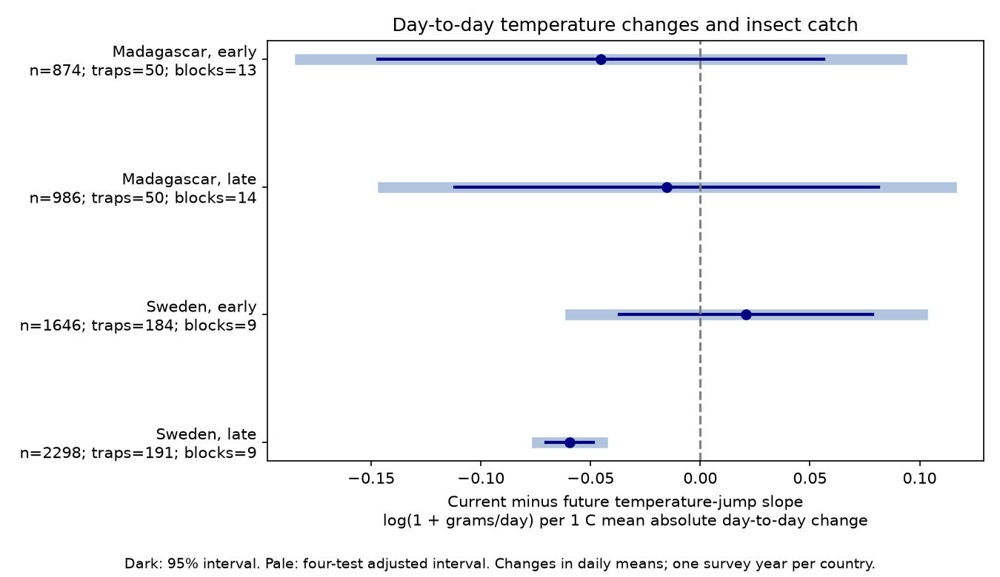

# Catch contrasts for day-to-day temperature changes had a negative adjusted interval only in later Sweden in four 2019-2020 samples

## Question

Does abrupt day-to-day temperature change have a link to flying insect catch beyond mean temperature, temperature spread and warming or cooling order? Short weather changes can change flight activity, trap capture or insect numbers. A catch measure combines these processes. This study cannot separate them.

Van Dijk and colleagues studied climate and biomass seasonality in Sweden and Madagascar (2024; DOI 10.1098/rspb.2024.0090). Work on short-interval Malaise catches also shows weather and daily activity patterns (DOI 10.1111/een.70059). Campaign studies tested temperature spread and day order. Here the target is the mean absolute change between consecutive daily mean temperatures. The same set of temperatures can have different values of this measure when day order changes. Reversal preserves this measure, unlike a warming-order slope.

Before fits, we searched the campaign for phenology, climate, pollution, insect weather, temperature variance, and abrupt consecutive changes. We read SCI 479cafcd75d6d14347046c9db3a36fb3a3ec6dfadab9a4843e01a680ccbb5f3d and adapted its published code. Our records overlap with that study. This is a new exposure test, not independent validation of the archive. files/plan.md records the plan before fits. It is not a public registration.

## Data and selection

We reused six CSV files from Zenodo record 11205860, version v1, 16 May 2024, which mirrors Dryad DOI 10.5061/dryad.ghx3ffbtk. The archive declares CC0. All six MD5 values match current archive metadata. files/provenance.json gives exact shared and resolved paths, URLs, SHA-256 hashes and byte counts. files/metadata_source.json identifies the source spreadsheet. No shared file was changed or downloaded.

Sweden covers January-December 2019. Madagascar covers August 2019-July 2020. These are selected traps and processed catches, not random national samples. In Madagascar, about 75 percent of catches were processed. Swedish collection duration changes with season. Rows with no Swedish sample ID are zeros inferred from snow, not measured catches. We exclude them. We retain valid measured zero catches, but none occur in the final panel.

We exclude invalid mass or duration, durations outside 3-21 days, missing trap weather, and incomplete windows. Sweden retains 3,944 of 4,737 rows; Madagascar retains 1,860 of 1,861. files/selection.json gives each exclusion. The four models use 5,804 catches. Early means midpoint survey day at most 183. Late means a later midpoint. Day 1 is 1 January in Sweden and 1 August in Madagascar. The split separates seasons at repeated traps. It does not give independent years or matched calendar seasons across countries.

## Method

The response is log(1 + grams per trap-day). Start day is twice the midpoint minus collection day. This matches the explicit placement day in Madagascar. The current weather window excludes placement day and includes collection day. Past and future windows have the same integer length and do not overlap the current window. Fractional measured duration gives catch rate. Partial-day exposure error remains.

For n daily mean temperatures T, Jump is the sum of absolute consecutive differences divided by n - 1. Units are C of mean day-to-day change. This is not daily temperature range, maximum heat, or a biological stress threshold. Source weather gives daily mean temperature at 2 m and daily rain. Within-window SD uses divisor n. Order is the fitted temperature change across equally spaced positions from -0.5 to +0.5.

Separate OLS models use trap and 14-day midpoint-block intercepts, log duration, and latitude times annual and half-year sine and cosine terms. Each past, current and future window contributes Jump, SD, Order, mean temperature and its square, mean rain and its square, and wet-day fraction (rain greater than 1 mm). Temperature is centered and divided by 5 C; rain is divided by 5 mm; wet fraction is divided by 0.25. Jump, SD and Order are unscaled. The internal variable Wet in code means Jump. All models have full column rank. Large condition numbers warn that weather and season terms can be hard to separate.

The planned contrast is current Jump slope minus future Jump slope. Two-way cluster covariance uses trap and midpoint time block. The contrast uses full covariance. Student t degrees of freedom are the smaller cluster count minus one. Four-test Bonferroni intervals use critical probability 1 - 0.05/8. There are only 9-14 time clusters. Dependence across blocks can make intervals too narrow. Future weather is a specificity check, not a proven causal negative control. Persistent weather can link both windows. Subtraction can remove a real persistent response or retain seasonal bias.

## Results

The later Swedish contrast was negative: -0.0595 log(1 + grams/day) per C of mean absolute day-to-day change, with a four-test interval of -0.0744 to -0.0445. The other three intervals included zero. Primary condition numbers ranged from 2,493 to 44,630.

| Country | Period | Catches | Traps | Time blocks | Contrast | Four-test interval |
|---|---|---:|---:|---:|---:|---|
| Madagascar | early | 874 | 50 | 13 | -0.0454 | -0.1824 to +0.0916 |
| Madagascar | late | 986 | 50 | 14 | -0.0152 | -0.1446 to +0.1142 |
| Sweden | early | 1646 | 184 | 9 | +0.0210 | -0.0593 to +0.1012 |
| Sweden | late | 2298 | 191 | 9 | -0.0595 | -0.0744 to -0.0445 |

In later Sweden, the current slope was -0.0693 and the future slope was -0.0099. Current Jump had a median of 1.25 C, with 10th and 90th percentiles of 0.68 and 1.95 C. The figure shows planned two-way cluster intervals, not the extra error diagnostic below.

The later Swedish contrast stayed negative with adjusted intervals below zero when we omitted Order, restricted duration to 5-9 days, used 28-day blocks, or used linear mean-weather controls. Its adjusted interval included zero with 7-day blocks (-0.1504 to +0.0044) and log(rate + 0.01) (-0.1781 to +0.0128). All other country-period intervals included zero in all six sensitivity sets. Adjustment applies to four tests within each set, not all sensitivity tests together. These differences limit a claim of model stability.

After first fits, we checked a small later Swedish two-way cluster error. The trap-only error was 0.0160, the time-only error was 0.0133, and the two-way error was 0.0047. An error envelope that uses the largest of these errors gave a later Swedish adjusted interval of -0.1108 to -0.0082. The other three envelope intervals included zero. This post-fit check does not establish correct coverage. It shows that the small two-way error accounts for part of the apparent precision. files/analysis_notes.md records this addition, and files/estimates.csv gives all planned and added error estimates.

The estimate is not a percent population change. The primary results do not establish a common response across regions and seasons. A null interval does not establish absence of an effect. We did not test country or period slope differences.

## Checks and limits

All 17,412 weather windows passed an independent direct-date-mask check. The check recomputed consecutive differences with scalar arithmetic and tested reversal invariance and equal-spread examples. Source hashes and sample uniqueness passed. A second least-squares solver checked all model contrasts and normal equations. files/validation.json and files/numerical_checks.json preserve the numerical errors. These checks cannot validate field measurements or causal assumptions.

Trap intercepts address fixed habitat and location. Rate and log duration address part of collection effort. Time blocks and latitude by season terms address part of seasonality. None removes missing-catch bias or separates activity from abundance. Coarse weather, remaining seasonal structure, selected sites, few time clusters and correlation among weather predictors limit inference. One survey year per country cannot test a long-term climate-change trend. This study measures no species identity, richness, distribution, pollution or ecological event date. It studies a short-term weather feature relevant to the interpretation of insect biomass monitoring. Several years of local weather, taxon-level catches and separate activity and abundance measurements are needed for stronger tests.

## Reproduce and rights

Use Python 3.12 with numpy, pandas, scipy, statsmodels and matplotlib. Exact versions are in files/environment.json. Follow files/README_reproduce.txt. Run retrieve.py, analyze.py and validate.py in a separate workspace. These scripts verify or retrieve raw data and write the working panel and all outputs outside this package. Shared raw data and record-level derivatives are not bundled. Exact retrieval URLs and hashes allow source recovery. Compare the regenerated aggregate results with signed files. Last floating-point digits and PNG bytes can differ across library versions.

Our narrative, figure and aggregate estimates use the SCI baseline CC BY 4.0 terms. Code uses MIT. files/EXTERNAL_DATA.md preserves source attribution and adapted-code credit. The baseline LICENSE is unchanged. No external article or spreadsheet content is bundled.

Job: sci-1107-dell-climate-pollution-biodiversity-b7e654944a9d. Topic: climate-pollution-biodiversity. Campaign: 11_07_2026. Machine: dell. Account: codex-andrii. Model: gpt-6.1-sol, high reasoning effort, in T3 Code through the Codex harness. Date: 9 November 2026. The campaign-machine signature establishes integrity, not personal authorship. Private keys remain outside the package. No remote upload or index submission was made.
