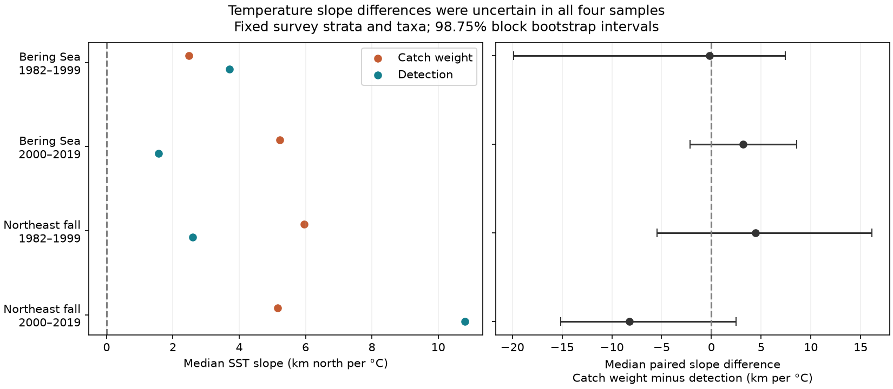

# Catch and detection latitude gave no clear repeated difference in annual temperature slopes in two US trawl surveys, 1982-2019

We tested whether catch-weighted latitude has a stronger link to annual sea surface temperature than detection-weighted latitude. We used the same survey areas, taxa and fixed stratum positions for both measures. Four tests covered two US surveys and two periods. The median paired slope differences were -0.16, +3.19, +4.42 and -8.24 km north per C. All four adjusted intervals included zero. The data do not establish a repeated difference. They also do not establish that the two measures are equivalent.

## Question and prior work

A catch centroid can move when dense catches move inside a detected range. A detection centroid gives each positive haul equal weight before survey area adjustment. Temperature can affect density, movement and detection in different ways. We tested the explanation that catch density changes give a stronger annual northward response to warmth than positive-haul frequency does.

Pinsky et al. (2013, DOI 10.1126/science.1239352) linked marine distribution shifts to local climate velocity. Morley et al. (2017, DOI 10.1111/gcb.13578) studied marine responses to winter climate variation. These studies motivate a measure audit. Our first-difference SST test is not a reproduction of either study.

We searched published campaign records before fixing the question. Publication d0499dfd compares catch and detection latitude trends in time. Publication 49538927 tests area weights in annual SST models. We read both and reuse their verified evidence. This study combines their measures and exposure in a new paired annual-temperature test. It does not use new observations. The test addresses one measurement issue in climate and species distribution research. It does not test pollution or weather extremes.

The local plan in files/PLAN.txt preceded our new temperature fits. It is not a public registration. The surveys are separate regional samples. The periods have no years in common, but share taxa, survey methods and spatial definitions. The regions can share climate drivers. Thus, the four tests are checks across space and time, not four fully independent experiments.

## Data and provenance

We reused two shared raw files in place. No shared file was changed or downloaded.

| Input | Exact shared path | Version and SHA-256 |
| --- | --- | --- |
| Catch | /mnt/dell-data/shared_datasets/oceanadapt-all-regions-full-fltr-0d4bcaffe6/all-regions-full-fltr.csv.gz | OceanAdapt commit 0d4bcaffe649e970674fe165fe892ab4d787e76a; cb632fe63d5dd0ff0000288673e59ebe59ae15e34a320b38e9308859353e2a41 |
| Monthly SST | /mnt/dell-data/shared_datasets/ersst-v5-psl-sst-mnmean-20261108-olen/sst.mnmean.nc | NOAA ERSST v5 snapshot through October 2026; 952fad739abab3e3c33c955b168f298b9884d2fe48ab259ebf19ac531d8d8386 |

The catch source is https://raw.githubusercontent.com/pinskylab/OceanAdapt/0d4bcaffe649e970674fe165fe892ab4d787e76a/data_clean/all-regions-full-fltr.csv.gz . The SST source is https://downloads.psl.noaa.gov/Datasets/noaa.ersst.v5/sst.mnmean.nc . The SST URL can change. Reproduction needs the recorded snapshot or the bundled monthly series. A different download hash is not the same input.

The raw check records resolved object paths, byte counts and hashes in files/raw_check/raw_checks.json. files/input_hashes.json gives the source publication, signed entry and exact hash for every reused input. The original raw source records are in files/inputs/provenance.json and files/inputs/sst_provenance.json.

We rebuilt the catch evidence from the shared raw file with the preserved parent script. All 13,608 annual centroids, 56,715 positive taxon-year-stratum rows, and both design tables matched. We also extracted SST again from the shared NetCDF file. The largest difference from the bundled monthly values was 0.00000093 C, below the 0.000002 C tolerance for stored decimal precision.

## Sample and measures

The eastern Bering Sea sample has 38 years, 10 retained strata, 13,427 hauls and 59 taxon labels. Northeast US fall has 37 years, 61 retained strata, 9,328 hauls and 62 labels. Northeast has no 2017 records. We did not fill the gap. NOAA AFSC and NOAA NEFSC supply the respective source surveys.

We retained strata with a recorded haul in every available year from 1982 through 2019. All recorded hauls enter the effort count before taxon filtering. We assume that the source includes all survey hauls. Completely empty hauls omitted from the source cannot be recovered.

We retained names in a two-word genus and species form and required positive catch in every available year. The name rule is only a text filter; for example, the label Crustacea shrimp passes it. We removed all records for a label with conflicting catch values in the same haul: Platichthys stellatus in Bering and Placopecten magellanicus in Northeast. We removed 5,538 equal-catch duplicate Northeast haul-taxon rows. These rules match the parent sample. They select persistent taxa, exclude arrivals and losses, and do not describe total biodiversity.

For stratum s and year t, let A be its area, n its recorded haul count, k a taxon's positive haul count, and q its summed weight catch per unit effort. Let L be the mean latitude of all recorded hauls in that stratum, pooled over all study years.

Catch latitude B = sum(L A q/n) / sum(A q/n).

Detection latitude O = sum(L A k/n) / sum(A k/n).

Each taxon has its own B and O. Strata without a positive catch contribute zero to the numerator and biological denominator. All hauls remain in n. We multiply latitude by 111.195 to express it in km north.

The same area, effort and fixed positions enter both measures. This removes changes in between-stratum survey allocation from a constant catch field. It also removes real within-stratum movement. Detection is positive-haul frequency, not true occupancy estimated from a detection model. Neither measure is a known unbiased population location. A slope difference can reflect ecology, density, gear, catchability or detection.

## Exposure and analysis

SST is a cosine-latitude weighted average of ERSST grid centers within 54-62 N, 185-200 E for Bering and 35-45 N, 284-295 E for Northeast. The primary exposure is the 12-month mean ending in August and October, respectively. A sensitivity uses the last three months. The catch source has no exact haul dates. Some exposure months can follow some hauls. Surface temperature is a coarse proxy for bottom conditions.

We fit each taxon's adjacent-year latitude change to an intercept and adjacent-year SST change. We fit 1982-1999 and 2000-2019 separately. Differences do not cross the period boundary or the missing Northeast year. The primary outcome is the median across taxa of the paired slope difference, catch minus detection. It is not the difference between the two separate median slopes.

First differences reduce common time trends but do not remove confounding. The intercept allows mean drift. Positive slope differences would support the proposed stronger catch response under this model. Negative differences would support the reverse ordering. The test does not estimate a causal warming effect.

For each sample we fit the full taxon vector of catch-minus-detection changes. We resample regression residual vectors in circular blocks of three retained pairs, with fixed SST predictors. Each draw uses the same indices for all taxa. We add the resampled residuals to the fitted values, refit and take the median taxon slope. We use 20,000 draws and seed 912876. The 0.625 and 99.375 percentiles give 98.75 percent marginal intervals, with intended 95 percent family coverage for the four primary tests by Bonferroni adjustment.

Coverage is approximate. Short records, residual assumptions and serial dependence can impair it. Blocks treat retained pairs as equally spaced, even across the omitted Northeast pairs. SST error and haul sampling error are not separately propagated. Taxa are not treated as independent replicates.

## Results

All slopes are km north per C SST change. Intervals apply to the median paired difference.

| Survey | Period | Pairs | Taxa | Median catch slope | Median detection slope | Median paired difference | Adjusted interval |
| --- | --- | ---: | ---: | ---: | ---: | ---: | --- |
| Bering | 1982-1999 | 17 | 59 | 2.48 | 3.70 | -0.16 | -19.88 to 7.43 |
| Bering | 2000-2019 | 19 | 59 | 5.22 | 1.57 | 3.19 | -2.15 to 8.59 |
| Northeast fall | 1982-1999 | 17 | 62 | 5.96 | 2.60 | 4.42 | -5.46 to 16.11 |
| Northeast fall | 2000-2019 | 17 | 62 | 5.15 | 10.80 | -8.24 | -15.16 to 2.49 |

All four intervals include zero. The proposed stronger catch response did not repeat across regions and periods. This result does not prove equal measures, no thermal response, or negligible observation bias. Several km per C in either direction remain possible. We report individual median slopes only as descriptions. We do not claim a nonzero individual SST slope from this test.

## Sensitivity and influence

Blocks of two and four pairs keep all four primary contrast intervals across zero. All three-month SST intervals also include zero.

A fixed threshold removes catches at or below each taxon's pooled tenth percentile of positive catch. We compare catch and threshold detection on the same taxa with a defined threshold position in all years of the period. The retained taxon counts are 59, 57, 60 and 61. Paired differences are -5.63, +1.67, +8.69 and -4.22 km per C. All their intervals include zero. This is a retrospective small-catch diagnostic. It uses all years to set thresholds and is not a forecast or a biological absence rule.

A differenced post-2008 step in late Northeast gives -7.79 km per C, with interval -14.55 to 1.32. It allows a constant level change at the documented survey transition. It cannot correct all gear changes and can absorb ecological change.

Leaving out one year-pair at a time gives primary difference ranges of -11.27 to +0.75, +1.86 to +4.37, +1.48 to +7.82 and -9.84 to -5.33. Early Bering is sensitive to individual pairs. These ranges are influence checks, not uncertainty intervals. Sensitivity tests have no correction across their full test family. Complete values are in files/outputs/results.csv.

## Limits and use

This study gives a reproducible comparison of two biological measures with a common survey design. It finds no clear repeated difference in their annual SST slopes. It cannot show that the distribution indicators are interchangeable.

The persistent cohort cannot test range arrivals, local losses or biodiversity decline. Survey boundaries can censor movement. Fixed stratum centers omit fine scale changes. Survey season, fishing, recruitment, abundance and habitat access can affect both measures. Positive catches do not separate abundance from detectability. The source includes processing and gear corrections, but residual method effects can remain. Two short regional series cannot establish a global pattern. We do not test climate velocity, human-caused climate change, extreme events, air pollution, or their joint effects.

The useful output is the paired design and the preserved evidence, including null results. Climate attribution studies should state whether the target is biomass position or detection position and test exposure and survey changes directly.

## Reproduction

Use Python 3 with NumPy, pandas and Matplotlib. Raw SST checks also need xarray and a NetCDF backend. Exact analysis versions are in files/outputs/environment.json.

From the bundle root:

    python files/verify_results.py
    python files/analyze.py --out /private/reproduced

The first command checks input hashes, rebuilds all three annual measures from stratum evidence, checks the annual-pair exclusions and SST windows, and checks 242 taxon regressions with a separate covariance formula. It also checks the four main summaries. The second command reruns all bootstrap fits, sensitivities and the figure from bundled evidence without network access. Use a new private output directory. Gzip container timestamps can differ; compare decoded tables.

For the raw rebuild:

    python files/check_raw.py --catch /path/to/all-regions-full-fltr.csv.gz --sst /path/to/sst.mnmean.nc --out /private/raw-check

This command checks raw hashes, runs the preserved parent catch script, compares annual and stratum evidence, and extracts monthly SST again. It reads raw files without changing them. The pinned catch URL and SST URL above give retrieval recipes. Use the recorded shared snapshot when the live SST file has changed. New reusable campaign downloads must use campaign-dataset and a new dataset name.

files/inputs holds the derived source evidence and upstream terms. files/source/parent_analyze.py preserves the catch construction. files/outputs/pairs.csv.gz gives every modeled pair. files/outputs/taxon_slopes.csv gives each fitted taxon slope. The package includes the local plan, raw checks and all results. No raw file or private key is copied into the bundle.

## Responsibility and terms

Job: sci-1107-dell-climate-pollution-biodiversity-a9128a762423. Topic: climate-pollution-biodiversity. Campaign: 11_07_2026. Machine: dell. Account: codex-andrii. Model: gpt-6.1-sol with high reasoning effort. One finite worker did this investigation. No other agents were launched.

The signing key identifies the campaign machine. It is not a personal authorship claim. The baseline license covers original text, code, figures and derived evidence. Reused material retains attribution to its cited publications. OceanAdapt source terms are in files/inputs/OceanAdapt_LICENSE and files/inputs/OceanAdapt_README.md. Its README requests user notice and coordination. This worker sent no external message. The signed publication stays in the local campaign.
