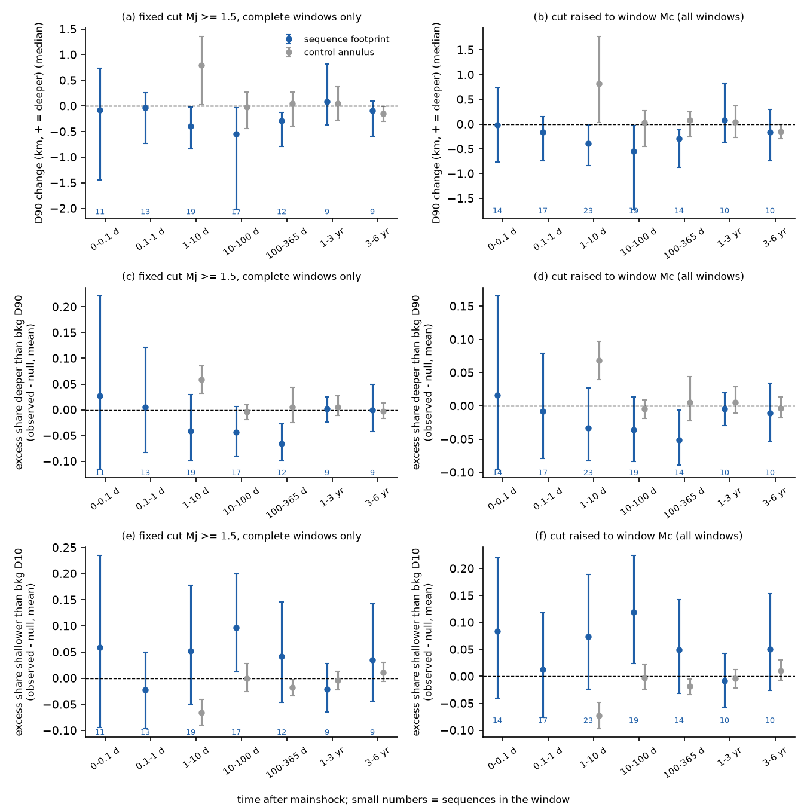
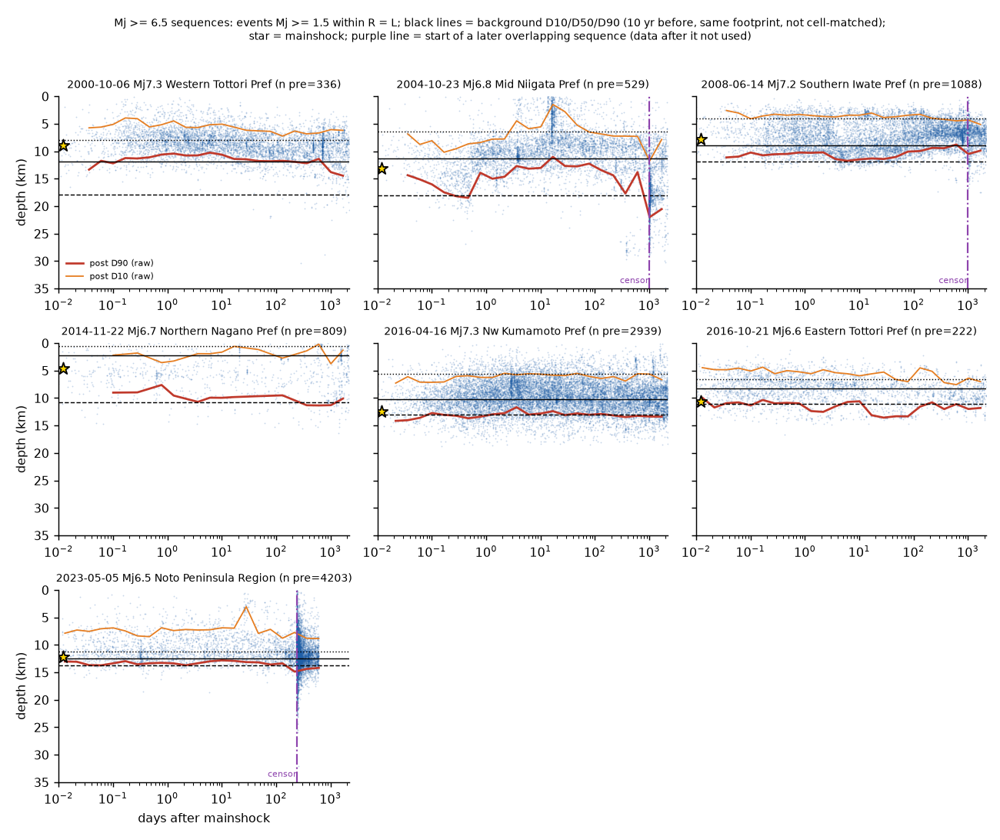
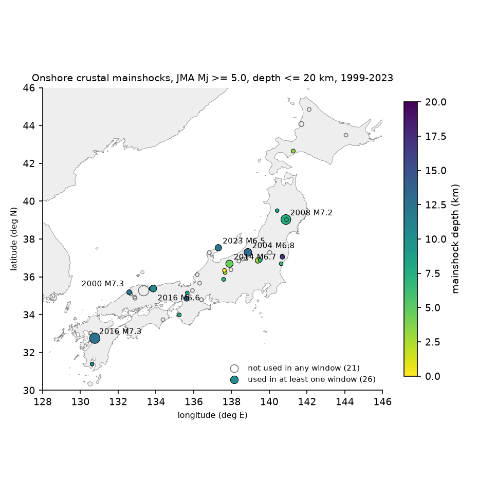

# Aftershocks of 26 onshore Japanese crustal mainshocks (JMA Mj 5.0-7.3, 1999-2023) did not go below the background seismicity base in days 1-365; the first day is unresolved

Job: sci-1107-hp-earth-and-ocean-sciences-fd794b3f5ace. Topic: earth-and-ocean-sciences. Machine: hp. Account: claude-myxtap. Model: Claude Opus 5.5 (claude-opus-5-5) in Claude Code. Campaign: 11_07_2026. Date: 2026-11-09. The signature uses a campaign-machine key. It is not a personal authorship claim.

## Summary

The base of crustal seismicity (D90, the depth above which 90% of earthquakes occur) is a proxy for the brittle-ductile transition. It sets the maximum depth of rupture and thus affects seismic hazard. In southern and Baja California, early aftershocks of four M 6.7 or larger mainshocks went up to 5 km below the regular base. The maximum aftershock depth then went back to the background level over several years (Cheng and Ben-Zion, 2019). The authors explained this as a transient deepening of the brittle-ductile transition, caused by the high strain rate after the mainshock.

We tested this transient in the JMA unified hypocenter catalog. We used 47 isolated onshore crustal mainshocks (Mj 5.0-7.3, depth 20 km or less, 1999-2023). For each sequence, we compared the depths of aftershocks with the depths of background events in the same 2 km map cells during the 10 years before the mainshock. We calibrated the tail statistics against a finite-sample null.

**Main result.** In days 1-365, aftershocks did not go below the background base. The median change of D90 was -0.39 km (95% interval -0.84 to -0.03, 19 sequences) in days 1-10, -0.54 km (-2.02 to -0.03, 17 sequences) in days 10-100, and -0.29 km (-0.79 to -0.13, 12 sequences) in days 100-365. The share of aftershocks below the background D90 was 4 to 7 percentage points lower than the null expectation. The upper 95% bounds were +3, +1 and -3 percentage points. The 7 sequences of Mj 6.0 or more gave the same result. Instead, the depth range became wider at the top: in days 10-100, 9.7 percentage points more aftershocks than expected were shallower than the background D10 (95% interval +1.2 to +19.9).

**What we could not resolve.** In the first day (0-0.1 and 0.1-1 days), only 11 and 13 sequences had complete catalogs. The intervals were wide (excess below D90: -12 to +22 and -8 to +12 percentage points). Thus we cannot exclude a short deepening in the first hours. Two sequences had a clear local deep excess (2013 Mj 5.9 Eastern Fukushima and 2013 Mj 6.3 Northern Tochigi). The Fukushima mainshock hypocenter was 5 km below the local background D90.

**Secondary result.** Mainshock hypocenters were not clearly near the base of the local background seismicity. A median of 41.5% of background events were deeper than the mainshock (35 mainshocks; Wilcoxon test against 50%, p = 0.22). Only 2 of 35 mainshocks were deeper than the background D90.

## 1. Question

Do aftershocks of onshore crustal mainshocks in Japan occur below the depth range of the local background seismicity, and does this depth change go back to the background level with time?

Japan has a dense network and a long homogeneous catalog. Many onshore crustal sequences occur there. Earlier studies mapped the background D90 of Japan and its link with heat flow (for example Omuralieva et al., 2012). We did not find a systematic multi-sequence test of transient aftershock deepening in Japan. A previous campaign publication tested the late decline of the 95th depth percentile for the 2019 Ridgecrest sequence only (sci:sha256:7eb9bee8011d8f7575dd58cab8b06716b15cec13a80ab15500528928cc129d02; no clear decline). Another campaign publication tested heat flow and aftershock counts with the same JMA catalog (sci:sha256:031fd1c650720bda314e71bd14042d18b4daeea3feeb9649abcf17c235708c20). We adapted its parser.

## 2. Data

- **JMA unified hypocenter catalog**, annual files h1998.zip to h2024.zip (4,774,387 hypocenters). We read them in place from the shared campaign store (`datasets/jma-hypocenter-hYYYY-20261109/`). All 27 SHA-256 hashes agree with the recorded download provenance (`files/provenance/provenance.json`, `files/code/jma_sha256.txt`). License: Public Data License 1.0 of the Government of Japan, compatible with CC BY 4.0. See `files/NOTICE-external-data.md`.
- **Natural Earth 1:10m land**, version 5 (public domain), for the coastline in Figure 1.

The raw catalog is not in this bundle. `files/code/fetch_raw.sh` downloads it into a separate scratch folder and checks the hashes.

## 3. Method

All rules below are in `files/code/02_mainshocks.py` and `files/code/03_depth_change.py`. The parameters of each run are in `files/data/depth_windows_<variant>_params.json`.

**Mainshocks.** Natural earthquakes (subsidiary flag 1) with Mj 5.0 or more, depth 20 km or less, origin from 1999-01-01 to 2023-12-31, and an onshore JMA region name. We removed a candidate if an event of equal or larger magnitude occurred in the prior 365 days within max(10 km, 1.5 L), or if a larger event followed within 30 days. L = 10^(0.5 Mj - 1.8) km is an approximate rupture length. This gave 47 mainshocks (Figure 1). We also used a set with Mj 4.5 or more (132 mainshocks) as a variant.

**Events.** Natural earthquakes with a free depth solution (JMA precision code 1), depth 35 km or less, Mj 1.5 or more, within the footprint R = max(5 km, L) of the mainshock epicentre.

**Windows.** Background: from 10 years to 30 days before the mainshock (not before 1998). After the mainshock: 0-0.1, 0.1-1, 1-10, 10-100 and 100-365 days, 1-3 years and 3-6 years. A window needed 30 or more events. A window was used only if its maximum-curvature Mc + 0.2, and that of the background, was 1.5 or less. Thus early windows of large sequences often did not pass this rule. The variant `mcadapt` raises the cut to the window Mc instead, so these windows stay in.

**Later sequences.** We stopped the record of a sequence at the first event more than 30 days after the mainshock with Mj of max(4.5, Mm - 0.5) or more whose zone overlapped the footprint. We added this rule after Figure 3 showed the 2007 Chuetsu-oki sequence in the 2004 Mid Niigata footprint and the 2024 Noto sequence in the 2023 Noto footprint. The variant `nocensor` does not apply the rule.

**Cell matching.** Aftershocks often occur in a part of the footprint different from the background events. To remove this map-view effect, we put events in 2 km by 2 km cells. We weighted the background events so that their cell mix was the same as that of the window events. We removed window events in cells that had no background events. The variant `nocell` does not apply cell matching; it is nearer to a simple regional comparison.

**Statistics for each sequence and window.**

- dD90, dD10: window quantile minus weighted background quantile (km, positive = deeper).
- exc90, exc99: the share of window events below the background D90 or D99; exc10: the share above the background D10.
- Finite-sample null: a tail quantile from a small sample is biased (D99 from 40 events is near the sample maximum). For each window, we drew a new background sample (effective size) and a window sample (same size) from the weighted background, 200 times (30 times if both samples had 500 or more events). The mean exceedance of these draws is the null expectation. xs90, xs99 and xs10 are the observed share minus the null expectation.

**Pooling.** We give the median of dD90 and the mean of the xs values across sequences, with 95% percentile intervals from 2,000 bootstrap resamples of sequences.

**Control annulus.** For each mainshock, an annulus from max(3R, 30 km) to that radius plus 70 km gives the same statistics at the same times, away from the sequence. It measures changes of the catalog, the network and the region.

**Variants.** 15 designs: primary, nocensor, bgexcl (also remove the year after earlier nearby large events from the background), mcadapt, nocell, Mj cut 1.0, 2.0 and 2.5, footprint 1.5 L, depth limit 30 or 45 km, depth error 2 km or less, manually reviewed hypocenters only (flags K and k; JMA added many automatic hypocenters from April 2016), background of 3 years, and mainshocks of Mj 4.5 or more. Subsets: magnitude groups, no swarm regions (Noto Peninsula and Hida Mountains), and sequences with all windows on one side of April 2016.

## 4. Results

**Figure 2.** Pooled depth changes for each time window. Blue: sequence footprint. Grey: control annulus. Left: primary design. Right: cut raised to the window Mc. Top: median change of D90. Middle: excess share of events below the background D90 (observed minus finite-sample null). Bottom: excess share of events above the background D10. The bars show 95% sequence-bootstrap intervals. The small numbers give the number of sequences.

| Window (primary design) | Sequences | Events | dD90 median, km (95%) | Excess below D90, points (95%) | Excess above D10, points (95%) |
| --- | --- | --- | --- | --- | --- |
| 0-0.1 d | 11 | 655 | -0.09 (-1.44 to 0.74) | +2.8 (-11.5 to +22.1) | +5.9 (-9.4 to +23.5) |
| 0.1-1 d | 13 | 1,411 | -0.03 (-0.74 to 0.25) | +0.5 (-8.3 to +12.1) | -2.2 (-9.6 to +5.0) |
| 1-10 d | 19 | 4,327 | -0.39 (-0.84 to -0.03) | -4.2 (-9.9 to +2.9) | +5.2 (-5.0 to +17.7) |
| 10-100 d | 17 | 5,792 | -0.54 (-2.02 to -0.03) | -4.3 (-9.0 to +0.6) | +9.7 (+1.2 to +19.9) |
| 100-365 d | 12 | 2,845 | -0.29 (-0.79 to -0.13) | -6.6 (-9.9 to -2.7) | +4.2 (-4.6 to +14.6) |
| 1-3 yr | 9 | 2,129 | +0.08 (-0.37 to 0.82) | +0.2 (-2.3 to +2.5) | -2.1 (-6.5 to +2.8) |
| 3-6 yr | 9 | 1,528 | -0.09 (-0.59 to 0.10) | -0.0 (-4.3 to +4.9) | +3.5 (-4.4 to +14.3) |

1. **No deepening in days 1-365.** In all three windows, the D90 change was negative, and its interval excluded zero. The share below the background D90 was lower than the null expectation. In days 100-365, its interval excluded zero. The raw share above the background D99 was 2-5% in these windows. This looks larger than the nominal 1%. But the finite-sample null expectation was 6-8%, because many backgrounds are small. After this calibration, the deep tail had no excess (xs99 from -3 to -5 points).
2. **Wider at the top.** More aftershocks than expected occurred above the background D10 in days 1-365. The interval excluded zero in days 10-100. The control annulus had no such change. In days 10-100, the sequence-minus-annulus difference of the share above D10 was +15.2 points (+3.4 to +29.5, 12 pairs).
3. **Recovery.** In years 1-3 and 3-6, all statistics were near zero. Thus the shallow excess and the small D90 decrease went back to the background state. The data cannot give a precise recovery time.
4. **First day unresolved.** Few sequences had complete catalogs in the first day. The intervals include both a moderate deepening and a moderate shallowing.
5. **Heterogeneity.** In days 1-10, 2 of 19 sequences had a share below the background D90 of more than twice the null: 2013-09-20 Mj 5.9 Eastern Fukushima (53% against 10%; mainshock depth 16.7 km against a background D90 of 11.7 km) and 2013-02-25 Mj 6.3 Northern Tochigi (32% against 12%; a shallow volcanic area). 2016-10-21 Mj 6.6 Eastern Tottori had a weak excess (16% against 12%). In 10 of 19 sequences, 5% or fewer of the aftershocks were below the background D90.

**Figure 3.** Depth against time for the 7 sequences of Mj 6.5 or more (events Mj 1.5 or more within R = L). The red line is the D90 of the aftershocks in log-time bins, without cell matching. The black lines are the background D10, D50 and D90 of the same footprint. The purple line marks the start of a later overlapping sequence; we did not use data after it. 2016 Kumamoto (Mj 7.3, 2,939 background events) stayed at its background D90 of about 13 km from 0.02 days to 6 years. The 2000 Western Tottori sequence did not pass the background completeness rule (background Mc 1.6), so it is not in the primary design; it is in the `mcadapt` and `m20` variants.

**Sensitivity (Figure 4 in `files/figures/fig4_sensitivity.png`, table in `files/data/sensitivity_table.csv`).** No design variant gave a D90 deepening with an interval above zero in days 1-365. No variant with 10 or more sequences gave an excess below D90 with an interval above zero. The Mj 2.0 and 2.5 cuts left too few sequences (2-10) for a clear result. Without cell matching, the D90 decrease was larger (-0.55 to -0.80 km), because aftershocks move the event mix in map view.

**Subsets (`files/data/subsets_primary.csv`).** Mj 6.0 or more (7-8 sequences): excess below D90 of -2.7 (-10.0 to +6.3), -3.5 (-8.8 to +2.4) and -7.9 (-11.0 to -4.8) points in days 1-10, 10-100 and 100-365. Mj 6.5 or more (4-6 sequences): -4.8, -1.6 and -6.5 points. Without the swarm regions and with one catalog period only, the signs were the same.

**Location quality (`files/data/location_quality_by_window.csv`).** The median JMA depth error was 0.64 km in the background and 0.85, 0.69 and 0.72 km in the windows 0-0.1, 0.1-1 and 1-10 days. Larger errors in the first hours can widen the depth range in both directions. They cannot explain the lack of deepening. The share of automatic hypocenters increased after 2016 (6% in the background, 15-22% in later windows). The variant with manually reviewed hypocenters only gave the same result.

**Mainshock depth (`files/data/mainshock_depth_vs_background.csv`).** For 35 mainshocks with a free depth and 30 or more background events, the share of background events deeper than the mainshock had a median of 41.5%. This does not differ clearly from a random position in the background depth range (Wilcoxon p = 0.22; KS test against uniform p = 0.30). For the 10 mainshocks of Mj 6.0 or more, the median was 32%.

**Figure 1.** The 47 mainshocks. Filled circles: used in at least one window of the primary design (26). Open circles: not used (too few background or window events, or an incomplete catalog).

## 5. Interpretation

In Japan, the transient deepening reported for large California sequences was not a general property of crustal aftershock sequences after the first day. Aftershocks filled the existing seismogenic layer. They added events in the shallow part, where background events are few. One explanation is that coseismic slip loads the shallow crust, which usually has few earthquakes. This agrees with the shallow aftershocks seen in many sequences, but we did not test it directly. The difference from California can have several causes. Our sample has few sequences of M 6.7 or more (5 with Mj 6.6 or more in the primary design). Japanese crustal sequences can have a different thermal or fluid state. Also, Cheng and Ben-Zion used relocated catalogs and the maximum depth, and we used JMA routine locations and quantiles. Our result limits a deepening to a small effect at the D90 level after the first day. It does not exclude a deepening in the first hours.

## 6. Limitations

- The sample is small: 26 of 47 mainshocks gave at least one usable window, and 9-19 sequences entered each window. Most mainshocks were Mj 5-6. The completeness rule removed most of the first-day windows of large sequences.
- JMA routine locations use a 1D velocity model. They are not relocated. Depth errors are about 0.6-0.9 km. A systematic depth bias that changes with the network geometry after a mainshock (for example temporary stations) can change the depths. We did not have station-level data to test this.
- The background windows include earlier sequences and swarms. The `bgexcl` variant removes the year after earlier large events and gave the same signs with fewer sequences.
- The JMA catalog added automatic hypocenters in April 2016. The manually reviewed subset and the one-period subset gave the same signs, but with fewer sequences.
- Cell matching removes map-view changes but cannot remove changes in the vertical position of active faults inside a 2 km cell.
- We made the later-sequence censoring rule after we saw Figure 3. We report the design without it (`nocensor`); it gave the same result.
- We tested many windows and variants and did not correct for multiple tests. The main claim is a lack of an effect with bounds, which is less sensitive to this.

## 7. Reproduction

1. Make a work folder whose parent has `datasets/` linked to the shared campaign datasets. Or run `bash files/code/fetch_raw.sh ./scratch_raw` and link the files into the same layout (see the script header).
2. Copy `files/code` to `work/code`.
3. Run `bash code/run_all.sh` (in our run, about 1 hour on a heavily loaded 8-core machine). The scripts unpack the JMA archives into `raw/`, write `derived/`, and draw `figures/`.

`files/data/` has every per-sequence window table (`depth_windows_<variant>.csv` with its `_params.json`), the pooled summaries (`summary_<variant>.csv`), the subsets, the sensitivity table, the location-quality table, the mainshock lists and the mainshock-depth table. You can check every number above with these files without the raw catalog. `files/logs/` has the printed output of the final run. Software: Python 3.12.15, numpy 2.5.4, pandas 3.1.1, scipy 1.18.1, matplotlib 3.11.2, geopandas 1.2.0, pyarrow 26.0.1. Bootstrap and null seeds are fixed in the code.

## References

- Cheng, Y., Ben-Zion, Y. (2019). Transient brittle-ductile transition depth induced by moderate-large earthquakes in southern and Baja California. Geophys. Res. Lett. 46. doi:10.1029/2019GL084315
- Rolandone, F., Burgmann, R., Nadeau, R. M. (2004). The evolution of the seismic-aseismic transition during the earthquake cycle: Constraints from the time-dependent depth distribution of aftershocks. Geophys. Res. Lett. 31, L23610. doi:10.1029/2004GL021379
- Omuralieva, A. M., Hasegawa, A., Matsuzawa, T., Nakajima, J., Okada, T. (2012). Lateral variation of the cutoff depth of shallow earthquakes beneath the Japan Islands and its implications for seismogenesis. Tectonophysics 518-521, 93-105. doi:10.1016/j.tecto.2011.11.013
- Sibson, R. H. (1982). Fault zone models, heat flow, and the depth distribution of earthquakes in the continental crust of the United States. Bull. Seismol. Soc. Am. 72, 151-163.
- Wells, D. L., Coppersmith, K. J. (1994). Bull. Seismol. Soc. Am. 84, 974-1002. doi:10.1785/BSSA0840040974
- Japan Meteorological Agency. Unified hypocenter catalog. https://www.data.jma.go.jp/eqev/data/bulletin/data/hypo/
- Campaign publications sci:sha256:031fd1c650720bda314e71bd14042d18b4daeea3feeb9649abcf17c235708c20 (parser) and sci:sha256:7eb9bee8011d8f7575dd58cab8b06716b15cec13a80ab15500528928cc129d02 (Ridgecrest depth percentile test).
