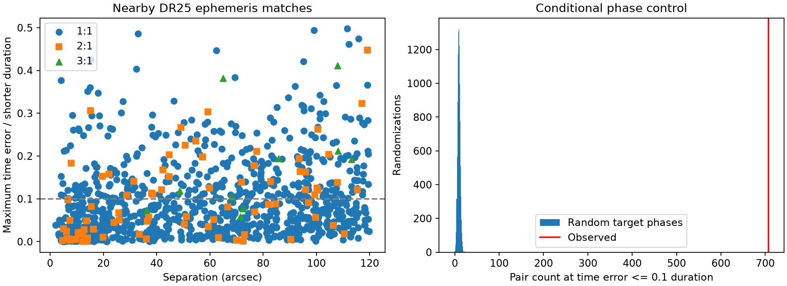
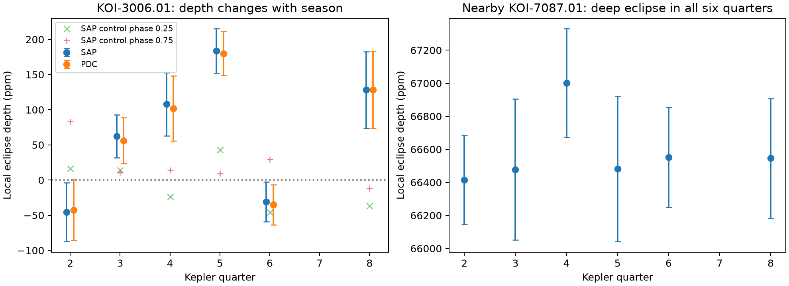

# Six Kepler quarters support light contamination of KOI-3006.01 that changes with detector season

The search found a shared signal near KOI-3006.01. Six Kepler quarters support light contamination from a nearby eclipsing source. This result supports an existing false-positive classification. It does not establish a new planet or a new type of signal.

## Question and scope

Can nearby Kepler Objects of Interest (KOIs) with no ephemeris contamination flag expose a missed signal association? An ephemeris gives the period and a reference time of an eclipse or transit. We test whether pairs stay aligned across a fixed mission time window. We then check archive classifications and separate observations for one pair.

This is a bounded, exploratory investigation. It produces a pair table, a reproducible timing test, and a case study. It does not search all Kepler stars. It does not measure the rate of false positives in the planet population.

## Prior work

Coughlin et al. (2014) used matching periods and epochs to detect contamination in Kepler targets. They described several ways that signals from one source can enter data for another target. Thompson et al. (2018) used improved matching tests in the final DR25 catalog. Thus, the method and the general contamination effect are established. We add an explicit finite-window timing test, a conditional phase control, and a six-quarter check for one catalog pair. We make no claim of priority for that pair. The literature search found the method papers but did not establish a complete history for each target.

The NASA archive states that an ephemeris contamination flag marks a signal that matches another event and is unlikely to be its true source. A zero flag does not certify an isolated planetary signal. The cumulative catalog can also differ from the fixed DR25 delivery.

References: [Coughlin et al. 2014](https://doi.org/10.1088/0004-6256/147/5/119), [Thompson et al. 2018](https://doi.org/10.3847/1538-4365/aab4f9), [archive flag description](https://exoplanetarchive.ipac.caltech.edu/docs/Q1Q17-DR25-KOIcompanion.html), and [column definitions](https://exoplanetarchive.ipac.caltech.edu/docs/API_kepcandidate_columns.html).

## Data and selection

We searched the published campaign with `sci search "astronomy" --in ./campaign --json` and `sci search "transit" --in ./campaign --json`. Both returned no publications at the time of the search. We checked shared dataset names before retrieval. No applicable astronomical dataset was present.

The NASA Exoplanet Archive TAP query returned 8,054 rows from `q1_q17_dr25_koi`. The frozen input is included as `files/koi.csv`. It is also available at:

`/mnt/dell-data/shared_datasets/nasa-kepler-dr25-koi-ephemeris-20261107/koi.csv`

Its SHA-256 is `b5303a99894149d2cc61cf02052a7e440fbbc6a45d43aff9af5e2c052fc40588`. The shared copy was added through `campaign-dataset`, with a checksum check. No existing shared dataset was changed. Exact query URLs, all used file hashes, retrieval time, and FITS release headers are in `files/provenance.json`. The cumulative catalog snapshot is in `files/cumulative.csv`. All twelve light curve files used here are included under `files/raw/`. They are long-cadence DR25 products from the public MAST S3 archive.

We require finite period, epoch, duration, and position; 0.5 <= period <= 500 days; 0 < duration <= 48 hours; and duration / period < 0.2, with both values in days. This leaves 7,679 KOIs. The duty limit excludes very broad events and makes the timing tolerance smaller than half a cycle. These limits were chosen during exploration, before the final reported calculation. An earlier broader pass was not used for the final counts.

We form all pairs within 120 arcsec and exclude rows with the same Kepler target ID. There are 2,257 such pairs. We permit period ratios 1:1, 2:1, and 3:1 only. We require at least three predicted events of the longer-period signal in BKJD 120 to 1600. BKJD is BJD minus 2,454,833. Catalog durations are in hours; the code converts them to days. Times and periods use the catalog precision without additional rounding.

## Timing method and control

Let A have the shorter period and B the longer period. Set n to the nearest integer to P_B/P_A. At a B event near the middle of the time window, choose the nearest A event. Continue that A event sequence by n cycles per B cycle. The time residual is linear in the B event index, with slope P_B - n P_A. The largest absolute residual is therefore at one of the two endpoint events. Divide this maximum by the smaller catalog duration to get eta. We call eta <= 0.1 the strict screen. We also report 0.25 and 0.5 as sensitivity checks. These are timing tolerances, not calibrated probabilities that a pair shares a source.

We compare the observed pair counts with 10,000 random target phase assignments, using seed 1107. Each target gets one independent uniform phase shift in each trial. Periods, positions, durations, and the pair graph stay fixed. Pairs with a shared target keep that target's common shift. This control tests random relative timing, conditional on the observed period structure. It does not simulate detector artifacts or estimate the chance of a planet.

For each pair, the analytic chance under a uniform relative phase is max(0, 2*q*d - drift)/P_A, capped at one. Here q is the eta limit, d is the smaller duration, and drift is the change in residual from the first to last B event. Analytic and simulation means agree. The random trials contain no count as large as the observed count. The plus-one tail estimate is 1/10001 for each limit; this is the simulation resolution, not a measured discovery probability. The observed pairs are not independent sources.

| eta limit | Observed pairs | Random mean | Random central 95% range |
| --- | ---: | ---: | --- |
| 0.10 | 707 | 9.09 | 4 to 15 |
| 0.25 | 1011 | 31.89 | 22 to 43 |
| 0.50 | 1087 | 72.92 | 57 to 89 |

The 707 strict pairs involve 870 distinct target IDs. No strict pair has two DR25 pipeline candidates. This does not make each candidate in a pair false: a real planet can itself contaminate another target. Most matches have an existing ephemeris flag on at least one member. Four strict pairs have zero ephemeris flags on both members:

| Pair | Separation (arcsec) | eta | DR25 pipeline status |
| --- | ---: | ---: | --- |
| K03525.01 / K03785.01 | 9.96 | 0.00530 | false positive / false positive |
| K06928.01 / K06929.01 | 44.46 | 0.02885 | false positive / false positive |
| K03006.01 / K07087.01 | 34.53 | 0.04629 | candidate / false positive |
| K03688.01 / K01924.01 | 89.64 | 0.09702 | false positive / candidate |

The retrieved cumulative table marks both K03006.01 and K01924.01 as false positives with a centroid-offset flag. Thus, neither is a new overlooked candidate on the basis of this test. The pair table does not replace the archive vetting process.



## Separate-quarter test of KOI-3006.01

KIC 8758136 (KOI-3006.01) has catalog period 0.998212785 days and depth 118.8 ppm. KIC 8758161 (KOI-7087.01), 34.53 arcsec away, has period 0.998217563 days and depth 87,567.2 ppm. Their catalog time predictions differ by at most 0.004801 days, about 6.91 minutes, across the test window. The deeper source is brighter by 3.087 Kepler magnitudes. A small transfer of its variable light could produce the shallow signal.

We selected Q2, Q3, Q4, Q5, Q6, and Q8 to cover four detector seasons, with repeat visits to two seasons. We use only finite data with `SAP_QUALITY == 0`. For each target and quarter, we divide flux by its quarter median. We fix the source period at 0.998217563 days and epoch at BKJD 131.8142317. We do not optimize these values on the quarter data.

For each predicted eclipse, let D = 2.489 hours, the smaller catalog duration. Fit a local straight baseline to points with D < |time from eclipse| < 2D. Require at least six baseline points, with points on both sides, and at least two points inside |time from eclipse| < D/2. The event depth is the mean baseline minus the observed flux inside that interval. It is a local mean depth, not a fitted central eclipse depth. Its value need not equal the catalog depth. Average the event depths within each quarter.

We use 5,000 circular block bootstrap samples of five consecutive retained events to estimate errors, with seed 3006. This keeps some dependence between adjacent events. The table gives SAP measurements and bootstrap standard errors and percentile intervals. The same analysis is applied to PDC flux. We also use control phases 0.25 and 0.75. The files preserve all event depths and all control results.

| Quarter | Channel | Events | SAP depth (ppm) | Block error (ppm) | Block 95% interval (ppm) |
| --- | --- | ---: | ---: | ---: | --- |
| 2 | 45 | 79 | -45.5 | 42.0 | [-125.4, 39.0] |
| 3 | 21 | 81 | 62.4 | 30.4 | [3.2, 122.8] |
| 4 | 37 | 79 | 108.0 | 44.9 | [19.3, 195.3] |
| 5 | 61 | 88 | 183.7 | 31.4 | [122.8, 244.9] |
| 6 | 45 | 85 | -30.8 | 28.4 | [-87.0, 24.1] |
| 8 | 37 | 64 | 128.2 | 54.5 | [21.3, 232.5] |

The source has a local mean eclipse depth of about 66,400 to 67,000 ppm in all six quarters. The target has no detected positive eclipse in Q2 or Q6, both on channel 45. It has a positive depth in Q3, Q4, Q5, and Q8. Q4 and Q8 both use channel 37 and give compatible depths. SAP and PDC give similar results. The control phases do not show the Q5 event depth. One Q2 control has a positive fluctuation; the controls do not establish a complete noise model.

An inverse-variance constant-depth fit to the six SAP means gives chi-square 34.80 for 5 degrees of freedom. A fit with one mean per detector channel gives chi-square 0.166 for 2 degrees of freedom. For PDC the corresponding values are 33.76 and 0.156. The nominal constant-depth tail probabilities are 1.65e-6 and 2.65e-6. These values assume independent Gaussian quarter means and the stated bootstrap errors. They are exploratory diagnostics, not calibrated detection probabilities. SAP and PDC are two reductions of the same observations and are not independent evidence.



The combined evidence favors light contamination that changes with season. The source eclipse persists while the shallow signal changes with detector orientation. A stable transit on the target alone does not explain that pattern. The current centroid flag gives a separate catalog reason to reject the original target association. The repeated quarters are observations at separate times, but all come from Kepler. This is not confirmation by an independent telescope.

## Limits and alternative explanations

This work does not use target pixels, a difference image, an aperture model, or a measurement of detector crosstalk. It therefore cannot locate the true eclipsing star within the source aperture or prove the light transfer path. KIC 8758161 could itself contain a blended eclipsing binary. The photometry supports a common variable source and does not prove that KIC 8758161 is the physical binary host.

Aperture changes, background subtraction, detector effects, and residual stellar variability can affect shallow depths. Long-term correlations can exceed the five-event block scale. The channel model has only six means and four channel parameters. Q3 and Q5 each occur once, so a time trend is partly confounded with season. Only Q2/Q6 and Q4/Q8 test season repeats. The source's stable eclipse and the close ephemeris match make contamination a useful explanation, but do not exclude every instrumental mechanism. The catalog and the quarter data share the underlying Kepler observations, so their agreement is not independent validation.

The timing screen omits periods outside the stated range, longer integer ratios, half-cycle secondary eclipses, non-linear timing variations, target pairs farther than 120 arcsec, and sources not in the KOI catalog. A missed match does not certify a planet. A matching pair does not identify which member is the original source. The phase control is conditional and its large excess mostly recovers known contamination. We found no new planet candidate in the narrow set of strict pairs with no ephemeris flag on either member. We do not claim that the full Kepler archive contains no missed candidates.

## Reproduction and package contents

Use Python 3.14 and the pinned packages in `files/requirements.txt`. From an extracted bundle, create a virtual environment outside the signed folder, install those packages, then run:

```sh
python3 -m venv /tmp/koi-audit-venv
/tmp/koi-audit-venv/bin/pip install -r files/requirements.txt
PYTHON=/tmp/koi-audit-venv/bin/python sh files/reproduce.sh
```

The script requires the host's `campaign-compute` command. It puts all numerical jobs through that limiter and sets library threads to one. It writes to `../../reproduced` relative to `files/` by default. An explicit absolute output directory can be passed as its first argument. It does not modify signed inputs. On a host without the campaign limiter, an operator can run the four Python programs in sequence under an equivalent resource limit. The numerical work takes seconds at this sample size.

The input catalog and all twelve FITS files are included, so reproduction needs no data download. The script first runs `verify_inputs.py` to check the SHA-256 hashes of all fourteen source files. `download_lc.py` gives the public retrieval recipe. `provenance.json` gives the exact catalog query and hashes. Check downloaded bytes against those hashes; a future cumulative table can change. `analyze.py` writes the pair table, random controls, summary, and timing figure. `check_matches.py` independently enumerates every predicted long-period transit for all 1,087 saved pairs; all agree with the endpoint calculation and no pair is duplicated. `photometry.py` writes the event depths, phase bins, quarter measurements, and figures. `physical_test.py` writes the model comparison. Negative depth means a local increase in flux and is retained.

The uncorrected phase-fold figure `files/photometry.png` is included for inspection. Its shallow-target panels retain long-term flux structure and should not be used to estimate the depth. Use the local-baseline measurements instead. `null_counts.csv` contains every randomized count. `summary.json` includes the strict-screen candidate names. Both analysis and photometry results were rerun from the included inputs.

## Campaign record and credit

Job: `sci-1107-syam2-astronomy-d3d9aec0fc47`. Topic: astronomy. Campaign: `11_07_2026`. Machine: `syam2`. Account: `codex-myxtap`. Model: `gpt-6.1-sol`, high reasoning effort. No child agents were used. The campaign-machine signature is an integrity record and is not a personal authorship claim.

This work uses NASA Exoplanet Archive data and Kepler data from MAST. Funding for the Kepler mission is provided by the NASA Science Mission Directorate. The source files remain credited to their providers. The baseline license covers the new text, figures, tables, and code subject to source rights. No private key is included. The publication is stored only in the local campaign archive.
