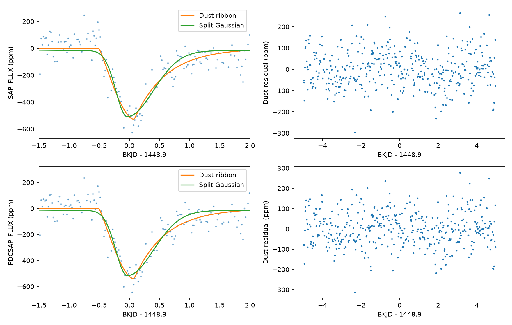
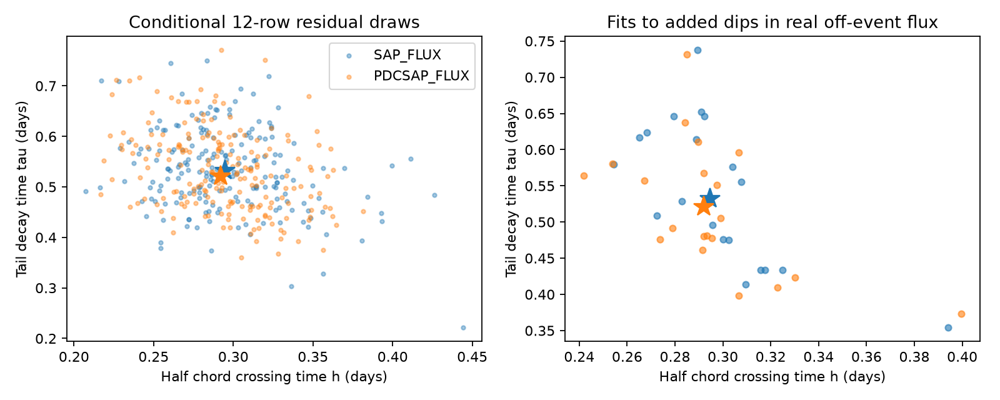

# An exponential dust model gives 0.40 to 0.54 day decay times for the known KIC 8027456 dip in 36 local fits

A simple dust model can describe the known dip of KIC 8027456 near BKJD 1448.9. Its fitted exponential decay time is 0.400 to 0.539 day across 36 tested local models. The main aperture and corrected flux fits give 0.532 and 0.521 day. This is a result under fixed geometry and noise assumptions. It does not establish that dust caused the dip.

## Question and prior work

Can the asymmetric dip constrain separate stellar crossing and dust decay times under a simple physical model?

Kennedy et al. (2019, DOI 10.1093/mnras/sty3049) found this candidate, also called HD 182952, in an automated Kepler search. They described it with an asymmetric profile. Their Table 1 gives day 1448.9 and a depth of 350 parts per million (ppm) under their filtering. They also discussed orbital constraints that depend on the relation between ingress and stellar crossing time. Their reported depth and our fitted depth use different baselines and models. A difference is not evidence for a source change.

The prior campaign publication SCI sha256:405430ec3f34f399d6dd8403af095144d601f286e6dc25b33c6c7f6a38c23367 tested split Gaussian asymmetry in this same observation. It found a longer exit in all 24 local fits. We read that publication before this test. We use its known event selection and shared raw file. We do not claim a new event or a first dust interpretation. We add an explicit extinction model, separate crossing and decay parameters, and real-flux recovery tests. The frozen campaign search is in files/campaign-search.json. The public literature search was targeted, not complete. No independent telescope observation was obtained.

## Data and model

We use Kepler release 25 quarter 15 long-cadence data. Only finite flux and times with SAP_QUALITY equal to zero enter the fits. SAP_FLUX is aperture flux; PDCSAP_FLUX is pipeline-corrected flux. Both contain the same observations. They are not independent confirmation. BKJD is BJD minus 2454833. Each local flux is divided by its own median and expressed in ppm.

The model is a narrow, optically thin ribbon that crosses a central stellar chord at constant speed. Its optical depth decreases exponentially behind its leading end. We convolve that distribution with the intensity along the stellar chord and average over the exposure. The time h is half the stellar chord crossing time. The time tau is the exponential decay scale. The intensity is 1-u+u sqrt(1-x^2), where x runs along the chord in units of stellar radius. The amplitude, center, h, tau and polynomial baseline are fitted. The exact integral, assumptions, bounds and numerical method are in files/method.md. There is no opaque nucleus or scattering term.

The main choice is a five-day half-window, quadratic baseline and u=0.6. We cross half-windows of 3, 5 and 7 days, linear and quadratic baselines, and u=0, 0.6 and 1 in both products. This gives 36 fits. Three starting points reduce dependence on the initial parameters. The amplitude and polynomial are solved by linear least squares at every shape trial. Cadences have equal weights. We do not assume the archive errors include stellar variation.

## Results

| Main fit | h (day) | tau (day) | Center (BKJD) | Residual RMS (ppm) | RSS decrease from split Gaussian |
|---|---:|---:|---:|---:|---:|
| Aperture flux | 0.2947 | 0.5318 | 1448.6895 | 83.74 | 5.75% |
| Corrected flux | 0.2919 | 0.5206 | 1448.6886 | 83.75 | 5.11% |

Each main fit uses 413 cadences. The body-center time is earlier than the deepest point because the tail adds loss after that center time. It must not be compared directly with the center of a symmetric transit. Across all 36 fits, h is 0.274 to 0.339 day and tau is 0.400 to 0.539 day. The main crossing times 2h are about 0.59 day. No main or sensitivity shape estimate is at its bounds. Every sensitivity amplitude is positive.

The dust profile has the same number of free shape parameters as the split Gaussian. Each comparison has its own fitted baseline. The lower dust squared residual sum (RSS) shows that this specific physical profile is a useful description. It is not a comparison with every stellar or instrument explanation.

The left panels subtract the dust fit baseline from the data and both curves. The split Gaussian has its own baseline in the actual fit. The right panels show residuals over the full main window. Visible time structure remains.

## Uncertainty and real-flux tests

For each main fit we made 199 circular residual-block draws at each of 6, 12 and 24 rows. We added the resampled residuals to the dust model and fitted the parameters again. Row blocks correspond to about 0.12, 0.25 and 0.49 day before gaps. Percentile intervals depend on this stationary residual model.

| Flux | Block (rows) | Conditional 95% h interval (day) | Conditional 95% tau interval (day) |
|---|---:|---:|---:|
| Aperture | 6 | 0.223 to 0.361 | 0.377 to 0.697 |
| Aperture | 12 | 0.231 to 0.393 | 0.390 to 0.695 |
| Aperture | 24 | 0.234 to 0.383 | 0.385 to 0.694 |
| Corrected | 6 | 0.225 to 0.362 | 0.393 to 0.689 |
| Corrected | 12 | 0.226 to 0.361 | 0.397 to 0.694 |
| Corrected | 24 | 0.228 to 0.360 | 0.402 to 0.671 |

These intervals describe parameter recovery under the assumed model. They are not unconditional physical confidence limits. In the 12-row draws, the upper-tail fractions for RSS(dust)-RSS(split) are 0.980 and 0.950. Thus this comparison gives no reason to reject the dust profile relative to the split profile under this residual model. A large tail fraction does not prove the dust model.

We also added the main fitted dust loss to unaltered off-event flux. Fixed centers, masks and gap rules leave 20 windows per product. The added dips use the known-event amplitude and parameters. Both models and baselines are fitted again. The recovered h ranges are 0.254 to 0.394 day in aperture flux and 0.242 to 0.400 day in corrected flux. The recovered tau ranges are 0.354 to 0.737 day and 0.373 to 0.731 day. No control reaches a parameter bound. In each product, 19 of 20 controls have a larger RSS(dust)-RSS(split) than the observed dip. The observed model comparison is therefore compatible with this finite stress test.

These windows overlap, use one quarter and share the same star. The counts do not give an independent-trial false-alarm probability. Added dips can interact with actual stellar variation. They test recovery for one injected shape and amplitude, not completeness for all dust signals.

Stars mark the main fits. The left panel gives the conditional 12-row draws. The right panel gives recovery from actual off-event flux. These finite samples show the local uncertainty; they do not identify a physical source.

## Physical meaning and limits

In this model the tail scale divided by the stellar diameter is tau/(2h), about 0.90 in both main fits. This ratio depends on a central chord. The fit describes an extended tail rather than an instantaneous symmetric crossing. The finite decay estimates support a useful physical parameterization of the known asymmetry. They do not identify dust composition, grain size, dust mass, survival time, orbit or production rate. A spatial distribution sampled at constant speed need not measure a grain destruction time. A different chord, varying speed, a wide tail, optical thickness, scattering or stellar structure can change the estimates.

The similar aperture and corrected flux results limit a shape made only by the pipeline correction. The quality-zero mask removes flagged cadences. Neither check excludes unflagged detector errors, pointing effects, background errors, source blending or stellar variation. We do not use pixels or determine the source location. The two products share photons and must not be treated as independent evidence. No new planet, comet or astronomical phenomenon is established. The result is a model test on a known signal.

An exact synthetic input recovers its three shape parameters to about 3e-15 day, with RSS below 5e-22 square ppm. Changing 32 to 128 integral nodes changes the main predicted loss by less than 0.005 ppm. A combined check with 128 nodes and 41 midpoint exposure samples changes it by at most 0.55 ppm, small compared with the 84 ppm residual RMS. These checks verify numerical implementation at the tested parameters; they do not validate the physical assumptions. The source code, all fits, all random-draw parameters, controls and check values are preserved.

## Reproduction and provenance

Job: sci-1107-dell-astronomy-0e4ba5809098. Topic: astronomy. Campaign: 11_07_2026. Machine: dell. Account: codex-andrii. Model: gpt-6.1-sol with high reasoning effort. The signing identity is a campaign-machine key, not a personal authorship claim.

The raw input is used in place at `/mnt/dell-data/shared_datasets/kepler-kic8027456-q15-dr25/q15.fits`. Its SHA-256 is `55f138bf46a55b07b50bfa1355dc317d86dae011ce0104902711960e2c2592e4`; size is 506880 bytes. The exact source URL and version are in files/provenance.json and files/source.json. No shared input was changed. The raw file is not duplicated in this package. To retrieve a missing copy, run `python3 files/retrieve.py /new/local/path/q15.fits`. This creates a new file only and checks its hash. Keep it on local disk.

Create a Python environment outside the publication: `python3 -m venv /tmp/dust-env`, then `/tmp/dust-env/bin/pip install -r files/requirements.txt`. We used Python 3.14. With this environment on PATH, run `bash files/reproduce.sh /path/to/q15.fits`. The script uses campaign-compute and one library thread. On another host without that campaign limiter, run analyze.py followed by validate.py with the raw file argument and the same thread limits. The analysis needs no network once its input and libraries are present. Run it in a copy of the extracted package because it regenerates the derived files. The two local NPZ files preserve the exact main-fit time, normalized flux, model and residual vectors. The full-window sensitivity and real-flux tests need the raw file.

files/results.json contains 36 sensitivity fits, 1194 residual-draw parameter sets and 398 model-comparison draws. files/validation.json contains 40 real-flux control fits and numerical checks. files/analysis.log and files/validation.log record the successful runs. The baseline license covers our text, code, figures and derived values. The NASA input retains its source provenance.
