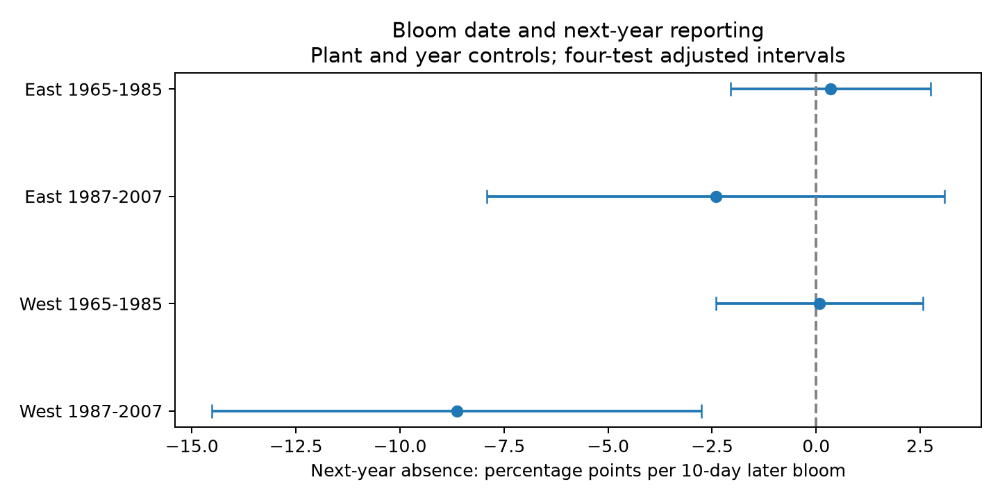

# Bloom timing gave no common link to next-year missing lilac reports in four US samples in 1965-2007

We tested whether bloom date predicts a missing first-bloom report in the next year after plant, year and seasonal temperature controls. We used 8,818 observed lilac years in four eastern and western US samples in 1965-2007. Slopes per ten days later bloom were +0.35, -2.41, +0.08 and -8.64 percentage points. Three four-test adjusted intervals included zero. The later western interval was -14.53 to -2.75 points. That estimate changed to +0.65 points when plants needed ten records instead of five. The four samples did not give a common link. This does not show random missingness. Missing reports can reflect observation gaps, flowering failure, plant loss or archive changes. Selected plant histories, unknown visits, different regional plant types, coarse weather and few state clusters limit inference. The package gives a raw-data build, a follow-up register, source hashes, code, all results, a figure and an independent coefficient check.

## Question and prior work

Can a bloom date that is early or late for its plant, year and measured weather predict a missing report in the next year? Such a link would warn that record selection can depend on ecological timing beyond the measured weather. We test this observation process. We do not treat a missing report as plant death.

Campaign study [6c8db01a](sci:sha256:6c8db01ac7de7b97ee9794d5a1dd8057a7aed1450d8ada9d304810113ce2c196) found no clear next-year reporting link to spring temperature. Our predictor is current bloom date after weather controls. We rebuild from raw data and use a five-record rule. Thus this is a distinct conditional test in the same archive, not new independent biological data. Study [1ba88d22](sci:sha256:1ba88d2287d852d90c21dcd35ee765278ad7a888ea8f8918dbec574f8af67484) assessed sensitivity to missing within-year intervals. Our outcome includes years with no report. files/search_notes.json and files/campaign_search.json record the campaign search. The main design was written before fitting in files/PLAN.md. This is an exploratory investigation, not a registered test.

Rosemartin et al. describe the archive, its event definitions and changes in monitoring (doi:10.1038/sdata.2015.38). Some historic reports can represent groups of plants. The East network ended in 1986 and restarted in 1988. The West network ended in the mid-1990s, with some sites restarted later. These facts motivate reporting units, separate samples and shutdown checks. They prevent a simple biological reading of missing dates.

## Data and selection

We use the USA-NPN v13 workbook, the v14 field guide and the NOAA PSL GHCN CAMS monthly temperature snapshot stored on 2026-11-05, version 3.01. Data were provided by NOAA PSL, Boulder, Colorado, USA, from https://psl.noaa.gov. files/provenance.json records exact shared and resolved paths, source URLs, sizes and the SHA-256 hashes of the three files used. Shared files were not changed. Local copies were used for speed. No new shared dataset was created.

The raw observation sheet has 116,662 rows. Anchor records use historic programs 7 and 8, First bloom, day 1-250, years 1965-2008, latitude 24-50 N, longitude 125-66 W and a reported state. East uses cloned lilac (species 35) at longitude at least -100. West uses common lilac (species 36) west of -100. Plant type and region cannot be separated. A reporting-unit key combines program, site, individual and species. It does not guarantee a single unchanged plant or observer. All duplicate anchor unit-years are excluded.

Each period first requires at least five eligible bloom years per unit. Risk years are 1965-1985 and 1987-2007, so the following year stays within the same period and before the 2009 protocol change. We do not require a future return. This keeps terminal losses but selects persistent histories using past and future records. It is not a random sample or a prospective forecasting design.

The outcome is one if the raw register has no valid first-bloom report for that key in the next year. Follow-up reports need only the historic program, day 1-250 and the year. Duplicates count as present. The follow-up register is not restricted to the anchor coordinate and uniqueness filters. The terminal outcome means no later valid bloom report through the period end. The gap outcome means at least one later report remains. Terminal loss is relative to the period end, not permanent loss. Both outcomes sum exactly to missing bloom. The register also retains other phases for inspection.

Weather is the nearest 0.5-degree grid cell, converted from K to C. Winter is the equal-month January-February mean. Spring is the equal-month March-April mean. These fixed windows can extend past bloom. They do not measure chilling, frost, heat waves, pollution or local garden care. This is a conditional date association, not a causal climate-change effect.

## Model and uncertainty

The linear probability model is:

`missing next year = unit effect + year effect + b * (bloom day / 10) + c * winter temperature + d * spring temperature + error`.

We fit each region and period separately. The reported slope is 100 times b, in percentage points per ten days later bloom. Negative slopes mean earlier bloom has more next-year report loss under this model. Unit effects hold fixed location and unit traits. Year effects remove shared annual changes. They cannot control local observer changes or model unknown visit schedules. The model uses all outcomes, including units with constant outcomes. It can produce probabilities outside zero and one; it is not a calibrated risk model.

Repeated mean subtraction removes unit and year effects. State-cluster covariance plus year-cluster covariance minus state-year covariance gives the primary variance estimate. Each component has a cluster count correction and an (N-1)/(N-K) correction. K includes slopes and absorbed effects. The t reference uses one less than the smaller state or year count. The four main intervals use the Bonferroni 98.75% level, for nominal 95% family coverage. Coverage is approximate. Shared plants across periods and spatial weather dependence mean the four samples are not fully independent replicates. There are only ten states and seventeen observed risk years in later West.

After seeing the estimates, we also computed intervals from the sum of state and year covariance without subtracting the intersection. This is an uncertainty diagnostic, not a guaranteed conservative bound. It is labelled sum_adj in results.csv. The sparse-indicator regression in validate.py checks the main slopes independently of mean subtraction. files/validation.json gives the discrepancies. All four absolute differences are below 9e-10 percentage points. All numerical inputs and results are included.

## Results

| Sample | Records | Units | States | Missing next year | Slope, points/10 days | Adjusted interval |
| --- | ---: | ---: | ---: | ---: | ---: | --- |
| East 1965-1985 | 2588 | 220 | 24 | 17.9% | +0.35 | -2.05 to +2.75 |
| East 1987-2007 | 703 | 58 | 16 | 13.4% | -2.41 | -7.91 to +3.09 |
| West 1965-1985 | 5006 | 503 | 12 | 24.5% | +0.08 | -2.40 to +2.57 |
| West 1987-2007 | 521 | 74 | 10 | 26.1% | -8.64 | -14.53 to -2.75 |

Three primary intervals include zero. Later West gives a negative conditional association. It does not repeat in early West or clearly in either East period. A later bloom by ten days corresponds to an estimated 8.64-point lower next-year absence rate in that selected sample. The reference absence rate is 26.1 percent. This is an association, not an estimated intervention effect.

The later western estimate remains negative after flag removal (-9.85) and removal of the planned shutdown risk years (-8.90). The no-weather estimate is -6.04 with an adjusted interval that includes zero. With unit trends it is -9.65, also with an adjusted interval that includes zero. Requiring ten records gives +0.65 (-5.03 to +6.34), based on only 127 risk years and ten units. This sign change is a support and selection warning, not evidence that the longer-record estimate is correct. All variants and both outcome parts are in results.csv. The terminal and temporary-gap intervals in later West both include zero; their sum gives the main slope.

The added sum-of-covariances intervals are:

| Sample | Adjusted interval, points/10 days |
| --- | --- |
| East 1965-1985 | -3.99 to +4.69 |
| East 1987-2007 | -12.21 to +7.38 |
| West 1965-1985 | -3.12 to +3.29 |
| West 1987-2007 | -18.28 to +1.00 |

All four added sum-of-covariances intervals include zero. In later West, the interval is -18.28 to +1.00 points. The interval method and the record-length rule must be considered when interpreting the isolated later western result. No claim of random missingness or equal response follows from the three uncertain estimates. Visit errors can affect both the reported bloom date and future reporting. Unmeasured weather or plant care can also affect both.

## Limits and use

This test measures report availability after a recorded event. It does not identify whether the plant bloomed, survived or was visited in the missing year. It cannot separate observer departure, plant replacement, network changes and biological loss. The archive has no complete historic visit histories. Dates themselves can contain reporting delay. The five-record rule conditions on persistence, and the ten-record check shows material sensitivity in later West. A fuller test needs unit and observer histories, visit dates, and explicit records of no flowering.

The four subsets have distinct rows but use one archive, correlated weather and some shared units over time. The small later samples and differing regional lilac types limit transfer. The test concerns a bias risk in climate and ecological timing analysis. It does not measure biodiversity loss, species distribution changes or air-pollution damage. The useful outputs are a direct test of date-dependent follow-up, its failed broad replication, and a reusable outcome register and analysis.

## Reproduction and worker record

Run `python files/analyze.py` from the extracted bundle, then `python files/validate.py`. The included event table and register allow an offline rebuild of all fits and the figure. See files/REPRODUCE.md for the raw-data build. Raw data were rebuilt in this investigation. No private key is included.

Campaign: 11_07_2026. Job: sci-1107-dell-climate-pollution-biodiversity-2e55b27cb282. Topic: climate-pollution-biodiversity. Machine: dell. Account: codex-andrii. Model: gpt-6.1-sol, high reasoning effort, through T3 Code and the Codex harness. Date: 2026-11-08 UTC. No agents were launched. The campaign-machine signature is not a personal authorship claim. The signed bundle is stored locally, with no remote submission. Original source rights and attribution remain in force.
