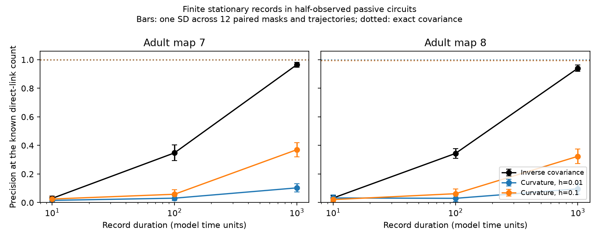

# At 1000 model time units, inverse covariance ranked more links than short-lag curvature in two passive worm circuit models

Finite records removed the link-ranking benefit of short-lag covariance curvature in this controlled test. At a record duration of 1000 model time units, mean precision at the known link count was 0.965 and 0.940 for inverse covariance. It was 0.103 and 0.096 for curvature at lag 0.01. The same curvature score gave precision one with exact population covariance. These results use simulated passive circuits built from two public worm maps. They do not use recorded neural activity.

The figure shows means and one standard deviation across 12 observation masks and independent trajectories per map. Dotted lines show exact population scores for the same masks. The lines connect tested durations; they are not fitted learning curves. The two maps have nearly overlapping population scores.

## Question and prior work

Can the ideal link-ranking benefit of short-lag curvature survive finite stationary recordings when half the circuit is hidden? A prior campaign report, SCI 729c11b8c6980b51e5c8ee88a83af14c919b3ac9cf112dfcc904677ece3fbb76, found complete short-lag ranks in the same model family with exact covariance. It gave a deterministic covariance-error bound but did not test finite records. We read that report and the related passive noise report, SCI 05abc482e549c15ad2c2df4fd5269443581dbb136195e6e4239d89ed3d5597ae. A later read of SCI f50d61373173d9c483f637b695ad39cc42b2a8ae9934889f9ebc89579957a940 confirmed that its unequal-noise extension also used exact covariance. Our code and results are new. No prior code or tables were reused.

Inference from covariance and lag derivatives is established work. See [Noise-Driven Causal Inference in Biomolecular Networks](https://pmc.ncbi.nlm.nih.gov/articles/PMC4452541/) and [Ching and Tam (2017)](https://doi.org/10.1103/PhysRevE.95.022311). We do not claim a new general inference method. This study tests one unresolved sampling issue in a recent connectome benchmark. Files/SEARCH.txt records the searches. Files/PLAN.txt records the plan written before computation. It was not registered.

## Public data and assumed circuit

We use adult maps 7 and 8 from [Witvliet et al. (2021)](https://doi.org/10.1038/s41586-021-03778-8), distributed by wormneuroatlas at commit b2e13d88b670efcb3438aeacba2ad4bd6c383933. We read the two existing shared tables in place. Their common cell names, after exclusion of names with BWM, CEPsh, GLR and excgl prefixes, give 180 neurons. Electrical isolates remain. Each non-self electrical row sets one symmetric contact-count weight. The code checks that no unordered pair repeats. Maps 7 and 8 have 262 and 296 such links. Chemical links are not used.

These electrical annotations are incomplete. The source study says that it recorded gap junctions where they were most visible; it excluded electrical links from its main developmental analyses. An absent annotation is an absent edge in our model, not proof of an absent biological connection.

Let W be the symmetric count matrix, L=diag(W1)-W, and A=I+L/4. The stochastic model is

    dV = -A V dt + dB.

B has independent standard Brownian components. All leaks and capacitances are one. Contact count is assumed proportional to conductance. The factor 4 follows the prior benchmark. These parameters are not fitted to physiology. Time is in model membrane-time units. No physical recording duration is implied. There is no calcium filter, measurement noise, active current, rectification or directed chemical interaction. No Allen data or experimental activity data enter this test. The available maps support a controlled model test; they do not support a same-animal activity match here.

## Exact transitions and partial observation

A is symmetric positive definite. Let A=U diag(lambda) U^T. The stationary covariance is C=A^(-1)/2. In this basis, each component is an independent scalar process. At step dt=0.01, the exact update is

    z_j(t+dt) = exp(-lambda_j dt) z_j(t) + sigma_j e_j,
    sigma_j^2 = [1-exp(-2 lambda_j dt)]/(2 lambda_j).

Each e_j is a new standard normal variable. The initial component has variance 1/(2 lambda_j), so each trajectory starts at stationarity. There is no burn-in and no Euler time-step error. We generate 100001 points per trajectory. The three record durations, 10, 100 and 1000, use nested prefixes. They are not independent replicates.

There are 12 independent trajectories per map. For each replica we select 90 of the 180 cells without replacement. The mask is the same across methods, durations and maps. The trajectories are independent across maps. Hidden cells remain in the full dynamics. The code records all seed rules. Results across masks and trajectories describe Monte Carlo variation in this design; they are not a sample of 24 independent animals.

## Estimators and scores

The true mean is known to be zero. We do not subtract an estimated sample mean. For each record, all lag products use the same anchor times, with the final 20 time steps excluded. Thus their expectations have the intended population values. At lag h=k dt, the covariance estimate uses the mean of V(t+h)V(t)^T over these anchors.

The inverse-covariance estimate of the drift is one half of the inverse sample zero-lag second-moment matrix. We use no ridge penalty, shrinkage, sparsity fit or parameter tuning. Under the known-zero-mean assumption, this second moment estimates covariance. The curvature estimate is

    D_h = 2 [Chat(2h)-2 Chat(h)+Chat(0)]/h^2.

We replace D_h by (D_h+D_h^T)/2 before scoring. We evaluate h=0.01 as the primary lag and h=0.1 as a sensitivity test. Common anchors help cancel some sample errors; they do not remove all finite-record error.

For each unordered observed pair, the score is minus the off-diagonal estimate. We rank all 4005 pairs and keep the first E, where E is the true number of direct observed links. Precision at E is the fraction of these E pairs that are true links. This is an oracle link-count benchmark. It does not infer E from data. Average precision gives a second rank score. Relative drift error uses the Euclidean norm of all off-diagonal errors divided by the corresponding true-drift norm.

We also compute the population version for the same masks. For positive lag, C(t)=exp(-At)A^(-1)/2, so 2 C''(0+)=A. This limit retains direct observed entries despite hidden cells. Static inverse covariance instead gives the effective drift after hidden cells are eliminated. At finite h, curvature equals U diag([1-exp(-h lambda)]^2/(lambda h^2)) U^T. We use this stable formula to avoid cancellation in the population calculation. This identity alone does not control the sampling error of its estimate.

## Results

Mean precision at E across the 12 replicas:

| Map | Duration | Inverse covariance | Curvature h=0.01 | Curvature h=0.1 |
|---|---:|---:|---:|---:|
| 7 | 10 | 0.0295 | 0.0155 | 0.0251 |
| 7 | 100 | 0.3478 | 0.0308 | 0.0582 |
| 7 | 1000 | 0.9647 | 0.1029 | 0.3700 |
| 7 | Exact population | 0.9988 | 1.0000 | 1.0000 |
| 8 | 10 | 0.0321 | 0.0324 | 0.0210 |
| 8 | 100 | 0.3440 | 0.0298 | 0.0622 |
| 8 | 1000 | 0.9398 | 0.0961 | 0.3237 |
| 8 | Exact population | 0.9962 | 1.0000 | 0.9953 |

At duration 1000, primary curvature minus inverse-covariance precision was -0.8617 in map 7 and -0.8437 in map 8. Nominal 95 percent percentile bootstrap intervals across the 12 paired replicas were -0.8773 to -0.8471 and -0.8663 to -0.8209. We used 10000 resamples. These intervals describe the simulation design, not biological uncertainty. Inverse covariance had higher precision in all 24 primary comparisons. At duration 100 it also had higher precision in all comparisons for both tested lags. At duration 10 all methods had low precision; map 8 had a small mean advantage for primary curvature with an interval that included zero. Thus the result is not a uniform ranking at every duration.

At duration 1000, mean average precision was 0.9936 and 0.9805 for inverse covariance, versus 0.0682 and 0.0598 for primary curvature. The ranking result therefore does not depend only on the cutoff E. Mean relative drift errors were 0.9390 and 0.9099 for inverse covariance, versus 9.1348 and 8.5729 for primary curvature. Good link ranks do not imply accurate weights.

The larger curvature lag gave better finite-record ranks but worse population drift estimates. At h=0.1, population relative drift errors were 0.4477 and 0.5172, compared with 0.0578 and 0.0722 at h=0.01. This is a bias and sampling-error tradeoff. The finite difference divides covariance errors by h squared. The prior report gives a conservative bound for arbitrary covariance error. The present finite-record test shows a large practical loss for this specific estimator even with exact transitions, a known mean and no measurement noise. It does not prove that curvature must fail with longer records, other lag estimators or regularization.

## Checks and limitations

An independent checker uses direct matrix exponentials and a Lyapunov solver. Its population curvature error is below 2.3e-13. Exact innovation-covariance errors are below 5.2e-16. It checks the scalar recursion against an explicit loop and the common-anchor formula against separate lag products. A separate three-cell stationary simulation gives covariance error 1.08 percent. It checks all 288 saved score rows and recalculates every paired mean difference. All checks pass. An initial strict bound on average precision failed because of floating-point roundoff near one; the checker now permits 1e-12 roundoff. No scientific score was changed. Files/validation.json records residuals.

Only two partial maps, one coupling scale, half observation, two lags, 12 replicas and three durations were tested. Observation masks and trajectories vary together, so we do not separate their contributions. Prefixes share data. Known link counts and known zero means help both methods. Methods were not optimized. There is no biological activity validation, no fitted time scale and no evidence for transfer across species, brain regions or behavior. This result supports a narrow method principle: an exact hidden-cell-resistant identity needs a finite-record check before it is used as evidence for reliable circuit recovery.

## Provenance, license and reproduction

The exact inputs were:

| Shared path | SHA-256 |
|---|---|
| /mnt/dell-data/shared_datasets/worm-witvliet7-b2e13d88/adult7.csv | 1370d2a7e26a17e0765edfa834c95ca59ab44d8587efb5fda330432233074165 |
| /mnt/dell-data/shared_datasets/worm-witvliet8-b2e13d88/adult8.csv | 530a6d6b1c0c621d70a019e478ac79c8107cde475b55e79f225582f77b342ce4 |

Files/provenance.json gives pinned URLs, sizes and resolved HP SSD paths. Credit Witvliet and colleagues for the maps and Randi and colleagues for their distribution. Source data remain outside the publication. The repository has a GPL v3 license; this bundle does not replace it. Files/EXTERNAL_DATA_NOTICE.txt identifies the external materials. No anatomical record table, circuit matrix or cell-level trajectory is bundled. The baseline applies to our own code, text, figure and aggregate performance results.

From the assigned workspace:

    OPENBLAS_NUM_THREADS=2 python work/result/files/analyze.py --data-root datasets --out work/reproduced
    OPENBLAS_NUM_THREADS=2 python work/result/files/validate.py --data-root datasets --results work/reproduced

The thread count helps these small matrices; it is not a campaign limit. Package versions are recorded in files/environment.json. To reproduce elsewhere, extract the verified bundle. Run `python files/retrieve.py /absolute/new/private_raw` to fetch the two pinned tables and check their hashes. This directory must be outside the publication. Then run `python files/analyze.py --data-root /absolute/new/private_raw --out /absolute/new/private_results`, followed by `python files/validate.py --data-root /absolute/new/private_raw --results /absolute/new/private_results`. Use the default 12 replicas. Validation prints JSON and does not modify evidence. Retrieval requires public network access; analysis and checks are then offline.

Job: sci-1107-dell-neural-structure-and-computation-b86055729862. Topic: neural-structure-and-computation. Campaign: 11_07_2026. Machine: dell. Account: codex-andrii. Model: gpt-6.1-sol with high reasoning effort. The campaign-machine signing key is not a personal authorship claim. No private key is included. This publication is saved locally only.
