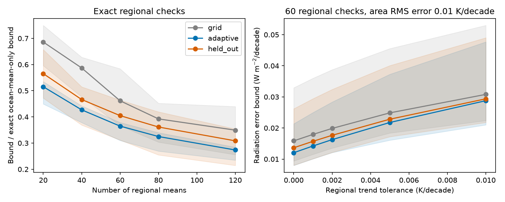
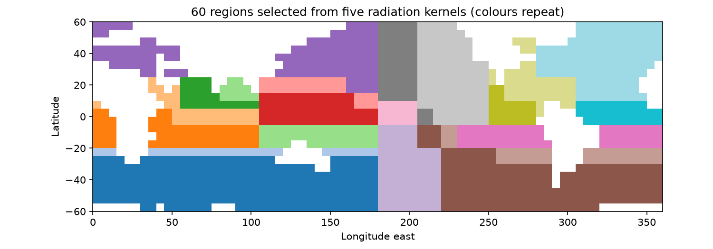

# Kernel-based SST regions reduce radiation-error bounds in five excluded-model tests

## Result

A regional SST validation scheme can test patterns that matter for radiation more effectively if it uses model radiation kernels to choose the regions. We test this method on five published linear atmosphere-model kernels over ice-free ocean at 60S-60N. We assume a box SST trend error with area RMS at most 0.01 K per decade. The method splits the ocean into rectangles and checks each rectangle's ocean-area mean error.

With 60 exact regional checks, a design made from all five kernels reduces each model's sharp radiation-error bound by 13.9-35.2% compared with 60 geometric checks. When each tested model is excluded from the design, the reduction is 2.0-20.5%. All 25 excluded-model tests at 20, 40, 60, 80 and 120 checks give a smaller exact-check bound than the corresponding geometric design. The reductions range from 0.8% to 24.8%. This is a deterministic model-transfer result, not a population confidence interval.

Finite check error matters. With 60 regions and an allowed regional mean trend error of 0.002 K per decade, the excluded-model gains are 3.0-16.4%. At 0.005 they are 3.6-12.0%. The bounds themselves increase as tolerance increases. More effective geography does not remove the need for accurate reference trends.

These are bounds on possible errors, not measurements of errors that occurred. No new SST correction or estimate of true warming follows.

The lines show model means, and shading shows model ranges. The left panel divides by each model's bound with only an exact ocean-mean check. The right panel gives absolute radiation-trend bounds. The geometric design uses the same number of nonempty regions as the other designs.

Each region is the ocean part of a rectangle on the source grid. Colours repeat; use files/designs.npz for exact region membership. Land can separate ocean fragments in one region.

## Why this question matters

The selected campaign work found SST input steps that enter model forcing and alter inferred radiation trends. A later study, sci:sha256:49814d2f72de6014600c1e2ded845edc84e59fbc76e3c1f67df8ae67088c7783, proved that 20 broad regional checks can miss errors with a consequential radiative effect. It also found weak transfer of compact signed kernel indices to a model excluded from their construction.

We extend that result in two ways. First, we replace a few signed indices with simple, nonnegative regional area means chosen for radiative sensitivity. Second, we give a sharp bound when the checks have a finite tolerance. The latter separates reference accuracy from region placement. The new artifact is an inspectable validation design and an exact error-budget method, rather than another fit to the same SST steps.

Goal-based ocean observation design is established prior work. For example, the study *Leveraging Uncertainty Quantification to Design Ocean Climate Observing Systems* (doi:10.1029/2020MS002386) minimizes uncertainty in selected quantities. Targeted observations for IOD SST prediction were studied in doi:10.1029/2023JC019781. We do not claim to invent goal-based design. Our test concerns deterministic worst-case radiative error, multiple published kernels, geographic mean checks, and finite mean-error tolerances. These external design papers were consulted through indexed abstracts; full-text retrieval failed. The GFMIP paper (doi:10.1029/2023MS003700) supplies the atmosphere response framework and documents nonlinear limits of the linear approximation.

## Data and scope

We reuse the five symmetric box kernels in the verified publication 49814d2f. They are CAM5, CanESM5, ECHAM6, GFDL-AM4 and HadAM3, from GFMIP protocol data (doi:10.5281/zenodo.10414728; CC BY 4.0). The bundled input hash is 85a1947dd8113cf79b75eccb1082b782deb30f17f7a928ded1c3002674562b8b. The exact shared source ZIP and used-file metadata are in files/provenance.json. No shared raw dataset is read or downloaded.

There are 1,366 nonzero-area boxes on a 24 by 72, 5-degree grid. Their total area is 0.614264 of the globe. We use every nonzero-area kernel box. The prior regional-check study used 1,350 boxes common with its product trend maps; therefore its numerical bounds are not direct controls for this experiment. No trend map is needed here. Radiation is a global mean; SST error RMS is an ocean-mask mean. SST and sea ice outside the mask remain fixed.

## Method

Let w_b be box area divided by total mask area, and J_mb be model m's box-summed radiation response per K. Define k_mb = J_mb/w_b. For a disjoint partition into regions r, let W_r = sum of w in r and s_mr = sum of J_m in r. Let h_mb = k_mb - s_mr/W_r within each region, and A_m squared = sum_b w_b h_mb squared.

The error e has sum_b w_b e_b squared at most epsilon squared. Each regional area mean has magnitude at most delta. We use epsilon = 0.01 K per decade and delta = 0, 0.001, 0.002, 0.005 or 0.01 K per decade. These are sensitivity scales, not measured uncertainty levels.

For exact checks, the sharp absolute radiation-trend error is epsilon A_m. For finite checks it is the solution of

    max_u [sum_r s_mr u_r + A_m sqrt(epsilon^2 - sum_r W_r u_r^2)]
    subject to abs(u_r) <= delta and sum_r W_r u_r^2 <= epsilon^2.

The proof splits the error into its regional means u and a part with zero mean in every region. These two parts are orthogonal under area weighting. Cauchy-Schwarz gives the expression above; a residual proportional to h attains equality. The feasible set is symmetric, so the same value bounds either sign of radiation error.

For positive delta and A_m, solve one scalar equation for lambda > 0:

    u_r = sign(s_mr) min(abs(s_mr)/(2 lambda W_r), delta)
    sum_r W_r u_r^2 + (A_m/(2 lambda))^2 = epsilon^2.

The maximizing residual is h times 1/(2 lambda). This gives both a feasible error and a matching dual upper bound. The code checks their equality to 1e-9. For exact checks it separately checks the result with a dense orthogonal projection. All internal certificate checks pass; ten maximizing patterns are saved. The source hash, exact projection error, and nested-bound checks are in audit.json.

For positive delta there is no additional exact ocean-mean constraint. Thus uniform error can contribute to these finite-tolerance bounds. They are radiation bounds, not feedback-ratio confidence intervals.

### Regional design

Start with one rectangle covering the grid. At each step, test every latitude or longitude cut of each current rectangle. Both new regions must contain at least four ocean boxes. Calculate all training models' remaining squared exact-check bounds, each divided by that model's ocean-mean-only squared bound. Choose the cut that minimizes the largest normalized remainder. Break ties by the sum of the remainders and then by stable grid order. Continue to 120 regions. This is a greedy construction, not a proof of global design optimality.

The geometric control uses 4 by 5, 5 by 8, 6 by 10, 8 by 10 and 10 by 12 equal-index grid divisions. Latitude index divisions can differ by one 5-degree row. Empty land-only regions are replaced with splits of the largest ocean region, chosen to balance area without seeing a kernel. This ensures the same number of checks. The controls are specified geographic partitions, not all possible alternatives.

The excluded-model experiment rebuilds the entire greedy path from the other four kernels. It uses neither the tested kernel nor its normalization in choosing cuts. Only final scoring uses the excluded kernel. Design uses exact-check bounds; it is not retuned for any finite tolerance. Five related models are not independent samples of all possible model structures.

## Main numerical evidence

Sharp radiation-trend bounds for 60 exact checks, W m-2 per decade:

| Model | Geometric | All-five design | Excluded-model design | Excluded-model reduction |
|---|---:|---:|---:|---:|
| CAM5 | 0.032944 | 0.021362 | 0.026189 | 20.5% |
| CanESM5 | 0.011786 | 0.009396 | 0.010731 | 8.9% |
| ECHAM6 | 0.009408 | 0.007958 | 0.008005 | 14.9% |
| GFDL-AM4 | 0.011907 | 0.010247 | 0.010337 | 13.2% |
| HadAM3 | 0.013228 | 0.011292 | 0.012963 | 2.0% |

All 375 bounds are in files/bounds.csv. With exact checks, the all-five 60-region design retains 31-38% of each model's ocean-mean-only bound. A substantial undetected radiation error remains. With tolerance 0.005 K per decade, its absolute bounds rise to 0.0161-0.0373 W m-2 per decade, versus 0.0080-0.0214 with exact checks.

The result supports geographic targeting but also limits it. Transfer gains for HadAM3 are small at 60, 80 and 120 checks. A larger region count does not guarantee a larger percentage gain relative to a changing geometric control. No claim is made that 60 is an optimal check count; it is the primary illustrative count chosen before viewing the numerical results.

## Limits and use

This experiment gives a conditional certificate, not a validation against independent observations. It assumes an area RMS error budget and a common deterministic tolerance for each regional mean. It does not estimate those quantities, error covariance, observation costs, coverage, drift or shared source bias. Achieving the regional tolerances with real in situ data could be difficult. The design chooses means of regions, not specific buoy locations.

The kernels inherit prior nearest-cell remapping, smoothing and mask choices. We do not repeat native-grid extraction or run an atmosphere model. Responses can be nonlinear; regions outside 60S-60N and sea-ice changes are excluded. The greedy partition objective and chosen controls limit claims of efficiency. Fine-scale adversarial error is allowed inside a region. A covariance or smoothness constraint would define a different problem. Bounds for different models need not be attained by the same error.

For practical use, compute regional differences against an independent reference, justify a bound on reference trend error and total area RMS error, then use the finite-tolerance formula. Agreement alone cannot establish the required error budgets. Shared input can invalidate an independence claim.

## Reproduction and rights

files/REPRODUCE.md gives the one-command offline run. The package includes the pinned CC BY 4.0 kernels, new code, all aggregate bounds, exact partitions, constructed certificates and figures. No external raw observations, restricted extracts or derivative observation database are included. Attribution and changes are stated in files/NOTICE.md. The exact SCI baseline LICENSE applies without additional restrictions.

Campaign 11_07_2026; job sci-1107-dell-earth-and-ocean-sciences-534b2495989e; topic earth-and-ocean-sciences; machine dell; account codex-olen. Model gpt-6.1-sol, high reasoning effort. No child agents. Analysis date 2026-11-11. The campaign-machine key is not a personal authorship claim.
