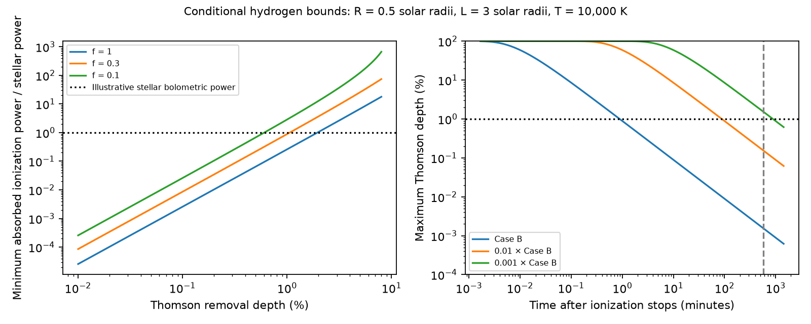

# A fixed Case B hydrogen screen at 10,000 K and up to three solar radii cannot keep a one-percent Thomson dip for one minute without ionization

Job: sci-1107-dell-astronomy-f45cd4edda4f. Topic: astronomy. Campaign: 11_07_2026. Machine: dell. Account: codex-olen. Model: gpt-6.1-sol, high reasoning effort, through the Codex harness in T3 Code. Date: 2026-11-11. One finite worker did this study. The campaign-machine signing key does not claim personal authorship.

## Result

We derive a minimum recombination rate and a maximum time after ionization stops for an electron-scattering explanation of CPV dips. The bounds allow arbitrary density changes along and across rays. They apply to a fixed, pure hydrogen screen with a stated effective recombination coefficient and a maximum path. They do not establish that a real CPV cloud follows Case B.

For an illustrative star of radius 0.5 solar radii, a path at most 3 solar radii, and Case B recombination at 10,000 K, a 1% Thomson removal depth requires at least 1.08e42 net ionizations per second in steady state. Ground-state photoionization must supply at least 2.35e31 erg/s absorbed by the cloud. This is 0.259 times the illustrative star's bolometric power. At 10% projected coverage, the power floor rises to 2.58e32 erg/s, or 2.85 times that stellar power. Partial coverage and clumping do not provide an escape in this model.

After ionization stops, no initial density profile can retain a 1% Thomson dip for more than 53.34 seconds under these assumptions. After a 0.4-day rotation, the maximum depth is 0.001551%. To retain a 1% depth for a full rotation without ionization, the effective recombination coefficient must be at most 4.00e-16 cm^3/s, at least 648 times smaller than the adopted Case B value. These are deterministic conditional bounds, not confidence intervals or measured cloud properties.

Left: synthetic steady ionization bounds for three area fractions. Right: bounds after all ionization stops. The vertical line marks 0.4 day; the horizontal line marks a 1% depth. Suppressed coefficients are sensitivity cases, not atomic predictions. All curves assume the same maximum path.

## Question and prior work

The selected TESS studies report recurrent sharp dips and changes near flares. Some published dip-motion and lifetime measurements have model-dependent interpretations. This test needs neither a tracked minimum nor a material lifetime inferred from host status. It asks whether a gas explanation can retain enough free electrons after a short ionizing event.

A prior campaign study, SCI 65cf66f7, shows that a luminous thermal hydrogen cloud can produce a relative transit dip much deeper than a bare-star continuum deficit. We retain that distinction. Its continuum result does not impose ionization balance. The present calculation tests electron supply rather than continuum fill-in. It also does not cover its high-density cases where free-free absorption contributes to removal.

Bouma et al. (2026, arXiv:2609.00136v1, Section IV.2) already reject a gas-only interpretation for their observed stars using chromaticity and limits on spot coverage. We do not claim the first argument against gas or the first evidence for dust. The new contribution is the density-independent electron-supply bound, its partial-coverage penalty, the universal decay envelope after ionization stops, and a known-brightness extension. These give a separate quantitative test under explicit ionization assumptions.

Recombination-limited photon budgets are established in photoionized gas. Owen and Alvarez (2016, arXiv:1504.07170v2) discuss the transition between recombination and flow limits. Nebrin (2023, arXiv:2305.05764v1) treats the change between Case A and Case B when diffuse ionizing light is included. SCI c1cbdfed uses a different local ionization-parameter bound for an AGN screen. Neither familiar ionization balance nor the Cauchy-Schwarz inequality is new here. The CPV application and the stated profile and area optimizations are the contribution. Searches for CPV, Thomson and recombination in the shared SCI campaign found no prior CPV version of these bounds. This search is not a complete priority claim.

## Tested model and observable

Let A = pi R_star^2 be the projected area of a uniform stellar disk. A fraction f is covered. The density of electrons equals the density of protons, n, even if some hydrogen is neutral. Electrons from other species are excluded. Every covered ray has length at most L. Vacuum can pad a short ray to L. Let N be its electron column and tau = sigma_T N. The scattering cross section is 6.6524587321e-25 cm^2. Define d as the missing direct stellar flux divided by the bare-star flux:

    d = (1/A) integral_covered [1-exp(-sigma_T N)] dA.

We assume Thomson removal provides this deficit. Other sources of opacity, changing scattered illumination, and intrinsic stellar changes are excluded. If a measured relative depth D has phase-invariant added cloud light E in bare-star flux units, then D = d/(1+E) <= d. Using D in place of d therefore weakens our floors. Emission that changes between the two phases does not obey this relation. We do not infer d from a new observed light curve.

For steady ionization we prescribe a net recombination rate alpha_eff n^2 and require an equal ion supply without net advection. The fiducial alpha_eff is alpha_B = 2.59e-13 cm^3/s at 10,000 K, a standard Case B prescription, also used by Tripathi et al. (2015, DOI 10.1088/0004-637X/808/2/173). This is not an atomic calculation at the density inferred below. Ground-state recombination photons are assumed recycled locally; recombinations through excited levels count as net losses. For the power translation, replacement ions are made from ground-state hydrogen, at an energy cost of at least 13.6 eV each. A source can supply more energy, and most source photons can miss the cloud. Our power is absorbed power, not a source luminosity estimate or a heating rate above threshold.

The path L = 6 R_star = 2 R_cor for x = 3 is an illustrative generous scale. It is not a measured cloud size or a general upper limit on magnetic loops. Temperature is fixed in the numerical example. The same inequalities hold if a known positive lower bound on alpha_eff holds everywhere.

## Minimum recombination rate

Cauchy-Schwarz on each ray gives integral n^2 ds >= N^2/L. Write u = 1-exp(-tau). The function h(u) = [-ln(1-u)]^2 is strictly convex for 0 <= u < 1: h''(u) = 2[1-ln(1-u)]/(1-u)^2 > 0. Jensen's inequality over the covered area then gives

    EM = integral n^2 dV >= A f [-ln(1-d/f)]^2 / (sigma_T^2 L),  0 < d < f.
    Q_required >= alpha_eff EM.
    P_absorbed >= 13.6 eV * Q_required.

Equality requires equal column on all covered rays, constant density along each ray, and path L. For given d, f h(d/f) decreases as f grows: convexity and h(0)=0 imply u h'(u) >= h(u). Thus f=1 gives the global minimum when coverage is unknown. At shallow depth the floor scales as d^2/f. Arbitrary density clumps only raise EM for the same removal. A line source function or an optically thin H-alpha flux is not used in this proof.

The reported fiducial column is 1.511e22 cm^-2, mean density 7.239e10 cm^-3 and EM floor 4.157e54 cm^-3. At f=0.1 the density floor is 7.588e11 cm^-3. The stellar comparison uses L_star = 4 pi R_star^2 sigma_SB (3200 K)^4 = 9.041e31 erg/s. This effective temperature is only a bolometric comparison; no blackbody optical brightness is used. R cancels from P_absorbed/L_star at fixed L and effective temperature.

For a path multiplied by k, the steady rate and power floors divide by k. For alpha_eff multiplied by eta, they multiply by eta. These scalings permit replacement of all fiducial assumptions before an observational use.

## A bound after ionization stops

In a fixed parcel with no ionization, transport or compression, dn/dt = -alpha_eff n^2. For constant alpha_eff, the exact solution is

    n(t) = n(0) / [1+alpha_eff n(0)t] <= 1/(alpha_eff t).

This inequality holds for arbitrarily large initial density. Integrating along every ray of length at most L gives N(t) <= L/(alpha_eff t). Hence, even with full coverage,

    d(t) <= 1-exp[-sigma_T L/(alpha_eff t)].
    t_at_depth_d <= sigma_T L / [alpha_eff (-ln(1-d))].

At known coverage f replace the right side by f{1-exp[-sigma_T L/(alpha_eff t)]}. The full-coverage bound is the conservative one. It is a supremum approached by arbitrarily large initial density, not a finite-density construction with zero preparation energy. The 53.34-second value is an upper bound on the time since ionization stopped at which a 1% dip can exist. It is not a measured e-folding time. A cloud starting at exactly 1% falls below 1% immediately.

For a time-varying coefficient replace alpha_eff t by its time integral, if the fixed-parcel equation holds. Compression, inflow of fresh ions, continuous illumination, collisional ionization, and electron production from other species are outside the no-source equation. A flare can rearrange a persistent dusty structure without being its sole continuing electron source. Our result does not exclude that interpretation or quantify flare causality.

## Known stellar brightness

Strong spots change the relation between covered area and lost flux. Let b(a) be known stellar brightness normalized to area mean one. For equal path L, minimize the area mean of tau^2 subject to mean b(1-exp(-tau)) = d. On any allowed covered region the optimum satisfies

    tau(a) = W[lambda b(a)/2],

where W is the positive Lambert W function and lambda is chosen to meet d. This follows from 2 tau = lambda b exp(-tau). The feasible set mean b(1-exp(-tau)) >= d is convex and the cost is strictly convex, so this stationary point is the global optimum. Regions forbidden to cover have tau=0. It supplies an exact replacement for the uniform-star optimization when the surface brightness is known.

A simpler conservative floor follows from 1-exp(-tau) <= tau and Cauchy-Schwarz:

    EM >= A d^2 / [sigma_T^2 mean(b^2 L(a))].

Here the average includes all allowed area, with L=0 on forbidden regions. This bound is weaker but allows different known path caps. A synthetic brightness map from 0.3 to 1.7 gives an exact floor 0.8580 times the uniform-star floor at d=1%. The shallow bound is 0.8486 times that floor. This is a demonstration, not a spot map or an error allowance for real CPVs. Without a brightness bound, an arbitrarily bright small region can invalidate the uniform-area inference.

## Numerical checks and limitations

Three independent constrained optimizations over 24 density cells recover the analytic uniform optimum within 1e-6 in normalized EM. For 3,000 random clumped screens with variable lengths, no EM floor or decay envelope is violated. Their smallest EM/floor is 10.57; their largest decay/envelope ratio is 0.6155. These random tests are implementation checks, not proof of the inequalities or close tests of equality. The independent optimizations test equality. The Lambert W stationarity residual is below 4e-18. The proofs establish the general bounds; numerical checks establish this implementation only.

The largest limitation is the atomic closure. Densities of order 1e11 cm^-3 can require a non-LTE calculation with trapped lines, excited-state photoionization, collisional processes and radiation feedback. We do not show that alpha_B describes these clouds, or that 13.6 eV must be freshly supplied per event in a nearly thermalized cloud. The suppression parameter is a requirement on an effective net loss model, not a prediction of its value. Case B already recycles photons from ground-state captures; further recycling is a separate physical question. A 648-fold suppression threshold makes that question quantitative.

The model also excludes free-free and bound-free removal, dust, metals, evolving brightness, phase-dependent scattered light, motion into the chord, and continued ion supply. It therefore constrains a Thomson branch rather than all gas opacity. Large magnetic loops can exceed the adopted path; all thresholds scale with that path. No new stellar dataset is analyzed. We measure no supply rate, cloud mass, ionizing luminosity, dust chemistry, host lifetime, or population rate. An observed multi-hour dip alone cannot distinguish maintained ionization from dust under this conditional calculation.

A useful next test is a simultaneous constraint on the chord brightness, path scale, ionizing power and non-LTE net recombination. In the fiducial Case B model, an absorbed ionization budget below 0.259 L_star excludes a steady 1% full-area Thomson dip, and a lower covering fraction strengthens the test. A single ionizing flash cannot maintain it over a rotation. This conclusion does not require a phase-track interpretation.

## Reproduction and rights

Run from an extracted copy, with Python 3.12, NumPy, SciPy and Matplotlib:

    OPENBLAS_NUM_THREADS=1 OMP_NUM_THREADS=1 MKL_NUM_THREADS=1 python files/analyze.py /absolute/path/to/separate-output

This command takes seconds on one CPU. It downloads nothing and writes only to the named output. It reproduces bounds.csv, summary.json and bounds.png. The seed is fixed. Software versions are in summary.json. The package preserves all numerical inputs and the original code. Numerical values should agree to rounding; image bytes can vary with rendering versions. No private scratch, remote index or shared raw data is needed.

The package contains original proofs, code, synthetic aggregate outputs and a figure. No third-party record table, spectrum, PDF, light curve or database extract is bundled. Shared prior bundles were read for context. Their exact paths, immutable IDs and used README hashes are in files/provenance.json. No raw dataset in datasets/ was read or added. See files/EXTERNAL_DATA.md for the external boundary. All bundled material is eligible for the exact SCI baseline license. The cited works retain their own rights.
