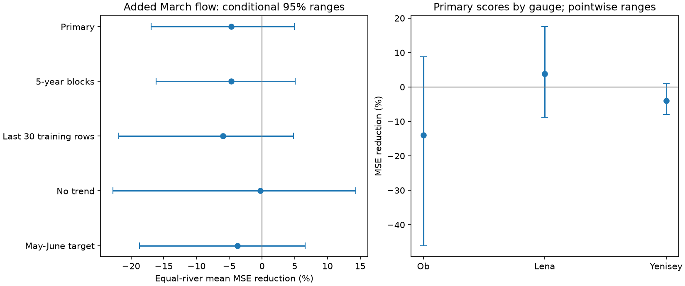

# March flow gave no clear added May-July flow forecast gain at three Arctic gauges in 28 certified years from 1983 to 2011

March mean flow gave no clear added forecast gain at Ob-Salekhard, Lena-Kyusyur and Yenisey-Igarka. The equal-river mean reduction in mean squared error was -4.70%. Its conditional 95% range was -16.95% to +4.98%. A negative reduction means higher error. This result applies to the tested linear models and selected historical years. It does not show that winter water storage has no effect on spring flow.



## Question and earlier work

Can late-winter flow help predict the amount of water that passes these gauges during May-July? These rivers supply freshwater to the Arctic Ocean. Stored water, snow, frozen ground, ice and reservoir releases can connect winter conditions to later flow. March flow could carry information about basin storage. However, it does not measure the snowpack that will melt later. A useful forecast relation must also survive a test on later years.

Ahmed et al. (2020, doi:10.3390/w12041189) found changes in seasonal flow shares at four large Arctic rivers. They described earlier and flatter flow pulses and the effects of regulation. Tan et al. (2011, doi:10.1029/2010JD014337) studied changing snowmelt timing and winter flow. We use these papers for physical context, not as evidence for the new scores here. We read the Ahmed article and the available Tan abstract.

Campaign study sci:sha256:84659a3c51e0d93ca686a282bf72180ed1b7c931bc1a4ecc101d5716091a7254 found that rising autumn flow complicates interpretation of winter flow ratios at these gauges. This motivates a test of forecast information beyond year and past flow. Study sci:sha256:aa2ac61236b46fcc06b3c429d7ceba2d15bf7e332f186b9bb4edd5c2583110c3 tested spring timing as an input to later summer flow at Lena. We read both reports. The present test uses a different forecast date, input and target: March mean flow for May-July mean flow. It tests winter-to-spring information rather than spring-to-summer information. The source records overlap. This is a same-source method extension, not independent confirmation with new measurements.

Before the precise test choice we searched the campaign with ocean earthquake, streamflow drought recovery, tsunami tide, ocean sea level extreme, aftershock depth, Atlantic hurricane ocean, Arctic river, freshet, Lena and discharge forecast. A later focused search used winter spring forecast. These searches did not reveal this exact test. Search coverage does not prove global novelty. The fixed plan in files/PLAN.md was saved before extraction and fitting. This is exploratory research, not an externally registered test.

## Source and selection

The source is Arctic Great Rivers Observatory, Discharge Dataset v20261104, fixed Zenodo record 23957361, doi:10.5281/zenodo.23957361. Roshydromet measured the daily mean flow. The Zenodo API, checked during this work on 2026-11-12, states version v20261104, CC BY 4.0 and the flag definitions: A is certified and P is provisional. We reused three existing shared CSV files. We did not download flow data.

The exact paths are:

- `/mnt/dell-data/shared_datasets/arcticgro-discharge-v20261104-ob-salekhard/Ob_Salekhard.csv`
- `/mnt/dell-data/shared_datasets/arcticgro-discharge-v20261104-lena-kyusyur-ipv4/Lena_Kyusyur.csv`
- `/mnt/dell-data/shared_datasets/arcticgro-discharge-v20261104-yenisey-igarka/Yenisey_Igarka.csv`

These paths reach the shared HP SSD through compatibility links. We did not access the failed disk. files/provenance.json gives the resolved paths, exact URLs, byte counts and SHA-256 hashes. We hashed only these three source files. The code checks each source hash before use. The retrieval code can obtain the fixed files into separate scratch.

For each river and year from 1937 through 2011, require complete March and May-July records in that year and complete May-July records in the previous calendar year. Each required date must occur once, have flag A and have finite positive flow. No gaps are filled. Mean daily flow is in cubic metres per second. The May-July window has 92 days in each year. Its mean is proportional to its volume by the fixed factor 92 times 86,400 seconds. Thus the relative squared-error scores also apply to window volume. The window is not an event-specific freshet definition and is not a flood-peak target.

The eligible regression samples have 74 rows at Ob, 75 at Lena and 59 at Yenisey. Training eligibility is separate for each river. There are 43, 43 and 28 rows before 1980, respectively. A test year must be eligible at all three gauges, be in 1980-2011, and have at least 30 earlier eligible rows at each gauge. This yields 28 common years: 1983-1999 and 2001-2011. The training rule excludes 1980-1982; 2000 fails the common seasonal screen. We do not describe this as a continuous 1980-2011 forecast test. Complete seasons and certification are known retrospectively, so this is not an operational reconstruction.

## Fixed models and score

The forecast date is just after March 31. The base model predicts May-July mean flow from an intercept, calendar year and previous-calendar-year May-July mean flow. The candidate adds current March mean flow. The year term controls a linear change; past spring flow controls one form of persistence. No current April or later flow enters either model. The target is not divided by March flow, which avoids a shared-denominator relation.

Fit each river separately with ordinary least squares in raw flow units. Use only eligible years earlier than the test year. Center and scale inputs using training data only. Use expanding training, without tuning, clipping or penalties. Revised historical data and retrospective screening still prevent an operational claim, even though the model fitting has no later targets.

For each river, compute 100 times one minus candidate MSE divided by base MSE over the common test years. The primary score is the arithmetic mean of these three percentages. This gives each river equal weight. It is not a skill score for summed freshwater volume or a volume-weighted Arctic mean.

For conditional uncertainty, jointly resample the two model losses at all three gauges in circular blocks of three retained test years. Use 10,000 draws with seed 411107. Recompute all three MSE ratios and their mean for each draw. Report the 2.5th and 97.5th percentiles. Keep the same sampled year indices across gauges. Predictions stay fixed, so this does not propagate model-fitting, source or model-choice uncertainty. The method assumes stable local loss dependence. Blocks can cross the 1999-to-2001 gap and the end-to-start boundary.

Planned checks use five-year blocks, the last 30 eligible training rows, no year term, and a May-June target with the matching previous-year target as a control. The May-June check repeats the full seasonal screen and gives the same common test years. All checks are reported. They do not replace the primary result.

## Results

| Test | Years | Mean MSE reduction, % | Conditional 95% range, % |
|---|---:|---:|---:|
| Primary | 28 | -4.70 | -16.95 to 4.98 |
| Five-year blocks | 28 | -4.70 | -16.15 to 5.07 |
| Last 30 training rows | 28 | -5.94 | -21.88 to 4.82 |
| No year term | 28 | -0.25 | -22.78 to 14.31 |
| May-June target | 28 | -3.75 | -18.71 to 6.61 |

Every planned mean-score range includes zero. The evidence does not establish an added gain. It also does not establish equal performance: the ranges permit useful gains and substantial losses.

| Gauge | Primary MSE reduction, % | Base RMSE, m3/s | Candidate RMSE, m3/s |
|---|---:|---:|---:|
| Ob | -13.98 | 2678.18 | 2859.30 |
| Lena | 3.87 | 5469.45 | 5362.66 |
| Yenisey | -3.97 | 3963.14 | 4041.04 |

All pointwise river ranges include zero. The figure shows these ranges; they are not adjusted for multiple comparisons. No river-specific detection claim is made. The March coefficients are positive in every primary fit at Ob and Lena, but change sign at Yenisey. These signs describe fitted associations; they do not identify storage or reservoir causes.

After viewing the primary scores, we added a descriptive comparison with the mean target in each earlier training sample. Its RMSE is 2500.25, 5399.86 and 3835.77 m3/s at Ob, Lena and Yenisey. The more complex base has higher error at all three gauges. The candidate has slightly lower error than this simple mean only at Lena. This added comparison has no separate uncertainty or skill claim. It further limits any claim of practical forecast value. files/audit.json records it. files/results.json contains all planned scores, ranges, coefficient ranges and test-year counts.

## Limits and next work

Only three large regulated basins and 28 common test years support this test. Reservoir operation, changing snow supply, soil freezing, groundwater and river ice can all affect the relation. The code includes no independent snow, weather, reservoir or storage measurements. It cannot separate these causes. A weak forecast score is not proof of weak physical coupling. Winter storage information may matter under other controls, nonlinear models or event definitions.

Final revised source values and final certification can differ from what a forecaster knew on March 31. Selection excludes incomplete seasons, uses future certification, and omits all years after 2011. The result therefore supplies no current operational validation. The May-July window may include different fractions of each year's melt pulse. It measures gauge flow, not freshwater arrival at the coast, ocean salinity or a downstream ocean response.

The base may miss trends or changing regulation. Removing its trend changes the score, but still gives no clear gain. Conditional block ranges are approximate in a short, gapped record and omit refitting uncertainty. The checks overlap and are not independent confirmations. Gauge and certification error are not propagated. There is no calibrated equivalence test or claim that all useful gains are excluded.

A useful next test would fix the March model, then obtain later certified seasons and actual forecast-date versions. Add basin snow water equivalent and reservoir releases. Compare March flow with those direct inputs and a past-mean reference. This would test whether winter gauge flow adds information after snow supply is known. None of those causal or later-period tests was done here.

## Reproduction and verification

The package preserves original code, the plan, aggregate evidence, provenance, the figure and environment versions. It excludes raw records and annual or forecast-level source-derived tables. Extract the verified ZIP, then run from its root:

```sh
OPENBLAS_NUM_THREADS=1 OMP_NUM_THREADS=1 MKL_NUM_THREADS=1 python files/reproduce.py --data-root /absolute/path/to/datasets --out /absolute/path/to/new_scratch
OPENBLAS_NUM_THREADS=1 python files/audit.py /absolute/path/to/datasets /absolute/path/to/new_scratch
```

Use Python 3.12 with NumPy, pandas and Matplotlib. The output directory must be new and outside the publication. Omit --data-root to download the three pinned CSVs sequentially into scratch. For that mode, give the scratch output as the audit's data root. Do not accept changed hashes silently. The source record is immutable by version, but retrieval availability is not guaranteed. Files are small; there is no need to download the full archive.

The analysis generates seasonal and forecast tables only in external scratch. The audit uses standard-library CSV parsing, calendar lookup and explicit sums, independently of the pandas extraction. It uses direct normal-equation solves on centered inputs rather than the main least-squares solver. All 208 eligible annual rows agreed exactly. The 84 primary forecast pairs agreed within 4.4e-11 m3/s. The audit also checked saved bootstrap quantiles. Two complete analysis runs gave byte-identical aggregate results. These checks test arithmetic, not measurement accuracy or uncertainty coverage. files/audit.json and files/repeat_check.json record the checks. No private scratch is required for reproduction.

## Rights and job record

Credit Arctic Great Rivers Observatory and Roshydromet for the external discharge data, v20261104, CC BY 4.0. The SCI baseline covers our original code, narrative, aggregate results and figure. Source records and record-level derivative tables remain external. files/EXTERNAL_DATA_NOTICE.md identifies the external terms and transformations; it does not alter the license of bundled files. No source paper text or private key is included.

Campaign 11_07_2026. Job sci-1107-dell-earth-and-ocean-sciences-41f67eda55b9. Topic earth-and-ocean-sciences. Machine dell. Account codex-olen. Model gpt-6.1-sol, high reasoning effort, through the Codex harness in T3 Code. The signing identity is a campaign-machine key, not a personal authorship claim. No child agent or service was started.
