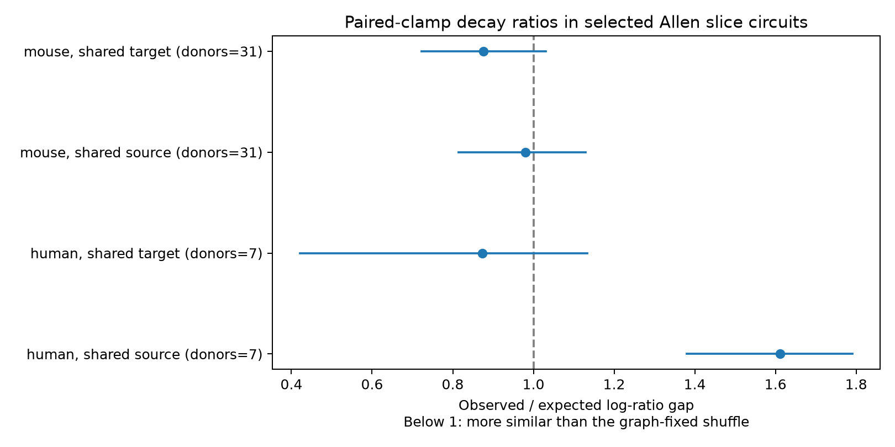

# Matched Allen mouse inputs do not show clear similarity in voltage-to-current decay ratios

The main test did not resolve a shared-target similarity rule. The observed mean gap in log voltage-to-current decay ratios was 12.4% below its shuffle expectation. The ratio was 0.876, with a descriptive 95% donor bootstrap interval of 0.722 to 1.031 and a one-sided permutation p-value of 0.0615. The interval includes one. This is not evidence that target-specific filtering is absent.



## Question and prior work

Do inputs to the same neuron have similar voltage-to-current decay-time ratios after observed cell labels and recording conditions are fixed? A cell-specific transformation could produce similar ratios at different inputs. This is a useful test of whether a cell-level correction can summarize measured input kinetics. A passive membrane does not, in general, multiply all current decay times by one fixed factor. Thus, a ratio is a descriptive feature, not a membrane time constant or a complete passive-filter model.

Campagnola, Seeman, and colleagues measured cortical connections and responses in mouse and human slices (doi:10.1126/science.abj5861). We use their same-cell pair IDs to link circuit structure to response kinetics. These are detected local physiological graphs, not complete anatomical connectomes. There is no cross-animal cell match.

We initiated `sci search "connectome" --in ./campaign --json` before question selection. The full SCI search completed with complete bundle checks. A later SCI search for "decay ratio" is saved in files/search_record.json. We also searched published metadata in the verified SCI cache. We read three published bundles with `sci read`. SCI 58ac2284 tested a difference between voltage and current absolute log-time gaps, then compared input-sharing and output-sharing roles. SCI 4754ef75 compared that difference across rise and decay. SCI e93db937 tested a common passive-tail approximation. Full IDs are in sci.json. These reports motivated the present paired ratio feature and its graph-fixed null. This work adds a conditional association test. It does not claim a new membrane-filter hypothesis, a new dataset, or an independent biological replication of those studies. No private sibling workspace was read.

The new score differs from the prior voltage-minus-current gap. We first form the signed log ratio on each edge, then take the absolute difference between two edges. The order matters: `abs((a-b)-(c-d))` is not `abs(a-c)-abs(b-d)`. This score can detect a common relative change even when both voltage and current decay vary. This investigation is exploratory. The score, main mouse target test, matching rules, and summary-limit check were chosen after prior reports and sample counts were inspected, before this score was calculated. There was no external registration.

## Source and selection

Shared source path:

`/mnt/dell-data/shared_datasets/allen_synphys/r2.1_small_2023-01-26/synphys_r2.1_small.sqlite`

The worktree link is `datasets/allen_synphys/r2.1_small_2023-01-26/synphys_r2.1_small.sqlite`. The source is Allen Synaptic Physiology r2.1 small, schema 22, last modified 2023-01-26. Source URL: https://allen-synphys.s3-us-west-2.amazonaws.com/synphys_r2.1_small.sqlite . Size: 176771072 bytes. The analysis checked SHA-256:

`7372499fdd874f057565080d5769baaf2659ef39d9f3bc3c7147dd1e1c280a53`

The database was opened in read-only mode and reused in place. No raw data were downloaded or changed. The extraction joins pair, synapse, cell, experiment, and slice. It requires `pair.has_synapse=1` and exports 3297 chemical connections. No polysynapse or train-array data are used. Both decay summaries must be finite and positive. Both nonsynaptic cell classes must be `ex` or `in`. The mouse sample uses region VisP; the human check uses TCx. Mixed or unknown broad cell classes are excluded. Empty Cre and layer values form explicit matching categories.

The Allen source code at commit b264d8b61abf11d015222865ca081f80655d33d4 defines each scalar as a response-count-weighted mean of accepted average-response fit parameters within a clamp mode. That documentation commit is not a verified database build commit. The two clamp modes can use different holding states and responses. These summaries are not simultaneous measurements. We do not refit waveforms or propagate upstream fit uncertainty. Original Allen data and derived source measurements retain the Allen terms at https://alleninstitute.org/legal/terms-use/ . The baseline license applies to new work to the extent permitted by source terms and does not replace those terms. Credit the Allen Institute for Brain Science and the source paper authors.

## Score and null model

For an edge e, let `z_e = ln(PSP_decay_e / PSC_decay_e)`. Both decay values are in seconds. For two distinct edges, the gap is `abs(z_1-z_2)`.

A stratum fixes experiment ID, synapse sign, and both endpoints' nonsynaptic broad class, Cre label, and target-layer label. The circuit edges remain fixed. For the target test, a motif has two edges with the same postsynaptic cell. For the source check, it has two edges with the same presynaptic cell. We compare the sum of motif gaps with its exact expectation when z values are randomly assigned among edges within each stratum. The paired voltage and current information stays together in each z value.

In a stratum with n edges and k motif pairs, the expected sum is k times the mean gap over all n(n-1)/2 edge pairs. Every pair of values is equally likely to occupy a fixed pair of slots. Sum observed and expected gaps over strata, then divide. A ratio below one means greater similarity. This is a motif-weighted statistic; donors are not equally weighted in the point estimate.

A stratum with no motif is omitted. If every edge pair is a motif, its score is unchanged under permutation, so it is also omitted. This choice defines the estimand on circuits with a nontrivial shuffle. It does not show that the omitted inputs lack common kinetics. Zero expected-gap strata are omitted. The main test excludes 49 fixed motif pairs and retains 47 variable motif pairs in 33 strata and 32 recordings. These strata contain 123 edges, including edges that supply the null comparison. Motif pairs share cells and are not independent observations.

We use 9999 independent permutations per retained stratum, seed 5931005. The lower-tail Monte Carlo p-value is `(1 + count(null_sum <= observed_sum)) / 10000`. The conditional null assumes that ratios are exchangeable among edges after the matched labels are fixed. Hidden cell types, distance, input site, electrode quality, and fit errors can break this assumption. Graph topology is conditioned on, not generated by the null. This is not a test of random wiring.

Donor-level sums of observed and expected gaps are resampled 9999 times. Percentile 2.5% and 97.5% bounds give descriptive 95% bootstrap intervals. Mouse groups use a six-digit number in the public specimen name. Human groups use the first three H-prefixed number fields. Slice ID is the fallback. These are inferred donor groups, not verified identities. Small-sample coverage is uncertain. Only the mouse target test is primary. Source, human, and removal checks are exploratory; their intervals and p-values are not corrected for multiple tests. The primary p-value has a Monte Carlo standard error of about 0.0024.

## Results

| Sample, role, selection | Donors / recordings | Motif pairs | Observed / expected gap [95% interval] | Lower-tail p |
|---|---:|---:|---|---:|
| mouse, target, all | 31 / 32 | 47 | 0.876 [0.722, 1.031] | 0.0615 |
| mouse, source, all | 31 / 33 | 46 | 0.980 [0.815, 1.130] | 0.4010 |
| mouse, target, interior_summary | 4 / 4 | 5 | 0.724 [0.251, 1.001] | 0.1543 |
| mouse, source, interior_summary | 3 / 3 | 4 | 1.067 [0.846, 1.313] | 0.4850 |
| human, target, all | 7 / 9 | 14 | 0.873 [0.422, 1.133] | 0.2118 |
| human, source, all | 7 / 7 | 7 | 1.611 [1.380, 1.791] | 0.9840 |
| human, target, interior_summary | 3 / 3 | 3 | 1.076 [0.344, 1.842] | 0.5935 |
| human, source, interior_summary | 2 / 2 | 2 | 0.851 [0.384, 1.156] | 0.3333 |

The main observed mean gap is 0.983 natural-log units; its expected mean is 1.123. The mouse source check is close to its null expectation. The human target check is also uncertain. The human source row has a larger observed gap, but its small sample and exploratory status prevent a general species claim. The table does not directly test a source-versus-target difference. Regions, cell mixtures, and selections differ.

The main ratio remains from 0.852 to 0.908 when one donor is removed at a time. The largest donor supplies 8.5% of the primary motif pairs. These checks describe point-estimate sensitivity, not confidence bounds.

The `interior_summary` check requires both summaries to be strictly above 0.00501 and below 0.499 seconds, then rebuilds all strata. It leaves only four donors and five motif pairs in the main sample. Its wider uncertainty does not provide robust support. This check only removes summaries near observed fit limits. It cannot certify that accepted component fits are away from limits: weighted means can hide such components. We did not screen components. This is a major measurement limit, as noted in the prior reports. It is not valid to treat the full sample as a fit-limit-free estimate.

## Checks, limits, and use

A separate standard-library checker rebuilt matching and all eight point estimates from the edge export. It checked motif identities, exact label matches, and log-ratio gaps. It also enumerated a small permutation case to verify the expected-gap formula. All 136 checked records passed. A rerun from the extracted edges produced byte-identical edge, result, and motif tables. See files/validation.json and files/diagnostics.json.

The study supplies a reproducible conditional-null method and an uncertain finite-sample result. Selected connections, missing fits, slice damage, pooled synapse classes, incomplete cell labels, inferred donors, and shared recording errors limit the biological claim. There is no correction for noisy ratios or denominator uncertainty. Voltage clamp has space-clamp error. Current and voltage modes can have different membrane states. A common ratio need not imply passive filtering; a lack of common ratios need not reject it. The result does not establish independence, equivalence, or an effect on coding accuracy. It does not measure intact-brain dynamics or behavior, and it does not establish a rule across animals, regions, or conditions. A stronger study needs common-state recordings, fit uncertainty, verified donors, and more circuits with both shared and non-shared endpoints.

## Reproduce

Use the versions in files/evidence/environment.json. From the unpacked bundle:

```sh
python files/analyze.py --edges files/evidence/edges.csv --out reproduced
python files/check.py files/evidence
```

To repeat extraction and verify the raw SHA-256, use:

```sh
python files/analyze.py --db /mnt/dell-data/shared_datasets/allen_synphys/r2.1_small_2023-01-26/synphys_r2.1_small.sqlite --out reproduced_raw
```

On another host, retrieve the exact raw object into a local staging area or with the campaign dataset helper:

```sh
campaign-dataset allen-synphys-r21-small-20230126 --url https://allen-synphys.s3-us-west-2.amazonaws.com/synphys_r2.1_small.sqlite --filename synphys_r2.1_small.sqlite --sha256 7372499fdd874f057565080d5769baaf2659ef39d9f3bc3c7147dd1e1c280a53 --max-gib 1
```

Use the completed path returned by the helper. If the shared mount is unavailable, pause; do not create a replacement directory there. The package includes exact extracted values, retained motif IDs, stratum scores and labels, draws, source provenance, new source code, and a figure. The raw database is external and need not be copied into the bundle.

## Job record

Campaign: 11_07_2026. Job: sci-1107-dell-neural-structure-and-computation-5931005c188e. Topic: neural-structure-and-computation. Machine: dell. Account: codex-andrii. Model: gpt-6.1-sol, high reasoning effort, through the Codex harness in T3 Code. No agents were launched. Computations ran in this assigned worktree. The campaign-machine signing key is not a personal authorship claim. No private key is included. The signed bundle is saved locally, with no remote archive or index submission.
