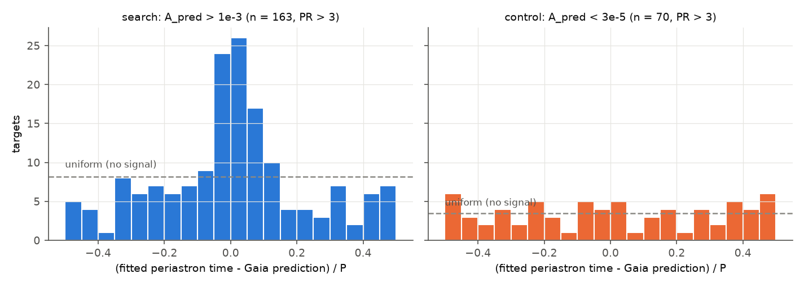
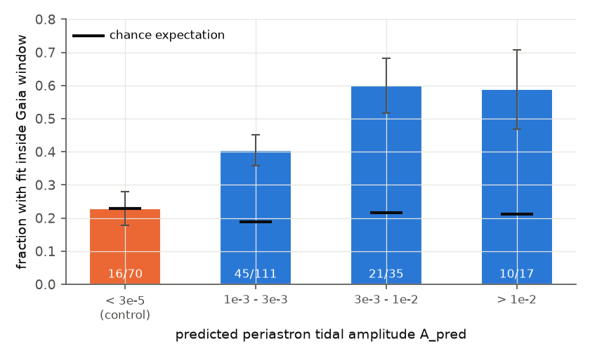
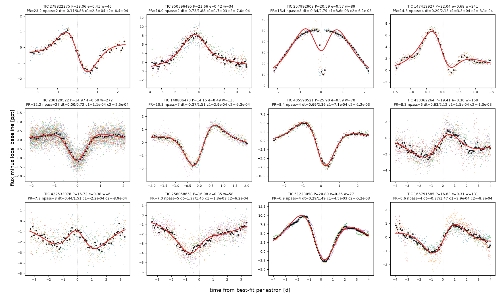

# TESS light curves show tidal heartbeat signals at Gaia DR3 periastron times in eccentric binaries with periods of 13 to 150 days

## Summary

Heartbeat stars are eccentric binaries. The tide at periastron changes the shape of the star, and the star brightness changes for a short time. A recent search (Gaia SB1/SB2 orbits with TESS QLP data, arXiv:2506.14869) used only orbits with periods less than 13 days, because TESS sector-edge systematics gave too many false signals at longer periods.

We used a different method for longer periods. The Gaia DR3 orbit gives the period P, eccentricity e, argument of periastron omega, and periastron time. These values set the shape and the time of a heartbeat signal. We fitted this fixed-shape signal to TESS light curves and found the best periastron time. Then we compared that time with the Gaia prediction. A real tidal signal must occur at the Gaia time. Stellar spots, pulsations and instrument systematics have no relation to the Gaia periastron time.

Main results:

1. **Population test.** In 414 high-amplitude targets with a usable Gaia time prediction and a defined peak ratio, 158 best fits are in the Gaia time window. Chance gives 82.1 (Poisson-binomial p = 1.9e-18). For the subset with peak ratio PR > 3, the count is 76 against 32.2 expected (p = 4.3e-15). In 196 control targets with a very small predicted tide, the count agrees with chance: 52 against 44.6 (p = 0.12), and 16 against 16.0 for PR > 3.
2. **The match rate increases with the predicted tidal amplitude.** The fraction in the window is 0.23 (control), 0.41, 0.60 and 0.59 for predicted amplitudes below 3e-5, 1e-3 to 3e-3, 3e-3 to 1e-2, and above 1e-2. Chance gives approximately 0.2 in each bin.
3. **Candidate list.** 22 targets pass an objective repeat test (grade A). Two of them show an eclipse in the periastron window. The other 20 have clean, repeated heartbeat shapes. The same test passes only 1 of 70 control fits, so we expect approximately 0.5 false grade-A matches (at most approximately 2.3 with a less strict false-pass rate). The 22 targets have orbital periods of 13.1 to 30.1 days. SIMBAD has no heartbeat, eclipse or tidal reference for any of them. For 21 targets, the SIMBAD object type is only "spectroscopic binary". UV For (TIC 33494863) is a known RS CVn variable.
4. **Amplitude check.** For the 20 non-eclipsing grade-A targets, the fitted peak-to-peak amplitude agrees with the simple tide estimate A_pred = (M2/M1)(R1/r_p)^3 from Gaia values. The median log10 ratio is +0.02 (interquartile range -0.34 to +0.24). The Spearman rank correlation is 0.48 (p = 0.03).
5. **Limits.** The search is not complete. In injection tests with at least two covered passages, the recovery is 45% at 5 times the per-bin noise and 75% at higher amplitude. Stellar variability (most targets are subgiants and giants) and TESS gaps cause most losses. Only 427 of 1468 search targets had a Gaia time prediction sufficiently precise for the timing test.

Job and provenance: campaign 11_07_2026, job sci-1107-hp-astronomy-16fe5242d251, topic astronomy, machine hp, account claude-olen, model Claude Opus 5.5 (claude-opus-5-5). The signing key is a campaign-machine key. It is not a personal authorship claim. All data came from public archives on 2026-11-08 (see Data provenance).



*Figure 1. Offset of the best-fit periastron time from the Gaia DR3 prediction, in units of the period, for targets with PR > 3 and a usable Gaia time window. Left: search sample. Right: control sample. The dashed line shows a uniform distribution (no signal at the Gaia time).*



*Figure 2. Fraction of best fits (PR > 3) inside the Gaia time window, in bins of predicted tidal amplitude. Black bars: chance expectation. Error bars: binomial standard errors.*

## Question

Do eccentric Gaia DR3 single-lined spectroscopic binaries with periods of 13 to 150 days show tidal (heartbeat) brightness changes in TESS data at the periastron times that Gaia predicts? Which individual systems show this signal?

## Data

- **Gaia DR3 orbits.** Table `gaiadr3.nss_two_body_orbit`, solution types `SB1` and `AstroSpectroSB1`, 13 <= P <= 150 d, e > 0.15. We joined `gaiadr3.gaia_source` and `gaiadr3.astrophysical_parameters`. The query returned 33,517 orbits; 31,643 have omega and periastron time. Query: `files/code/00_gaia_query.py`. Result: `files/data/gaia_sb1_p13_150.ecsv.gz`. Gaia DR3 doi:10.1051/0004-6361/202243940.
- **TIC identifiers.** We used the ExoFOP-TESS name resolver (`gototicid.php?target=Gaia DR3 <id>&json`). The CDS XMatch and MAST TIC services were not reachable or timed out on the day of the work. Cache: `files/data/tic_cache.json.gz`.
- **TESS light curves.** MIT Quick-Look Pipeline (QLP) full-frame-image light curves, MAST HLSP, doi:10.17909/t9-r086-e880. We computed the possible sectors with tess-point 0.9.5 and requested each file at its fixed URL. We used 13,269 files (sectors 1 to 105; 5.4 GB). `files/data/qlp_files_sha256.txt.gz` lists the SHA-256 of each file. URL rule: `https://archive.stsci.edu/hlsps/qlp/sXXXX/AAAA/BBBB/CCCC/DDDD/hlsp_qlp_tess_ffi_sXXXX-AAAABBBBCCCCDDDD_tess_v01_llc.fits`, where AAAABBBBCCCCDDDD is the 16-digit TIC. We did not copy these files into the shared dataset store. The recipe above and the checksums let a reader get the same files.
- **Vetting data.** Gaia DR3 `vari_classifier_result` and `vari_eclipsing_binary` (`files/data/gaia_vari.ecsv`). SIMBAD TAP through the Harvard mirror (`files/results/simbad_prelim.json`).

## Method

1. **Predicted tidal amplitude.** For each orbit, `01_predict_amplitude.py` computes A_pred = (M2/M1)(R1/r_p)^3, with r_p = a(1-e). R1 and M1 come from Gaia FLAME values. If these are not available, the script uses GSP-Phot radius, or a colour-luminosity radius and a fixed mass (flag columns `R1_src`, `M1_src`). M2 comes from the mass function with i = 60 deg (or the astrometric inclination for AstroSpectroSB1).
2. **Samples.** Search sample: A_pred > 1e-3. Control sample: A_pred < 3e-5 (random draws, seeds 1 and 2). We kept only targets with a periastron passage time tau = P(1-e)^1.5 / (2 pi sqrt(1+e)) < 3 d, so that a local baseline can separate the signal. Final list: 1514 search and 860 control targets with a TIC (`files/data/targets_sel2.ecsv.gz`). 2299 targets had usable QLP data.
3. **Light-curve preparation** (`04_search.py`). We used QLP `SAP_FLUX` with `QUALITY == 0`. We removed cadences with high scattered light: per orbit segment, `SAP_BKG` above its 20th percentile plus 10 times the robust scatter of the lower half. We also removed the first 0.3 d of each segment. We binned the data to 0.02 d and normalised each segment by its median. We removed single bins more than 8 sigma from a 0.3-d running median.
4. **Fixed-shape heartbeat fit.** The Kumar, Ao and Quataert (1995) equilibrium-tide model is dF/F = S [1 - 3 sin^2 i sin^2(nu + omega)] (a/r)^3. We wrote it as c1 b1 + c2 b2, with b1 = (a/r)^3 and b2 = sin^2(nu + omega)(a/r)^3. P, e and omega are fixed at the Gaia values. For each trial periastron time T (step max(tau/5, 0.01 d)), the fit uses all passages in the data. Each passage has its own quadratic baseline over +-h, with h = min(max(3 tau, 0.75 d), 4 d). A passage counts only if at least 60% of the bins within +-max(tau, 0.1 d) exist. The statistic dchi2(T) is the chi-square decrease from the heartbeat terms.
5. **Visits and period.** Data groups separated by more than 20 d are visits. We added dchi2 over visits on a grid of periods within +-3 sigma of the Gaia period. The result is the best T and P, the peak value D_max, and the peak ratio PR = D_max divided by the highest value more than max(3 tau, 0.05 P) away in phase.
6. **Timing test** (`05_analyze.py`). We propagated the Gaia periastron time to the best-fit epoch with sigma_tp = sqrt(sigma_T^2 + n^2 sigma_P^2). The window half-width is w = sqrt((3 sigma_tp)^2 + tau^2). We used only targets with w < 0.15 P ("timed"). The chance that a fit falls in the window is 2w/P. The number of in-window fits then follows a Poisson-binomial distribution. We calculated it exactly.
7. **Repeat test and grades** (`09_passage_consistency.py`). With the best-fit shape fixed, we fitted a free scale s_k to each passage, with a local quadratic. We inflated the errors by the reduced chi-square of each passage. Grade A: at least 2 fitted passages, at least 75% of them with s_k > 3 sigma, scatter std(s_k)/mean(s_k) <= 0.5, and tau <= 1.6 d. Grade B: at least 2 passages, at least 2 with s_k > 3 sigma, scatter <= 1.0. We applied the same grades to 70 control fits and to 87 search fits outside the Gaia window, to measure the false-pass rate.
8. **Visual check.** We looked at passage-stacked plots of all 76 in-window candidates (PR > 3). We marked the targets that show a narrow eclipse in the periastron window (column `eclipse_visual`). We did not use the visual check to make the grades.
9. **Injection test** (`04_search.py inject`, `10_injection_coverage.py`). We added one synthetic heartbeat (i = 70 deg, log-uniform S from 1e-6 to 1e-3) at Gaia periastron + P/2 to each light curve. Then we ran the same search. A recovery needs the best time within max(tau, 0.02 P) of the injected time and PR > 3.

## Results

### Population timing test

| Sample | PR limit | Timed targets | In window | Expected by chance | p (Poisson-binomial) |
|---|---|---|---|---|---|
| search | none | 414 | 158 | 82.1 | 1.9e-18 |
| search | > 3 | 163 | 76 | 32.2 | 4.3e-15 |
| search | > 10 | 39 | 20 | 8.1 | 1.9e-5 |
| control | none | 196 | 52 | 44.6 | 0.12 |
| control | > 3 | 70 | 16 | 16.0 | 0.55 |
| control | > 10 | 19 | 4 | 4.3 | 0.66 |

(The rows without a PR limit exclude 13 search and 10 control timed targets with an undefined PR, because the data did not cover any off-peak phase. The full table is `files/results/population_timing_test.csv`.)

The control sample uses the same pipeline, the same data products and the same window rule. Thus the excess in the search sample does not come from the method. It comes from a brightness change at the Gaia periastron time, and its size increases with the predicted tide (Figure 2, `files/results/population_by_amplitude.csv`).

### Grade-A heartbeat candidates

All 22 grade-A targets are in the search sample and inside the Gaia window. The sum of their chance probabilities 2w/P is 4.0. The false-pass rate of the grade rule on control fits is 1/70. Thus we expect approximately 0.5 grade-A false matches (approximately 2.3 if we use the combined control and off-window false-pass rate of 11/157). Some off-window grade-A fits are eclipsing binaries, with eclipses at conjunction and not at periastron (see Limitations). The column "Kumar sign/ratio valid" is "yes" if c1 > 0 and -3 <= c2/c1 <= 0, which is the range of the simple model with positive S. Ten of the 20 non-eclipsing targets are outside this range. Irradiation, Doppler beaming, gravity darkening, or tidally excited oscillations can cause this. Columns dt and w give the offset from the Gaia prediction and the window half-width. "fitted p-p" is the peak-to-peak of the best-fit model.

| TIC | Name (SIMBAD) | Gaia DR3 | G | P (d) | e | omega (deg) | tau (d) | passages | dt (d) | window w (d) | fitted p-p (ppt) | A_pred (ppt) | Kumar sign/ratio valid | eclipse seen |
|---|---|---|---|---|---|---|---|---|---|---|---|---|---|---|
| 279822275 | HD  78109 | 1012233567290542976 | 8.90 | 13.058 | 0.41 | 46 | 0.79 | 2 | -0.11 | 0.86 | 2.5 | 1.1 | yes | no |
| 350596495 | TYC 1597-2304-1 | 4519040176556947584 | 12.10 | 21.664 | 0.42 | 34 | 1.26 | 2 | -0.73 | 1.88 | 7.2 | 12.7 | yes | no |
| 257992903 | TYC 6581-1399-1 | 5644757117781650560 | 10.89 | 20.590 | 0.57 | 89 | 0.73 | 3 | -0.34 | 2.79 | 35.6 | 1.1 | yes | yes |
| 147413927 | TYC 8203-301-1 | 5363294922888372608 | 10.44 | 22.039 | 0.68 | 241 | 0.49 | 4 | +0.29 | 2.13 | 6.2 | 3.6 | yes | no |
| 230129522 | TYC 4197-1975-1 | 1636180646249973120 | 10.49 | 14.974 | 0.50 | 272 | 0.69 | 27 | +0.00 | 0.72 | 1.4 | 1.4 | yes | no |
| 140806473 | HD  30911 | 551809465387877248 | 9.29 | 14.149 | 0.49 | 115 | 0.67 | 7 | -0.37 | 1.51 | 3.1 | 1.8 | yes | no |
| 405590521 | BD+59  2405 | 2203762361132796800 | 10.40 | 25.899 | 0.59 | 70 | 0.87 | 4 | +0.69 | 2.36 | 12.5 | 49.1 | yes | no |
| 430362264 | TYC 3969-2059-1 | 2005373458054167680 | 11.57 | 19.407 | 0.30 | 159 | 1.58 | 6 | +0.63 | 2.12 | 2.8 | 2.6 | no | no |
| 422533078 | TYC 3682-1507-1 | 510182917241794688 | 11.51 | 16.715 | 0.38 | 6 | 1.10 | 3 | +0.44 | 1.51 | 1.8 | 6.1 | no | no |
| 256058651 | TYC 3584-1462-1 | 2184276816063768448 | 11.07 | 16.081 | 0.35 | 58 | 1.14 | 5 | +1.37 | 1.45 | 3.2 | 1.5 | no | no |
| 51223058 | HD 193389 | 1808373856612878464 | 7.45 | 20.797 | 0.36 | 77 | 1.47 | 4 | +0.29 | 1.49 | 12.3 | 13.6 | yes | no |
| 166791585 | CD-34  1436 | 4858803185211795072 | 9.89 | 16.631 | 0.31 | 131 | 1.33 | 4 | -0.37 | 1.47 | 2.1 | 1.5 | yes | no |
| 417675319 | TYC 4093-480-1 | 481284796722561280 | 10.67 | 15.178 | 0.38 | 181 | 0.99 | 6 | +0.40 | 1.16 | 3.1 | 9.5 | yes | no |
| 322387888 | TYC 4274-1554-1 | 2219523482353841664 | 10.52 | 20.462 | 0.41 | 199 | 1.24 | 5 | -1.09 | 2.83 | 1.9 | 4.0 | no | no |
| 196426780 | TYC 6578-1113-1 | 5647003935424232576 | 11.48 | 18.908 | 0.56 | 64 | 0.72 | 5 | -0.43 | 1.83 | 7.8 | 2.2 | no | yes |
| 416808222 | TYC 4013-118-1 | 1998441204722731392 | 12.14 | 15.363 | 0.34 | 55 | 1.14 | 5 | -0.11 | 2.24 | 3.1 | 1.4 | no | no |
| 468714072 | TYC 3609-1506-1 | 1975693962717728768 | 11.81 | 18.111 | 0.28 | 19 | 1.56 | 6 | +0.00 | 1.82 | 5.3 | 4.1 | yes | no |
| 266844685 | TYC 8638-735-1 | 5342578818152971264 | 11.38 | 23.843 | 0.53 | 359 | 0.98 | 4 | -0.29 | 2.06 | 6.1 | 14.0 | no | no |
| 84019385 | BD+37  4435 | 1952972378824777344 | 8.80 | 22.105 | 0.47 | 152 | 1.11 | 2 | +0.89 | 1.35 | 1.6 | 1.7 | no | no |
| 4355108 | TYC 4757-386-1 | 3211064854984973184 | 11.39 | 18.953 | 0.49 | 66 | 0.91 | 2 | +1.09 | 1.10 | 4.7 | 2.7 | no | no |
| 33494863 | V* UV For | 5038295950184756736 | 7.72 | 30.105 | 0.50 | 118 | 1.38 | 2 | -0.23 | 1.60 | 10.3 | 1.2 | no | no |
| 321742673 | TYC 3749-47-1 | 264720004348285568 | 10.41 | 13.692 | 0.26 | 355 | 1.24 | 3 | -0.31 | 1.67 | 7.6 | 100.7 | no | no |



*Figure 3a. Grade-A candidates 1 to 12. Each colour is one periastron passage, after removal of a local quadratic baseline. Black points: binned median. Red line: best-fit two-term heartbeat model with Gaia P, e and omega. Panel titles give PR, the number of passages, dt/w, and the coefficients c1 and c2.*


*Figure 3b. Grade-A candidates 13 to 22.*


*Figure 4. TIC 230129522 (TYC 4197-1975-1, P = 14.97 d, e = 0.50). Left: QLP light curve in five visits from 2020 to 2025. Red lines: best-fit periastron times. Blue dashed lines: Gaia prediction (they overlap). Right: all 27 passages stacked. The 1.4 ppt heartbeat dip occurs at each predicted periastron.*

Other examples are in `files/figures/showcase/`: HD 193389 (TIC 51223058, P = 20.80 d, F5.5 II-III, 12 ppt peak-to-peak), HD 30911 (TIC 140806473, P = 14.15 d, A3) and HD 78109 (TIC 279822275, P = 13.06 d, F0).

### Amplitude check


*Figure 5. Fitted peak-to-peak amplitude against the Gaia-based tide estimate A_pred. Blue: grade A. Gray: grade B. Orange rings: targets with an eclipse in the periastron window. Dashed line: 1:1.*

For the 20 non-eclipsing grade-A targets, the median of log10(fitted / predicted) is +0.02. The correlation is weak but positive (Spearman rho = 0.48, p = 0.03). This agreement supports a tidal cause. The estimate uses i = 60 deg and ignores gravity darkening and limb darkening, so a scatter of a factor of 2 is expected. The eclipsing grade-B targets have large amplitudes that the tide estimate does not explain; their eclipses dominate the fit.

### Completeness


*Figure 6. Recovery of injected heartbeats as a function of amplitude divided by the noise per 0.02-d bin. Blue: injections with at least two covered passages. Gray: all injections.*

Recovery is near the chance level (approximately 6-10%) below 1 times the bin noise. It is 23% at 1 to 3, 45% at 3 to 10, and 75% above 10 times the bin noise, for injections with at least two covered passages. Red noise from the stars limits the recovery. Thus the 22 grade-A targets are a lower limit on the number of detectable heartbeat stars in this sample.

## Limitations

- **Single photometric source.** All light curves are QLP FFI photometry. We did not use independent photometry (for example SPOC 2-min or ground data) to confirm each candidate. Confirmation in independent data is still necessary.
- **Contamination.** QLP apertures are several 21-arcsec pixels wide. We did not do a pixel-level centroid test. However, a nearby unrelated star cannot give a signal at the Gaia periastron time of the target, and the amplitudes agree with the tide estimate. This makes a target origin likely, but it does not prove it.
- **Model.** The fit uses only the two-term equilibrium-tide model. We did not model irradiation, Doppler beaming, eclipses, or tidally excited oscillations. Ten of the 20 clean candidates have coefficients outside the simple model range. The fitted c1, c2 values are therefore not reliable inclination measurements.
- **Eclipses.** The fixed shape can fit an eclipse near periastron. We marked eclipses by eye. The two grade-A targets with eclipses (TIC 257992903, 196426780) and seven grade-B targets with eclipses are eccentric eclipsing binaries, not clean heartbeat stars. Off-window grade-A fits (10 targets in `files/results/falsematch_sets_metrics.csv`) are mostly eclipsing binaries with eclipses at conjunction.
- **Timing precision.** Most Gaia DR3 periastron times propagate to TESS epochs with uncertainties of several days. Only 427 of 1468 search targets with data had w < 0.15 P. We did not assess candidates in the other targets.
- **Stellar parameters.** A_pred uses Gaia FLAME or GSP-Phot values, or a rough colour-luminosity fallback (column `R1_src`). Extinction is not corrected in the fallback. A_pred is an order-of-magnitude value.
- **Systematics.** The background mask removes many, but not all, scattered-light ramps. The control sample shows that the remaining systematics do not occur preferentially at the Gaia time.
- **Prior catalogues.** We checked SIMBAD (Harvard mirror) only. We could not reach VizieR at CDS or AAVSO VSX. A target can be in a recent catalogue that SIMBAD does not list.

## Reproduction

The Python 3.12 environment had numpy 2.5.4, scipy 1.18.1, astropy 8.0.2, matplotlib, astroquery 0.4.11, pyvo and tess-point 0.9.5. Run from a work directory that contains `code/` (copy `files/code`). The scripts write to `scratch/`, `results/` and `figures/`.

```
python code/00_gaia_query.py              # Gaia DR3 orbits (ESA Gaia archive)
python code/01_predict_amplitude.py       # A_pred, stellar parameters
python code/02_select_and_tic.py          # search + control sample 1, ExoFOP TIC resolution
python code/02b_add_controls.py           # control sample 2, tau < 3 d cut -> targets_sel2.ecsv
python code/03_download_qlp.py            # QLP light curves (compare with files/data/qlp_files_sha256.txt.gz)
OMP_NUM_THREADS=1 python code/04_search.py search
OMP_NUM_THREADS=1 python code/04_search.py inject
python code/06_gaia_vari.py               # Gaia variability classes
python code/05_analyze.py                 # population tests, preliminary candidates
python code/07_simbad_vet.py results/candidates_prelim.csv results/simbad_prelim.json
python code/09_passage_consistency.py results/candidates_prelim.csv results/candidates_prelim_metrics.csv
python code/09_passage_consistency.py results/falsematch_sets.csv results/falsematch_sets_metrics.csv
python code/10_injection_coverage.py
python code/11_final.py                   # grades, final table, figures
DPI=110 python code/08_gallery.py results/gradeA.csv figures/fig3_gradeA_gallery
python code/plot_target.py scratch/search_search.json figures/showcase 51223058,230129522,140806473,279822275
```

Notes: (1) `results/falsematch_sets.csv` was made with a short selection (control targets with PR > 3 and search targets with PR > 3 outside the window, both "timed"); the exact rows are in that file. (2) `11_final.py` adds the grades to the metric tables in place; the grade rule is in its header. (3) `03_download_qlp.py` first ran on `targets_sel.ecsv` and then on `targets_sel2.ecsv`; the checksum list gives the exact files used. (4) The injection seed is 7; process order does not change the injected values.

## Files

- `files/code/`: all scripts (`hbmodel.py` has the model).
- `files/data/`: Gaia query result, selected targets, TIC cache, Gaia variability classes, QLP checksums.
- `files/results/candidates_final.csv`: all 76 in-window candidates with PR > 3, grades, fit values, stellar values, SIMBAD names, eclipse flags.
- `files/results/search_results.csv`: search output for all 2299 targets with data.
- `files/results/population_timing_test.csv`, `population_by_amplitude.csv`: timing tests.
- `files/results/candidates_prelim_metrics_passages.json`, `falsematch_sets_metrics*.csv/json`: per-passage scales.
- `files/results/injection_table.csv`, `injection_completeness.json`: injection test.
- `files/results/amplitude_comparison.json`, `simbad_prelim.json`, `summary.json`.
- `files/results/search_search.json.gz`, `search_inject.json.gz`: raw search and injection outputs.
- `files/figures/`: all figures.

## References

- Kumar, P., Ao, C. O. and Quataert, E. J. 1995, ApJ 449, 294 (tidal heartbeat model). doi:10.1086/176055
- Gaia Collaboration, Vallenari et al. 2023, A&A 674, A1 (Gaia DR3). doi:10.1051/0004-6361/202243940
- Gaia Collaboration, Arenou et al. 2023, A&A 674, A34 (Gaia DR3 stellar multiplicity). doi:10.1051/0004-6361/202243782
- Huang, C. X. et al. 2020, RNAAS 4, 204 and 206 (QLP). QLP HLSP doi:10.17909/t9-r086-e880
- Astronomical Cardiology: a search for heartbeat stars using Gaia and TESS, arXiv:2506.14869 (prior work, periods below 13 d).
