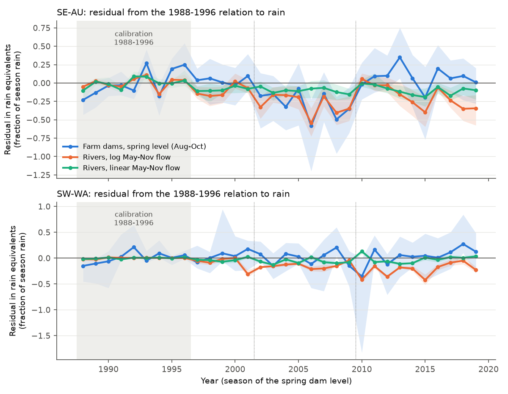
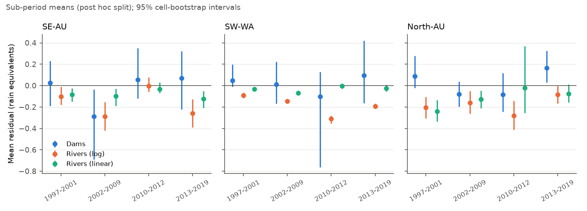
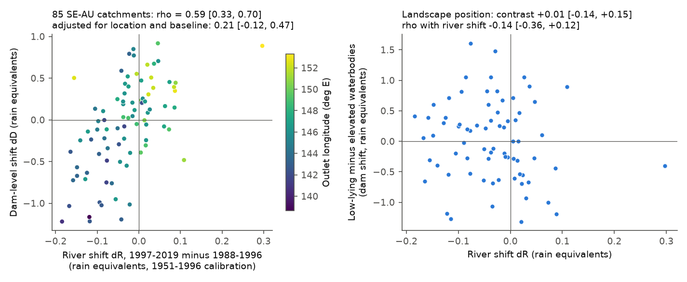

# Landsat farm-dam levels fell with river flow in the 2002-2009 drought in 85 south-east Australian catchments, but not after 2010; a similar dam-river gap in a northern control limits attribution

Job `sci-1107-dell-earth-and-ocean-sciences-7ce4cd5994a3`, campaign 11_07_2026, topic
earth-and-ocean-sciences, machine dell, account claude-olen. Model: Claude Opus 5.5
(`claude-opus-5-5`) in Claude Code (T3 Code). The signing key is a campaign-machine key. It is
not a personal claim of authorship.

## Summary

**Question.** After 1997, river runoff in south-east Australia (SE-AU) fell 20-25% below its
1951-1996 relation to rain and stayed low (campaign bundles 871b2192, 36d145c1, df943002). Earlier
campaign work excluded rain-gauge artefacts, stored water, evaporative demand, greening, bushfire
and one-parameter Budyko changes. Victorian bores fell about 1 m (47f425a9, 795f820e), but the
spatial bore-runoff link became weak after location controls (646c1422), and runoff stayed low at
matched bore levels (905bbb47). Thus one question is open: **does the loss occur where runoff is
generated on the hillslopes, or lower in the landscape (stream channels, valley-floor groundwater)?**

**New idea.** Small farm dams fill from the overland and shallow subsurface flow of a few hectares
of hillslope. Landsat has observed their water area since 1987 (DEA Waterbodies). Thus the spring
level of these dams is an independent, gauge-free index of local hillslope runoff. We compared this
index with river flow in the same catchments and years.

**Data.** DEA Waterbodies v1 (Geoscience Australia, CC BY 4.0): 11,445 waterbodies of 0.1-5 ha
that held water before 1997, inside CAMELS-AUS v2.03 catchments; weekly wet-area percentages,
1987-2020. CAMELS-AUS flow, AGCD and SILO rain, and SILO lake evaporation. Copernicus GLO-90 DEM for
landscape position. Groups: SE-AU (85 catchments with at least 5 dams), SW-WA (16) and North-AU (35,
a control without the SE-AU deficit). The calibration period for all dam relations is 1988-1996,
because the satellite record starts in 1987.

**Main results.**

1. **The planned annual test was inconclusive.** With the 1988-1996 calibration, the SE-AU river
   shift was only -1% of rain (2010-2019; 95% CI -4% to +1%). Part of the deficit predates the
   satellite record. Relative to the 1951-1996 calibration, the residual of the same catchments was
   already -6% of flow in 1988-1996, and -19% in 1997-2021.
2. **In the 2002-2009 drought, dams and rivers fell below their rain relations together.** In
   rain-equivalent units (the fraction of season rain that would explain the residual), the SE-AU
   dam level was -0.29 (95% cell CI -0.69 to -0.04) and log river flow was -0.29 (-0.42 to -0.15).
3. **After 2010 the dams returned to their rain relation; the rivers did not.** In 2013-2019 the
   SE-AU dam level was +0.07 (-0.22 to +0.32) and log river flow was -0.26 (-0.39 to -0.13). The
   dam-minus-river gap was +0.33 (+0.09 to +0.56). The upper envelope of the dam wet area did not
   change between Landsat eras (median 95th percentile 82.2% in 1988-1998, 82.1% in 2013-2019).
   Thus a detection drift does not explain the dam recovery.
4. **But the North-AU control had a gap of the same size.** In 2013-2019 its dam-minus-river gap
   was +0.25 (+0.10 to +0.43), and SW-WA had +0.29. Thus the post-2010 gap is not specific to the
   SE-AU deficit. In all three regions, dams return to their rain relation within one or two years,
   but rivers keep multi-year anomalies. With a two-way bootstrap that also resamples the nine
   calibration years, the SE-AU 2010-2019 gap interval included zero (-0.17 to +0.85).
5. **Across SE-AU catchments, dam and river shifts agree, but mainly as a regional gradient.**
   Rank correlation of the 1997-2019 shifts: 0.59 (0.33 to 0.70). Western Victoria and south-east
   South Australia lost the most in both; NSW and forested eastern catchments gained in both. After
   adjustment for latitude, longitude, baseline rain, baseline runoff ratio and catchment area, the
   correlation was 0.21 (-0.12 to 0.47). This is the same pattern as the bore link of 646c1422.
   Dam shifts were 4 to 10 times larger than river shifts in rain-equivalent units.
6. **The waterbody loss was not concentrated on valley floors.** Within catchments, low-lying
   waterbodies (lowest third by height above the local valley floor) lost 2.4 percentage points more
   spring wet area than elevated ones (-5.0 to +0.1). But they also respond 1.7 times more to rain.
   In rain-equivalent units the contrast was +0.01 (-0.14 to +0.15), and it did not follow the river
   loss (rho -0.14, -0.36 to +0.12). A valley-floor groundwater mechanism predicted a negative
   contrast that grows with river loss. The data do not show this.

**Conclusion.** Satellite farm-dam levels give a new, independent view of hillslope runoff. In SE-AU
they shared the drought-time loss with rivers. After 2010 they returned to their rain relation while
rivers stayed low. This agrees with a persistent loss in slow, below-hillslope stores, but the same
dam-river gap in a northern control region means that we cannot attribute it to the SE-AU deficit.
The waterbody data show no valley-floor signature of falling groundwater. The spatial dam-river
link, like the bore-river link, is mainly a regional gradient. The method can not resolve the
mechanism with a 9-year pre-1997 baseline.

Figure 1. Yearly mean residuals from the 1988-1996 relation to season rain, antecedent rain and lake
evaporation, in rain equivalents. Blue: spring (Aug-Oct) dam level. Orange and green: May-Nov river
flow, log and linear scale. Bands: 95% intervals from resampling 2 x 2 degree cells.

## 1. Background and prior work

The persistent post-drought runoff loss of south-east Australia is well documented (Saft et al.
2015, doi:10.1002/2014WR015348; Peterson et al. 2021, doi:10.1126/science.abd5085). Fowler et al.
(2022, doi:10.5194/hess-26-6073-2022) list candidate mechanisms, including groundwater decline and
stream disconnection, changes of vegetation water use, and farm dams. Campaign bundles cited in
`sci.json` tested many of them. This study adds an observation type that the campaign had not
used: the water area of small dams and wetlands from Landsat (DEA Waterbodies; Krause et al. 2021,
doi:10.3390/rs13081437). We do not know of earlier work that uses farm-dam fill as a gauge-free
index of hillslope runoff to locate the post-drought loss.

## 2. Data

| Data | Use |
| --- | --- |
| DEA Waterbodies v1 polygons (`AusWaterBodiesFINALStateLink`, 295,826 polygons) and weekly wet-pixel percentage array (`waterbodies_time_series.npz`, 1986-08 to 2020-10) | dam index |
| CAMELS-AUS v2.03 boundaries, daily flow (`streamflow_mmd`), AGCD and SILO daily rain, SILO Morton lake evaporation | seasonal flow and climate |
| Annual tables of bundle 871b2192 (`annual_AU`, `climate_AU`, `catchments_primary`) | annual test, groups, 2 x 2 degree cells |
| Copernicus GLO-90 DEM, 68 tiles | landscape position |

Exact URLs, hashes and licences: `files/DATA_NOTICE.md` and `files/provenance/`.

## 3. Methods

The plan and three addenda are in `files/ANALYSIS_PLAN.md`. Each addendum was written after the
previous result and before the next calculation. Thus the seasonal, cross-sectional and position
tests are not pre-specified in the original plan; we report all of them.

- **Dam selection.** Polygon area 0.1-5 ha; wet at least 50% at least once in 1987-1996 (the dam
  existed before 1997); representative point inside the catchment.
- **Annual index (planned).** Weekly wet % minus the waterbody's calendar-month mean; monthly and
  then annual means; mean over at least 5 waterbodies.
- **Seasonal index (Addendum A).** Spring level S = mean wet % in Aug-Oct (North-AU: Mar-May).
  Season rain Apr-Sep, antecedent rain of the 12 months before, season lake evaporation, river flow
  May-Nov (North-AU: Nov-Mar rain, Dec-May flow). This index was chosen on the 1988-1996 data only:
  its within-catchment correlation with log river flow was 0.54 (partial 0.42 after rain), against
  0.37 for the annual index.
- **Models.** Y = a_c + b pw + c pa + d e on 1988-1996 with catchment intercepts and pooled slopes,
  for Y = S, log(Qw + 0.5 mm) and Qw / mean (linear). Residuals divided by b + c give rain
  equivalents, so that dams and rivers have the same unit.
- **Cross-section (Addendum B).** Per catchment: river shift dR (1951-1996 calibration, period mean
  minus 1988-1996 mean) and dam shift dD. Spearman correlation, slopes, split-half reliability of dD
  and a partial rank correlation with the five controls of 646c1422.
- **Landscape position (Addendum C).** h1k = DEM height of the waterbody point above the lowest cell
  within 1 km. Within-catchment terciles; contrast of the lowest and highest third; continuous
  within-catchment slope; link of the contrast with dR. Each waterbody is used once, in its smallest
  catchment.
- **Uncertainty.** Resampling of 2 x 2 degree outlet cells (2,000 replicates for primary statistics,
  500 for sensitivities; 1,000 for the time path), with refits. For the seasonal test also a two-way
  bootstrap that resamples the nine calibration years.

## 4. Results

### 4.1 Planned annual test (inconclusive)

| SE-AU, 84 catchments | 1997-2009 | 2010-2019 |
| --- | --- | --- |
| River shift E_q (rain eq.) | -0.014 (-0.051, 0.013) | -0.013 (-0.040, 0.012) |
| Dam shift E_F (rain eq.) | +0.012 (-0.105, 0.115) | +0.225 (0.096, 0.365) |
| North-AU dam shift E_F | +0.053 | +0.203 (0.093, 0.319) |

The river shift relative to 1988-1996 was too small for the decision rule. The annual dam index rose
in 2010-2019 in all regions. The annual index has a weak relation to rain (within-catchment R2 0.31).
Results: `files/results/annual/`.

### 4.2 Seasonal test (Addendum A)

| SE-AU, 85 catchments | 1997-2009 | 2010-2019 |
| --- | --- | --- |
| Dam level E_S | -0.17 (-0.52, 0.05) | +0.06 (-0.17, 0.30) |
| River E (log flow) | -0.22 (-0.34, -0.10) | -0.19 (-0.30, -0.09) |
| River E (linear flow) | -0.09 (-0.18, -0.03) | -0.10 (-0.17, -0.04) |
| Ratio R = E_S / E_log | 0.77 (-0.39, 1.74) | -0.34 (-2.67, 0.70) |
| Gap E_S - E_log, cell bootstrap | +0.05 (-0.21, 0.19) | +0.25 (0.06, 0.44) |
| Gap, cell and calibration-year bootstrap | +0.05 (-1.29, 0.31) | +0.25 (-0.17, 0.85) |
| North-AU gap, cell bootstrap | +0.16 (0.07, 0.29) | +0.24 (0.10, 0.42) |
| SW-WA gap, cell bootstrap | +0.15 (0.05, 0.30) | +0.26 (-0.05, 0.58) |

Under the planned rule, 1997-2009 (primary in Addendum A) is inconclusive. In 2010-2019 the ratio
interval excludes 1, which supports a loss below the dams, but the controls have similar gaps.
SILO rain, dams below 1 ha and all waterbody sizes changed E_S, E_log and the gaps by at most 0.05
(`files/results/seasonal/`).

Figure 2. Sub-period means of the residuals (rain equivalents). This split is post hoc. Bars: 95%
cell-bootstrap intervals.

### 4.3 Cross-section and landscape position

| Statistic (SE-AU, 1997-2019) | Value (95% CI) |
| --- | --- |
| Spearman rho(dR, dD), linear flow | 0.59 (0.33, 0.70) |
| Same, adjusted for five controls | 0.21 (-0.12, 0.47) |
| Log flow: raw / adjusted | 0.68 (0.38, 0.80) / 0.37 (0.12, 0.55) |
| SILO: raw / adjusted | 0.59 / 0.24 (-0.07, 0.44) |
| SE-AU + SW-WA: raw / adjusted | 0.49 / 0.14 (-0.11, 0.36) |
| Slope dD on dR | 4.0 (2.1, 6.4) |
| Split-half reliability of dD | 0.86 (0.66, 0.94) |
| Position contrast, raw (pp) | -2.4 (-5.0, 0.1) |
| Within-catchment slope on log(1 + h1k) (pp) | +2.3 (1.0, 3.2) |
| Position contrast, rain equivalents | +0.01 (-0.14, 0.15) |
| rho(contrast, dR) | -0.14 (-0.36, 0.12) |
| Horse race with controls: low / high third | 0.10 (-0.24, 0.46) / 0.03 (-0.18, 0.20) |

Position sensitivities (h500, h2k, tpi1k, all sizes) gave rain-equivalent contrasts from -0.09 to
+0.06, all with intervals that include zero (`files/results/position/`). Under the decision rule of
Addendum B the slope test is inconclusive (its interval excludes both 0 and 1).

Figure 3. Left: catchment dam-level shift against river shift (colour: outlet longitude). Right:
low-lying minus elevated waterbody shift against river shift.

### 4.4 Sensor check

Figure 4. Median over waterbodies of the 95th percentile of weekly wet % per Landsat era (0.1-5 ha).
SE-AU: 82.2, 69.2, 75.8, 82.1. The low values in 1999-2011 agree with drought. North-AU rose by 2.7
points and SW-WA by 5.5 points from the first to the last era (`files/results/timepath/envelope.csv`).

## 5. Interpretation

- During the deep drought, the hillslope stores (soil and dams) were short of water, as the rivers
  were. This part of the deficit is not only a channel or groundwater effect.
- After 2010, dam fill followed rain again. The river deficit continued. This agrees with a loss in a
  slow store below the hillslope dams, for example groundwater discharge to streams. But rivers in
  North-AU and SW-WA showed the same type of gap. Thus the gap can also be a general difference
  between seasonal stores (dams) and rivers with multi-year memory, together with the short
  calibration.
- The waterbody data do not show the valley-floor pattern that a falling water table would give.
- The spatial link of dams and rivers is mainly regional, as for bores. The west-to-east gradient of
  the deficit is shared by all three water bodies (rivers, bores, dams), so cross-sectional links
  cannot separate cause and common cause.

## 6. Limitations

- The satellite record starts in 1987; the 1988-1996 baseline has 9 years and already contains part of
  the deficit. The 1997-2009 test has low power.
- Dam level is a storage index, not a flow. It also depends on farm water use (larger in drought),
  evaporation, dam size and spill. We did not have water-use data.
- DEA Waterbodies v1 does not separate farm dams from small natural wetlands, and misses dams below
  about 0.1-0.3 ha. Its time series end in October 2020.
- The North-AU control has a different (summer) season and a different climate. It is a weak control.
- The seasonal, cross-sectional and position tests were added after the planned test (addenda), and
  the sub-period split is post hoc.
- Rain-equivalent units depend on linear models. Log and linear flow scales give different sizes.
- Position is from a 90 m DEM at the waterbody point, not from stream networks or bore depths.

## 7. Reproduction

1. `files/code/fetch_inputs.sh SCRATCH CAMPAIGN_DIR DATASETS_DIR` downloads DEA Waterbodies and the
   Copernicus tiles into a private scratch folder and unpacks the CAMELS-AUS and bundle inputs.
   Compare hashes with `files/provenance/`.
2. Run in order (S = scratch folder): `02_extract.py S`; `03_index.py S 1000 50000 all primary`,
   `03_index.py S 1000 50000 spring spring`, `03_index.py S 1000 5000000 all allsize`;
   `05_monthly.py S`; `06_seasonal_index.py S 1000 50000 primary`, `... 1000 5000000 allsize`,
   `... 1000 10000 small`; `09_position.py S`; then `run_final.sh S`,
   `11_timepath.py S seas_lq main 1000`, `12_envelope.py S`, `13_figures.py S OUT`.
   (`01_assign.py` runs inside `fetch_inputs.sh`.)
3. All scripts take the scratch folder as first argument and run with `python -I`. Software versions:
   `files/provenance/environment.txt`. Random seeds are fixed in the scripts.

Bundled outputs: catchment-level dam indices (`files/data/`), all result JSON and CSV tables, run
logs and figures. Waterbody-level tables and DEM values are not bundled; the scripts regenerate them.
