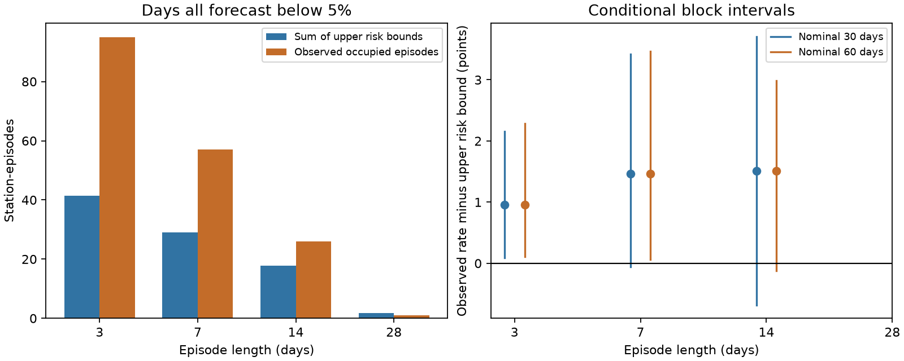

# NOAA low-probability flood weeks had 57 confirmed events against a risk bound sum of 29 in January to October 2026

The NOAA CO-OPS monthly flood outlook assigned less than 5% probability to every day of 1,905 selected station-weeks at 66 gauges. Floods were confirmed in 57 of those weeks. The sum of conservative upper bounds for weekly flood risk was 29.1235. The observed count was 1.96 times that sum. This is an episode check of an earlier daily count deficit. It counts a week once, even if several days flood.

The result has an important limit. The primary conditional 95% interval for the observed rate minus the upper risk bound was -0.059 to +3.415 percentage points. It includes zero. The point gap was positive for all seven week start dates and after removal of each month. But removal of the five calendar weeks with the largest gaps reduced the gap by 95%. Thus the daily deficit does not give equally strong evidence at the weekly episode scale. The data do not establish a stable weekly calibration failure.

## Question and contribution

The selected campaign work tests public hazard products against observations. It finds both model errors and errors caused by the verification method. A new campaign result, SCI 854385b6..., found useful updates to the NOAA monthly flood outlook in January to October 2026. It also found 191 floods against 47.1 expected among station-days with probabilities below 5%. Its daily deficit interval excluded a count ratio of one. Repeated days in the same weather episode could contribute to that count.

Dusek et al. (2022, doi:10.3389/fmars.2022.1073792) describe the outlook and limit their Gaussian argument to the bulk of the residual distribution. Hovenga et al. (2025, doi:10.3389/fmars.2025.1618367) study skewed residual distributions at 148 gauges and propose better tail estimates. Therefore non-Gaussian coastal residuals are prior knowledge. We do not claim to discover them or to verify their causal role here.

We add a test that needs no model of dependence between the days in one forecast episode. We also avoid an assumption that observation gaps are random. We count a flood only when the data confirm it, while retaining all forecast-selected episodes. The method is useful when a forecast gives daily probabilities but does not give episode probabilities. The probability inequality is standard. Its application to this issued product, the conservative observation rule, and the direct check of count concentration are the contributions. We do not propose another fitted probability correction.

Campaign searches for tsunami, monthly flood and flood union bounds preceded the precise design. They returned the parent and related annual flood tests, but no matching episode-bound test. This is a scoped search, not proof of global novelty. files/plan.md records the local plan and two clarifications made before inspecting the joined records. The parent aggregate findings were already known. This was not a public pre-registration.

## Data and sample

We reuse the parent's frozen NOAA Derived Product API forecasts and hourly Data Retrieval API observations. Source files were retrieved on 11 November 2026. We rebuilt the parent's join from 142 shared source files and checked that all hashes matched the parent. The source snapshots are in `/mnt/dell-data/shared_datasets`, available through `./datasets`. files/source_provenance.json gives each exact shared path, source URL, retrieval time, version fixed by its hash, size and SHA-256. No new raw download was required.

For each January to October 2026 target month, the forecast is the latest archived run dated strictly before the month starts. The January forecast fixes the population of 66 disseminated gauges. The daily event is hourly water level above the threshold in that forecast, in feet relative to mean higher high water. Daily maxima use local civil days. Inferred hourly values are removed. A valid observed day needs at least 23 hourly values. To avoid threshold rounding ambiguity, a confirmed hit must exceed the stored threshold by more than 0.005 ft. Hourly peaks differ from six-minute peaks, and gauge threshold events differ from flooded roads or damage.

The rebuilt parent complete sample has 18,789 station-days at 65 gauges and 581 floods. This check reproduced its sample totals. Our primary episode sample uses all forecast rows, including the gauge without usable hourly observations. An observed absence is not needed: an episode without a confirmed hit is counted as zero even if some or all observations are missing. This lowers the observed count and cannot create a false confirmed event.

We split dates into fixed non-overlapping seven-day bins starting on 1 January. A station-week must have all seven forecasts, all probabilities below 5%, and one target month and one forecast run. Thus one issued schedule supplies all its daily probabilities. Blocks that cross target months are excluded. There are 1,905 eligible station-weeks. This selection uses forecasts, not observed water levels. Missing data do not remove primary episodes. The secondary complete-case sample uses the parent's daily validity rules.

## Risk bound and inference

Let A_it be a flood on day t in station-episode i, with issued probability p_it. Let F_i be the information for the common forecast run. If these are correct conditional marginal probabilities, then

`P(any A_it | F_i) <= U_i = min(1, sum_t p_it)`.

This is the union bound. It allows every form of within-episode dependence. It is sharp when the daily events can be disjoint. Let W_i be one when the observations confirm at least one flood. Since W_i is no larger than the true episode event, `E(W_i | F_i) <= U_i` also holds, even if missingness depends on floods. This observation rule is a useful extension of a usual complete-case test.

For the primary bound we increase each issued probability by 0.0005 (0.05 percentage point), to allow nearest-0.1-percentage-point rounding. Thus the test uses `min(1, sum_t(p_it + 0.0005))`. The 5% selection uses issued values. The statistic is `sum(W_i - U_i) / number_of_episodes`. A positive value is a count excess over a conservative expected-risk ceiling. A realized count can exceed its expected ceiling by chance. This is not a deterministic constraint on the observed count.

The null concerns probabilities conditional on the full issued schedule. It is stronger than calibration conditional only on each scalar daily probability. Scalar daily calibration does not by itself guarantee calibration after selecting on a whole probability vector. Archive dates also do not independently prove when each row first became public.

We resample calendar episode bins together with all gauges. Ten thousand circular moving-block draws use seed 650167. Nominal 30- and 60-day blocks mean `ceil(days / episode_length)` bins. At seven days these are 35 and 63 days. This retains shared regional events and short time dependence. The intervals are conditional on one finite period and assume the block procedure represents its variation. They are not valid under arbitrary dependence across all episodes. The union inequality alone, without such assumptions, supplies no small significance level: under a fixed-design interpretation the crude Markov bound for the observed total is 29.1235/57 = 0.511. We do not use an independent-day binomial test.

## Results

| Episode length | Station-episodes | Confirmed occupied episodes | Sum of upper risk bounds | Observed / bound | Nominal 30-day 95% interval for rate gap, points |
|---|---:|---:|---:|---:|---:|
| 3 days | 5,599 | 95 | 41.4235 | 2.29 | +0.090 to +2.153 |
| 7 days, primary | 1,905 | 57 | 29.1235 | 1.96 | -0.059 to +3.415 |
| 14 days | 550 | 26 | 17.7130 | 1.47 | -0.680 to +3.707 |
| 28 days | 24 | 1 | 1.7740 | 0.56 | Not estimated |

The weekly observed rate was 2.992%, against an upper risk bound mean of 1.529%. The gap was 1.463 points. The nominal 30-day ratio interval was 0.962 to 3.086. The nominal 60-day rate-gap interval was +0.058 to +3.470 points, with ratio 1.040 to 3.011. These intervals differ at zero. We retain the primary interval and do not select the interval that excludes zero.

The episode-length tests use different selected samples. Longer intervals are less likely to have every daily probability below 5%, or to fit in one month. The 28-day sample is small and limited by this calendar rule. It has fewer than ten populated calendar bins, so we report no bootstrap interval. The 3-day result supports an excess on a shorter scale. It does not resolve the uncertainty of the primary weekly test.

Complete-case weeks gave 54 occupied episodes against a bound sum of 27.1325 in 1,703 station-weeks. The conservative missing-data rule therefore does not explain the primary point excess. With October removed, the result was 45 against 25.9285 in 1,747 station-weeks. Every leave-one-month-out point gap was positive. With each of the seven calendar start offsets, observed-to-bound ratios ranged from 1.77 to 2.19. These offsets overlap and are not seven independent replications.

The 57 occupied weeks contained 98 confirmed flood days. All six NOAA regions had positive weekly point gaps, but the Gulf Coast was close to its bound (8 against 7.5105). The largest gaps were in the Mid-Atlantic (16 against 6.2770) and Southeast (11 against 4.6130). These are descriptive results without region-specific significance claims.

For the concentration stress test, we ranked shared calendar weeks by summed gap over stations. Removing the largest one left 48 confirmed events against 28.4315. Removing the largest three left 34 against 26.0615. Removing the largest five left 26 against 24.6625. The last operation reduced the gap from 27.8765 to 1.3375. This is an outcome-selected removal, not a corrected estimate or a valid test. It shows that a few shared weeks can account for most of the sample excess. It does not identify their weather systems.

As an exploratory diagnostic, 1,180 station-weeks had all daily probabilities printed as zero. Nine had confirmed floods, against a rounding-adjusted bound sum of 4.13. files/caps.csv gives other probability caps. These nested samples were not separate confirmatory tests.

## Meaning and limits

At the level of point estimates, grouping repeated flood days into weeks does not remove the deficit, and no change in within-week dependence can raise the expected episode probability above the union bound while retaining the assumed conditional marginals. But the weekly evidence is sensitive to variation across calendar episodes. We cannot conclude from this period alone that weekly risk is systematically too low. This qualifies a broad interpretation of the parent's daily result rather than refuting its daily arithmetic or its useful forecast updates.

The analysis does not distinguish Gaussian tails, sea-level anomaly errors, threshold errors or other model inputs as causes. A causal attribution needs run-time model states or controlled forecasts with changed inputs. Existing work on non-Gaussian residuals motivates such tests but cannot establish the cause of these particular misses.

Other limits are the incomplete 2026 year, selected disseminated gauges, revised observations, uncertain public release history, short numbers of independent weather episodes, seasonal non-stationarity, circular bootstrap wrap-around, and the stronger full-schedule calibration null. There is no independent new year. The source snapshot and the parent test overlap completely. Calendar-week concentration is not a physical storm catalogue. Counting missing observations as no hit is conservative but reduces power. Removing cross-month blocks changes the target population. Displayed probability precision is treated as nearest rounding; an undocumented precision scheme could differ.

## Reproduce

Use Python 3.12 and versions in files/requirements.txt. Set `OPENBLAS_NUM_THREADS=1 OMP_NUM_THREADS=1 MKL_NUM_THREADS=1`. No process pool is needed. Keep all raw and record-level outputs outside the publication.

1. Use the existing shared datasets at `/mnt/dell-data/shared_datasets`. On another host, run `python files/retrieve.py --data-root /absolute/path/to/external-data`. It downloads the recorded URLs and refuses source bytes with different hashes. Live API revisions may prevent exact retrieval; use the recorded shared snapshot in that case. Do not use `--source-code`; the optional external MATLAB files are not needed.
2. Run `python files/rebuild_parent.py --data-root /absolute/path/to/external-data --out /absolute/path/to/rebuilt`. This rebuilds the parent join and validates hashes. Its analysis and plotting code are unchanged from the parent. It takes a few minutes on the shared filesystem.
3. Run `python files/episodes.py --matched /absolute/path/to/rebuilt/matched_external.csv.gz --out /absolute/path/to/episodes`. This makes the aggregate results, figure and external episode tables. All outputs must be outside this publication directory.
4. Run `python files/check_episodes.py --matched /absolute/path/to/rebuilt/matched_external.csv.gz --results /absolute/path/to/episodes/results.json`. This independent standard-library implementation checked 1,905 episodes, 57 hits and bound sum 29.1235.
5. Compare aggregate JSON and CSV outputs with the bundled results. The figure is rebuilt from the same computations. Gzip metadata may differ, so the intermediate file hash is a run record, not a required identity for regenerated gzip bytes.

The bundle contains original narrative, aggregate evidence, a static PNG, code, exact source provenance, a local analysis plan and an independent arithmetic check. It excludes raw NOAA responses and record-level derivative tables. files/NOTICE.md gives attribution and external-data terms. Source hashes match the verified parent publication. Its rebuilt headline totals also match. No private scratch is needed beyond regeneration from the exact external snapshots.

Job: sci-1107-dell-earth-and-ocean-sciences-65016776607d. Topic: earth-and-ocean-sciences. Campaign: 11_07_2026. Machine: dell. Account: codex-olen. Model: gpt-6.1-sol with high reasoning effort. This investigation used one worker and at most two CPUs. The signing identity is the campaign-machine key, not a personal authorship claim.
