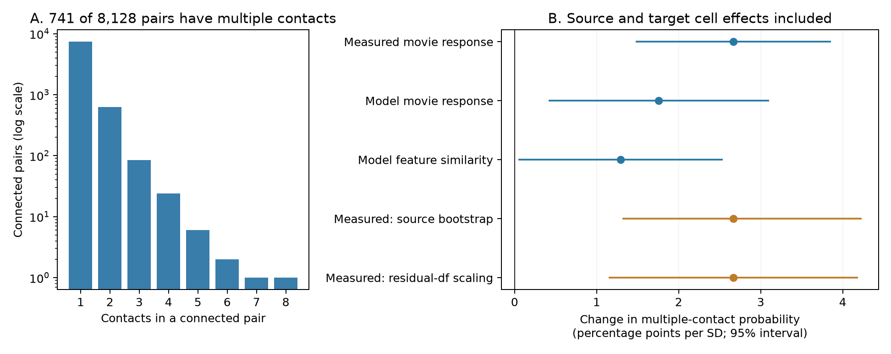

# Measured movie response similarity is linked to multiple contacts after cell controls in one MICrONS mouse

## Result

Among connected neuron pairs in the MICrONS mouse, pairs with more similar measured movie responses had a higher probability of multiple synaptic contacts. The link remained after a separate fixed effect for each source neuron and each target neuron, with controls for axon and dendrite proximity lengths. The estimate was **2.67 percentage points per standard deviation (SD) of response similarity**. The nominal 95% interval was **1.48 to 3.86 points**. The Holm-adjusted p value for three similarity tests was **0.000057**.

A source-neuron bootstrap gave an interval of **1.31 to 4.23 points**. A check that increased the standard error for the many cell effects gave **1.15 to 4.19 points**. These are conditional intervals for one selected tissue sample. They are not intervals for variation across mice.

This result extends a reported contact-count association with controls for both neurons. It does not establish a new general law. It does not show that extra contacts cause response similarity or improve reliable signal transfer.



Figure 1. Panel A shows contact counts for all 8,128 connected pairs. Panel B shows separate similarity models with source and target cell effects. Blue intervals use a sandwich variance for pairs that share a neuron. Orange intervals are sensitivity checks for measured response similarity. The bootstrap resamples sources and retains the observed target labels. All intervals in the figure are nominal 95% intervals. Each SD uses the full connected sample. The three similarity models use the same 5,158 graph-core edges. Model feature similarity has a Bonferroni interval that includes zero; see the tables below.

## Question and prior evidence

A representation can be supported by which neurons connect and by how many contacts each connection contains. The source study, Ding et al. (2025), reported that visual response similarity was linked to synaptic connection, synapse size, and contact count in this mouse. It adjusted the contact-count comparison for anatomical proximity. Its reported contact-count test did not answer our question about a separate effect for each neuron. [Source study](https://doi.org/10.1038/s41586-025-08840-3).

A published campaign analysis found that response similarity predicted the presence of a connection after source and target fixed effects in the same data release. It tested a binary connection outcome across connected and unconnected pairs. We ask a different conditional question: **among connected pairs, is response similarity linked to more than one contact after both cell effects?** We use its published sample description and control design as context. We wrote new analysis code and did not reuse its code or fitted values. [Prior campaign result](sci:sha256:c59a7cc9c394931da48264dbdd64f4dd2ef21ea50f820313c35558be9be14d07).

The hypothesis is that the contact-count link contains a pair-specific component beyond additive source and target tendencies. The fixed effects remove additive cell contributions to the linear outcome. They do not remove all possible interactions between cell properties.

## Data and scope

We used the public `edge_data_v1.pkl` table from Ding et al. (2025). The table links electron microscopy anatomy to calcium response similarity for the same identified neurons. The MICrONS resource was made by a consortium that includes the Allen Institute. Its main dataset paper describes the linked functional and anatomical measurements. [Dataset paper](https://doi.org/10.1038/s41586-025-08790-w), [data portal](https://www.microns-explorer.org/cortical-mm3).

The input has 1,693,276 rows in three population groups. We selected the 8,128 rows labelled `Connected` with positive `axon_len` and `dend_len`. All selected rows had finite values for the three similarity measures. Each ordered pair appeared once. No self-pair was present. Counts were positive integers. There were 148 source neurons and 4,811 target neurons. The outcome was one for `n_synapses >= 2` and zero for one contact.

| Contacts per pair | Pairs |
|---:|---:|
| 1 | 7,387 |
| 2 | 623 |
| 3 | 84 |
| 4 | 24 |
| 5 | 6 |
| 6 | 2 |
| 7 | 1 |
| 8 | 1 |

Thus 741 pairs (9.12%) had multiple contacts. All data came from one mouse. We used the fixed v1 analysis table, not the current live segmentation. We did not extract or reprocess calcium traces, synapse images, or full neuron arbors.

The exact input hash, size, source URL, absolute workspace path, and resolved shared-store path are in `files/provenance.json`. The reusable shared path is:

`/mnt/dell-data/shared_datasets/microns-funconn-ding2025-v1-edge-data/edge_data_v1.pkl`

The SHA-256 is `efcd387233960026464f285597fd5bc1c3a00432e4d62570bc578149a9707bbb` (201,511,086 bytes). The source URL is preserved in both provenance and metadata. We reused this existing file in place and checked its hash. No shared data were changed or downloaded. The node table was not used.

The package contains the selected numerical data as `files/connected_pairs.csv.gz`. It also contains the projection/layer labels used for a later check. These files are selected and reformatted source data. We credit Zhuokun Ding and colleagues and the MICrONS Consortium. The source portal states CC BY 4.0 terms; its attribution and warranty terms remain applicable. [Terms](https://www.microns-explorer.org/terms-and-conditions), [citation policy](https://www.microns-explorer.org/citation-policy).

## Design and methods

The analysis plan in `files/PLAN.md` was written after reading the table schema and published results, before we computed the outcome associations. It is a local plan, not a registered protocol. Primary and secondary predictor choices, the outcome, geometry terms, and cell controls were fixed there. Bootstrap and residual-degree-of-freedom checks were added after the main fit to check uncertainty. The added projection/layer control was also a later check.

For connected pair i to j, the main linear model was:

`multiple_ij = source_i + target_j + beta * similarity_z_ij + geometry_ij + error_ij`.

`geometry` contains natural log axon length, natural log dendrite length, and their separate squares. The units of these lengths change intercepts and linear coefficients but do not change this quadratic log adjustment. The published proximity lengths measure anatomical opportunity; they are not axonal conduction path lengths.

We fit one similarity predictor at a time. The primary predictor was measured `in_vivo_sig_corr`. The secondary predictors were model signal correlation (`in_silico_sig_corr_cvt`) and model feature similarity (`readout_similarity_cvt`). They are different measures from the same mouse, not independent replications. We standardized each predictor in all 8,128 connected pairs, before graph pruning. The SDs were 0.17457, 0.13179, and 0.10824, respectively.

We removed source and target means by alternating projections to a maximum change below 1e-12. We then used least squares to remove the four geometry terms. The Frisch-Waugh-Lovell identity gives the similarity coefficient. A separate sparse least-squares fit with explicit cell indicators gave a measured-response coefficient within 1.03e-9 of this result.

### Which edges can support the comparison

Source and target effects form a bipartite graph, with a distinct vertex for each cell role. For a graph with E edges, V vertices, and C components, the dimension left after cell effects is E minus V plus C. Here it was **3,171**, from 8,128 edges, 4,959 role vertices, and two components.

Edges removed by repeated deletion of degree-one vertices carry no contrast after cell effects. We removed them before the main fit. The remaining graph core had **5,158 edges, 144 sources, and 1,844 targets**. It contained 531 multiple-contact pairs (10.29%). All core rows had nonzero residualized primary predictor to a tolerance of 1e-9. The other 2,970 rows still describe the selected tissue, but they do not identify this cell-adjusted slope. This is a design limit, not a biological exclusion criterion.

### Uncertainty

We used a dyadic sandwich variance, which allows score dependence between any two pairs that share a neuron, including a neuron that changes source and target roles. Let each row score be the residualized predictor times the regression residual divided by the predictor sum of squares. We sum these scores at each neuron. The variance is the sum of squared neuron score sums minus the sum of squared unordered-pair score sums. We multiply it by G/(G-1), where G is the number of source cells in the fit, and use a t reference with G-1 degrees of freedom. For the main model G was 144. An explicit sum over every pair of rows that share a neuron reproduced this standard error within 1e-10. The method follows the dyadic sandwich principle of [Aronow, Samii, and Assenova](https://doi.org/10.1093/pan/mpv018).

These intervals use an approximate sampling model. Dependence between pairs with no common neuron can remain in a neural tissue. Many sparse target effects can also affect standard errors. We therefore report source resampling and a degree-of-freedom sensitivity check. Neither check supplies replication across animals.

We applied Holm correction to the three main similarity tests. We also report separate 98.333% Bonferroni intervals. These intervals and Holm tests use different correction rules and need not give identical decisions for every secondary measure.

## Results

| Similarity measure | Change in percentage points per SD | Nominal 95% interval | Bonferroni 98.333% interval | Holm p |
|---|---:|---:|---:|---:|
| Measured movie response | 2.67 | 1.48 to 3.86 | 1.21 to 4.13 | 0.000057 |
| Model movie response | 1.76 | 0.41 to 3.10 | 0.11 to 3.40 | 0.0215 |
| Model feature similarity | 1.29 | 0.05 to 2.54 | -0.23 to 2.82 | 0.0421 |

These are linear probability slopes. They are not risk ratios or validated predictions for individual pairs.

With no cell effects, the primary estimate on all pairs was 1.44 points per SD. With source effects it was 1.38 points. Both had positive nominal intervals. Those fits used a larger sample than the main model. On the same graph core, the estimates were 1.82 points without cell effects, 1.78 points with source effects, and 2.67 points with both effects. Thus the positive main result is not explained by changing to the graph-core sample alone.

### Sensitivity checks

- Across 499 source-neuron bootstrap draws (seed 110708), the primary percentile interval was **1.31 to 4.23 points**. All draws were positive. Repeated source cells received separate source indicators; observed target labels were retained. This is uncertainty conditional on the target sample.
- Leaving each of the 148 original sources out gave slopes from **2.47 to 2.83 points**. The source jackknife interval was **1.26 to 4.08 points**.
- Multiplying the main standard error by `sqrt(5157/3166)`, or 1.2763, gave **1.15 to 4.19 points**. Here 3,166 is the graph residual dimension after five fitted predictor and geometry terms. This is an explicit sensitivity scaling, not a proof of corrected coverage.
- With log contact count as outcome, the primary slope was **0.02250 per SD** (95% interval 0.01285 to 0.03216).
- Removing the four pairs with more than five contacts, followed by graph pruning, gave **2.63 points** (1.43 to 3.82).
- Adding the published joint projection/layer labels as categorical controls gave **2.96 points** (1.76 to 4.16). This check was added after the main result.

Exploratory regional fits gave the following primary slopes. The units remain points per full-sample SD. Their intervals are nominal and are not corrected for regional testing.

| Projection group | Core edges | Slope | 95% interval |
|---|---:|---:|---:|
| V1 to V1 | 1,325 | 3.55 | 1.05 to 6.05 |
| HVA to HVA | 2,148 | 1.26 | -0.63 to 3.16 |
| V1 to HVA | 159 | 5.65 | -2.13 to 13.43 |
| HVA to V1 | 373 | 7.01 | -2.03 to 16.06 |

HVA means higher visual area. The smaller regional cores do not add to the pooled core: separate fits prune edges again. All four measured-response point estimates were positive, but three intervals included zero. The study does **not** establish a common effect across projection groups.

## Interpretation and limits

The main result is consistent with a pair-specific component of the link between visual similarity and contact number. Separate source and target tendencies, under the stated linear model, do not account for the full link. A useful circuit model can therefore need to distinguish the presence of an edge from the allocation of extra contacts to an existing edge.

The result has these limits:

1. There is one animal, one selected proofread source set, and a finite EM volume. We cannot infer population variation across animals, other brain regions, or behavioral conditions.
2. We condition on detected connectivity. This selection can induce associations. The model estimates a conditional link among connected pairs; it is not a model of synapse formation or a causal effect.
3. The source table contains estimated functional similarity and automated anatomical measurements. We did not propagate calcium-response error, matching error, synapse detection error, or proofreading uncertainty.
4. Geometry adjustment is limited to the released proximity lengths. Fine dendritic location, axon trajectory, and cell-property interactions can remain as confounders. Linear probability and quadratic log-length terms can be misspecified.
5. The uncertainty checks do not account for every form of tissue dependence. The source bootstrap conditions on targets, and dyadic intervals do not allow arbitrary dependence between disjoint pairs.
6. Contact count is not measured synaptic efficacy or release reliability. Extra contacts can share release fluctuations. We did not test information transmission, recurrent dynamics, or behavior.
7. The regional checks are not animal replication. Sparse regional contrasts and model-derived secondary measures limit generalization.

A direct next test would apply the same conditional contact-count model to another animal with matched anatomy and repeated activity measurements. This report provides that model and an inspectable graph-support audit.

## Reproduce

The package includes source code, selected data, source hashes, graph counts, all 499 bootstrap draws, all 148 leave-one-source-out estimates, residual scores, complete model tables, and a figure. No private key is included.

Use Python 3.12.15 with the versions in `files/requirements.txt`. From an extracted bundle root:

```sh
uv venv .venv --python 3.12
uv pip install --python .venv/bin/python -r files/requirements.txt
mkdir -p rerun/files
cp files/connected_pairs.csv.gz files/projection_layer_labels.csv rerun/files/
OPENBLAS_NUM_THREADS=1 OMP_NUM_THREADS=1 MKL_NUM_THREADS=1 NUMEXPR_NUM_THREADS=1 campaign-compute -- .venv/bin/python files/code/run_all.py --files rerun/files
```

Compare the numerical outputs with `campaign-compute -- .venv/bin/python files/code/compare_repeat.py --reference files --rerun rerun/files`. The completed offline repeat had zero numeric difference in every stored table and identical figure bytes; see `files/results/offline_repeat_check.json`.

This runs entirely from the packaged numerical evidence. It writes under `rerun/files` and does not change the signed files. On a system outside the campaign, the same Python command can run without `campaign-compute` under suitable local resource controls. It uses one library thread. The original and offline-repeat runs used the host limiter. The numerical analysis is small: one selected table with 8,128 rows; the source file is about 202 MB.

To repeat the raw extraction, first reuse the shared file stated above. Outside the shared store, retrieve the exact source URL in `files/provenance.json` to a local scratch path, check the stated SHA-256, then run:

```sh
OPENBLAS_NUM_THREADS=1 OMP_NUM_THREADS=1 MKL_NUM_THREADS=1 campaign-compute -- .venv/bin/python files/code/build.py --input /path/to/edge_data_v1.pkl --out rerun/files
```

The extractor checks the raw hash before it reads the pickle. Do not read a different unverified pickle. `additional_controls.py` uses packaged labels; to rebuild those labels from raw data, use a fresh output directory without `projection_layer_labels.csv` and pass `--input /path/to/edge_data_v1.pkl` to that script. No new shared download is needed for this publication.

## Campaign record

Campaign: `11_07_2026`. Job: `sci-1107-hp-neural-structure-and-computation-d786e42ff590`. Topic: `neural-structure-and-computation`. Machine: `hp`. Account: `codex-andrii`. Model: `gpt-6.1-sol`, high reasoning effort, through T3 Code and the Codex harness. The work used one worker and no child agents. The signing identity is a campaign-machine key. It is not a personal authorship claim. This bundle is stored locally in the campaign and was not sent to a remote archive or index.
