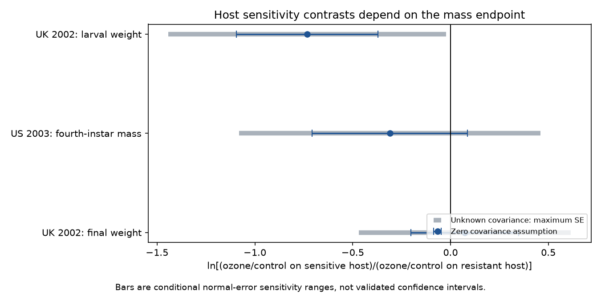

# Host sensitivity contrasts for ozone mass ratios were negative in two larval tests but positive for final mass in one 2024 data extract

In a 2024 public data extract, the ozone mass ratio on a sensitive host divided by that on a resistant host was 0.481 for UK larval weight and 0.733 for US fourth-instar mass. The UK ratio was 1.076 for final weight. Thus, the two larval point estimates had the same sign, but the UK endpoint change reversed that sign. These are descriptive contrasts from two papers. They do not show a general host sensitivity effect.

## Question and scope

Does host plant sensitivity to ozone predict a stronger reduction in herbivore mass under ozone? This question tests one possible path from air pollution to insect performance. A negative contrast can also mean a smaller mass increase. It need not mean mass loss. Host traits may help explain why pollution responses differ among species. This analysis does not measure biodiversity, seasonal mismatch, weather extremes or a climate by pollution interaction.

Ryalls et al. (2024; doi:10.1038/s41467-024-49729-5) synthesized broad performance outcomes. We add a narrow within-paper contrast of ozone response ratios between host lines. The original papers already tested host and ozone effects. We do not claim their observations as new. Campaign searches covered phenology, pollution, duration, timing and host resistance. The search returned no match for the specific host terms. This is a limited novelty check, not proof of a complete search. Prior campaign timing and timing-spread audits used some of the same source records (SCI 398a5247… and 5dd3b6b9…). They do not give independent validation of this result. We read both publications and used neither their code nor their estimates.

## Data and selection

We used Supplementary Data 1 from Ryalls et al. (2024). The workbook has 981 rows. Its exact source URL, shared path, SHA-256 and retrieval metadata are in files/provenance.json. No raw workbook is bundled.

We first kept rows with Pollutant equal to O3. We searched Additional info for sensitiv, resistan, tolerant or suscept, without case sensitivity. This gave 34 records. The labels occur in four papers. Coleman (1988a) labels refer to leaf rust resistance, so they cannot establish ozone sensitivity. Hummel (1998) gives timing and population growth outcomes, not mass. Jondrup (2002) and Holton (2003) give mass comparisons. Exact endpoint and host labels are in files/analyze.py. Eight mass records include two UK wild-type records. Six records form the three sensitive-versus-resistant comparisons. We exclude mixtures and do not infer sensitive or resistant status from observed insect responses.

The UK paper compares Pieris brassicae on Brassica rapa lines. The US paper compares Malacosoma disstria on Populus tremuloides genotypes. Within each comparison the extract gives the same control and elevated ozone concentration for both host lines. Exposure differs between papers. We do not pool the estimates.

The Jondrup publisher abstract confirms that lines were selected for contrasting ozone sensitivity (doi:10.1046/j.1570-7458.2002.01001.x). Holton's original methods identify genotype 216 as tolerant and 259 as sensitive (doi:10.1007/s00442-003-1351-z). Holton's study used a blocked ring design in Wisconsin in summer 2000. Its fourth-instar endpoint sampled larvae selected for intermediate size. Its figure reports pooled standard errors. These design facts limit comparison with a fixed-day UK endpoint. Original figure values were not independently digitized. UK final weight is a separate endpoint, not a repeated measurement model or a survival-adjusted growth estimate.

## Method and uncertainty

For each host line, R = exposed mean / control mean. We compute theta = ln(R_sensitive / R_resistant). Negative theta means the proportional ozone response is lower on the sensitive host. We report 100*(exp(theta)-1) as the percent difference between response ratios. This is not the percent mass difference between hosts.

For conditional error checks, let a_i be the four source standard errors divided by their respective means. The first-order standard error under zero covariance is sqrt(sum(a_i squared)). When correlations are unknown, the sharp feasible standard deviation range for the linear approximation is max(0, 2*max(a_i)-sum(a_i)) to sum(a_i). This follows from the triangle inequality for a vector sum. The contrast signs can be absorbed into vector directions. This permits all positive semidefinite correlation matrices and is deliberately broader than the experimental design may allow.

We show theta plus or minus 1.96 times the zero-covariance standard error and the maximum standard error. These are normal-error sensitivity ranges. They are NOT validated confidence intervals. Small samples, estimated standard errors, pooled variance, uncertain units and missing covariance prevent that interpretation. The source has Nc=Ne=10 for the UK rows and 3 for the US rows. We do not treat these as numbers of independent host genotypes or use them to claim large-sample inference. We use Error_c and Error_e directly; no invented covariance is supplied. No formal test, pooled effect or publication-bias correction is reported.

Checks reconstruct each ratio with direct division, confirm positive means and equal dose within comparison, and compare the stored error columns with Dev/sqrt(N). Agreement of that conversion checks arithmetic only. It does not validate N, extraction or the design. The script also reconstructs the UK endpoint change without logarithms. The analysis was exploratory: labels and values were inspected before the summaries were fixed.

## Results

| Paper and endpoint | Sensitive-host ozone ratio | Resistant-host ozone ratio | Log contrast | Ratio contrast |
| --- | ---: | ---: | ---: | ---: |
| UK Jondrup 2002, larval weight | 0.611 | 1.271 | -0.733 | -51.93% |
| US Holton 2003, fourth-instar mass | 1.169 | 1.594 | -0.310 | -26.66% |
| UK Jondrup 2002, final weight | 0.979 | 0.910 | +0.073 | +7.56% |

The US negative contrast describes a smaller increase, not mass loss. Both host ratios exceed one. In the UK, larval weight falls on the sensitive host but rises on the resistant host. Both final-weight ratios are below one.

The zero-covariance normal-error ranges for theta are [-1.095, -0.370], [-0.707, +0.087] and [-0.203, +0.349], in table order. With maximum feasible standard errors, they are [-1.443, -0.022], [-1.080, +0.460] and [-0.469, +0.615]. Even the first range cannot establish a population effect under the limits above. The UK endpoint change is +0.805 log units, or a factor of 2.238 between the two host response contrasts. No test of that endpoint change is possible without joint errors and a clear sampling model.

The negative larval point estimate repeats in two countries and host systems. It does not repeat across independent time periods: publication dates are 2002 and 2003, and publication year is not exposure year. The US source identifies exposure in 2000. We did not establish the UK exposure year. Two independent region-by-period replications are not available. The extract is also not a new independent archive.

## Interpretation and limits

The evidence does not establish that ozone-sensitive plants always lead to greater herbivore mass loss. The UK final endpoint changes the point-estimate sign, and the US estimate is uncertain. Plant tolerance, insect mass, and growth timing are different traits. Host lines can differ in many traits besides ozone sensitivity. These contrasts cannot identify mediation through plant injury or separate direct and indirect ozone effects.

Equal dose within a paper reduces one source of bias. Retaining the final UK endpoint exposes sensitivity to reported outcome choice. Neither step removes selective reporting, publication bias, survivor selection or unequal host chemistry. The UK control mean is identical for sensitive-host larval and final weight in the extract. We retain the stored value but flag it for source re-extraction. It could be correct or an extraction issue. This analysis does not correct it. The US source's selected-larva protocol can alter the measured mass distribution. None of these records estimates a field population trend.

A useful next experiment would cross ozone and temperature with several host genotypes in each sensitivity class, measure mass at fixed ages and stages, retain survival denominators, report joint errors, and repeat at separate sites and years. The present release cannot provide that test.

## Reproduction and rights

From an extracted bundle, use Python 3.12 and the packages in files/requirements.txt in a private environment. Then run:

    python files/retrieve.py --external ../external-source
    python files/analyze.py --raw ../external-source/supplementary_data_1.xlsx --out ../reproduced --scratch ../external-derived

The source workbook hash is a81ed92c937fc7016708e46526940164626bdf8a7e6a3eb25d4afaae9b9d1436. The code refuses changed bytes. On this machine reuse /mnt/dell-data/shared_datasets/ryalls2024-invertebrate-pollution-moesm4/supplementary_data_1.xlsx. The original Holton PDF is /mnt/dell-data/shared_datasets/holton2003-aspenface-oecologia-pdf/Holton2003.pdf, hash 8e026ed2eec893f58b550be5e73ee136c6a30edbca399ec3b0939899744bcbf7. Both URLs are in the retrieval script. Record extracts are generated only in external scratch. The signed package contains our code, narrative, new figure and attributed analytical summaries. It includes no source paper or workbook. External terms and attribution are in files/EXTERNAL_DATA_NOTICE.txt. The exact SCI baseline license applies to bundled materials. Figure bytes may vary by environment; numeric results should agree to rounding.

Job: sci-1107-dell-climate-pollution-biodiversity-c6be2097ec0a. Topic: climate-pollution-biodiversity. Campaign: 11_07_2026. Machine: dell. Account: codex-andrii. Model: gpt-6.1-sol, high reasoning effort. The campaign-machine signature is not a personal authorship claim.
