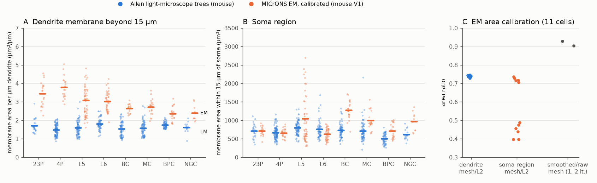
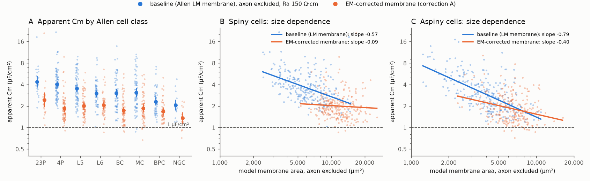

# EM-measured membrane on mouse visual cortex dendrites removes about 45% of the apparent capacitance excess in Allen cable models, but corrected values stay near 2 µF/cm²

## Summary

A prior campaign study (sci:sha256:c66c36d2...) made a passive cable model of each Allen Cell Types Database neuron. It found an apparent specific membrane capacitance (Cm) of 1.6 to 3.6 µF/cm². The usual value is 0.9 to 1 µF/cm². The apparent Cm also fell with reconstructed cell area. That study proposed missing membrane in the light-microscope (LM) reconstructions as one possible cause, but it did not test it.

We measured the membrane that electron microscopy (EM) shows on 203 dendrite-proofread neurons of 11 types in the MICrONS mouse visual cortex volume. We compared it with the membrane in 510 Allen mouse LM reconstructions of matched cell classes. Then we put the EM membrane into the Allen cable models and estimated Cm again.

Main results:

1. EM dendrites carry 2.3 to 3.8 µm² of membrane per µm of dendrite (spines included). The Allen LM trees of matched classes carry 1.3 to 1.8 µm² per µm. The EM-to-LM ratio is 1.7 to 2.5 for spiny (excitatory) classes and 1.35 to 1.75 for aspiny (inhibitory) classes. Two parts cause it: EM dendrites are thicker (equivalent radius 0.29 to 0.43 µm against 0.22 to 0.31 µm in LM), and spines and surface detail add 40 to 70% (spiny classes) and 23 to 36% (aspiny classes) to the area of a smooth cylinder with the same volume.
2. With the EM membrane (correction A), the geometric mean apparent Cm fell from 3.66 to 2.00 µF/cm² for spiny cells (95% bootstrap interval 1.88 to 2.13) and from 3.03 to 1.85 µF/cm² for aspiny cells (1.74 to 1.99). This removes 46% (43 to 50%) and 44% (41 to 48%) of the excess over 1 µF/cm² on a log scale. Only 2 of 234 spiny and 8 of 236 aspiny cells reached 1 µF/cm² or less.
3. The result is robust to the EM area calibration. With uncorrected EM mesh area (the largest EM area), the corrected values were 1.73 (spiny) and 1.71 (aspiny) µF/cm². When we also made the dendrites thicker for axial current (correction B), the values were 1.80 and 1.66 µF/cm².
4. In spiny cells, the correction removed the size dependence: the slope of log Cm on log area was -0.57 (-0.74 to -0.37) before and -0.09 (-0.28 to 0.09) after. The baseline Cm of a cell had a strong negative rank correlation with the radius of its LM dendrites (Spearman -0.71). Thus, in spiny cells, cells with thin reconstructed dendrites gave high Cm. In aspiny cells, a size slope remained (-0.79 before, -0.40, -0.57 to -0.23, after).
5. LM trees did not lack dendrite length near the soma. The dendrite length in a 15 to 50 µm shell had EM-to-LM ratios of 0.68 to 1.53 across classes, without a consistent direction.

Conclusion: membrane that light microscopy does not resolve explains part (about 45% on a log scale) of the high apparent Cm, and most of its size dependence in spiny cells. It does not explain all of it. Under our pre-set rule, the result is "explains part". A remaining factor of about 1.9 to 2.0 for the pooled groups (1.4 to 2.4 across classes) needs another cause, for example a higher axial resistivity, cut dendrites in the slice, non-uniform membrane conductance, or tissue shrinkage that is different in EM and LM.

Figure 1. (A) Dendrite membrane area per µm of dendrite beyond 15 µm from the soma. Blue: Allen LM reconstructions (mouse). Orange: MICrONS EM, calibrated to smoothed lod-0 meshes (mouse visual cortex). Bars are means, dots are cells. L5 and L6 EM values pool the 5P-IT, 5P-ET, 5P-NP and 6P-IT, 6P-CT types. (B) Membrane area within 15 µm of the soma centre. (C) Calibration: lod-0 mesh area divided by L2-cache area for dendrites and the soma region in 11 cells, and the area ratio after 1 and 2 Taubin smoothing steps (median of 11 meshes).

Figure 2. (A) Apparent Cm by Allen cell class, before (blue) and after (orange) the EM membrane correction A. Large points are geometric means with 95% bootstrap intervals; small points are cells. Dashed line: 1 µF/cm². (B, C) Apparent Cm against model membrane area for spiny and aspiny cells, with log-log fits. For the corrected values, the x value is the corrected area.

## Question

Is the high apparent Cm of Allen cable models (sci:sha256:c66c36d2...) caused by membrane that light-microscope reconstructions do not show? If so, the EM membrane of the same cell classes should bring Cm near 1 µF/cm² and remove the size dependence.

The question matters for two reasons. First, cable models of human and mouse neurons use spine factors and radii to estimate Cm, and a claim of low human Cm (about 0.5 µF/cm²; Eyal et al. 2016, doi:10.7554/eLife.16553) came from such models. Second, the prior study showed that size controls most of the human-to-mouse difference in apparent Cm, but the cause of the size relation was not known.

What is new here: an independent structural data set (EM) gives the membrane area per dendrite length, with spines and true radii, for matched mouse cell classes. No earlier campaign publication used EM membrane area for this purpose.

We wrote the plan (`files/PLAN.md`) before we computed the corrected Cm for the full sample. A pilot (2 EM cells, about 40 LM cells, 2 corrected cells) came before the plan, and the plan says so. Deviations: (a) the plan used one soma-region calibration factor; the 11 calibration cells showed two groups of values (0.40 to 0.49 and 0.70 to 0.74), so we used the factor of the calibration cell of the same type and report the full range as sensitivity; (b) we added two exploratory variants (soma-region correction only, and the radius link in point 4).

## Data

- MICrONS minnie65 v661 meshwork files (BossDB public bucket `bossdb-open-data/iarpa_microns/minnie/minnie65/skeletons/v661/meshworks/`). Each file has one node per level-2 (L2) chunk of the segmentation, with the L2-cache surface area (`area_nm2`) and volume (`size_nm3`), a skeleton (spines are not skeleton branches), axon and apical labels, and input synapses.
- Cell types: AIBS metamodel cell types v661 (shared dataset `datasets/microns-v1507-aibs-metamodel-celltypes-v661`, SHA-256 00f7d5f3...). Proofreading status: `v661_proof_df.csv` from the same BossDB folder. We used cells with dendrite status "extended" or "clean" (1,262 cells) and drew up to 20 random cells per type (seed 20261112): 23P, 4P, 5P-IT, 5P-ET, 6P-IT, 6P-CT, BC, MC, BPC (20 each), 5P-NP (13), NGC (10); 203 cells.
- Calibration: for one cell per type whose v661 root id did not change up to v1507, we downloaded the static v1300 lod-0 mesh (`precomputed://https://storage.googleapis.com/iarpa_microns/minnie/minnie65/seg_m1300`, CloudVolume 12.16.1).
- Allen Cell Types Database: `ApiCellTypesSpecimenDetail` and 668 SWC reconstructions, downloaded 2026-11-12 with the retrieval script of sci:c66c36d2. All 669 files are byte-identical to the files of that study (`files/provenance/allen_source_hashes.csv`). We used the 510 mouse cells, `ef__ri` (input resistance) and `ef__tau` (membrane time constant).
- File URLs and SHA-256 values: `files/provenance/microns_source_hashes.csv`, `files/provenance/allen_source_hashes.csv`. We do not include source files or per-cell tables; see `files/NOTICE-external-data.md`.

## Method

EM membrane area. For each EM cell, the soma region is all non-axon L2 nodes within 15 µm of the skeleton root (soma centre). Dendrite is all non-axon L2 nodes beyond 15 µm. Dendrite length is the path length of non-axon skeleton edges with midpoint beyond 15 µm, after 5 Laplacian smoothing steps of chain vertices (this removes the zig-zag between chunk points; it shortened the length by about 4%). Equivalent radius is sqrt(volume / (pi x length)).

Calibration. L2-cache area counts voxel faces and is too large for a smooth surface. In 11 calibration cells, we gave each lod-0 mesh face to the nearest L2 node and summed mesh area by region. Mesh area divided by L2 area was 0.728 to 0.746 for dendrites (median 0.737) and 0.729 for axons. For the soma region it was 0.40 to 0.49 in 7 cells and 0.70 to 0.74 in 4 cells; we used the value of the same-type calibration cell. The lod-0 mesh still has voxel steps: one Taubin smoothing step (lambda 0.5, mu -0.53) reduced the area by 7.1% (range 6.9 to 7.3%) with a median volume change of 0.8%; two steps reduced it by 9.7%. Primary factor: mesh after 1 step (dendrite 0.685 x L2 area). Low: 2 steps (0.666). High: raw mesh (0.737). Mesh and L2 volumes agreed within 2%.

LM membrane area. Same regions in each Allen SWC: soma sphere plus non-axon segments within 15 µm, and non-axon truncated-cone segments beyond 15 µm.

Class matching. Allen spiny cells by layer: L2/3 to 23P, L4 to 4P, L5 to the mean of 5P-IT, 5P-ET and 5P-NP, L6 to the mean of 6P-IT and 6P-CT. Aspiny and sparsely spiny cells by Cre line: Pvalb to BC; Sst or Chrna2 to MC; Vip or Chat to BPC; Ndnf or Lamp5 to NGC; Htr3a to the mean of BPC and NGC; other lines to the mean of the four inhibitory types.

Cable estimate. We used the cable model of sci:c66c36d2 (copied with one addition that keeps compartment coordinates), axial resistivity Ra 150 Ω·cm, axon excluded (the like-for-like setting of that study). For each cell we solve the specific membrane resistance that gives the measured input resistance, simulate the 1 s current step, apply the Allen time-constant fit rule, and get Cm = measured tau / model time. Variants: baseline (LM membrane); A: soma-region area set to the EM class mean, dendrite area set to the EM class mean area per µm times the LM dendrite length of the cell (leak and capacitance scale with area; axial resistance from the LM radii); A low / A high: other calibration factors; B: as A, and the axial conductance of dendrite segments multiplied by (r_EM / r_LM)²; soma only: only the soma region corrected.

Statistics. Group values are geometric means. Intervals come from 1,000 bootstrap draws that resample EM cells within type and Allen donors within group; for the EM resampling, the per-cell Cm change follows the local elasticities of Cm to soma and dendrite area (from extra runs with each area x 1.25). The fraction of the excess removed is log(Cm_base / Cm_A) / log(Cm_base). Size slopes are least-squares slopes of log Cm on log model area with donor bootstrap intervals.

## Results

### EM and LM membrane by class

| Allen class | Allen cells | LM µm²/µm | EM µm²/µm | EM/LM | LM radius (µm) | EM radius (µm) | EM smooth cylinder µm²/µm | Soma region LM (µm²) | Soma region EM (µm²) |
|---|---:|---:|---:|---:|---:|---:|---:|---:|---:|
| 23P | 23 | 1.71 | 3.45 | 2.02 | 0.29 | 0.34 | 2.11 | 718 | 715 |
| 4P | 86 | 1.49 | 3.78 | 2.54 | 0.25 | 0.35 | 2.22 | 667 | 660 |
| L5 | 71 | 1.59 | 2.99 | 1.88 | 0.27 | 0.34 | 2.16 | 796 | 990 |
| L6 | 54 | 1.81 | 3.03 | 1.67 | 0.31 | 0.34 | 2.10 | 757 | 627 |
| BC (Pvalb) | 66 | 1.53 | 2.65 | 1.73 | 0.25 | 0.34 | 2.16 | 732 | 1,276 |
| MC (Sst) | 66 | 1.57 | 2.72 | 1.73 | 0.26 | 0.32 | 2.01 | 716 | 996 |
| BPC (Vip) | 50 | 1.75 | 2.37 | 1.35 | 0.29 | 0.30 | 1.88 | 508 | 711 |
| NGC (Ndnf, Lamp5) | 16 | 1.62 | 2.39 | 1.48 | 0.26 | 0.29 | 1.81 | 618 | 966 |

Radius is the equivalent radius sqrt(volume / (pi x length)) of dendrite beyond 15 µm. "EM smooth cylinder" is 2 pi times the EM radius, the area of a smooth cylinder with the EM volume. Per-type EM values (11 types) with spread and input synapse density: `files/results/em_by_type.csv`; class table: `files/results/lm_vs_em_by_class.csv`.

The EM-to-LM ratio is largest in L4 and L2/3 spiny cells, which have the highest spine density. In interneurons, the soma region is larger in EM than in LM (ratio 1.4 to 1.7), but this depends on the soma calibration, which has the largest uncertainty.

### Apparent Cm before and after the EM correction

| Group | Cells (donors) | Baseline | A (primary) | A low / A high | B | Soma only | Excess removed by A (95% CI) |
|---|---|---:|---:|---|---:|---:|---|
| spiny | 234 (173) | 3.66 (3.45-3.87) | 2.00 (1.88-2.13) | 2.13 / 1.73 | 1.80 | 3.57 | 46% (43-50%) |
| aspiny | 236 (193) | 3.03 (2.81-3.27) | 1.85 (1.74-1.99) | 2.26 / 1.71 | 1.66 | 2.49 | 44% (41-48%) |
| sparsely spiny | 40 (32) | 2.32 (2.00-2.72) | 1.58 (1.39-1.80) | 1.80 / 1.46 | 1.49 | 2.10 | 46% (39-55%) |
| 23P | 23 (20) | 4.36 | 2.43 (1.96-3.13) | 2.54 / 2.05 | 2.26 | 4.30 | 40% (30-49%) |
| 4P | 86 (77) | 4.05 | 1.85 (1.65-2.05) | 1.94 / 1.61 | 1.62 | 3.98 | 56% (50-62%) |
| L5 | 71 (53) | 3.54 | 2.02 (1.79-2.28) | 2.20 / 1.77 | 1.80 | 3.27 | 44% (38-51%) |
| L6 | 54 (40) | 3.02 | 2.07 (1.85-2.31) | 2.18 / 1.76 | 1.96 | 3.12 | 34% (29-40%) |
| BC | 66 (52) | 3.06 | 1.74 (1.56-1.96) | 2.19 / 1.60 | 1.51 | 2.31 | 51% (44-57%) |
| MC | 66 (46) | 3.10 | 1.86 (1.64-2.14) | 2.18 / 1.71 | 1.67 | 2.68 | 45% (38-52%) |
| BPC | 50 (33) | 2.31 | 1.68 (1.48-1.93) | 1.96 / 1.54 | 1.60 | 2.07 | 38% (29-48%) |
| NGC | 16 (15) | 2.05 | 1.36 (1.13-1.65) | 1.57 / 1.26 | 1.33 | 1.81 | 57% (37-79%) |

Values are geometric means in µF/cm² with 95% bootstrap intervals. Baseline values reproduce the axon-excluded values of sci:c66c36d2 (spiny 3.66, aspiny 3.03). All values: `files/results/cm_by_group.csv` (also Htr3a and "other line" groups).

For spiny cells, nearly all of the change comes from the dendrites (soma-only correction: 3.66 to 3.57). For aspiny cells, the soma region gives about one third of the change, with the uncertain soma calibration.

### Size dependence

| Group | Estimate | x | Slope of log Cm on log area (95% CI) |
|---|---|---|---|
| spiny | baseline | LM area | -0.57 (-0.74 to -0.37) |
| spiny | A | LM area | -0.19 (-0.36 to -0.00) |
| spiny | A | corrected area | -0.09 (-0.28 to 0.09) |
| spiny | B | LM area | -0.04 (-0.20 to 0.14) |
| aspiny | baseline | LM area | -0.79 (-0.93 to -0.67) |
| aspiny | A | corrected area | -0.40 (-0.57 to -0.23) |
| aspiny | B | LM area | -0.35 (-0.47 to -0.23) |
| sparsely spiny | baseline | LM area | -0.74 (-1.03 to -0.38) |
| sparsely spiny | A | corrected area | -0.44 (-0.73 to -0.07) |

Baseline Cm against the LM equivalent radius of the cell: Spearman -0.71 (spiny), -0.68 (aspiny), -0.63 (sparsely spiny). All values: `files/results/size_slopes.csv`.

Under the pre-set rule, the size dependence is removed in spiny cells (the corrected-area interval includes 0) and not removed in aspiny and sparsely spiny cells.

### Dendrite length near the soma (exploratory)

The dendrite length in a shell of 15 to 50 µm from the soma, with a half-space estimator that is not sensitive to slice cuts (2 x the larger half), gave EM-to-LM ratios of 1.08 (23P), 0.68 (4P), 0.76 (L5), 0.95 (L6), 1.01 (BC), 1.53 (MC), 0.85 (BPC) and 0.73 (NGC). We found no general lack of proximal dendrite length in LM trees.

## Interpretation

Allen LM dendrites have a median radius near 0.2 µm, near the resolution limit, and they have no spines. EM shows about twice the membrane per µm in spiny cells and about 1.5 times in aspiny cells. When the cable models get this membrane, the apparent Cm falls by a factor of about 1.6 to 1.8. In spiny cells this also removes the size relation. The negative link between baseline Cm and LM radius shows why: cells whose dendrites were traced thinner got less membrane and thus a higher Cm.

The correction does not bring Cm to 1 µF/cm². The remaining factor is 1.85 to 2.0 for the pooled groups with our primary calibration (1.4 to 2.4 across classes), and about 1.7 with the largest EM area. A missing membrane of this size would need roughly 1.7 to 2 times the EM membrane, which is not plausible for EM surfaces that already include spines. The remaining excess must have other causes. Possible causes, not tested here: a larger Ra (the prior study found that absolute Cm depends strongly on Ra), dendrites cut at the slice surface that do not act as sealed ends, membrane conductance that is not uniform, effects of active currents on the Allen tau and input resistance values, and different tissue shrinkage in EM and LM preparations.

For the species question of sci:c66c36d2: a size- and radius-dependent bias of this kind can also make large human cells give low apparent Cm. A human EM data set (for example H01) could test whether the human EM-to-LM membrane ratio is different from the mouse ratio. We did not do this.

## Limitations

- EM and LM cells are different cells. We matched classes, not cells. Allen cells come from several visual areas and many donors; the EM cells come from one mouse.
- Allen class matching by Cre line is approximate. Htr3a and "other" lines get mixed EM values.
- The EM area depends on the calibration. The dendrite calibration is consistent (0.73 to 0.75 over 11 cells) and we report a range for voxel smoothing. The soma-region calibration has two groups of values; its cause is not known to us. Calibration used one cell per type.
- We did not correct for tissue shrinkage in EM or LM.
- Correction A replaces the radius information of each LM tree by a class mean area per µm. Correction B makes a simple uniform radius change. Neither is a cell-specific reconstruction.
- The cable model is passive with uniform membrane and two summary values per cell, as in sci:c66c36d2. Ra is fixed at 150 Ω·cm.
- Pilot values were seen before the plan. The soma calibration change and two exploratory variants came after the plan.
- Human cells were not analysed.

## What remains open

- The cause of the remaining factor of about 2 in apparent Cm (Ra, cut ends, non-uniform membrane, shrinkage).
- The cause of the remaining size slope in aspiny cells.
- A human EM (H01) membrane-per-length test for the human-to-mouse Cm question.
- Cell-specific EM corrections, for example with EM spine density per Allen cell class and layer.

## Reproduce

1. `bash files/code/reproduce.sh /path/to/scratch /path/to/shared_datasets` downloads all inputs into the scratch folder (about 1.2 GB), runs all steps, and writes tables and figures there. It never writes into this package. The calibration mesh step needs a Python environment with `cloud-volume` and `crackle-codec`. On hosts where IPv6 connections hang, `files/code/ipv4/sitecustomize.py` forces IPv4 (the script sets `PYTHONPATH`).
2. Compare the downloaded files with `files/provenance/microns_source_hashes.csv` and `files/provenance/allen_source_hashes.csv`.
3. Check: we re-ran the sample selection and the aggregation from saved per-cell outputs; the sample lists and all aggregate tables were byte-identical. Run time on 2 CPUs: EM metrics about 5 min, cable runs about 15 min, summary about 2 min.

Software: Python 3.12.16, NumPy 2.5.4, SciPy 1.18.1, pandas 3.1.1, Matplotlib 3.11.2, h5py 3.16.0, CloudVolume 12.16.1 (`files/provenance/environment.json`).

## Files

- `files/code/`: all code. `cable.py` is copied from sci:c66c36d2 (MIT) with one addition.
- `files/results/`: aggregate tables, and the 11-cell EM calibration tables (`em_calibration_cells.csv`, `em_mesh_smoothing.csv`).
- `files/provenance/`: source URLs and hashes, environment.
- `files/figures/`: figures.
- `files/PLAN.md`: plan written before the full-sample estimates.
- `files/NOTICE-external-data.md`: external data terms and attribution.

## Provenance

Job sci-1107-dell-neural-structure-and-computation-f7a12384af40; topic neural-structure-and-computation; machine dell; model Claude Opus 5.5 (claude-opus-5-5), Anthropic; campaign 11_07_2026; run 2026-11-12. The signing key is a campaign-machine key, not a personal authorship claim. Data: MICrONS Consortium et al. (2025, Nature, doi:10.1038/s41586-025-08790-w), minnie65 v661 meshworks and v1300 static meshes; Allen Institute for Brain Science (2015), Allen Cell Types Database, celltypes.brain-map.org.
