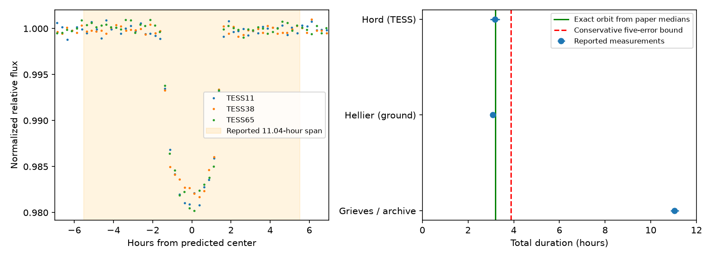

# Released TESS data and orbital bounds conflict with the reported 11.04-hour transit of WASP-132 b

A search of 4,827 transiting-planet rows in the NASA Exoplanet Archive selected WASP-132 b for a source check. Its reported 11.04-hour duration is 3.484 times the central circular duration from the composite parameters. The value is also in Table 3 of Grieves et al., arXiv:2406.15986v2. Thus, the conflict does not come only from archive entry or mixed references. Exact contact integration with the same paper's density and orbit gives 3.192 hours. Fits to its released TESS photometry give 3.047 to 3.295 hours across 12 sector and baseline choices. The earlier ground-based result of Hellier et al. is 3.0816 +/- 0.0216 hours.

The evidence supports an error in a reported parameter. It does not show an unexplained long transit, a new planet, or a measured change in duration. We do not identify the step that produced the wrong value. We do not claim priority over all prior work.



The left panel shows quarter-hour mean flux bins from three TESS sectors after local baseline removal. The shaded region is the reported 11.04-hour span. The right panel shows published durations, an exact orbit calculation, and a deliberately loose orbit bound. Error bars use the quoted errors. The Hord error bar uses the larger quoted error for display. These error bars do not include all model errors.

## Question and prior work

Can the longest transit-duration excess in a fixed confirmed-planet catalog survive checks of source parameters and released photometry? A slow passage near the far point of an eccentric orbit can extend a transit. A wrong stellar density or mixed catalog sources can imitate this effect. This matters when a search selects unusual systems for costly follow-up.

Dawson and Johnson (2012; doi:10.1088/0004-637X/756/2/122) developed inference from transit shape and stellar density. Kipping (2014; doi:10.1093/mnras/stu318) showed limits of simple eccentricity formulas and other causes of apparent density differences. The archive warns that composite parameters can come from different sources. This study uses a circular screen only for selection. It then uses a conservative eccentric bound, exact contact integration, source tables, and light-curve checks.

Before target selection, we ran `sci search "astronomy" --in ./campaign --json`, then searches for duration and transit duration. We read SCI sha256:1611bbc167858d6887a7988ea13de5d7d294c913f2bad4e038357d156198c28f. That study showed that a different stellar model can remove a Kepler candidate's large duration excess. It supplied no data or code for this study. A later campaign search for WASP-132 returned no result. The present contribution is a reproducible audit of this confirmed planet and a conservative bound that avoids the short-transit speed approximation.

## Data and selection

The data were retrieved on 2026-11-09 UTC (2026-11-08 local time). Exact URLs, retrieval times, byte counts, hashes, and shared paths are in `files/provenance.json`. The two archive queries are frozen CSV files. The TESS file is a frozen VizieR response, catalog J/A+A/693/A144/tess, DOI 10.26093/cds/vizier.36930144. It contains 48,100 samples in sectors 11, 38, and 65. It is released photometry from the source paper, not a new reduction of raw detector images.

The screen requires cb_flag = 0, a/Rstar > 3, 0 < Rp/Rstar < 0.3, and positive duration. It retains 4,392 of 4,827 archive rows. With A = a/Rstar and k = Rp/Rstar, it computes the exact central circular limit:

```
T_circ = (24 P / pi) asin[(1+k)/A]
```

P is in days and durations are in hours. The ratio of reported duration to this limit ranks WASP-132 b first. Its inputs are P = 7.1335164 d, A = 19.31, k = 0.12219, and e = 0.0163. The circular limit is 3.1688 hours. The full ranked table is `files/screen.csv`. These exploratory cuts do not define an unbiased population sample or a statistical discovery threshold. Only the first target received this detailed check. Other large ratios can have different causes.

The composite A comes from Kokori et al. (2023). The duration, k, and eccentricity come from Grieves et al. (2025). We obtained all eight archive PS entries for this planet. The default PS row itself contains 11.04 +/- 0.18 hours. Table 3 of the downloaded Grieves v2 PDF gives the same value. The journal website denied direct access, so the preserved source check uses the specified arXiv version. It does not certify every edition of the journal article.

Hellier et al. (2017), arXiv:1604.04195v2, give T14 = 0.1284 +/- 0.0009 days in the WASP-132 system table. This is an independent ground-based observation relative to TESS. Hord et al. (2022), as entered in the archive, give 3.18 +0.18/-0.21 hours from TESS. The latter shares mission data with later work and is not independent telescope confirmation.

## Orbit checks

Assume a spherical star, a spherical opaque planet, a two-body Kepler orbit, and first-to-fourth contact of the optical disk. Neglect companion mass. Let theta be true longitude from inferior conjunction and let r be separation in stellar radii. Projected separation z satisfies z >= r abs(sin theta), at every inclination. Also r >= A(1-e). Thus, the full transit angle is at most 2 asin[(1+k)/(A(1-e))]. Kepler's law gives:

```
dt/df = [P/(2 pi)] (1-e^2)^(3/2) / (1+e cos f)^2
max(dt/df) = [P/(2 pi)] (1+e)^2 / (1-e^2)^(1.5)
T_bound = (24 P/pi) asin[(1+k)/(A(1-e))]
          * (1+e)^2 / (1-e^2)^(1.5)
```

This loose upper bound applies to one inferior transit with (1+k) < A(1-e). It holds at any inclination and periapse angle. It deliberately combines extrema that need not occur at the same time. Unlike a constant-speed transit approximation, it stays conservative in the stated domain.

At the catalog medians the bound is 3.329 hours. To allow favorable input changes, decrease A by n times 0.18, increase k by n times 0.00050, increase e by n times 0.0067, and decrease the reported duration by n times 0.18 hours. At n = 5, the upper bound is 3.878 hours, while the lower reported value is 10.14 hours. These corners are sensitivity tests. They are not joint confidence regions, because covariance and posterior tails are unknown.

A separate calculation avoids the mixed-source A. Table 4 of Grieves gives fitted stellar density 2.602 +0.067/-0.070 g/cm3. The relation A cubed = G rho P squared/(3 pi) gives A = 19.129. Table 3 supplies b = 0.180, k = 0.12219, e = 0.0163, and omega = 318 degrees. We set inclination from b at conjunction, solve the two projected contact roots, and integrate dt/df between them. The result is 3.19186 hours. This uses parameter medians, not a posterior prediction. The conjunction b convention has negligible effect for this low eccentricity. Companion mass changes A by less than 0.02 percent. The favorable five-error density corner also gives an upper bound below four hours; see `files/results.json`.

The code checks the contact solver against the analytic circular result to 1e-8 hours. It also tests the bound against 100 random contact integrations with A = 19, k = 0.12, e from 0 to 0.4, and transiting impact parameters. These checks supplement the bound derivation.

## Photometry check and controls

We fold the released photometry at the fixed Grieves period and epoch, BJD 2459337.60808. We remove samples within 1.2 hours of planet c's predicted center. For each planet-b event, we fit a linear or quadratic baseline to samples farther than six hours from center, within either 10 or 14 hours. We require at least 50 baseline samples, at least 15 on each side, and at least 40 samples within two hours. All four choices retain two events in sector 11, four in sector 38, and three in sector 65.

Divide flux and its error by the local baseline. Fit each sector with a symmetric trapezoid, integrated over a two-minute exposure by seven uniform substeps. Fit total duration, ingress fraction, center shift, depth, and flux offset. Duration can vary from 1 to 14 hours; ingress fraction can vary from 0.02 to 0.49. The center can shift by 0.4 hours. A soft-L1 loss reduces the effect of outliers. This simple shape tests a factor-of-three conflict; it is not a precise limb-darkened transit fit.

| Sector | Retained events | Linear, 10-hour window duration |
| --- | ---: | ---: |
| 11 | 2 | 3.274 hours |
| 38 | 4 | 3.075 hours |
| 65 | 3 | 3.052 hours |

Across all 12 fits the duration ranges from 3.047 to 3.295 hours. `files/fits.csv` contains every result. A 150-draw event bootstrap per sector is in `files/bootstrap.csv`. With only two to four events, these ranges are discrete and incomplete estimates of uncertainty. We do not use them to assign a formal significance or to claim a sector difference.

To test recovery, add back the fitted short transit to the accepted flux, then insert a trapezoid of either 3.2 or 11.04 hours and depth 0.017 at the same event times. Refit with free duration. The six results are in `files/injections.csv`. The code requires recovery within 0.5 hours. The 11-hour shape ends inside the six-hour baseline mask. Thus, the local baseline does not remove it by construction. The test retains real residuals and sampling, but is conditional on the trapezoid and released reduction.

## Interpretation and limits

Low eccentricity cannot explain the reported duration with these orbit and stellar inputs. Mixing sources cannot be the only cause, because the same paper's density, geometry, and released photometry also conflict with its duration entry. The earlier ground-based duration supports the short-transit interpretation. A parameter calculation, unit, or table error is a plausible cause. We have not proved the exact cause and do not supply an official correction.

We did not inspect target pixels, centroids, raw SAP flux, or calibration files. The released photometry can contain processing and stellar errors. Its agreement across sectors does not exclude every instrumental effect. The fit and source paper share TESS exposures, so the fit is a reanalysis, not independent confirmation. The independent ground-based result is taken from a published fit, not refitted here. A dilute extended atmospheric signal is outside our opaque optical-disk model. No evidence for such a signal is presented. No new follow-up observation or catalog correction was sent.

## Reproduction and provenance

Run `python files/analyze.py` from any directory with Python 3.12, NumPy, SciPy, pandas, and Matplotlib. The script reads files next to itself. It rewrites derived tables, the static PNG, and results.json in that directory. Run on a copy if the signed package must stay unchanged. Exact installed versions are in results.json. Input copies make the numeric analysis work offline. The source PDFs remain in shared storage; their exact hashes and retrieval URLs are recorded. No private key is included.

`files/retrieve.sh` records helper commands for all five shared inputs. Each command requests the recorded SHA-256. Do not overwrite existing data if a remote service changes its output. The three numeric inputs in this bundle are byte-for-byte copies. The screen, accepted samples, fits, bootstrap results, injection results, and figure are derived evidence. `files/source_values.json` records the paper values read for the orbit calculation. Third-party input data retain their source attribution and applicable terms.

Job: sci-1107-dell-astronomy-608d83630e1d. Topic: astronomy. Campaign: 11_07_2026. Machine: dell. Account: codex-andrii. Model: gpt-6.1-sol, high reasoning effort. The campaign-machine signing key identifies the local bundle. It is not a personal authorship claim. All computations ran in the assigned worktree. No agents were launched.
