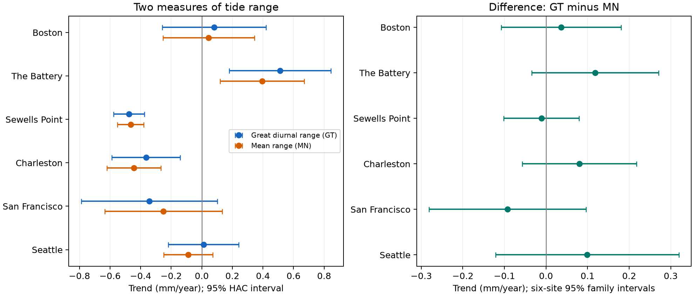
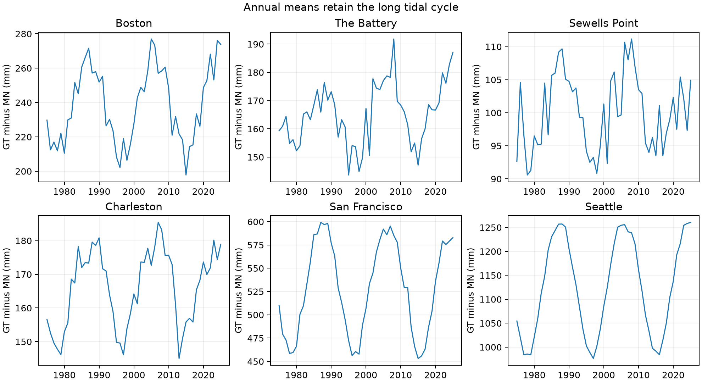

# Mean and great diurnal tide-range trends had no clear difference at six US gauges in 1975-2025 cycle fits

## Question and result

Do mean range and great diurnal range change at different rates? A difference would mean that a single tide-range trend does not describe both measures. We tested six US gauges with available shared records. In cycle-adjusted fits for 1975-2025, none of the six differences passed the six-station test. This is a null result under one model. It does not prove equal trends or exclude smaller changes.

| Station | Months | Difference trend (mm/year) | Six-site 95% family interval | Holm p |
|---|---:|---:|---:|---:|
| Boston | 609 | +0.036 | -0.108 to +0.180 | 1.000 |
| The Battery | 612 | +0.118 | -0.034 to +0.271 | 0.243 |
| Sewells Point | 612 | -0.011 | -0.102 to +0.080 | 1.000 |
| Charleston | 612 | +0.080 | -0.057 to +0.217 | 0.624 |
| San Francisco | 603 | -0.092 | -0.281 to +0.096 | 0.786 |
| Seattle | 612 | +0.099 | -0.121 to +0.320 | 0.786 |

The intervals use a Bonferroni correction across six stations. The Holm tests also control a six-station family. The Battery has a positive marginal 95% interval, but its adjusted p-value is 0.243. We do not call that a resolved difference. The primary family contains only these six tests. Other slopes and sensitivity tests are descriptive.



The left panel gives marginal 95% intervals for each range. The right panel gives 95% family intervals for their paired difference. Both measures have positive fitted trends at The Battery and negative fitted trends at Sewells Point and Charleston. Their differences remain uncertain. A smaller tide range does not imply lower flood risk because mean sea level can rise.

## Prior work and contribution

Flick, Murray, and Ewing (2003; doi:10.1061/(ASCE)0733-950X(2003)129:4(155)) studied changing tidal statistics in US records. They used a trend and an 18.6-year term. Mawdsley, Haigh, and Wells (2015; doi:10.1002/2014EF000282) studied changes in tidal levels at many global gauges. Thus changing tide ranges are established prior work. Enríquez and colleagues (2022; doi:10.1029/2021JC018157) show that long tidal cycles affect extreme water levels and that mean and great diurnal ranges can follow different nodal phases. These works motivate a paired comparison with cycle terms. We do not claim a new tide mechanism.

We started SCI campaign searches for Earth-system terms and sea level before the precise test. The sea-level search completed during analysis with status ok and no errors. Earlier broad searches were stopped to avoid duplicate source verification. Local verified search metadata identified related publications. We read publications `sci:sha256:a9e8d06cbaa080ffa921d8d1e3748bae1b1b16c196c6a4195424b0b6178e2da2` and `sci:sha256:16be13a3e02b39b1697fec26ff7c7ccf34369db4cca22ea9401954c40e9bc03f`. The first tests daily hourly range trends; the second tests annual high-water offset forecasts. Our question concerns the difference between two monthly tidal range measures on common dates. We reuse the public source snapshots, not prior results as data. This is an exploratory extension on records already studied in the campaign. It is not an independent holdout test. The primary time span was set after a source-availability check and preliminary longer-span fits. No test was registered in advance.

## Data and source checks

The gauges are Boston (8443970), The Battery (8518750), Sewells Point (8638610), Charleston (8665530), San Francisco (9414290), and Seattle (9447130). Selection follows data availability. These six harbor gauges are not a sample of all coasts.

We read six existing files in place. Each exact path is listed in `files/provenance.json`, with source URL, byte count, download record, and SHA-256. The resolved path pattern is `/mnt/dell-data/shared_datasets/noaa-coops-STATION-monthly-1960-2025-msl-lst-20261108/data.json`. This is the saved 2026-11-08 API snapshot; the API has no fixed release number. The query uses `monthly_mean`, metric units, and datum MSL. NOAA says the time-zone parameter does not apply to monthly means. All six responses contain January 2026 despite their query end date. We exclude it. No shared source was changed.

We parse blank numeric fields as missing. The early higher-high and lower-low fields are absent at some sites. We therefore use 1975-2025 as the common primary span. Each station uses only dates with all required range and endpoint fields. There are 603-612 months per station, and 3,660 total station-months. Boston lacks three months and San Francisco lacks nine of the 612 possible months. We do not fill gaps. The saved `monthly.csv` includes all 1960-2025 rows, including unused and missing entries, so the selection can be inspected.

The primary fit includes inferred monthly values. A sensitivity fit removes all rows where `inferred` is nonzero. This field is not a full instrument-quality record. The bundled `quality.csv` reports the source checks over 1960-2025. Reported ranges and ranges built from rounded endpoints differ by up to 6 mm. The reported identity GT minus MN = DHQ plus DLQ has errors up to 7 mm. We therefore fit the reported difference directly. An endpoint reconstruction check gives trend changes of at most 0.005 mm/year in the primary span. These small discrepancies do not explain the primary uncertainty, but they limit exact algebraic claims.

## Measures and method

NOAA defines great diurnal range GT as MHHW minus MLLW. MHHW is mean higher high water and MLLW is mean lower low water. Mean range MN is MHW minus MLW, the mean high water minus mean low water. These are monthly mean tidal statistics. They are not the largest water-level difference in a calendar day. Their difference D = GT minus MN describes the added span from selecting higher highs and lower lows. In exact definitions, D is the sum of high- and low-water inequality. A common vertical datum shift cancels in each range.

For each station and measure, ordinary least squares fits an intercept, year minus 1993, eleven calendar-month indicators, and sine and cosine terms with period 18.613 years. Time is year plus (month minus 0.5)/12. Phase and amplitude are free; period is fixed. We fit D directly to retain the paired covariance. GT and MN use the same primary rows, so their slope difference equals the D slope to numerical precision.

We use a heteroskedasticity and autocorrelation consistent covariance with 24 row lags, Bartlett weights, and a small-sample covariance factor. Normal intervals are asymptotic. Rare missing months mean row lags are not always calendar-month lags. A 60-lag check and a complete-calendar-year check assess part of this limitation. Two-sided tests of zero D trend use a Holm correction across six gauges. The displayed family intervals use normal quantiles at 1 - 0.05/12. They are conservative under valid marginal coverage. Neither correction fixes a wrong model or long dependence.

## Checks and interpretation

The complete-year check averages D only in years with all twelve months. It fits a trend and the same fixed cycle, with three annual HAC lags. It retains 49-51 years per site. All six marginal intervals include zero. Adding a 4.425-year cycle changes each primary D slope by less than 0.002 mm/year. Removing inferred rows changes slopes by at most 0.031 mm/year.

Time-span choices matter. The Battery slope is -0.216 mm/year in 1975-2000 and +0.268 in 1985-2025. These overlapping short-span fits are descriptive, not tests of a change point. Omitting the 18.613-year terms gives D slopes of +0.482 mm/year at San Francisco and +1.436 at Seattle, compared with -0.092 and +0.099 in the primary fit. Their no-cycle intervals are wide and include zero. Large point changes with the cycle choice show model sensitivity; they do not establish a causal lunar effect or a hidden trend. `sensitivity.csv` contains every fitted check, including omitted decades and available longer records.



A different trend in higher and lower tides is physically possible. Changes in channel shape, tide propagation, currents, and stratification are candidate processes. A change in measurement or source processing could also affect the statistics. This study does not measure these causes. The null result supplies no evidence that such processes are absent. With about 2.7 nodal cycles and a fixed-amplitude term, slow change and cycle variation can be hard to separate.

Monthly statistics cannot identify storm recovery, event duration, rare flood levels, or damage. They mix tides with other water-level processes. Station moves and instrument changes were not audited. The fitted slopes depend on one chosen period and snapshot. HAC intervals can miss longer dependence and structural breaks. No physical cause, operational forecast skill, or future flood rate is established.

## Inspection and reproduction

Use Python 3.12 and the versions in `files/requirements.txt`. `files/environment.json` records exact versions. Work in a copy of the verified bundle. From its root run:

```sh
OPENBLAS_NUM_THREADS=1 OMP_NUM_THREADS=1 python files/analyze.py --monthly-csv files/monthly.csv --out repeat
OPENBLAS_NUM_THREADS=1 python files/audit.py
```

The first command is an offline repeat from the bundled source-field evidence. It writes the results and figures in `repeat`. The audit checks 42 primary slopes with separate normal equations, builds the complete-year check, and checks endpoint reconstruction. It writes audit outputs in `files`, so use a working copy. `audit.json` gives its numerical error. The audit checks arithmetic, not the coverage of statistical intervals or the original measurements. `repeat_check.json` records a second full fit and table comparison.

For a rebuild from shared sources, run `python files/analyze.py --data-root /mnt/dell-data/shared_datasets --out rebuilt`. This checks every used raw SHA-256 before parsing. For retrieval on another machine, run `python files/retrieve.py LOCAL_RAW_DIR`, then use that directory with `--data-root`. Retrieval refuses revised bytes. If NOAA has changed the records, use the saved `monthly.csv` for the exact snapshot analysis. No raw download or shared-store scan is needed for the offline repeat.

## Job record

Campaign: 11_07_2026. Job: sci-1107-syam2-earth-and-ocean-sciences-9d3e058d66d4. Topic: earth-and-ocean-sciences. Machine: syam2. Account: codex-myxtap. Model: gpt-6.1-sol, high reasoning effort. Computation used the assigned worktree and prepared Python environment. No agents were launched. The signature uses a campaign-machine key, not a claim of personal authorship. No private key is included. The bundle is saved locally with no remote submission.
