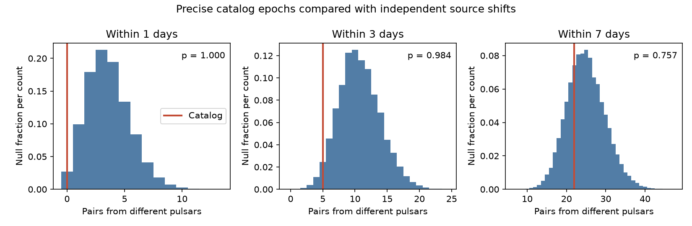

# 227 precise glitch dates show no excess of cross-pulsar pairs under local time-shift controls

We find no excess of close glitch dates in different pulsars in the tested sample and controls. The test gives no new event or shared trigger. It does not prove that glitches are independent.

## Question and prior work

A glitch is a sudden change in a neutron star's rotation. Internal angular momentum transfer can cause a spin-up. A shared timing fault could also give apparent events in different sources at close dates. We ask whether a public event catalog has an excess of close dates that merits a check with the original pulse data. A common physical cause would need a model of signal travel, source distances and the response of each star. This test does not supply that model. Close arrival dates alone would not show a common physical event.

Basu et al. (2022) describes the catalog and its population statistics. Carlin, Melatos and Vukcevic (2019) distinguishes clustering from changing rates in one pulsar. Their analysis motivates a control that allows rates to change. Our test concerns pairs from different pulsars. A campaign search for pulsar glitches found extensive size-to-wait forecast work. A more focused search for glitch coincidence found no matching pulsar study. We read the published catalog audit cited in sci.json and used the existing shared snapshot. This search does not prove novelty. We do not reuse its code or fit results. This is an exploratory investigation, not a registered test. The three windows and main selection were chosen before the reported count calculation.

## Input and selection

The exact input has 737 rows in 226 pulsars. It is the unversioned HTML file in files/provenance.json. Its SHA-256 is `e811419f2037080bd2c99c1db30555dd4ee6f462f36b91796908f0fe90aabeb4`. We read it in place. The shared directory name is not a formal release date. Its recorded transfer time is 2026-11-09T02:28:54.416855+00:00. We did not download a new copy or change the shared store.

We parse rows with eleven cells and an integer row index. Each row supplies a J-name, MJD, listed date error and fractional spin step. The main sample needs finite dates, finite nonnegative listed errors of at most one day, and a finite positive spin step. It has 227 events in 87 sources, from MJD 40491.8 to 61333.0. There are no duplicate source-date pairs in it. Three selected rows have listed zero date error; we use these as listed, without claiming exact timing. The full table has 46 rows with unknown date errors. These are excluded, rather than treated as precise. We make no selection on the measured pair separation.

## Method and assumptions

For each unordered pair from different J-names, we count whether the absolute date difference is at most 1, 3 or 7 days. Multiple pairs can use one event. Pairs are not independent trials. The null simulation retains this dependence in the count statistic. We use actual linear time for pair distances, without circular distances across the whole catalog.

The main control divides MJD into fixed blocks of 730 days starting at MJD 40000. For each source and occupied block, it draws an independent uniform shift from 0 to 730 days and wraps that source's dates inside that block. All events of one source in one block get the same shift. Thus the source count per block and its relative circular spacings within that block stay fixed. Spacings across block edges do not stay fixed. Sources with one event in a block get a uniform date in that block. Source phases are independent under the tested null. We make 19,999 draws with NumPy seed 1510853. The windows are much shorter than a block.

This control assumes that a source's absolute phase within a block is exchangeable under independent shifts. It does not know the observing windows, seasonal visibility, survey starts or stops within a block. It can move a date to an unobserved time. It is a conditional catalog diagnostic, not a complete physical or instrumental noise model. The 365-day, 1460-day and shifted-origin controls test some sensitivity to this choice. They are fixed lengths in days, not calendar years. The fourth control uses a 730-day block and origin MJD 40365. A further check limits listed errors to 0.1 day; it retains 102 events in 33 sources.

Each upper-tail p value includes ties and includes the observed count in its denominator of 20,000. For the joint test, we compute the upper-tail rank for each window for every simulated and observed count vector. We use the smallest rank in each vector, then rank the observed minimum among all vectors, including ties. This accounts for selection among these three windows under the shift null. The secondary controls are descriptive checks; we do not claim a new discovery from them or from a low count. Monte Carlo error is not physical uncertainty.

## Results

| Control | Events | Pairs at 1 / 3 / 7 days | Null means | Joint upper-tail p |
| --- | ---: | --- | --- | ---: |
| primary | 227 | 0 / 5 / 22 | 3.58 / 10.71 / 24.98 | 0.91510 |
| one year | 227 | 0 / 5 / 22 | 3.69 / 11.01 / 25.67 | 0.93105 |
| four year | 227 | 0 / 5 / 22 | 3.59 / 10.76 / 25.12 | 0.91505 |
| shifted origin | 227 | 0 / 5 / 22 | 3.67 / 11.00 / 25.66 | 0.92925 |
| strict precision | 102 | 0 / 2 / 6 | 0.77 / 2.29 / 5.32 | 0.56740 |

The main null 95 percent count ranges are 0 to 8, 5 to 17, and 16 to 35. These are null reference ranges, not confidence intervals for a population rate. All three observed counts are below their null means. Our test targets an excess. We do not reinterpret the low one-day count as evidence for repulsion.



As a date-error sensitivity check, we move each selected date independently and uniformly inside its listed error bound in 2,000 draws. The middle 95 percent count ranges are 0 to 2, 4 to 7, and 20 to 23. These are conditional perturbation ranges. They are not confidence intervals and do not calibrate new p values. Missing or correlated date errors are not included.

The source-block changes give joint p values from 0.91505 to 0.93105. The strict precision sample gives 0.56740. None shows an excess under its stated control. The test does not identify an unusual pair for independent telescope confirmation. A catalog is not an independent observation of its source papers.

## Physical meaning and limits

The tested dates give no reason here to prefer a shared short-time trigger over the conditional independent-phase model. This is consistent with separate internal events, but it is not a test of a specific superfluid model. A common timing standard error, observing campaign or fitting practice can affect different pulsars. Date-quality cuts reduce the effect of broad errors but can select particular instruments and sources. The catalog has no complete exposure history, detection threshold, pulse arrival data or instrument-state series. We cannot exclude these artifacts directly.

A shared physical disturbance can arrive at separated stars at different times. Travel to Earth gives further delays. This search tests close observed MJD dates, not simultaneity in a common rest frame or a sky-dependent propagation model. Many physical models would not produce this pattern. The sample excludes 510 rows and cannot establish a population-wide null result. The control preserves counts in broad time blocks but cannot preserve unknown short observing gaps. We do not set a bound on a common-trigger rate: no injection recovery or detection-efficiency model was used. A weak excess can remain undetected. No planet, new pulsar, new glitch or unexplained signal is claimed.

## Reproduction and rights

Job: sci-1107-dell-astronomy-1510af853a51. Topic: astronomy. Campaign: 11_07_2026. Machine: dell. Account: codex-andrii. Model: gpt-6.1-sol, high reasoning effort. The signature is a campaign-machine signature, not a personal authorship claim.

The package contains our original code, aggregate results and figure. It contains no source HTML, event rows or record-level pair table. Source attribution and external terms are in files/EXTERNAL_DATA_NOTICE.txt. We do not grant a baseline license for the external catalog. The results are non-record-level statistical summaries; they do not provide a replacement for the source database. No third-party text or figure is copied.

Extract a verified ZIP to a directory of your choice. Python and package versions are in files/results.json. NumPy, SciPy, Matplotlib and BeautifulSoup4 are required. Run from the extracted directory and write only to a separate scratch directory:

```sh
python files/test_method.py
python files/analyze.py --input /mnt/dell-data/shared_datasets/jbo-glitch-table-20261104/gTable.html --output /tmp/glitch-coincidence-run
```

The input hash must match. The script rejects output inside the publication directory. It regenerates results.json, coincidence.png and simulated aggregate null_counts.npz. To retrieve the input elsewhere, first run:

```sh
python files/retrieve.py /tmp/glitch-external/gTable.html
python files/analyze.py --input /tmp/glitch-external/gTable.html --output /tmp/glitch-coincidence-run
```

The retrieval script uses the exact source URL, refuses to overwrite a different file and checks the snapshot hash. A changed live catalog is not the same input. If the saved shared snapshot is lost and the live URL changes, exact reproduction requires recovery of the recorded hash from an external archive. This is a preservation limit of keeping rights-restricted inputs outside the bundle. It must not be hidden by silently using a newer table. The saved aggregate evidence can still be inspected without external data.

Small exact checks cover pair counting, source exclusion, nested windows and tied ranks. An independent cKDTree count gave the same main counts, 0, 5 and 22. All computations ran in the assigned workspace. The external source and dataset store were read only.
