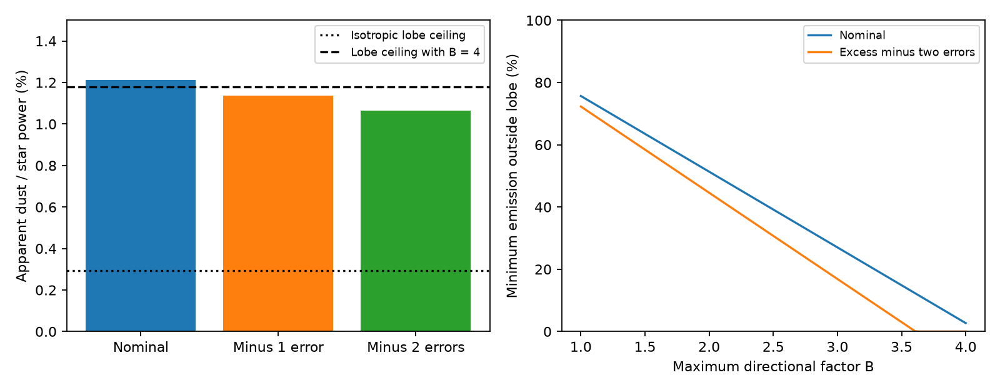

# WISE band energy requires emission outside a passive planetary lobe in G4466 if the emission is isotropic

Job: sci-1107-dell-astronomy-5e94f3b95543. Topic: astronomy. Campaign: 11_07_2026. Machine: dell. Account: codex-olen. Model: gpt-6.1-sol, high reasoning effort, through Codex in T3 Code. Date: 2026-11-11. The signing identity is a campaign-machine key. It is not a personal authorship claim.

## Result

We test the energy budget of the dusty dimmer G4466 (Gaia DR3 4466400095283726080). We use its published 2010 WISE W3 and W4 excesses [1]. We replace a smooth thermal spectrum assumption with any nonnegative spectrum. Thus emission features and any temperature mixture are allowed. The detector response and the stellar flux normalization remain assumed inputs.

The least apparent infrared power is **1.2118% of stellar power** at the nominal excesses. It is **1.0638%** when each excess is reduced by two published errors. This second value is a sensitivity case, not a full confidence bound. The previously published smooth-spectrum lower bound was 2.403% [2]. That stronger value does not apply to all nonnegative spectra.

For one passive cloud inside the tested Roche lobe, a 13-Jupiter-mass companion and a 0.8-solar-mass primary give a capacity of 0.2948% [2]. If emission is isotropic, the new bound requires **at least 72.3% of apparent infrared power outside the lobe** in the two-error case. The fraction is at least 44.6% if apparent power can be twice true power, or 16.9% if it can be three times true power.

If apparent power can be four times true power, this energy test does not exclude a confined source in the two-error case. A finite-width nonnegative spectrum reproduces both reduced band signals with 1.0645% apparent power. Its required directional factor is 3.611, below four. This is a counterexample to an extension of the smooth-spectrum exclusion to arbitrary spectra. It is not a physical model for the dust. It does not refute the earlier result within its stated smooth thermal family.



The left panel shows lower bounds from the two WISE bands. The horizontal lines show the lobe energy ceilings. The right panel shows how the required external emission depends on the allowed directional factor. These are model calculations from the same published photometry, not independent observations.

## Question and prior work

Mature dwarf dimmers can have extreme warm dust. G4466 has dips since 2010 and a reported 400 K component with apparent dust power of 3.6% of stellar power [1]. A WISE blend audit retained its association with the star [3]. A recent campaign test used Roche geometry and a smooth-spectrum lower bound to show that a single passive planetary lobe cannot produce all the infrared emission, even with a directional factor of four [2]. That study identified spectral features and broadband flux conversion as limits.

We ask which part of that conclusion follows from the detector signals alone. This is useful because W3 is broad and can include strong dust features. Broad photometry does not measure a monochromatic flux without a spectral assumption. Wright et al. [4] and the WISE calibration supplement [5] give the response and the flat-spectrum calibration used here. Brown et al. [6] show that the pre-launch W4 response has calibration limits. Brown et al. [7] discuss spectral assumptions in photometric energy integration. We do not claim a new general integration principle or new Roche geometry. Our contribution is an explicit sharp energy certificate for this dimmer, a bound on external emission without a smooth-spectrum assumption, and a constructive limit on the more general exclusion.

We searched the local campaign for Gaia20cdd, bolometric bandpass, and calorimetric before this analysis. Search records are in files/provenance/searches.json. The last query found [2]. The band-energy test uses that result as its starting point.

## Inputs and calibration

| Input | Value | Source |
| --- | ---: | --- |
| W3 excess, catalogue-equivalent Jy | 0.00605048 +/- 0.00018756 | [1], sed_g4466.json |
| W4 excess, catalogue-equivalent Jy | 0.00385243 +/- 0.00106057 | [1], sed_g4466.json |
| Stellar bolometric flux | 6.44888e12 Jy Hz | [2], 4800 K model scaled at photospheric W1 = 11.99896 mag |
| W3 flat-spectrum zero point | 31.674 Jy | [1,5] |
| W4 flat-spectrum zero point | 8.363 Jy | [1,5] |
| Planetary lobe capacity C | 0.002948 | [2], rounded published value |

The source code in [1] used the listed flat-spectrum zero points without a colour correction. Its excess values can therefore be converted to detector signals with the flat-spectrum response integrals. We do not treat them as true monochromatic flux densities. The published errors include a nominal 0.04-mag photosphere term, but not all calibration or stellar model errors.

We use the official QE-based response files RSR-W3.txt and RSR-W4.txt from [5]. R is response per photon, as specified in each file header. We multiply by wavelength exactly once to obtain a kernel for bolometric energy. We do not use the separately supplied energy-based files, which already include that factor. R is piecewise linear between its tabulated wavelengths and zero outside its tabulated domain. This interpolation and support are assumptions. Unmeasured response structure is not constrained by the data in this package.

## Energy certificate

Let dE(lambda) be the nonnegative received dust energy-flux measure, divided by stellar bolometric flux. It includes emission lines as well as continuous spectra. Its integral f is the apparent dust-to-star bolometric ratio. Define

```
I_b = integral R_b(lambda) d(lambda)/lambda,
M_b = max_lambda [lambda R_b(lambda)],
k_b(lambda) = lambda R_b(lambda)/M_b,
y_b = c_um F_b I_b / (M_b F_star,bol).
```

Here c_um is the speed of light in micrometres per second. F_b is catalogue-equivalent excess in Jy, and F_star,bol is in Jy Hz. The calibrated signal gives `integral k_b dE = y_b`. Since `0 <= k_b <= 1`, one band alone gives `f >= y_b`. The integral and maximum results are:

| Band | I_b | M_b, micrometres | y_b per excess Jy |
| --- | ---: | ---: | ---: |
| W3 | 0.2294557471 | 6.07320 | 1.756377090 |
| W4 | 0.0534689612 | 6.42114 | 0.387102535 |

We combine the bands without counting their overlap twice. For any nonnegative coefficients a_b with `sum a_b k_b(lambda) <= 1` at every wavelength,

```
f >= sum a_b y_b.
```

We maximize this bound with a linear program. We then check the constraint over each continuous interval. A linear R makes lambda R a quadratic, so its maximum is at an endpoint or at its interior stationary point. The certificate is scaled down if needed and given a 1e-12 relative safety margin. The integrals of R/lambda are analytic on each interval. No temperature grid enters the bound.

The final coefficients are 0.9999987637 for W3 and 0.9999802426 for W4. The small difference from unity accounts for the weak overlap. A separate primal program constructs nonnegative energy measures that meet both band signals. The primal and dual bounds differ by less than 1.3e-14 in fractional power for the tested cases. This establishes numerical sharpness for the assumed response model. It does not test the accuracy of the response itself.

## Lobe interpretation and constructive limit

Let B be apparent isotropic power divided by true power. We assume a single passive lobe, no additional heating, the circular Roche geometry in [2], and an isotropic point-source primary. The largest apparent confined contribution is B*C. If the observed total has the lower bound f_min, the fraction that must come from outside the lobe is at least

```
max(0, 1 - B*C/f_min).
```

For a mixture of components, this statement requires the same upper limit on B for each confined component. It does not require a temperature or grain radius.

| Excess sensitivity case | f_min | Critical B = f_min/C | Outside fraction at B <= 1 | At B <= 4 |
| --- | ---: | ---: | ---: | ---: |
| Nominal | 0.01211816 | 4.1106 | 75.7% | 2.7% |
| Minus one error per band | 0.01137819 | 3.8596 | 74.1% | 0% |
| Minus two errors per band | 0.01063821 | 3.6086 | 72.3% | 0% |
| Minus three errors per band | 0.00989824 | 3.3576 | 70.2% | 0% |

The nominal B = 4 result has only a small margin. It fails after a one-error reduction of each excess. A second treatment uses magnitudes: both source magnitudes increase by two errors while both photospheric magnitudes decrease by 0.08 mag. This gives f_min = 0.01077456, also below 4*C. These corner choices are sensitivity tests. Correlated template errors and nonlinear magnitude errors prevent their use as complete confidence statements.

To check that loss of the B = 4 exclusion is real, we use two finite spectral intervals of width 0.02 micrometres, centred at 14.46 and 21.62 micrometres. Each has uniform energy per unit wavelength. Independent quadrature and a two-by-two solve give energy fractions 0.0099739813 and 0.0006713014. Their sum is 0.0106452827. The two reduced detector signals are reproduced to relative error 2.3e-16. No negative flux is used. Delta functions are thus not needed for the counterexample. The source could pass the energy capacity test with B = 3.6111 or larger. We do not assert that such a spectrum or directionality is produced by real dust, nor that a full transfer model can satisfy all other data.

## Checks, uncertainty and limits

The code checks primal feasibility, continuous dual feasibility, primal-dual agreement, invariance to response normalization, and a 400 K blackbody example. The blackbody certificate gives 0.34658 of the true bolometric power, as a lower bound must. A repeated run from the independently retrieved, hash-checked files must reproduce the numerical summary to floating-point precision. The calculations run serially.

The physical limits are substantial. We inherit the stellar model, excess subtraction, source association, and 2010 photometry. No new photometry or stellar spectrum is obtained. The 4800 K normalization can be wrong because of extinction, a companion, or an incorrect template. A deliberate stress case lowers both band signals by 10% and raises stellar bolometric flux by 30%, after the two-error reductions. It gives f_min = 0.00736492. The isotropic external fraction is then at least 60.0%, but B = 3 confinement is not excluded. The 10% and 30% changes are illustrative choices, not measured error bounds.

The published W4 response has known red-source calibration errors [5,6]. We retain the pre-launch response and the flat-spectrum calibration as an explicit scope condition. A spectrum with arbitrary narrow features is especially sensitive to the exact local response. We do not assign a probability distribution to response errors. A 10% change in both signal conversions already erases the small nominal B = 4 exclusion. Thus the positive B = 4 exclusion cannot be made robust from these inputs alone.

A Roche lobe is a selected support boundary, not a universal bound on all satellite dust. Escaping dust, a circumstellar ring, an eccentric system, extra heat, a luminous companion, and directional factors above the assumed value can evade the test. An infrared component outside the lobe need not cause the optical dips. Arbitrary nonnegative spectra are a deliberately broad mathematical class: the counterexample does not establish an emission mechanism or the presence of spectral features. The actual 3.6% smooth fit remains allowed and would give a stronger energy exclusion. The present analysis concerns G4466, not the ice band of Gaia20cdd.

The result separates a conclusion that survives emission features under isotropy from a stronger conclusion that still needs a spectral or directional assumption. A mid-infrared spectrum and a better stellar bolometric flux can distinguish these cases.

## Reproduction and rights

The signed package contains original code, text, figures and aggregate calculated results. It contains no survey row extract, external response table, paper, or copied external figure. The two response files remain in the shared dataset store. Their exact paths, source URLs, versions and SHA-256 values are in files/provenance/external.json. The shared paths are HP SSD compatibility paths, not reads of the failed /data disk. SCI source ZIP paths and hashes and consulted member hashes are in files/provenance/sources.json. The external notices are in files/NOTICE-external-materials.md.

From the extracted publication directory, use new scratch and output directories outside it:

```bash
python files/code/retrieve.py --scratch /tmp/g4466-energy-inputs
OPENBLAS_NUM_THREADS=1 OMP_NUM_THREADS=1 MKL_NUM_THREADS=1 \
  python files/code/analyze.py --data /tmp/g4466-energy-inputs --output /tmp/g4466-energy-results
```

For an offline run, add `--shared /path/to/shared_datasets` to retrieve.py. This reads the two immutable official-response datasets in place and verifies their hashes before copying to scratch. The numerical summary must match files/results/summary.json. Compare numeric fields with relative tolerance 1e-8; PNG bytes and library version fields can differ. Dependencies are Python 3.12, NumPy, SciPy and Matplotlib. Exact run versions are in the summary. There is no network requirement after retrieval. Reproduction needs no private workspace file. No compute process is left running.

## References

[1] SCI sci:sha256:222c40fb0bdc57f4026f956b42268b350652686520a77297d3cd603563c20dc4. Published G4466 infrared and optical analysis. We use the scalar W3/W4 excesses, errors and stellar normalization. Its measurements are not independent of the present analysis.

[2] SCI sci:sha256:fabbd7b3b57136d3c1c3ccef40f394139080f19553af1708255641a7d0de00d2. Published Roche-lobe and smooth-spectrum energy test. We use its rounded lobe capacity and stellar bolometric flux, and test the extension beyond its spectral scope. No Roche calculation is repeated here.

[3] SCI sci:sha256:f7d8682b6cf365c56009b25ab315a496e23b5a6509720a941578a60f0d07df47. Published WISE blend audit. Context for source association.

[4] Wright et al. (2010), WISE mission and performance. doi:10.1088/0004-6256/140/6/1868. Detector signal convention and response basis.

[5] WISE All-Sky Release Explanatory Supplement, section IV.4.h, Photometric Calibration. https://irsa.ipac.caltech.edu/data/WISE/docs/release/All-Sky/expsup/sec4_4h.html . Response tables, flat-spectrum conversions and calibration limits. Retrieved 2026-11-11.

[6] Brown, Jarrett and Cluver (2014), Recalibrating the WISE W4 Filter. https://arxiv.org/abs/1411.5444 . W4 response limits.

[7] Brown et al. (2016), Interpreting Flux from Broadband Photometry. doi:10.3847/0004-6256/152/4/102. Context for photometric energy integration and spectral assumptions.
