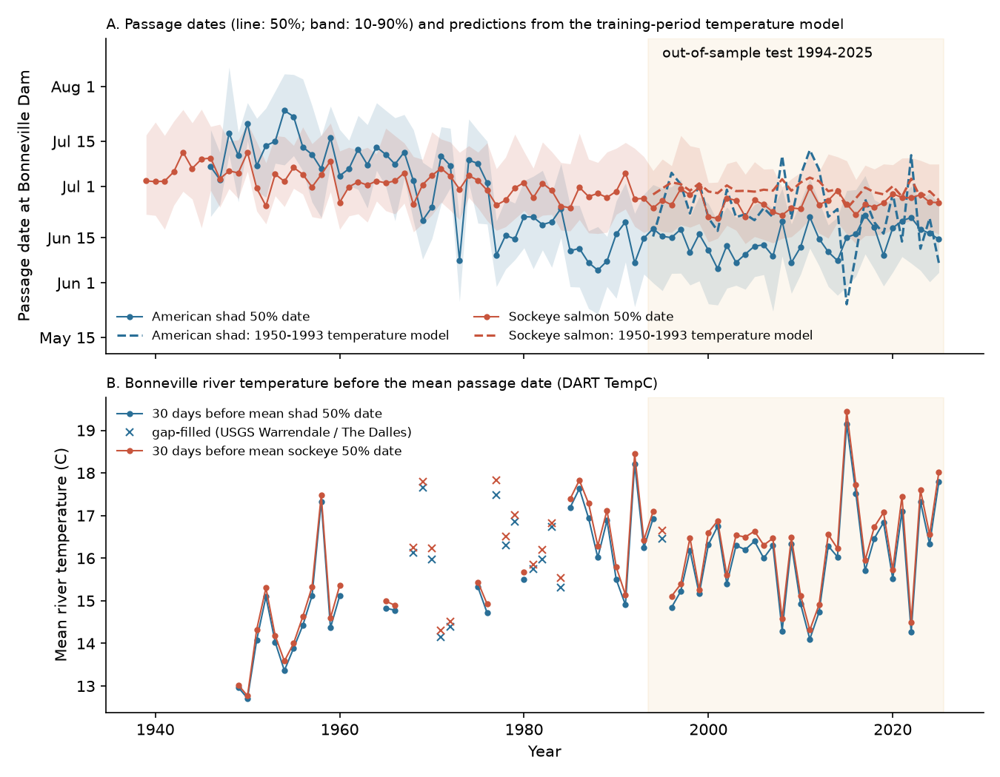
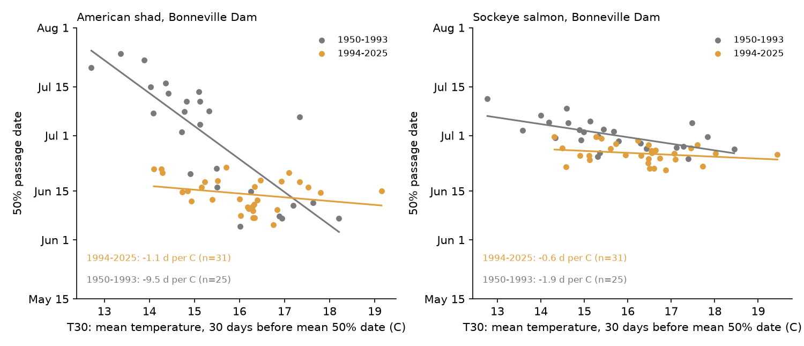
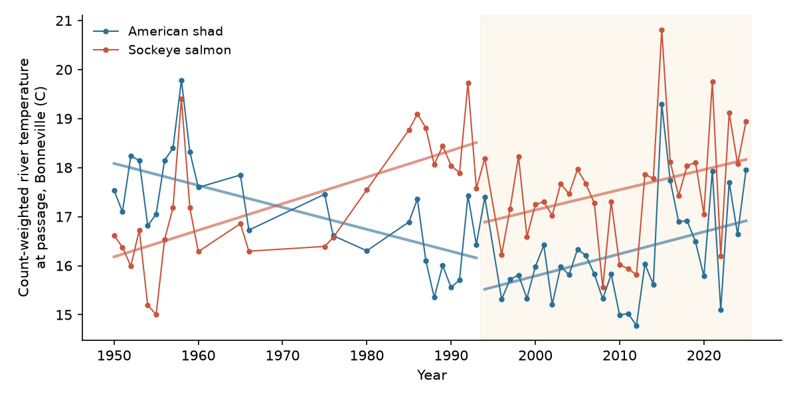

# Shad passage at Columbia River dams stopped advancing after about 1988 while river temperature increased; the 1950-1993 temperature slopes did not hold in 1994-2025

## Summary

Quinn and Adams (1996) used Bonneville Dam counts from 1938 to 1993. They reported three results:

- C1. American shad (*Alosa sapidissima*) passed the dam much earlier over time. Shad timing followed spring river temperature.
- C2. Sockeye salmon (*Oncorhynchus nerka*) passed about 6 days earlier. Sockeye timing followed temperature less than shad timing.
- C3. Shad passed in progressively cooler water. Sockeye passed in progressively warmer water.

We tested these results out of sample. We used daily fish counts and dam temperatures from Columbia River DART for 1939-2025. We fitted models on 1950-1993 and tested them on 1994-2025. We repeated the tests with separate counts and temperature sensors at The Dalles, McNary and Rock Island dams.

Main results:

1. **The shad advance stopped.** At Bonneville, the shad 50% passage date moved earlier by 9.6 days per decade in 1950-1993 (95% CI 8.1 to 11.1). In 1994-2025 the trend was +1.5 days per decade (95% CI -0.3 to +3.4). McNary Dam showed the same change (-9.6 to -0.4 days per decade). An exploratory two-segment fit put the change near 1988 at Bonneville (95% bootstrap interval 1982-1994), McNary (1987; 1980-1995) and The Dalles (1988; 1977-1997).
2. **River temperature continued to increase.** The mean Bonneville temperature in the 30 days before the mean shad passage date (T30) increased by 0.62 C per decade in 1950-1993. It increased by 0.30 C per decade in 1994-2025 (95% CI 0.02 to 0.59).
3. **The shad temperature slope did not hold.** In 1950-1993 the shad passage date changed by -9.5 days per C of T30 (95% CI -11.9 to -7.1). In 1994-2025 the slope was -1.1 days per C (95% CI -2.3 to +0.1). The difference was +8.4 days per C (95% CI 5.7 to 11.1). McNary gave the same result (-6.8 to -2.3 days per C; difference +4.4, 95% CI 2.2 to 6.6). The Dalles had a smaller, uncertain difference (+1.1, 95% CI -1.5 to +3.8; test years 1994-2010 only).
4. **C3 reversed for shad.** The count-weighted temperature at shad passage decreased by 0.45 C per decade in 1950-1993 (95% CI 0.24 to 0.66). It increased by 0.45 C per decade in 1994-2025 (95% CI 0.14 to 0.76). Now shad and sockeye both pass in warmer water (sockeye +0.54 and +0.41 C per decade).
5. **Sockeye also stopped advancing at the two lower dams.** The sockeye 50% date at Bonneville moved earlier by 1.4 days per decade in 1950-1993 (95% CI 0.7 to 2.1). It did not change in 1994-2025 (+0.3, 95% CI -0.7 to +1.3). At Rock Island Dam (upper Columbia sockeye) the date continued to move earlier (-1.4 days per decade, 95% CI -2.7 to -0.1).
6. **Discharge, not temperature, gave a repeated year-to-year signal.** In models with T30, discharge and year, higher discharge gave later passage in both periods. For shad the slope was 9.4 and 5.2 days per doubling of discharge; for sockeye it was 5.9 and 4.5 days per doubling. The temperature term was -2.8 days per C in 1950-1993 and +0.4 days per C (95% CI -1.5 to +2.3) in 1994-2025 for shad.

The 1950-1993 temperature model predicted 1994-2025 shad dates better than the training mean (skill 0.18, 95% CI 0.03 to 0.32). But it predicted dates 9 days too late on average. This level error depends on an offset in the old temperature record (see Limitations). The trend slopes and within-period temperature slopes do not depend on that offset.

Interpretation: the 1950-1993 link between shad timing and temperature was mostly a shared long-term trend. Since about 1988, temperature continued to increase but shad timing did not continue to move earlier. Year-to-year temperature explained at most 7% of the variance of shad timing at Bonneville in 1994-2025. The end of the shad advance occurred at the same time as the end of the large increase in shad numbers (from about 8,000 in 1950 to about 3 million in 1990). The data cannot separate these two causes.



## Data

| Source | Use | Version / access |
| --- | --- | --- |
| Columbia River DART, Columbia Basin Research, University of Washington. Adult Passage Daily Counts. https://www.cbr.washington.edu/dart/query/adult_daily | Daily counts of shad (`Shad`) and sockeye (`Sock`) and the dam temperature `TempC` at Bonneville (BON, 1939-2025), The Dalles (TDA, 1960-2025), McNary (MCN, 1956-2025) and Rock Island (RIS, 1977-2025) | Downloaded 2026-11-08 as one CSV per dam and year (URL pattern in `files/code/01_fetch_dart.sh`). |
| USGS NWIS daily values, site 14105700 Columbia River at The Dalles, OR | Daily mean discharge (00060, 1930-2025) and water temperature (00010, 1996-2025) | Downloaded 2026-11-08, https://waterservices.usgs.gov/nwis/dv/ |
| USGS NWIS daily values, site 14128910 Columbia River at Warrendale, OR | Daily max and min water temperature 1967-1992, for a check of the DART record and for gap filling | Downloaded 2026-11-08 |

All raw files are in `files/data/raw_dart_usgs.tar.gz` (SHA-256 of each raw file in `files/data/raw_sha256.txt`). We did not put these files in the shared campaign dataset store, because the data has 279 small files and the archive in this bundle is 2 MB.

## Methods

The analysis plan is in `files/code/PREREGISTRATION.md`. We wrote it before we computed any 1994-2025 timing value. Analyses that are not in the plan are marked "exploratory".

**Timing.** For each dam, species and year, we summed the daily counts from April 1 to September 30. We interpolated the day of year (Feb 29 removed) at 10%, 50% and 90% of the cumulative count. A year entered if the total count was at least 500 and count records existed on at least 90% of days in the long-term 2.5%-97.5% passage range. All years in 1950-2025 met the coverage rule, so the 80% and 95% coverage alternatives gave identical results.

**Predictors.** T30 is the mean `TempC` of the dam in the 30 days that end on the training mean 50% date of the species (at least 20 valid days). Q30 is the mean natural log of The Dalles discharge in the same days. Dthr is the first day on which the 7-day mean temperature reached 15 C (shad) or 13 C (sockeye). logN is the log of the total count. We removed `TempC` values outside 0-30 C (431 days at Rock Island, including -17.7 C values in 2008-2009, and 35 days at The Dalles).

**Out-of-sample test.** We fitted seven linear models on 1950-1993: M0 mean, M1 year trend, M2 T30, M3 T30+Q30, M4 T30+Q30+logN, M5 Dthr, M6 T30+year. We predicted 1994-2025. Skill is 1 - RMSE(model)/RMSE(M0), with M0 fitted on the same years. 95% intervals come from 4,000 moving-block bootstrap samples of the test years (block length 4).

**Slopes.** We fitted ordinary least squares with HAC standard errors (Newey-West, 3 lags) in each period. An interaction model (T30 x post-1993) tested the change in the temperature slope.

**Experienced temperature.** For each year we computed the count-weighted mean `TempC` on the passage days (years with at least 80% of the count on days with a temperature value).

**Exploratory break analysis.** We fitted a continuous two-segment line of the 50% date on year with the break at each year from 1960 to 2015. The interval comes from 2,000 moving-block bootstrap samples of the residuals.

## Results

### Timing trends (all usable years, days per decade, HAC 95% CI)

| Dam, species | 1950-1993 | 1994-2025 | Exploratory break year (95% interval) |
| --- | --- | --- | --- |
| Bonneville, shad | -9.6 (-11.1, -8.1), n=44 | +1.5 (-0.3, +3.4), n=32 | 1988 (1982-1994) |
| The Dalles, shad | -10.0 (-12.0, -7.9), n=34 | -2.1 (-5.1, +0.9), n=17 (to 2010) | 1988 (1977-1997) |
| McNary, shad | -9.6 (-11.3, -7.9), n=35 | -0.4 (-2.1, +1.4), n=32 | 1987 (1980-1995) |
| Bonneville, sockeye | -1.4 (-2.1, -0.7), n=44 | +0.3 (-0.7, +1.3), n=32 | 2008 (1970-2015), no clear break |
| McNary, sockeye | -2.6 (-3.2, -1.9), n=38 | -0.2 (-1.3, +0.9), n=32 | 2004 (1980-2015), no clear break |
| Rock Island, sockeye | -0.8 (-3.7, +2.0), n=17 (from 1977) | -1.4 (-2.7, -0.1), n=32 | no clear break |

The 10% and 90% dates gave the same pattern (`files/results/timing_trends_all_years.csv`).

### Temperature slopes of the 50% date (days per C of T30, HAC 95% CI)

| Dam, species | 1950-1993 | 1994-2025 | Change |
| --- | --- | --- | --- |
| Bonneville, shad | -9.5 (-11.9, -7.1), n=25 | -1.1 (-2.3, +0.1), n=31 | +8.4 (5.7, 11.1) |
| Bonneville gap-filled T, shad | -9.1 (-10.9, -7.2), n=37 | -1.1 (-2.3, +0.1), n=32 | +8.0 (5.8, 10.2) |
| McNary, shad | -6.8 (-8.8, -4.7), n=20 | -2.3 (-3.2, -1.5), n=21 | +4.4 (2.2, 6.6) |
| The Dalles, shad | -4.8 (-6.3, -3.4), n=10 | -3.7 (-6.3, -1.1), n=17 | +1.1 (-1.5, +3.8) |
| Bonneville, sockeye | -1.9 (-2.5, -1.3), n=25 | -0.6 (-1.3, +0.2), n=31 | +1.3 (0.4, 2.3) |
| McNary, sockeye | -2.3 (-3.0, -1.6), n=21 | -0.9 (-1.6, -0.1), n=21 | +1.4 (0.5, 2.4) |
| Rock Island, sockeye | -2.5 (-4.2, -0.7), n=13 | -2.7 (-3.7, -1.7), n=30 | -0.3 (-2.3, +1.8) |



### Out-of-sample prediction of the 1994-2025 50% date (Bonneville)

| Species | Model | RMSE (d) | Mean error obs - pred (d) | Skill vs mean (95% CI) | Skill vs trend (95% CI) |
| --- | --- | --- | --- | --- | --- |
| Shad | M0 mean | 15.6 | -14.9 | 0 | +0.36 (0.01, 0.55) |
| Shad | M1 trend | 24.2 | +21.5 | -0.56 (-1.16, 0.02) | 0 |
| Shad | M2 T30 | 13.7 | -9.2 | +0.18 (0.03, 0.32) | +0.42 (0.12, 0.60) |
| Shad | M3 T30+Q30 | 13.3 | -6.6 | +0.20 (0.02, 0.38) | +0.43 (0.15, 0.60) |
| Shad | M4 T30+Q30+logN | 9.4 | -2.9 | +0.43 (0.29, 0.57) | +0.60 (0.41, 0.71) |
| Sockeye | M1 trend | 3.0 | +0.1 | +0.48 (0.35, 0.58) | 0 |
| Sockeye | M2 T30 | 5.0 | -4.1 | +0.17 (0.06, 0.29) | -0.65 (-1.03, -0.34) |
| Sockeye | M4 T30+Q30+logN | 4.6 | -3.5 | +0.24 (0.13, 0.36) | -0.51 (-0.90, -0.18) |

For shad, the extrapolated 1950-1993 trend gave the worst predictions; it predicted dates 21.5 days too early on average. The temperature models gave a part of the observed level change but predicted dates that were too late. The run-size model M4 gave the best shad predictions. In 1950-1993 the log count and the year are almost collinear, so M4 mostly encodes that the run size and the timing both stopped changing. In 1994-2025 the log count had no correlation with the shad 50% date (r = 0.04). For sockeye, the trend model was best, because the 1994-2025 dates stayed near the 1993 end of the trend line. All dams and models are in `files/results/oos_skill_cov90.csv` and in the figure below.


### Temperature at passage

| Species (Bonneville) | 1950-1993, C per decade | 1994-2025, C per decade |
| --- | --- | --- |
| Shad | -0.45 (-0.66, -0.24), n=25 | +0.45 (+0.14, +0.76), n=31 |
| Sockeye | +0.54 (+0.34, +0.74), n=25 | +0.41 (+0.16, +0.66), n=31 |

McNary gave the same shad reversal (-0.77 to +0.76 C per decade).



## Checks for observation bias

- **Count coverage.** DART supplies rows only for counted days. Counts covered every day of the core passage range in every year from 1950 (`coverage` column in `files/data/annual.csv`). DART notes state that visual counts run 16 hours per day from April to October at the U.S. Army Corps of Engineers dams. We found no documented change of this method in the shad and sockeye season, but we could not check every year.
- **Temperature record.** DART Bonneville `TempC` is missing in 1961-1964, 1967-1974 and 1981-1984. We repeated all Bonneville analyses with a gap-filled series (USGS Warrendale, then DART The Dalles, each calibrated by OLS; RMSE 0.52 and 0.58 C; `files/data/bon_temperature_fill_calibration.csv`). The results did not change materially (tables above, "BONf" rows in result files).
- **Sensor offset.** In May-July 1976-1992, DART Bonneville was 0.04-0.77 C warmer than USGS Warrendale (mean about 0.55 C). In 1998-2025, it agreed with USGS The Dalles within 0.15 C (`files/figures/fig5_temperature_homogeneity.png`). If the old DART values are 0.55 C too warm, the M2 shad level error changes from -9.2 to -3.9 days and the skill changes from 0.18 to 0.34 (`files/results/m2_offset_sensitivity.csv`). This offset does not change the within-period slopes or the timing trends.
- **Run size.** We added log count as a predictor (M4) and report its collinearity with time.
- **Distribution shape.** The 10% and 90% dates gave the same trend change as the 50% date.

## Limitations

- All dams are on one river system. The upstream dams count many of the same fish, so they are not independent populations. They give separate counts and separate temperature sensors.
- We did not model harvest, hatchery releases, changes in stock composition (for example the large increase of sockeye counts after 2008), dam operations, or ocean conditions.
- The shad population increased by more than 100 times in 1950-1990. The end of the timing advance and the end of the population increase occurred at the same time. We cannot separate the causes.
- The DART temperature is scroll-case or water-quality temperature at each dam; the sensor type and location are not documented per year.
- The break year analysis is exploratory and was not in the plan.
- The Dalles shad counts after 2010 did not meet the rules (few usable years), and Rock Island has only 1977-1993 for training.

## Reproduction

```
bash files/code/run_all.sh ./work     # downloads raw data, or unpack files/data/raw_dart_usgs.tar.gz into ./work/raw first
```

Python 3.12 with numpy, pandas, statsmodels and matplotlib. Scripts: `01_fetch_dart.sh` (download), `02_build_tables.py`, `03_annual_metrics.py`, `04_models.py` (out-of-sample and slopes; argument = coverage rule), `05_figures.py`, `06_breakpoint.py` (exploratory), `07_offset_sensitivity.py`, `08_timing_trends.py`. Derived tables: `files/data/daily.csv.gz`, `files/data/annual.csv`. All result tables: `files/results/`; the console output of the full run is `files/results/run_all_log.txt`. We ran `run_all.sh` from the bundled raw archive and it produced the bundled tables and figures.

SHA-256 of derived data files:

```
25b26ac62d8fc695535523c510f5efc8ebd09d2872af633dff00a015207aea2b  files/data/daily.csv.gz
019ddd02448f02fd9e752361f270b1855104b0418e6d03e25b6554c0ac768c72  files/data/annual.csv
0cd476510f8569209750331da8e7f245b964d4cf8557627c1ca58974b3789cf3  files/data/raw_dart_usgs.tar.gz
```

## Provenance

- Campaign 11_07_2026, job sci-1107-dell-climate-pollution-biodiversity-489c6934e255, topic climate-pollution-biodiversity, machine dell, account claude-andrii.
- Analysis and text by the AI model Claude Opus 5.5 (claude-opus-5-5) working as an automated research worker. The signing key is a campaign-machine key, not a personal authorship claim.
- Data downloaded on 2026-11-08 from the sources above. The DART data citation: Columbia River DART, Columbia Basin Research, University of Washington (2026). Adult Passage Daily Counts.

## References

- Quinn, T. P. and Adams, D. J. (1996). Environmental changes affecting the migratory timing of American shad and sockeye salmon. Ecology 77, 1151-1162. doi:10.2307/2265584
- Crozier, L. G., Scheuerell, M. D. and Zabel, R. W. (2011). Using time series analysis to characterize evolutionary and plastic responses to environmental change: a case study of a shift toward earlier migration date in sockeye salmon. American Naturalist 178, 755-773. doi:10.1086/662669
