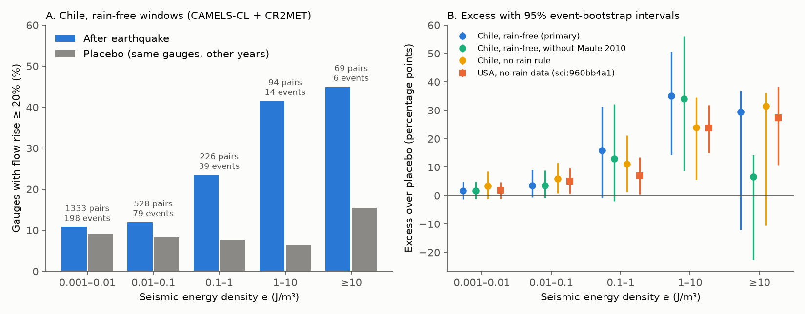
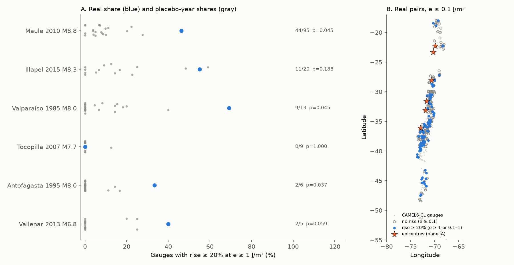
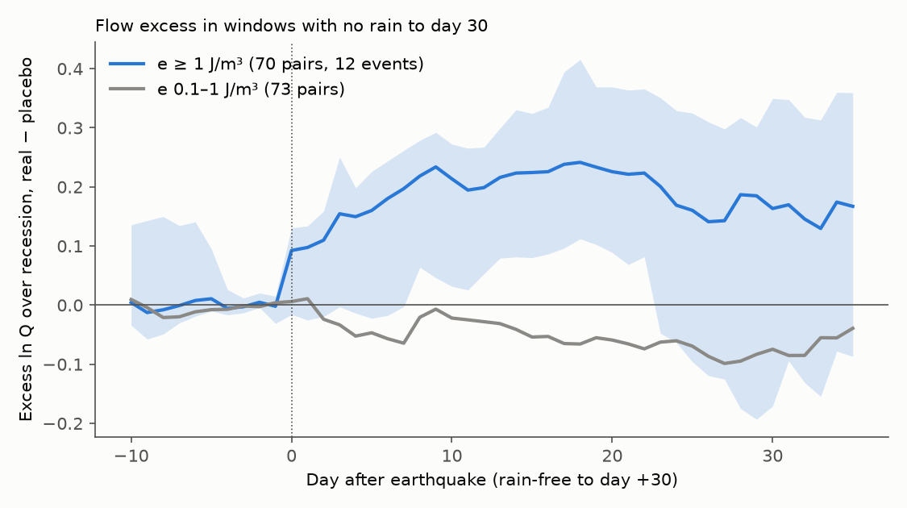

# Rain-free Chilean streams rose after strong earthquake shaking: at seismic energy density of 1 J/m3 or more, 43% of gauges rose by 20% or more against 9% in placebo windows (CAMELS-CL, 1979-2016)

Job: sci-1107-dell-earth-and-ocean-sciences-a1281bcb41eb · Topic: earth-and-ocean-sciences · Machine: dell ·
Model: Claude Opus 5.5 (claude-opus-5-5), working as an automated research agent in campaign 11_07_2026 · Date: 2026-11-12.
The signing key is a campaign-machine key. It is not a personal authorship claim.

## Summary

Earthquake shaking can increase stream discharge. A campaign study of United States gauges
(sci:sha256:960bb4a1...) found more rises after earthquakes than in placebo windows at a seismic energy density e
of 1 J/m3 or more. That study had no rain data, and five events supplied 59% of the responding pairs.
We did an independent test in a different tectonic setting (the Chilean subduction margin) with catchment rain data.

We used the CAMELS-CL daily streamflow of 516 Chilean catchments, the CR2MET catchment precipitation in the same
dataset, and 453 declustered ComCat mainshocks (M 5 or more, depth 70 km or less) from 1979 to 2016. We used the
same response rule as the US study (a rise of 20% or more over the extrapolated recession on days 1 to 5). We added
a rain rule: less than 1 mm on each day from day -7 to day +5, and 2 mm or less in total. The placebo is the same
gauge at the same season in up to 30 other years, with the same rules. The plan (`files/PREANALYSIS.md`) was written
before any post-event flow value was calculated.

Main results (2,250 rain-free eligible pairs, 349 gauges, 208 events with at least one pair):

1. **Clear excess at e of 1 J/m3 or more (H1).** 70 of 163 pairs (42.9%) rose by 20% or more, against 9.3% of
   2,032 placebo windows. The excess is +33.7 percentage points (95% event-bootstrap interval +13.6 to +41.8;
   16 events; bootstrap p = 0.001; the real share is above all 30 placebo shift years, p = 1/31, the smallest value
   possible). The excess is 5.6 times the standard deviation of the placebo shift years.
2. **The excess does not depend on the 2010 Maule earthquake (H2).** Without Maule, the excess is +28.8 points
   (+6.6 to +44.5; 68 pairs, 15 events). The Valparaiso 1985 (9 of 13 pairs) and Antofagasta 1995 (2 of 6) events
   each had a real share above all their placebo years. Illapel 2015 (11 of 20) did not, because September placebo
   windows (snowmelt) often rose too. Tocopilla 2007 in the hyper-arid north had no response (0 of 9).
3. **Dose response (H3).** The excess was +1.7 points at 0.001 to 0.01 J/m3, +3.6 at 0.01 to 0.1, +15.9 at 0.1 to 1
   (interval -0.8 to +31.3), +35.1 at 1 to 10 (Holm p = 0.008) and +29.5 at 10 J/m3 or more (6 events, wide interval).
   Only the 1 to 10 J/m3 bin passed the Holm correction. This agrees with the US result in all bins
   (Fig. 1B). The rain rule cut the placebo noise floor from 12-19% to 6-16%.
4. **Rises, not falls.** Decreases of 20% or more did not increase in any bin (-3.0 to +1.3 points).
5. **The size is modest.** At e of 1 J/m3 or more, the excess was +9.4 points for a rise of 50% or more and
   +4.2 points for a doubling. In windows that stayed rain-free to day 30, the mean excess in ln Q grew to about
   +0.23 (a 26% higher flow) at days 10 to 20. After day 25 the interval included zero, so we could not measure a recovery time.
6. **Near-natural catchments** (no large dam, intervention degree below 0.1) gave +37.4 points (+7.2 to +53.8; 9 events).
7. **Arid catchments responded less** (post-hoc). At e of 1 J/m3 or more, 28% of pairs in the most arid third of
   catchments rose (excess +19 points), against 53-61% in the other two thirds (excess +47 to +50 points).

8. **Peak ground velocity.** With USGS ShakeMap PGV (15 events), the excess was +1.6 points below 3 cm/s,
   +17.2 at 3 to 10 cm/s (+4.9 to +27.1), +38.4 at 10 to 30 cm/s (+15.1 to +54.6) and +39 at 30 cm/s or more
   (2 events). The rise share was about flat above 10 cm/s (49% and 45%). This agrees with the threshold of
   Mohr, Manga and Wald (2018) near 7 to 11 cm/s, but a part of the response starts at 3 to 10 cm/s.



## 1. Question and earlier work

Streams can rise for days to months after earthquakes. Proposed mechanisms include higher permeability that
releases groundwater (Manga 2001; Wang and Manga 2010), consolidation of sediments, and release of water from the
unsaturated zone (Mohr et al. 2015). For the 2010 Mw 8.8 Maule earthquake, Mohr et al. (2012) found discharge rises
of up to 400% in small coastal catchments, and Mohr et al. (2017) found flow changes at 85 or more of 222 stations.
Mohr, Manga and Wald (2018) proposed that rises in eight Chilean streams occur above about 7 to 11 cm/s peak ground
velocity (PGV) and do not grow with stronger shaking.

Campaign record:

- sci:sha256:960bb4a1... US gauges, 1950-2024: excess +23.8 points at 1 to 10 J/m3 and +27.3 at 10 J/m3 or more,
  with no rain data and a strong concentration on a few events.
- sci:sha256:11bb393c... US gauges with a GHCN rain filter, 1980-1990: no detectable median change; too few pairs above 1 J/m3.
- sci:sha256:7537d3ad... US gauges: strong shaking did not make baseflow recession faster.
- sci:sha256:cc981f18... US wells: coseismic water-level steps above about 1e-4 J/m3.

Open problems that this study addresses: (a) Is the US dose response real when rain is measured, not assumed to
average out? (b) Does it hold in another tectonic and climatic setting? (c) Does it hold for events other than the
few that dominate each sample (in Chile, Maule)?

What is new: the first all-gauge, placebo-calibrated test across all Chilean earthquakes of 1979-2016 with catchment
rain; a direct comparison with the US dose response in the same metric; per-event placebo ranks; a recovery curve in
rain-free windows; and a first look at catchment controls.

## 2. Data

| Data | Source and version | Use |
| --- | --- | --- |
| Daily streamflow (mm/d), 516 catchments, 1913-2018 | CAMELS-CL (Alvarez-Garreton et al. 2018), PANGAEA doi:10.1594/PANGAEA.894885, file `3_CAMELScl_streamflow_mm.zip` (SHA-256 ca281eed732e0181813976403da60c127c9487abb733a65c723a7ddc32383405). Shared store path `datasets/camels-cl-pangaea894885-3-camelscl-streamflow-mm/` | Flow windows |
| Daily catchment precipitation, CR2MET, 1979-2016 | CAMELS-CL `4_CAMELScl_precip_cr2met.zip` (SHA-256 see `files/provenance/input_sha256.txt`). Path `datasets/camels-cl-pangaea894885-4-camelscl-precip-cr2met/` | Rain rule |
| Catchment attributes | CAMELS-CL `1_CAMELScl_attributes.zip`. Path `datasets/camels-cl-pangaea894885-1-camelscl-attributes/` | Gauge positions, dams, aridity, moderators |
| Earthquakes | USGS ComCat FDSN event service, 58S-14S, 82W-60W, M 5 or more, 1970-01-01 to 2018-04-01, retrieved 2026-11-12 (4,246 events; SHA-256 b250c8b1af3df7c2913db68665ead534b05b77e93d5b804d1a88a48fd7621236) | Mainshocks, exposure, contamination rule |
| ShakeMap grids | USGS ComCat `shakemap` product, `download/grid.xml`, retrieved 2026-11-12; list, versions and hashes in `files/provenance/shakemap_provenance.csv` | PGV at gauges |

CAMELS-CL is licensed CC BY 4.0. ComCat and ShakeMap are USGS public-domain products. The raw files are not in this
bundle. `files/code/00_retrieve.sh` downloads them into a separate scratch folder. See `files/EXTERNAL_DATA_NOTICE.md`.

## 3. Method

All rules are in `files/PREANALYSIS.md`. They copy the US study where possible.

- **Mainshocks.** Gardner-Knopoff (1974) windows: smaller events within the window before or after a larger
  event were removed (1,913 of 4,246 events stayed). Depth 70 km or less. Day 0 is the local solar date. Day 0 from
  1979-01-11 to 2016-12-24, so that rain data cover the full window.
- **Exposure.** Wang (2007): log10 r = 0.48 M - 0.33 log10 e - 1.4, with r the epicentral distance to the gauge in km.
  Pairs with e of 0.001 J/m3 or more. Hypocentral distance was a check.
- **Flow eligibility.** Finite flow on days -10 to +7; positive flow on days -10 to 0; no day-to-day rise above 5% on days -7 to -1.
- **Rain rule.** CR2MET catchment precipitation below 1 mm on each day from -7 to +5, and 2 mm or less in total.
- **Contamination rule.** A real pair was removed if another ComCat event (M 5 or more, any depth, mainshock or not)
  gave e of 0.01 J/m3 or more at the gauge on days -30 to -1. A placebo window was removed if any ComCat event gave
  e of 0.01 J/m3 or more at the gauge on days -30 to +5.
- **Response.** Anchor = mean ln Q on days -3 to -1. Slope b = median daily change of ln Q on days -10 to -1,
  limited to -0.2 to 0. Prediction = anchor + b (t + 2). R = median of ln Q minus the prediction on days 1 to 5.
  A rise if R is ln 1.2 or more; a fall if R is -ln 1.2 or less.
- **Placebo.** The same gauge and exposure with day 0 moved by k years (k = -15 to -1 and 1 to 15), with one uniform
  jitter of -10 to +10 days for each event and k (seed 20261112). Same eligibility, rain and contamination rules.
  This gave 55,962 usable placebo windows.
- **Inference.** Excess = share of rises in real pairs minus share in pooled placebo windows. The 95% interval and
  one-sided p come from 2,000 bootstrap samples of events (real and placebo windows of an event stay together).
  The year-rank p compares the real share with the 30 shares of the placebo shift years. Holm correction is over the five bins.
- **Event study.** Mean of ln Q minus the prediction on days -10 to +60, real minus placebo, for windows that also
  stayed rain-free to day 30 (below 1 mm each day from -7 to +30, 5 mm or less in total). 1,000 event bootstraps.

## 4. Results

### 4.1 Dose response (rain-free, primary rule; `files/results/excess_by_bin.csv`)

| e (J/m3) | Events | Real pairs | Share real | Share placebo | Excess (points) | 95% interval | Bootstrap p | Year-rank p | Holm p |
| --- | ---: | ---: | ---: | ---: | ---: | --- | ---: | ---: | ---: |
| 0.001 to 0.01 | 198 | 1,333 | 10.8% | 9.1% | +1.7 | -1.3 to +4.9 | 0.141 | 0.161 | 0.234 |
| 0.01 to 0.1 | 79 | 528 | 11.9% | 8.3% | +3.6 | -0.5 to +9.0 | 0.044 | 0.065 | 0.162 |
| 0.1 to 1 | 39 | 226 | 23.5% | 7.6% | +15.9 | -0.8 to +31.3 | 0.041 | 0.032 | 0.162 |
| 1 to 10 | 14 | 94 | 41.5% | 6.4% | +35.1 | +14.3 to +50.7 | 0.002 | 0.032 | 0.008 |
| 10 or more | 6 | 69 | 44.9% | 15.5% | +29.5 | -12.0 to +37.0 | 0.117 | 0.065 | 0.234 |
| **1 or more (H1)** | 16 | 163 | 42.9% | 9.3% | **+33.7** | **+13.6 to +41.8** | 0.001 | 0.032 | - |

In the 10 J/m3 or more bin, the percentile interval does not contain its point estimate because the bin has only
6 events and Maule supplies most pairs. Read this bin together with the pooled H1 bin.

### 4.2 Checks of the main result

| Rule | Excess at e of 1 J/m3 or more (points) | 95% interval | Events, real pairs |
| --- | ---: | --- | --- |
| Primary (rain-free) | +33.7 | +13.6 to +41.8 | 16, 163 |
| Without Maule 2010 (H2) | +28.8 | +6.6 to +44.5 | 15, 68 |
| Near-natural catchments | +37.4 | +7.2 to +53.8 | 9, 90 |
| No rain rule (as in the US study) | +26.3 | +6.7 to +34.1 | 31, 296 |
| Hypocentral distance for e | +35.8 | +12.9 to +46.4 | 9, 148 |
| Rise threshold 10% (post-hoc) | +43.0 | +14.4 to +52.7 | 16, 163 |
| Rise threshold 50% (post-hoc) | +9.4 | +0.9 to +12.1 | 16, 163 |
| Rise threshold 100% (post-hoc) | +4.2 | +1.6 to +6.8 | 16, 163 |

Without the rain rule, the placebo share was 12-19% (Chile) and 19-21% (US). The rain rule halved this noise floor.
The real share at 1 J/m3 or more changed little (40% to 43%), which shows that rain did not cause the rises.

### 4.3 Single events (`files/results/per_event_e_ge1.csv`, Fig. 3A)

| Event | Pairs at e of 1 J/m3 or more | Rises | Share real | Share placebo | Placebo years | Rank p |
| --- | ---: | ---: | ---: | ---: | ---: | ---: |
| Maule 2010-02-27, M 8.8 | 95 | 44 | 46% | 9.0% | 21 | 0.045 |
| Illapel 2015-09-16, M 8.3 | 20 | 11 | 55% | 23% | 15 | 0.19 |
| Valparaiso 1985-03-03, M 8.0 | 13 | 9 | 69% | 4.5% | 21 | 0.045 |
| Tocopilla 2007-11-14, M 7.7 | 9 | 0 | 0% | 0.8% | 22 | 1.0 |
| Antofagasta 1995-07-30, M 8.0 | 6 | 2 | 33% | 1.8% | 26 | 0.037 |
| Vallenar 2013-01-30, M 6.8 | 5 | 2 | 40% | 5.7% | 16 | 0.059 |

The rank p of a single event cannot go below 1/(placebo years + 1). Maule, Valparaiso and Antofagasta reached this
floor. Valparaiso 1985 is a large independent replicate of Maule: a late-summer megathrust event in central Chile
with 9 of 13 rain-free gauges rising, against 4.5% in its placebo years.



### 4.4 Time course (`files/results/event_study_*.csv`, Fig. 2)

In 70 pairs (12 events) that stayed rain-free to day 30 at e of 1 J/m3 or more, the excess in ln Q was +0.09 on day 0
(the day 0 mean includes hours after the origin), +0.16 on day 5, +0.21 on day 10 (95% interval +0.03 to +0.27),
and +0.24 on day 17 (+0.10 to +0.39). After day 23 the interval included zero; on day 30 the excess was +0.16
(-0.17 to +0.35). Thus the rise starts on the day of the earthquake and lasts two weeks or more. We cannot say when it
ends. Rain-free pairs at 0.1 to 1 J/m3 (73 pairs) showed no excess (about -0.05).



### 4.5 Falls

Falls of 20% or more did not exceed the placebo in any bin (`excess_by_bin.csv`, outcome `decr`). At e of 1 J/m3
or more, the fall share was 3.7% against 4.6%.

### 4.6 Peak ground velocity (`files/results/excess_by_pgv.csv`)

PGV is the value at the nearest node of the ShakeMap grid. All 15 grids are USGS ShakeMap Atlas products, which use
ground-motion models with few or no strong-motion records for older events. One event (M 5.2, 2006) had no ShakeMap.
Placebo windows take the PGV of their real pair.

| PGV (cm/s) | Events | Real pairs | Share real | Share placebo | Excess (points) | 95% interval |
| --- | ---: | ---: | ---: | ---: | ---: | --- |
| below 3 | 15 | 138 | 6.5% | 4.9% | +1.6 | -1.7 to +5.8 |
| 3 to 10 | 14 | 127 | 25.2% | 8.0% | +17.2 | +4.9 to +27.1 |
| 10 to 30 | 6 | 79 | 49.4% | 10.9% | +38.4 | +15.1 to +54.6 |
| 30 or more | 2 | 11 | 45.5% | 6.3% | +39.2 | +38.4 to +42.9 |

The US study found +8.7 points at 3 to 10 cm/s and +31.9 at 10 to 30 cm/s. Mohr, Manga and Wald (2018) also said that
the size of a rise does not grow above the threshold. Among the 85 responding pairs, the rank correlation of R with PGV
was 0.31, but the 95% event-bootstrap interval was -0.09 to +0.45 (`rise_size_vs_pgv.csv`). Within Maule it was 0.40
(45 pairs), and in the other 10 events it was 0.10 (40 pairs). Thus our data do not establish that size grows with PGV.

### 4.7 Catchment controls (exploratory, `files/results/moderators_logit.csv`, `posthoc_sensitivity.csv`)

In logistic fits of the real response on log10 e and one standardised catchment property at a time (e of 1 J/m3
or more, 16 events), the 95% event-bootstrap intervals included zero for log area, aridity, baseflow index, slope,
snow fraction, mean precipitation, mean elevation and forest fraction. Only gauge latitude excluded zero (more rises
to the south, -0.64 per standard deviation, -1.38 to -0.02). At e of 0.1 J/m3 or more (42 events), a higher baseflow
index gave fewer rises (-0.48 per SD, -0.94 to -0.07) and a higher forest fraction gave more rises (+0.51, +0.08 to
+1.02). The aridity terciles (post-hoc) gave the clearest pattern: at e of 1 J/m3 or more the excess was +47 points
(humid third), +50 (middle third) and +19 (arid third, +7 to +29). These are many exploratory tests without
correction. The latitude, aridity and forest patterns are correlated and are not independent findings. They agree
with a mechanism that needs water stored in soil or shallow aquifers (Mohr et al. 2015, 2017), but they do not prove it.

## 5. Interpretation

The Chilean data replicate the US dose response with a direct rain control. The share of rises at e of 1 J/m3 or more
is near 40-45% in both countries, and the excess is +34 points in Chile against +24 to +27 in the US. The weaker
placebo noise in rain-free Chilean windows makes the Chilean excess slightly larger. Below 0.1 J/m3 neither country has
a clear excess. The 0.1 to 1 J/m3 bin has a positive excess in both countries (+16 and +7 points), but neither is
established.

The response is a rise in most cases, it starts on the day of shaking, and in rain-free windows it lasts two weeks or
more. This agrees with water released from storage (Manga 2001; Mohr et al. 2015, 2017), and with the US result that
recession rates did not become faster (sci:sha256:7537d3ad...). Fewer rises in arid catchments, and none in the
hyper-arid north after Tocopilla 2007, suggest that a catchment must hold water that shaking can release.

## 6. Limitations

- **Few strong events.** Sixteen events have pairs at e of 1 J/m3 or more. Maule supplies 58% of these pairs. The
  result without Maule rests on 68 pairs from 15 events, of which Valparaiso 1985 and Illapel 2015 supply 33.
- **Empirical exposure.** e uses epicentral distance and a relation calibrated in California. For Mw 8 or larger
  ruptures of 200-500 km length, the distance to the fault plane can be much smaller than the epicentral distance.
- **Rain data.** CR2MET is a gridded product. It can miss local showers, and it ends in 2016, so the 2016 Chiloe
  earthquake is not in the test. Snowmelt can raise flow without rain; the same-season placebo controls this on
  average, but for Illapel (September) placebo rises were frequent.
- **Regulation.** Many CAMELS-CL catchments have water rights and dams. The near-natural subset agrees with the main result.
- **Daily data.** We cannot resolve the first hours. Zero flows after day 0 are treated as missing in R.
- **Exploratory moderators** are many tests without correction.
- **Mechanism.** A change in flow does not show why the flow changed.

## 7. Deviations from the plan

- ShakeMap grids are about 23 MB each. To limit shared network use, we downloaded grids only for the events with
  pairs at e of 1 J/m3 or more (plan: 0.1 J/m3 or more). PGV bins therefore use the gauges of these events only.
- The threshold sensitivity (10%, 50%, 100%) and the aridity terciles were added after the first results. They are post-hoc.

## 8. What remains open

- A finite-fault distance (or PGV for all events) instead of epicentral e, mainly for Maule and Illapel.
- The end of the response: a longer rain-free sample (for example, the Atacama margin or a later dataset version
  past 2016) is necessary to measure a recovery time.
- Whether catchment water storage controls the response (aridity effect) needs a test with independent storage data
  (for example, GRACE or soil moisture before the event).
- The same test in other countries with catchment rain (for example, CAMELS-AUS, CAMELS-BR or Japanese and New Zealand records).

## 9. Files

- `files/PREANALYSIS.md`: plan written before outcomes.
- `files/code/`: `00_retrieve.sh` (raw data into scratch), `01_prepare.py`, `02_events.py`, `03_feasibility.py`,
  `04_windows.py`, `05_stats.py`, `05b_sensitivity.py`, `06_event_study.py`, `07a_fetch_shakemap.py`, `07b_pgv.py`,
  `08_moderators.py`, `09_figures.py`, `run_all.sh`.
- `files/results/`: all tables used in the text (CSV). `real_pairs.csv.gz` gives each real pair with exposure,
  rule flags and R. `window_counts_by_event_shift_bin.csv.gz` gives real (k = 0) and placebo counts of rises and falls
  by event, shift year and e bin (primary rule), enough to recompute Table 4.1 and the bootstrap.
  `real_pairs_pgv.csv` gives PGV for the real pairs of the ShakeMap events. These are derived from CAMELS-CL
  (CC BY 4.0, attribution in `files/EXTERNAL_DATA_NOTICE.md`).
- `files/data/mainshocks.csv`: the declustered ComCat events used (USGS public domain).
- `files/provenance/`: input hashes, ShakeMap list, Python environment.

## 10. Reproduce

Python 3.12 with numpy, pandas, pyarrow, statsmodels, matplotlib (`files/provenance/environment.txt`).
From an empty folder with `code/` copied from `files/code/`:

```
bash code/00_retrieve.sh scratch          # CAMELS-CL from PANGAEA and ComCat into scratch/raw (not into the bundle)
bash code/run_all.sh scratch out          # all steps; tables in out/results, figures in out/figures
```

`07a_fetch_shakemap.py` forces IPv4 because IPv6 connections hung on the campaign host. On the campaign host the
CAMELS-CL files were read from the shared store paths in section 2. The full run takes about 15 minutes on 2 CPUs,
plus the ShakeMap download (about 180 MB for 15 grids).

## References

- Alvarez-Garreton, C. et al. (2018). The CAMELS-CL dataset. Hydrology and Earth System Sciences 22, 5817-5846. doi:10.5194/hess-22-5817-2018
- Gardner, J. K. and Knopoff, L. (1974). Bulletin of the Seismological Society of America 64, 1363-1367. doi:10.1785/BSSA0640051363
- Manga, M. (2001). Origin of postseismic streamflow changes inferred from baseflow recession and magnitude-distance relations. Geophysical Research Letters 28, 2133-2136. doi:10.1029/2000GL012481
- Mohr, C. H. et al. (2012). Streamflow response in small upland catchments in the Chilean coastal range to the Mw 8.8 Maule earthquake. JGR Earth Surface 117. doi:10.1029/2011JF002138
- Mohr, C. H., Manga, M., Wang, C.-Y., Kirchner, J. W. and Bronstert, A. (2015). Shaking water out of soil. Geology 43, 207-210. doi:10.1130/G36261.1
- Mohr, C. H., Manga, M., Wang, C.-Y. and Korup, O. (2017). Regional changes in streamflow after a megathrust earthquake. Earth and Planetary Science Letters 458, 418-428. doi:10.1016/j.epsl.2016.11.013
- Mohr, C. H., Manga, M. and Wald, D. (2018). Stronger peak ground motion, beyond the threshold to initiate a response, does not lead to larger stream discharge responses to earthquakes. Geophysical Research Letters 45. doi:10.1029/2018GL078621
- Wang, C.-Y. (2007). Liquefaction beyond the near field. Seismological Research Letters 78, 512-517. doi:10.1785/gssrl.78.5.512
- Wang, C.-Y. and Manga, M. (2010). Hydrologic responses to earthquakes and a general metric. Geofluids 10, 206-216. doi:10.1111/j.1468-8123.2009.00270.x
