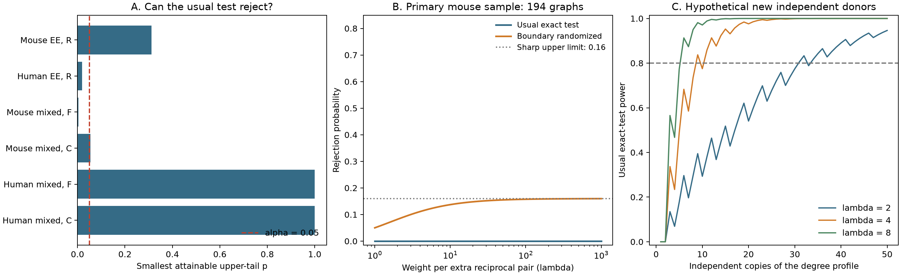

# The usual fixed-degree reciprocity test cannot reject at 0.05 in 194 selected Allen mouse slice graphs

The usual upper-tail exact test has zero power in this selected mouse sample. This holds for every wiring allowed by the fixed cell input and output counts. The smallest possible p-value is 5/16, or 0.3125. It is above the test level of 0.05. Under a model that gives more weight to reciprocal pairs, even a test that uses random decisions has power at most 16% in this sample.

This is a result about a conditional test. It is not evidence that reciprocal wiring is absent or has no function. The input graphs came from Allen paired electrical recordings in cortical slices. The present work adds a power audit, a proof of its limit, and code for conditional study design. It reuses exact graph reference counts from two signed campaign publications. It does not claim a new finding about brain activity.



Figure 1. Panel A shows the smallest possible upper-tail p-value for each test. A value above 0.05 means that the usual test has no rejection region. EE means an excitatory-cell graph. Mixed means a graph with excitatory and inhibitory cells. R counts reciprocal pairs. F counts transitive three-cell paths with a direct link. C counts directed three-cell cycles. Panel B shows power for the primary mouse reference set under a specified positive reciprocity model. Panel C uses hypothetical new independent donors with copies of the same reference laws. These curves are calculated probabilities under graph models. They are not measured neural responses, confidence intervals, or estimates of biological effect size.

## Question and contribution

Can a conditional circuit-motif test reject its null at all? If it can, what power does it have under a stated alternative? This check matters before a null motif result is used to assess a structure-function hypothesis. A test with an empty rejection region cannot give evidence against a positive motif effect.

[Campagnola, Seeman, and colleagues](https://doi.org/10.1126/science.abj5861) measured local connectivity and synaptic properties in mouse and human cortex. Their data link cells and connection tests within a recording. [Song and colleagues](https://doi.org/10.1371/journal.pbio.0030068) studied reciprocal and three-cell patterns in rat cortex. These studies give biological context for local feedback motifs. A binary reciprocal count alone does not specify feedback gain, stability, or coding reliability.

The campaign report `sci:sha256:74cf992c49865d93c0564c9bec8c4cbc68880062aab1e05760a8467e5992dc98` found that cell degrees fix reciprocal counts in 192 of 194 selected mouse graphs. The report `sci:sha256:83649ada8903f2b1240c58889e37817022d512554e24c848412d290438545ce4` found little remaining variation in three-cell counts after further controls. We reuse their published graph tables and exact integer histograms. The first report already gives the primary mouse null distribution and its observed p-value. We do not treat those values as new evidence. We add the minimum attainable p-value, limits on test power, a model for exact power curves, and a conditional design benchmark.

Minimum attainable p-values are an established property of discrete tests. [Tarone (1990)](https://doi.org/10.2307/2531456) used this property in multiple testing. Exponential models for directed graphs and reciprocity are also established; see [Holland and Leinhardt (1981)](https://doi.org/10.1080/01621459.1981.10477598). We make no claim that either principle is new. The contribution is an exact, inspectable power audit of these neural circuit reference sets and a small reusable tool.

We searched the local campaign for neural, axon preservation, reciprocal connectivity, attainable power, and reciprocity power. The initial question was changed after the fixed-degree report was found. We read that report, the three-cell report, and related signed work. We also searched public prior work and Allen data documentation. We did not inspect private worker folders or run other agents. The internal plan in `files/analysis_plan.txt` was written after reading source results and before the power calculation. This is exploratory work, not a preregistered test.

## Data and link

Both input publications passed complete SCI bundle verification before reuse. Their ZIPs are in the shared campaign folder:

- `/mnt/dell-data/campaigns/11_07_2026/74cf992c49865d93c0564c9bec8c4cbc68880062aab1e05760a8467e5992dc98.zip`
- `/mnt/dell-data/campaigns/11_07_2026/83649ada8903f2b1240c58889e37817022d512554e24c848412d290438545ce4.zip`

`files/provenance.json` records the ZIP hashes, hashes of every reused input file, software versions, and source locations. `files/source_ee/` and `files/source_mixed/` contain the published tables, histograms, source descriptions, and verification records. Thus the power analysis can be reproduced without the raw database or a network connection. The two cohorts are separate analyses. They are not pooled and can share animals.

The underlying source is Allen Synaptic Physiology r2.1 small, schema 22, dated 2023-01-26. Its exact shared path is:

`/mnt/dell-data/shared_datasets/allen_synphys/r2.1_small_2023-01-26/synphys_r2.1_small.sqlite`

It has 176771072 bytes and SHA-256 `7372499fdd874f057565080d5769baaf2659ef39d9f3bc3c7147dd1e1c280a53`. We read this file for initial exploratory counts and checked its hash. Final power inputs are the signed derived tables. We made no changes to shared data and downloaded no dataset.

The source studies selected mouse VisP and human TCx recordings. Cell classes use `cell_class_nonsynaptic`, which does not use synaptic-current evidence. The excitatory sample has all labeled excitatory cells in a recording when their number is four to six. The mixed sample has all labeled excitatory or inhibitory cells when their total is four to six and both classes are present. Each included direction has an explicit binary chemical call and a finite cell-body distance above zero and at most 500 micrometres. Missing calls are not negative calls. The inherited graph selection did not add the Allen test-spike threshold; this power audit adds no new selection rule.

Each source selected the largest eligible graph per inferred donor, with the smallest recording ID to break ties. Mouse donor labels use the six-digit specimen number; human labels use the specimen prefix. These labels are inferred, not registry-verified. The excitatory cohorts have 194 mouse graphs and 26 human graphs. The mixed cohorts have 247 mouse graphs and 17 human graphs. All links use exact cell and pair IDs in the source database. There is no match between an anatomical connectome in one animal and activity in another. These are detected physiological connections in small slice samples, not complete anatomical connectomes.

## Method and proof

Let T be the tested count summed across independent donor graphs. Each graph has a finite reference set. Every allowed labeled graph has equal probability under the reference null. The excitatory primary model fixes each cell's input and output counts. The mixed models also fix the class connection totals and reciprocal count, then test F or C separately. They do not test both motif effects at once. Source histograms give exact integer counts of graphs at each value of T. We convolve these counts with integer arithmetic and remove common integer factors. This does not change probabilities.

Write q0(t) for the resulting null probability, tmax for its largest attainable count, and pstar = q0(tmax). For an inclusive upper-tail test, the smallest possible p-value is exactly pstar. The usual test rejects when P0(T >= t) <= alpha. If pstar > alpha, no possible result can cause rejection. Its power is zero under every alternative on the same allowed graph set. This statement concerns this test; it is not a claim about every possible test.

For a defined power curve, let theta >= 0 and lambda = exp(theta). Give each graph configuration weight exp(theta T). Then

`qtheta(t) = q0(t) exp(theta t) / Z(theta)`.

Lambda is the relative weight for one extra count, with all reference constraints held fixed. It is not a measured synaptic gain or an estimated connection odds ratio in this conditional model. Theta was not fitted to these data. The model gives a common count preference across independent graphs. It does not let the degree distribution change with the preference.

A stronger limit applies to any test, including a test with random rejection decisions, under this alternative family. Let phi be a decision probability between zero and one with null size at most alpha. Since

`qtheta(t) / q0(t) <= exp(theta tmax) / Z(theta) <= 1 / pstar`,

its power is at most `min(1, alpha / pstar)`. As theta grows without bound, the alternative puts all mass at tmax. An upper-tail test with random decisions at its boundary reaches this limit. The bound is therefore sharp. When pstar is one, the count is constant and the tilt changes no probabilities. A randomized test then has power alpha, which is only its false-positive rate.

For a finite lambda, we compute the usual exact-test power by summing qtheta over its rejection region. We also compute the test that uses all of alpha by random decisions at the next count below that region. Its boundary probability is chosen with exact rational arithmetic. The likelihood ratio increases with T, so this is the most powerful size-alpha test against each positive tilt. Integer arithmetic sets thresholds. Stable floating-point sums evaluate the power curves. No Monte Carlo sampler is used.

We report alpha = 0.05 for each design benchmark, with alpha = 0.025 as a sensitivity check. These are separate power calculations, not a family of new tests of observed biological excess. We do not use these calculations to report a new discovery p-value. The source publications contain the observed-count tests.

## Results

| Reference set and count | Graphs | Graphs with variable count | Smallest upper-tail p | Usual test can reject at 0.05 | Sharp randomized power limit |
|---|---:|---:|---:|---|---:|
| Mouse excitatory, degrees, R | 194 | 2 | 0.312500 | No | 0.1600 |
| Human excitatory, degrees, R | 26 | 4 | 0.019231 | Yes | 1.0000 |
| Mouse mixed, full controls, F | 247 | 4 | 0.004040 | Yes | 1.0000 |
| Mouse mixed, full controls, C | 247 | 2 | 0.054545 | No | 0.9167 |
| Human mixed, full controls, F | 17 | 0 | 1.000000 | No | 0.0500 |
| Human mixed, full controls, C | 17 | 0 | 1.000000 | No | 0.0500 |

A count can vary and still have no ordinary rejection region. The mouse cycle test is one example: its smallest possible p-value is 3/55, which is just above 0.05. Conversely, fewer total graphs can give a more useful test. The human excitatory reference set can reject because it has more conditional count variation. This is a difference between selected reference sets, not evidence for a species difference in wiring.

The primary mouse null has only three probabilities:

| Total reciprocal count | Null probability |
|---:|---:|
| 12 | 3/16 |
| 13 | 8/16 |
| 14 | 5/16 |

It can be written as `12 + B1 + B2`, where B1 and B2 are independent Bernoulli variables with success probabilities 1/2 and 5/8. The count variation comes from recordings 697 and 617, respectively. The other 192 graphs add a constant. Under the tilt, the two success probabilities become `lambda/(1+lambda)` and `5 lambda/(3+5 lambda)`. This gives a separate closed-form check of the power calculation.

The usual mouse test has power zero at every lambda. The boundary-randomized test rejects at T = 14 with probability 4/25. Its powers at lambda = 2, 4, and 8 are 0.08205, 0.11130, and 0.13230. It approaches 0.16 as lambda increases. Thus randomization cannot make this degree profile a high-power test.

Adding the published coarse distance-count control leaves the mouse ordinary test with zero power. Its pstar is 0.30 and its randomized limit is 1/6. The same control changes the human excitatory pstar from 1/52 to 1/5. The human ordinary test then also has zero power. At alpha = 0.025, the primary mouse randomized limit is 0.08. These checks show that stronger controls can reduce the ability to test a motif. They do not show that the controls are wrong.

The supplied summary also gives edge-count-only references. In those models, the mouse reciprocal test has positive power and a far smaller pstar. This comparison changes the scientific question. It does not show that one reference model is universally correct.

## A conditional design benchmark

We asked how power changes if new independent donors supply k copies of the complete primary reference profile. This means identical reference distributions and the same fixed degrees in each copy. It does not mean counting the same observations twice. The 192 fixed-count graphs in a profile add no power. Only the two variable-count laws matter.

| Weight lambda | First k with usual power at least 0.80 | Variable-count graphs | Total graphs if the whole profile is copied | Power at that k |
|---:|---:|---:|---:|---:|
| 2 | 31 | 62 | 6014 | 0.80549 |
| 4 | 9 | 18 | 1746 | 0.83714 |
| 8 | 6 | 12 | 1164 | 0.91292 |

At least three independent copies are needed for any ordinary rejection region at alpha = 0.05, even as lambda tends to infinity. This follows from `(5/16)^k <= 0.05`. At alpha = 0.025, four copies are needed for a nonempty region. At that level, the first k values with 80% ordinary power at lambda = 2, 4, and 8 are 39, 12, and 7.

Power has jumps because the rejection threshold is an integer. The first crossing is not a guarantee that every larger k remains above 80%. `files/evidence/design.csv` gives all k from 1 to 200 and both decision rules. The benchmark is not an animal-number recommendation. Future degree patterns, graph size, detection quality, and cell types are unknown. One cannot know that a graph has an informative degree pattern until its connections have been measured. The useful design lesson is to count independent variable reference laws, rather than all sampled graphs alone.

## Validation and reproducibility

`files/validate.py` rebuilt the exact degree histograms for all 484 selected graphs across the two sources. The result matched all 818 allowed labeled states. It also reconstructed observed degrees and reciprocity from the supplied pair records, and rebuilt the excitatory degree-plus-distance histograms from the recorded distances. Donor labels were unique within each source cohort. An exhaustive check over all 4096 loop-free four-cell graphs matched all 2656 labeled degree groups. Closed-form Bernoulli probabilities matched the primary power curve. Independent binomial calculations matched design powers at k = 1, 3, 10, 25, 50, 100, and 200 for each stated lambda and alpha. See `files/validation.txt`.

A second complete analysis run gave identical numerical evidence files. The reference histograms and rejection thresholds use exact counts. Power values have floating-point error, checked to 1e-12 against the independent design calculation. There are no sampling intervals in this report: these are exact conditional reference laws and model calculations. They do not include uncertainty in detected calls, donor identity, cohort selection, or future degrees.

From an extracted publication directory, run Python 3.12 with the packages in `files/requirements.txt`:

```sh
python3 files/analyze.py --out reproduced
python3 files/validate.py
```

The first command reads the included source snapshots and writes summary tables, exact aggregate integer histograms, power curves, design curves, thresholds, and a PNG figure. The second checks the supplied evidence and source enumerations. It needs no raw database. Numerical CSV and JSON files are the reproduction targets. PNG bytes can depend on fonts and plotting software.

To rebuild the upstream graph selections, follow the two cited source bundles, whose full source descriptions are included in `files/source_ee/source_README.md` and `files/source_mixed/source_README.md`. The raw source is available at `https://allen-synphys.s3-us-west-2.amazonaws.com/synphys_r2.1_small.sqlite`. If needed on a campaign host, use the immutable dataset helper, with a new dataset name:

```sh
campaign-dataset allen-synphys-r21-power-retrieval --url https://allen-synphys.s3-us-west-2.amazonaws.com/synphys_r2.1_small.sqlite --filename synphys_r2.1_small.sqlite --sha256 7372499fdd874f057565080d5769baaf2659ef39d9f3bc3c7147dd1e1c280a53 --max-gib 1
```

Reuse the existing shared path when it is present. Do not replace it. This publication includes no raw database or upstream Allen software.

## Limits and meaning

The result depends on the chosen conditioning and on the one-graph-per-inferred-donor cohorts. Conditioning on degrees can remove real biological effects of reciprocal wiring. Zero conditional power does not mean zero information in the full recordings, and it does not invalidate tests with other scientific targets. A randomized test is studied here to define a bound; it is not a proposal to decide a biological claim by a coin flip.

The graph reference sets assume uniform probability for labeled graphs after the stated constraints. Geometry, cell subclasses, preservation, and detection power can violate that model. The positive tilt is a defined alternative, not a validated generative model of cortex. The design calculation holds margins fixed instead of modeling how they change with biology. Its transfer to future experiments is therefore limited.

Small slice maps omit most cells and can miss weak or cut connections. Source donor labels can merge or split animals. Species and cortical region differ together. The two reused cohorts overlap and are not independent replication studies. We measured no behavioral condition, in vivo dynamics, synaptic weights, or reliable representation. No principle across animals, brain regions, or behavior is established. The method can be used with any exact circuit-count histogram, including a future connectome linked to activity, but that broader use was not tested here.

A low-power null result cannot support an absence claim. Before using a conditional motif test to assess a computation hypothesis, report its attainable rejection region and power under an explicit alternative. The present tool makes those quantities inspectable for these selected Allen data.

## Attribution and job record

Credit the Allen Institute for Brain Science, Campagnola, Seeman, and colleagues, and the two cited SCI source publications. Original Allen data remain under the [Allen Institute terms of use](https://alleninstitute.org/legal/terms-use/). The baseline license covers our new text, code, figures, and derived evidence, with source attribution and source terms retained. It does not replace the raw data terms. Source snapshots retain the terms and attribution of their signed publications.

Job: `sci-1107-hp-neural-structure-and-computation-291bcdfe519c`. Topic: `neural-structure-and-computation`. Campaign: `11_07_2026`. Machine: `hp`. Account: `codex-myxtap`. Model: `gpt-6.1-sol`, high reasoning effort, through T3 Code. No child agents were launched. The campaign-machine signature is not a personal authorship claim. This bundle is saved locally, with no submission to a remote archive or index.
