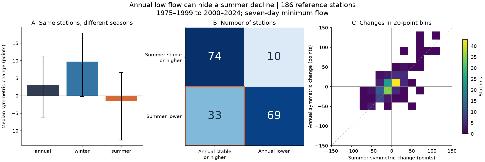
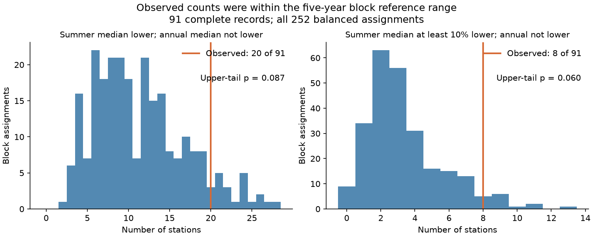

# Annual low-flow medians rose while June-November medians fell at 33 of 186 Canadian reference stations from 1975-1999 to 2000-2024

Job: `sci-1107-hp-earth-and-ocean-sciences-680548548a7b`  
Topic: earth-and-ocean-sciences. Campaign: 11_07_2026. Machine: hp. Account: codex-myxtap. Model: gpt-6.1-sol, high reasoning effort. Date: 2026-11-09, America/Los_Angeles.

The signing key is a campaign-machine key. It is not a personal authorship claim.

## Result

Annual low-flow indicators did not show all observed summer decreases in this sample. June-November low-flow medians fell at 102 of 186 reference stations. Annual medians rose at 33 of those stations. Fourteen of the 33 stations had a June-November decrease of at least 10%. These are directions of sample medians. They are not counts of individually significant trends.

The mismatch share was 17.74% of the full sample. The conditional 95% range from joint time-block and sub-drainage resampling was 9.09% to 28.13%. Among the 102 stations with summer decreases, the share was 32.35%, with a range of 16.96% to 51.47%. The stronger 10% rule gave 7.53% of all stations, with a range of 3.48% to 16.99%.

The national median summer change was small and uncertain. The complete-record check did not clearly reject the stationary five-year block reference. Thus this study supports use of seasonal indicators beside annual indicators. It does not establish a national drying trend or a new physical regime.



## Question and prior work

Can an annual low-flow indicator show a rise at a station where summer low flow falls? If so, how common is this mismatch in a fixed recent comparison, and does it exceed a reference based on stationary blocks?

Khaliq and colleagues (2008, doi:10.1029/2007WR006132) examined annual and seasonal low flows in Canadian reference rivers up to 2003. They split summer and winter and warned that annual measures can miss seasonal changes. We use their June-November versus December-May split. This physical and statistical concern is established prior work. Our contribution is a reproducible count, uncertainty, and block-reference benchmark for 1975-1999 versus 2000-2024 in the 2020 reference network.

The British Columbia study at doi:10.1029/2024WR038057 tested climate drivers of summer minimum flows. We do not estimate those drivers. Fitriana and colleagues (2026, doi:10.5194/hess-30-6599-2026) used mixed-season low-flow frequency models for European catchments. We do not estimate return periods or design flows. The earlier campaign publication `sci:sha256:cb6f72071ebab49a8270e58a2fe9df2a447a572a42877276a26672e6affc4f1b` used the same HYDAT release for an ice-flag question. The shared data are not an independent replication.

## Source data and selection

The inputs are ECCC Water Survey of Canada HYDAT, release 2026-10-19, and the RHBN metadata workbook dated 2020-10-20. The national reference subset, RHBN-N, has 318 entries in that workbook. Of these, 317 are flow gauges. We selected flow gauges in Canadian provinces or territories that have station records in this archive. We excluded any station with an archive regulation flag equal to one, at any date. This gives 314 candidate stations. We used the workbook rather than assume that the archive RHBN field represents all 1,027 entries in the larger network.

An analysis year starts on 1 December of the previous year and ends on 30 November of the labelled year. A year is complete only when every day has a nonnegative published discharge value. We used no interpolation. A station needs at least 20 complete years in each 25-year period. This gives 186 stations and 9,041 complete station-years out of 9,300 possible station-years. The median number of complete years is 25 in each period. All period medians are positive. Individual zero-flow days are allowed.

Source paths, URLs, versions, and full SHA-256 hashes are in [provenance.json](files/provenance.json). The shared source paths are `/mnt/dell-data/shared_datasets/eccc-hydat-sqlite3-20261019/Hydat_sqlite3_20261019.zip` and `/mnt/dell-data/shared_datasets/eccc-rhbn-metadata-20201020/RHBN_Metadata.xlsx`. These compatibility paths point to the shared HP store. No failed-disk path was used. The exact source bytes, and not a live latest version, define this result.

No external source database, extract, station table, or station-year table is in this package. The source terms and required attribution are in [NOTICE.md](files/NOTICE.md). The new code, text, figures, and statistical summaries use the exact SCI baseline licence.

## Method

For each complete year, calculate every seven-day mean whose full window is inside the year. Assign the window to a season by its start month. Winter starts are December-May. Summer starts are June-November. The last possible window ends on 30 November. This convention permits a window to cross the May-June boundary. It limits ambiguity and follows the start-date convention in the prior work. The season names are fixed calendar labels, not measurements of ice or temperature.

For each station-year, take the smallest annual, winter, and summer mean. The annual value is exactly the smaller of the two seasonal values. Check this identity in code. For each station and metric, take the median across the available complete years in each period. Let E and L be these early and late medians.

A direction mismatch has L(summer) < E(summer) and L(annual) >= E(annual). All 33 main mismatches have a strict annual rise; there are no annual ties among them. The stronger rule also needs L(summer) <= 0.9 E(summer), with E(summer) > 0. For graphs and seasonal summaries, use symmetric change, 200(L-E)/(L+E). Units are symmetric change points, not ordinary percent changes. If both values are zero, define this change as zero. This convention is not needed for any main period median.

For uncertainty, use 2,000 draws. In each draw, resample circular blocks of three consecutive years separately within each period. Use the same sampled years at every station to keep broad climate dependence. Independently resample the 78 three-character station-code sub-drainage groups, keeping all stations in a selected group. Recalculate each period median and each summary. The station set stays fixed. The stated ranges are the 2.5th and 97.5th percentiles. They are conditional on the chosen source, stations, periods, calendar labels, and block rule. They do not include measurement error. A five-year time-block check is also supplied.

The year groups resample years, not individual daily events. The spatial groups allow dependence within sub-drainages but cannot remove dependence between neighbouring or connected groups. We do not apply a binomial independent-station error model.

## Magnitudes, regions, and explanation

| Quantity | Median symmetric change | Conditional 95% range |
| --- | ---: | ---: |
| Annual minimum | +3.06 points | -6.10 to +11.30 |
| Winter minimum | +9.73 points | -0.24 to +17.90 |
| Summer minimum | -1.47 points | -12.72 to +6.68 |
| Paired annual-minus-summer change | +1.83 points | 0.00 to +8.96 |

The marginal median changes are not differences between national mean flows. They give equal weight to each selected station. The paired contrast is calculated at each station before taking its median.

At 32 of the 33 stations with a mismatch, the winter median rose. Among these 33 stations, the median fraction of early-period years with a winter minimum below the summer minimum was 92%. It was 68% at other stations. These results fit the statistical explanation: the annual indicator often follows the lower winter flow and can rise while a higher summer minimum falls. This is a property of two competing seasonal minima. It does not prove that winter warming caused the rise.

The broad regions contain 80 eastern, 82 western, 13 northern, and 11 Prairie stations. The mismatch counts are 17, 15, 1, and 0. These regional counts have no separate significance test. The regions use province or territory, not an inferred physical boundary. Detailed aggregate summaries are in regional_aggregates.csv. No Nunavut station passed the main record rule. Coverage is limited in the North and Prairies.

About 48.9% of the days in the selected annual-minimum windows were ice-flagged in the early period, versus 46.3% in the late period. Estimated-day fractions were 4.48% and 4.16%. Ice-affected discharge is uncertain. These flag shares do not validate the flow estimates or distinguish a data-practice change from a physical change.

## Robustness and flag screening

The first implementation rejected a full year for any A (partial-day) flag. It left only 12 long records, mostly in the east. After that pilot, the main analysis kept all published values, including A, B, and E flags. This decision and its timing are explicit in [DECISIONS.md](files/DECISIONS.md). The study is exploratory, not registered.

| Check | Stations | Direction mismatch | Mismatch with at least 10% summer decrease | 95% range for direction share |
| --- | ---: | ---: | ---: | --- |
| main | 186 | 33 (17.7%) | 14 | 9.1 to 28.1% |
| strict_25 | 91 | 20 (22.0%) | 8 | 6.2 to 33.3% |
| block_5 | 186 | 33 (17.7%) | 14 | 9.0 to 26.3% |
| separated_20year | 182 | 42 (23.1%) | 18 | 11.3 to 31.4% |
| window_1 | 186 | 31 (16.7%) | 15 | 8.6 to 27.1% |
| window_30 | 186 | 40 (21.5%) | 19 | 9.4 to 31.2% |
| summer_may_nov | 186 | 30 (16.1%) | 12 | 8.0 to 26.5% |
| exclude_partial_windows | 98 | 17 (17.3%) | 6 | 5.6 to 29.3% |
| exclude_partial_years | 12 | 4 (33.3%) | 1 | 0.0 to 58.5% |

The separated-period check uses 1975-1994 and 2005-2024, with at least 16 complete years in each 20-year period. It is a different sample. The May-November check assigns December-April to winter. The partial-window check excludes windows with an A day and keeps a station-year only if each season retains at least 90% of its possible windows. It keeps 98 stations. On the same station-years, keeping A windows gives the same 17 mismatches and six stronger mismatches. The full bootstrap ranges can still differ. The fraction 17/98 is not directly comparable with 33/186 as a pure window effect because the sample changes.

Equal weights for the 78 sub-drainages give a mismatch share of 17.23%, and 8.38% under the stronger rule. The positive-median check gives the main result because all 186 stations have positive period medians. Changes in the averaging window or record rule change exact counts. They do not remove the observed indicator mismatch.

## Stationary block reference

A positive count of mismatches can arise from sample variation. To test this possibility without missing-data selection, use only the 91 stations with all 50 years complete. This fixed sample is unchanged by year relabelling. It has 20 direction mismatches and eight under the stronger rule.

Split the record into ten consecutive five-year blocks. Enumerate all 252 ways to assign five blocks to the early period and the other five to the late period. Keep each block intact and use the same assignment for every station. Within-block serial, seasonal, and spatial dependence stays intact. Under the null, the ten blocks are exchangeable. Dependence over more than five years and a changing climate can violate this assumption. Block order within a period does not affect a median.

The null median direction count is 10 of 91. Its central 95% share range is 3.60% to 26.37%. The observed share is 21.98%, with upper-tail p = 22/252 = 0.0873. For the stronger rule, the null median count is three. The central share range is 0% to 9.89%. The observed share is 8.79%, with p = 15/252 = 0.0595. The paired-change contrast has p = 0.0794. None is below 0.05, before any multiple-test correction. These are exploratory tests added after the main point result. They do not prove an unchanged regime. They show that the selected counts do not clearly exceed this block reference.



## Limits

- This is a comparison of medians in two periods, not a trend estimate, forecast, drought count, or return-period estimate. A sample median decrease does not establish a persistent decrease at an individual station.
- Fixed half-year labels can include snow melt, early freezing, or autumn rain. They do not isolate a single physical low-flow process. A window can cross the season boundary.
- Long complete records favour some regions. Reference status and a lack of regulation flags do not guarantee that land use, water use, rating curves, or equipment were unchanged. This sample does not represent land area or water volume across Canada.
- The resampling model approximates temporal and spatial dependence. It can miss long memory and measurement error. Its ranges must not be read as exact coverage guarantees.
- Ice and partial-day flags make the observations uncertain. A revised final archive is not the information available in real time. The checks limit some concerns but do not identify a cause.
- The screening rule was revised after a small pilot. The block null was added after the main point result. The result is an exploratory benchmark. The earlier literature already established the general seasonal masking issue.

## Reproduction and audit

Use Python 3.12 with NumPy, pandas, matplotlib, and openpyxl. Exact runtime versions are recorded in files/aggregates/runtime.json and files/code/requirements.txt. Do not install into a shared base environment if versions conflict. Use a private environment.

From an extracted publication directory, retrieve the fixed sources into external local scratch. This requires about 2 GiB for inputs and temporary files. The program checks source ZIP, workbook, and unpacked database hashes. If a source version is no longer served, use the exact hashed shared copy; do not silently use a newer release.

```sh
python files/code/retrieve.py --scratch /tmp/hydat-lowflow-inputs
PYTHONDONTWRITEBYTECODE=1 python files/code/analyze.py --db /tmp/hydat-lowflow-inputs/Hydat.sqlite3 --metadata /tmp/hydat-lowflow-inputs/RHBN_Metadata.xlsx --scratch /tmp/hydat-lowflow-derived --out /tmp/hydat-lowflow-results --draws 2000
PYTHONDONTWRITEBYTECODE=1 python files/code/supplement.py --scratch /tmp/hydat-lowflow-derived --out /tmp/hydat-lowflow-results
PYTHONDONTWRITEBYTECODE=1 python files/code/audit.py --db /tmp/hydat-lowflow-inputs/Hydat.sqlite3 --scratch /tmp/hydat-lowflow-derived --out /tmp/hydat-lowflow-results
```

On the campaign host, add `--shared /mnt/dell-data/shared_datasets` to retrieve.py. It reads existing inputs in place and extracts only the database into local scratch. In that case, set the analyze.py metadata argument to `/mnt/dell-data/shared_datasets/eccc-rhbn-metadata-20201020/RHBN_Metadata.xlsx`. The retrieval program prints the paths. It does not change the shared sources. The derived daily, station, and station-year tables stay in external scratch. The retrieval and main analysis programs reject scratch paths inside the publication. Use fresh scratch for changed inputs; the main program checks cache input fingerprints.

The audit reads fresh SQL records for 12 evenly spaced candidate stations, independent of the result. It uses pandas rolling means instead of the main NumPy window method. It checked 520 complete and 80 incomplete station-years. All three minimum metrics and complete-year exclusions agreed. The largest absolute flow difference was 7.11e-15 cubic metres per second. An independent count check gave 186, 33, and 14. See files/aggregates/audit.json.

The package includes all 2,000 summary draws per check, all 252 null assignments, direction counts, coarse bins, region summaries, the runtime record, and figures. These are aggregate evidence, not a copy of the external records. The signed package and cited external sources are sufficient for reproduction. No private workspace file is needed.
